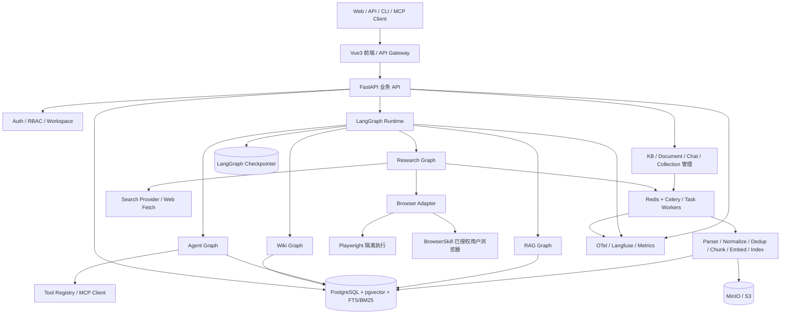
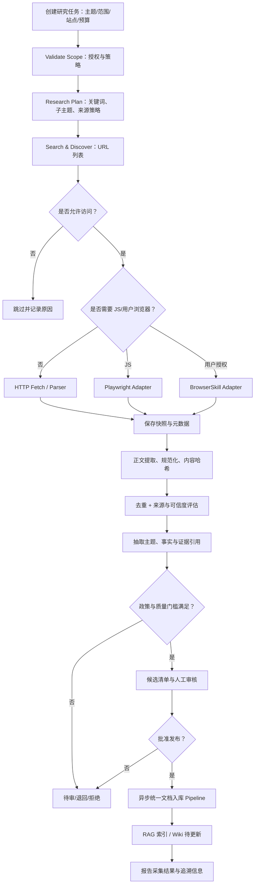
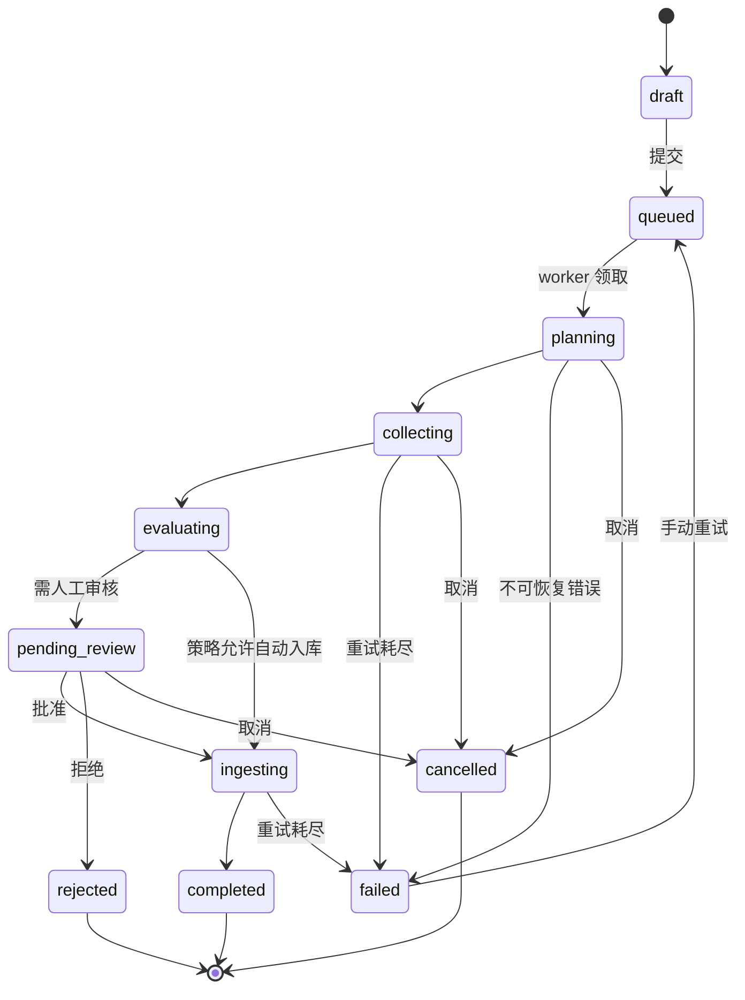
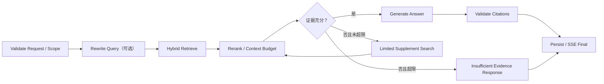
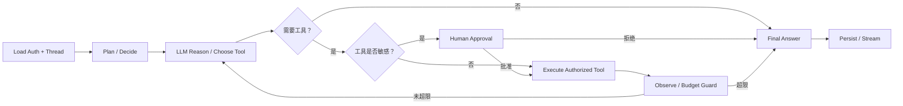
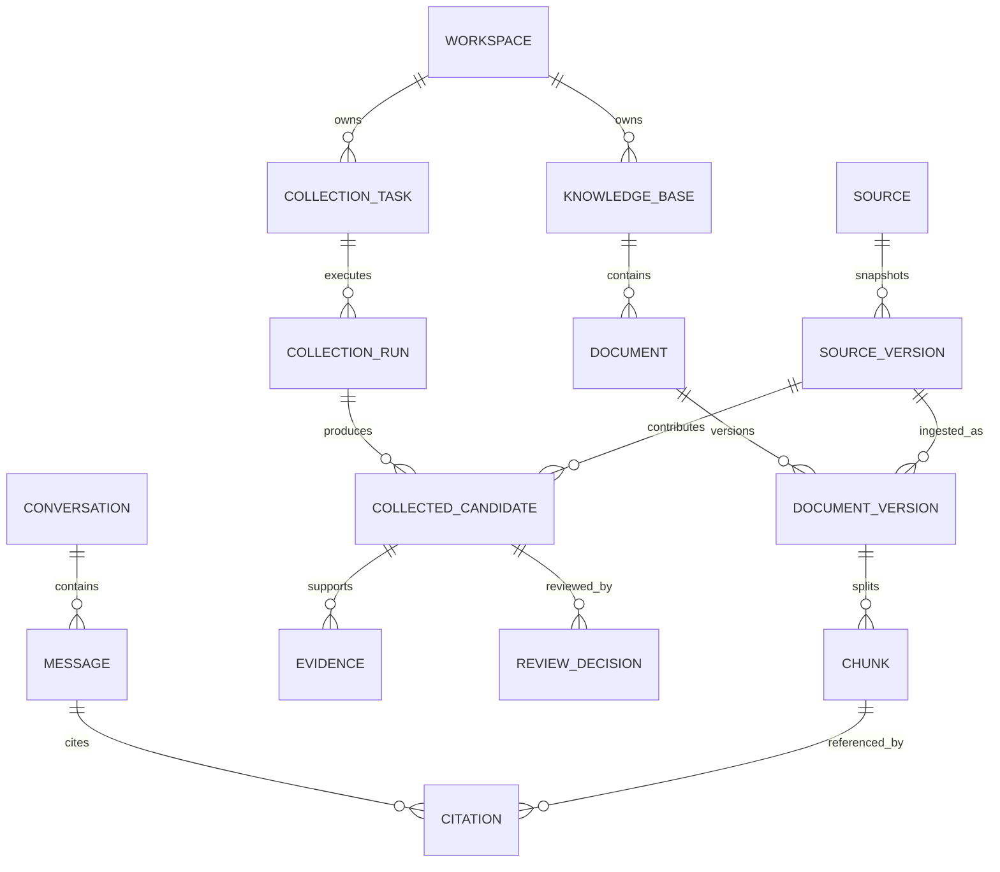
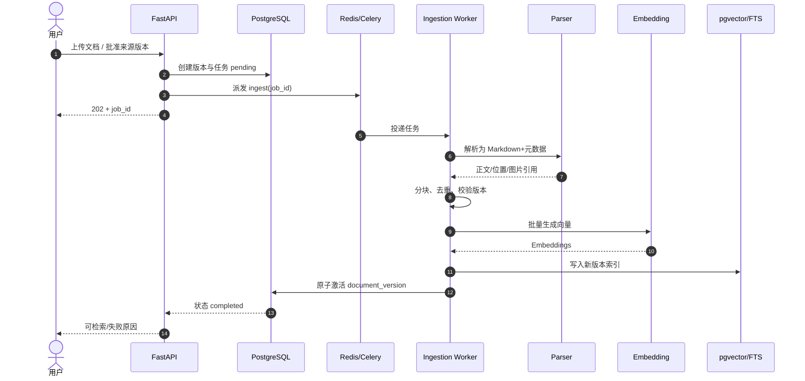

# PyKnora — WeKnora Python + LangGraph 重构产品需求文档（PRD）

> **版本**：v1.0（需求基线草案）  
> **日期**：2026-10-26  
> **项目代号**：PyKnora（自定义）  
> **参考项目**：[Tencent/WeKnora](https://github.com/Tencent/WeKnora)  
> **参考基线**：WeKnora v0.8.3（2026-10-14 发布；以审阅时的公开文档为准）  
> **定位**：以 Python + LangGraph 重构企业知识管理、智能问答、Agent、Wiki 及专业知识自动采集平台  
> **状态**：供产品、研发、架构和测试评审；范围、性能目标与迭代排期需正式评审确认

## 0. 执行摘要

本项目参考腾讯开源 WeKnora 的 **RAG + Agent + Wiki** 产品模型，用 **Python/FastAPI + LangGraph** 建立模块化、私有化可部署的企业知识工作平台。新增关键场景 **E：信息采集**：用户提出专业领域知识建设任务，Research Agent 规划搜索、调用搜索工具与浏览器、筛选可用资料、记录出处及版本、去重和结构化提取，经策略或人工审核后进入统一知识入库流水线，最终供 RAG 问答及 Wiki 使用。

**重构不等于逐行翻译 Go**：保留产品能力和关键体验，不承诺原 API、数据表或全部外围集成的即刻兼容。原项目架构由 Vue3 前端、Go 主服务、Python docreader、PostgreSQL（默认含 BM25/pgvector）、Redis/Asynq，以及可选对象/图谱/向量存储构成；新架构以 FastAPI 提供业务 API，LangGraph 承载有状态推理流程，独立 Worker 承载耗时摄取和定期采集。

**版本策略**：P0 交付安全可靠的知识库与 RAG 闭环，以及受控的 URL/网页单次采集；P1 完成 Agent 任务式研究采集、Browser 双适配、MCP 与 Wiki；P2 迭代多模态、知识图谱、Skills 沙箱、跨会话记忆和多渠道发布。功能优先级详见 §6 和 §16。

---

## 1. 背景、依据与研究结论

### 1.1 WeKnora 现有能力

| 领域 | WeKnora 当前公开能力 | 重构处理 |
|---|---|---|
| RAG | 文档/URL/手动内容入库；解析、分块、混合检索、Rerank、引用定位 | P0 核心闭环 |
| Agent | 多步推理、工具调用、MCP、Skills、状态/会话控制 | P1 LangGraph 有状态执行 |
| Wiki | 依据知识库自动生成页面、图谱、版本管理 | P1 页面；P2 图谱增强 |
| 浏览器 | BrowserSkill：通过授权扩展操作用户 Chrome/Edge，WebSocket 连接 | P1 浏览器适配之一 |
| 数据源 | 飞书、Confluence、GitLab、Notion 等同步源 | P1 起按需分批 |
| 模型 | 多家模型厂商、Ollama、本地或远端模型 | P0 统一 Provider；逐步拓展 |
| 企业特性 | Workspace、RBAC、审计、API Key、监控 | P0 最小隔离；P1 全面完善 |
| 运行方式 | Compose、K8s、Lite、桌面 | P0 Compose；P2 K8s |

### 1.2 原项目架构事实（与本项目的选择区分）

- `app`：Go/Gin 后端，处理 REST/SSE、Agent、检索、工作任务、集成。
- `frontend`：Vue3 + TypeScript + Vite，静态页面/反代。
- `docreader`：**现有 Python gRPC 文档解析微服务**，已支持多格式和网页解析；Python 重构不意味着必须推翻它。
- `postgres`：官方标准环境使用 ParadeDB，提供 BM25/pgvector；`redis` 支持 Asynq 队列、流和分布式协调。
- 文档 ingestion：创建知识记录、文件/URL 校验、异步解析、Chunk、Embedding/索引、摘要/问题/Wiki 等后处理；URL 入口有多层 SSRF 防护。
- 浏览器：Chrome/Edge 扩展与 BrowserSkill daemon 经 WebSocket 路由到服务端；用户可介入登录或验证码；不能等同于面向大规模研究任务的独立采集系统。

以上来自官方公开文档，参见 §20。**产品增量** 是将现有 Web 搜索、浏览器操作与知识入库组件编排为闭环的“专业知识采集任务”，而不声称 WeKnora 完全没有 URL 导入或浏览器功能。

### 1.3 重构动机

1. 采用 Python AI 生态降低解析、NLP、模型/工具扩展成本。
2. 用 LangGraph 的状态、checkpoint、中断/恢复控制复杂 Agent。
3. 明确拆分 API、Workflow、Worker、存储与集成的职责。
4. 将知识生产（上传、同步、采集）和知识消费（RAG/Agent/Wiki）接成统一平台。
5. 用可观测、可评价、可回溯的流程降低幻觉和错误知识污染。

## 2. 愿景、目标与非目标

### 2.1 愿景

让组织中的文件、网站和外部专业信息，在遵循来源、权限和授权规则的前提下，转变为**可检索、可核验、可维护、可执行**的知识资产。

### 2.2 项目目标（G）

- **G1**：建立可私有化部署的知识库—解析—检索—可引用回答闭环。
- **G2**：构建具备工具、状态持久化、审批与恢复的 LangGraph Agent 基座。
- **G3**：实现主题驱动的信息采集并安全纳入统一知识流水线。
- **G4**：提升检索质量与答案可证据性，建立数据集/回归评测。
- **G5**：支持工作区隔离、敏感数据保护、运行追踪与成本度量。

### 2.3 非目标（首个正式版本不包含）

- 原 Go 后端全量接口兼容、现有数据库无损直读/自动迁移。
- 一次性实现原版所有模型厂商、IM 频道、知识数据源和终端。
- 未授权网站的大规模爬取、绕过登录/验证码/付费墙或规避反爬机制。
- 不经审核就自动把不确定、重复或禁止使用的外部内容发布为可信企业知识。
- 默认开启任意 Shell/浏览器高风险写操作。

## 3. 目标用户及权限角色

| 角色                 | 目标           | 权限示例                |
| ------------------ | ------------ | ------------------- |
| 个人用户               | 整理文件与网页，检索问答 | 自有知识库 CRUD、运行自身任务   |
| 企业成员（Viewer）       | 安全查询团队知识     | 授权范围内查询/引用          |
| 内容贡献者（Contributor） | 上传、编辑、审核采集资料 | 资料写入、待审提交           |
| 工作区管理员（Admin）      | 管理成员与数据源     | 工作区配置、采集策略、审计       |
| 工作区所有者（Owner）      | 全局配置与治理      | 生命周期、账单、权限策略        |
| Agent 开发者          | 配置工具和工作流     | 按授予权限创建工具与流程        |
| 平台运维               | 监控与故障处理      | 脱敏观测、任务重试，不默认越权读取内容 |

原则：四级角色矩阵用于 P1 完整 RBAC；P0 先实现工作区隔离和最小授权，任何检索、采集、原文查看、工具调用都必须校验有效 Principal/作用域。

## 4. 核心场景与用户故事

### A. 企业知识问答

**故事**：作为员工，我选择一个或多个获授权知识库提问，希望得到引用到原文具体段落的回答；无充分证据时系统明确提示。

**链路**：选择范围 → 问题 → 混合检索 → Rerank → 证据充分性判断 → 流式回答 → 点击引用查看原文。

### B. 多步骤知识分析

**故事**：作为分析师，我提出跨文档问题，让 Agent 分解任务、逐步检索与读取、归纳结论，并展示关键工具活动。

### C. 自动知识整理（Wiki）

**故事**：作为知识管理员，我要求系统从已有资料生成主题 Wiki，能查看引用、审核发布和对比版本；源文变化时提示受影响页面。

### D. 工具执行

**故事**：作为业务用户，我授权 Agent 查询知识库以及调用指定 MCP/业务 API，敏感操作必须先审批。

### E. Agent 自动信息采集与知识沉淀

**故事 E1：主题研究**：用户输入“收集某行业过去一年的法规和技术标准变化”，限定地域、时间和可信来源，系统规划搜索、采集网页/公开文件、抽取事实、呈现候选知识清单与原文链接，审核后入库。

**故事 E2：指定网站采集**：用户提供允许访问的官方网站栏目，设置抓取深度/页数/频率，系统提取文章标题、作者、发布日期、正文、URL 和哈希，跳过重复并完成索引。

**故事 E3：动态网页阅读**：网页需 JS 渲染时，系统在受限 Playwright 浏览器读取；用户浏览器中的授权页面可通过 BrowserSkill 进行人工协同，但不得尝试绕过访问控制。

**故事 E4：定期更新**：管理员设置周期任务，系统比对来源变更，生成新增/变更/删除候选，待批准后更新知识与关联 Wiki，不静默覆盖人工内容。

**故事 E5：失败与回溯**：采集网页失败或可信度不足时，系统标注失败原因/来源质量、可重试步骤，不把未经验证的内容写成已发布事实。

**E 场景边界**：仅采集有权访问及允许处理的内容，遵守 robots.txt、网站使用条款、版权/许可和隐私要求，设置域名白名单及速率限制；对登录、验证码及授权问题采用用户介入或停止，绝不自动绕过。

## 5. 产品信息架构与关键交互

导航建议：**工作台**（任务/概览）｜**知识库**（文档/URL/Chunks/索引）｜**智能问答**（RAG/Agent）｜**信息采集**（任务、候选、审批、源站）｜**Wiki**｜**工具箱**（模型/MCP/浏览器）｜**设置**（工作区、权限、审计、追踪）。

采集任务创建表单建议包括：主题、研究目标、允许域名、排除域名、关键词、时间范围、语言、地区、结果数/页数/时长预算、采集模式（搜索/站点/混合）、选择目标知识库、自动提交或人工审核策略、是否允许 Playwright / BrowserSkill、允许的登录环境、更新频率。默认采用“先审核后入库”。

界面应展示：任务计划、阶段进度、发现 URL、来源标签、失败/跳过原因、候选事实、重复簇、授权告警、预计成本、待审清单、入库结果与可点击原始链接。

## 6. 功能优先级与版本范围

| 需求编号 | 模块              | 能力                                       | P0 MVP | P1  | P2  |
| ---- | --------------- | ---------------------------------------- | :----: | :-: | :-: |
| F-01 | 用户/工作区          | 登录、最小隔离、基础成员                             |   ✓    |     |     |
| F-02 | 模型              | Chat/Embedding/Rerank + Ollama/OpenAI 兼容 |   ✓    |     |     |
| F-03 | 知识库             | KB/文档 CRUD、标签、状态                         |   ✓    |     |     |
| F-04 | 解析              | PDF/DOCX/TXT/MD/HTML、分块、Embedding        |   ✓    |     |     |
| F-05 | 检索              | 向量+关键词、融合、重排、权限过滤                        |   ✓    |     |     |
| F-06 | 对话              | SSE、多轮、引用定位、反馈                           |   ✓    |     |     |
| F-07 | URL 入库          | 单 URL 受控抓取、来源/元数据存档                      |   ✓    |     |     |
| F-08 | 采集基础治理          | 域名/SSRF/速率/去重/人工确认                       |   ✓    |     |     |
| F-09 | Agent           | LangGraph 工具循环、checkpoint、HITL           |        |  ✓  |     |
| F-10 | Research Agent  | 多来源研究计划、批量采集、质量评分                        |        |  ✓  |     |
| F-11 | Browser Adapter | Playwright 服务端 + BrowserSkill 本机         |        |  ✓  |     |
| F-12 | 采集调度            | 周期执行、差异比对、候选审批与发布                        |        |  ✓  |     |
| F-13 | MCP             | MCP Client、工具开关、审批；Server 基础             |        |  ✓  |     |
| F-14 | Wiki            | 目录/页面生成、引用、编辑、版本                       |        |   ✓   |     |
| F-15 | 企业治理            | 四级 RBAC、审计、API Key、限额                    |        |  ✓  |     |
| F-16 | 观测/评测           | 基础 trace P0；完整质量/成本监控 P1                 |   ✓    |     |     |
| F-17 | 高级检索            | 图谱、父子 Chunk、跨模态图文                        |        |     |  ✓  |
| F-18 | Agent 能力        | Skills 沙箱、长期记忆、多智能体                      |        |     |  ✓  |
| F-19 | 发布生态            | IM、Embed、完整 MCP Server、K8s               |        |     |  ✓  |

## 7. 端到端总体架构

设计原则：LangGraph 仅负责需要状态/推理/分支的流程；普通 CRUD 和文档入库可靠队列由独立业务层承担。向量检索初期 PostgreSQL+pgvector；关键词初期 PostgreSQL FTS，可在评测显示收益后切换 ParadeDB BM25 或 OpenSearch，不把 FTS 与 BM25 混为相同算法。

## 8. 核心业务需求详述

### 8.1 用户、工作区及认证（F-01/F-15）

- 用户登录、退出，工作区创建与成员关系；资源绑定 `workspace_id`/owner。
- P0 至少支持 Owner/Member 的最小权限策略；P1 实现 Owner/Admin/Contributor/Viewer 四级角色及资源级授权。
- 后端 DAO/查询层执行范围过滤；引用预览、对象访问签名也进行权限检查。
- API Key 按作用域及失效时间授权，敏感操作入审计日志。

**验收**：跨工作区 KB ID、Chunk ID、会话 ID、采集任务 ID 直接访问均被拒绝且无信息泄漏。

### 8.2 模型管理（F-02）

- 配置 Provider、Base URL、模型 ID、模型类型、维度、API Key、并发限额、超时。
- 支持 OpenAI 兼容 API、Ollama；扩展特定 SDK 通过 Adapter。
- 能力探测与连接测试；密钥密文存储、展示脱敏、日志不落敏感信息。
- Embedding 维度变更要求创建新索引并重建；禁止混用不同 embedding 空间。

### 8.3 知识库与文档（F-03/F-04）

- 创建、修改、软删除/恢复知识库；多文档上传与查询；标签/状态/错误诊断。
- P0 文件：PDF、DOCX、TXT、MD、HTML；来源 URL 可导入网页及公开文件；XLSX/PPTX、图片、音频等延后。
- 文档上传安全检查：大小、扩展名/MIME、恶意文件、解压炸弹、路径遍历；URL 前置及最终抓取均做 DNS/IP/重定向 SSRF 检查。
- 异步流水线：暂存 → 解析（Markdown 与位置映射）→ Chunk（保留页码/标题）→ Embedding → 向量/全文索引 → 可检索发布。
- 重试幂等；以 `document_version` + `ingestion_attempt` 防旧 Worker 覆盖新索引；新版本发布后原子切换可见状态。
- 资源删除应解除索引、候选和对象引用；保留策略及审计由管理员配置。

### 8.4 检索与可引用问答（F-05/F-06）

- 向量 Top-K、PostgreSQL FTS Top-K、RRF 融合和可选 Rerank；按 KB/文档/标签/时间/权限过滤。
- RAG 支持查询重写（可选）、证据不足终止或有限补搜、上下文去重和 Token 预算。
- SSE 输出回答事件、引用事件、结束/错误事件；断线恢复策略在 P1 引入。
- 每条引用至少含 `document_id`、`chunk_id`、原文标题、有效源 URL/存储定位、页码/片段范围（若存在）。
- 不可将模型虚构引用转为真实链接；答案缺少证据时显式提示“不足以确认”。

### 8.5 LangGraph Agent 与工具（F-09/F-13）

- 具备 plan / act / observe / finalize 节点及条件边；设置最大步数、成本/时间预算。
- Tool Registry 实现 `search_knowledge`、`read_document`、`list_documents`、`web_search`、`browser_read` 等统一调用协议。
- MCP Client 连接外部 Server，工具按空间、用户和会话授予；敏感写操作审批。
- 用 Checkpointer 保存 `thread_id` 状态，取消、恢复、审批结果与业务 Task 状态保持一致。
- 不允许把 API Key、浏览器 cookie 或原始认证令牌写入 State/LLM 上下文。

### 8.6 Wiki（F-14）

- KB 内容抽取主题→去重归并→大纲→页面生成→引用核验→人工审核→发布。
- 版本化 Markdown、页面编辑/对比/回滚；源文更新时标注“可能过期”。
- 自动改写需区分 AI 文本和人工编辑，人工编辑默认需要合并或审批。

## 9. 场景 E：专业知识自动采集

### 9.1 目标与定位

输入一个**研究目标**，产生一个可审计的“来源—网页快照—证据—知识候选—审核—版本化入库”流水线。区别于单 URL 导入：Research Agent 具有多源发现、评估、去重、任务规划、自动增量更新能力。

### 9.2 两种浏览器适配

| 维度     | Playwright Browser Adapter | BrowserSkill Adapter       |
| ------ | -------------------------- | -------------------------- |
| 用途     | 服务端 JS 页面读取、分页、公开站点研究      | 用户授权的本机浏览器、需用户协同页面         |
| 运行位置   | 独立隔离容器/浏览器池                | 用户 Chrome/Edge + 扩展/daemon |
| 授权     | 服务端允许域名、网站策略、执行预算          | 设备配对、用户本轮授权、指定标签页范围        |
| 会话     | 任务临时上下文，受控保留               | 不复制用户长期 cookie 到服务端        |
| 登录/验证码 | 不自动绕过；必要时停止/人工介入           | 用户自行完成，Agent 恢复            |
| 风险     | SSRF、浏览器逃逸、资源消耗            | 私密页面误读、设备操作失控              |
| P 阶段   | P1                         | P1（按本机 Agent 产品目标决定先后）     |

**共同接口**：`BrowserAdapter.open(url)`、`read()`、`click(selector)`、`extract()`、`screenshot()`、`close()`、`request_human_help()`（具体参数及动作白名单后续 TDD 定义）。服务端执行应隔离网络，限制协议、域名、IP 范围、下载类型、请求速率、脚本/导航时长；浏览器读取的站点内容视为不可信输入，不能当系统指令。

### 9.3 采集工作流

### 9.4 Research Graph 节点与状态

- `validate_request`：检查用户权限、站点允许范围、预算、规则。
- `plan_research`：拆解主题、生成检索词、定义覆盖面与停止条件。
- `discover_sources`：搜索 API 与站点导航生成 URL 候选。
- `policy_filter`：robots/条款/域名/SSRF/版权标识与速率策略。
- `select_reader`：HTTP/静态解析、Playwright、BrowserSkill（只有授权条件满足才可选）。
- `collect`：读取页面、链接、附件、结构化元数据；记录异常和重试。
- `evaluate_source`：来源信誉、时效、相关性、完整性、权威性与重复信息。
- `extract_knowledge`：结构化抽取结论，并将每条结论绑定具体原文证据。
- `deduplicate`：URL 规范化、内容哈希、语义近重检测、版本匹配。
- `human_review`：高风险、低可信度、版权不明确、敏感数据进入审核。
- `submit_ingestion`：仅向 Worker 投递批准且合规的文档版本。
- `finalize_report`：来源/处理统计、可疑项、引用、拒绝原因、成本。

Graph 状态建议：`task_id`、`workspace_id`、`user_id`、`goal`、`scope`、`policy_snapshot_id`、`plan`、`candidate_urls`、`visited_url_ids`、`source_refs`、`evidence_refs`、`review_refs`、`iteration`、`budget_used`、`pending_approval`、`errors`、`result`。**原始 HTML、大文件、图片放对象存储，不写进 Graph State**。

### 9.5 任务状态机

状态之外为步骤保存 `attempt_no`、事件日志、checkpoint、入库 job ID；暂停/恢复与定期采集 P1；对不确定是否完成的外部操作不自动重复执行。

### 9.6 来源可信度与质量评价

每个候选来源记录：`canonical_url`、原始 URL、网站域名、标题、作者/机构、发布日期、采集时间、许可/使用限制、语言、HTTP 状态、内容哈希、快照 URI、抽取策略、证据定位、来源引用及质量细项。

评分维度（建议，**可配置且初始权重待评测**）：

| 维度 | 示例信号 | 处置 |
|---|---|---|
| 来源权威性 | 政府/标准机构/同行评审/原始发布机构 | 优先级提高，但不自动认定事实正确 |
| 主题相关性 | 标题、正文、关键词与研究目标一致 | 低相关跳过或备查 |
| 时效性 | 发布/更新时间与用户时间窗口一致 | 过期降权或标记历史资料 |
| 内容完整性 | 是否正文缺失、登录墙、乱码、截断 | 低完整度拒绝入库 |
| 可追溯性 | 有稳定 URL、具体证据位置、存档版本 | 无证据则必须待审 |
| 交叉一致性 | 多个相互独立来源是否支持关键事实 | 冲突标记，不强行合并 |
| 权利与隐私 | 允许保存/处理、无未经授权个人数据 | 不合规直接阻断 |

阈值与权重均由配置决定；展示分项和原因，而非仅一个不透明“可信分”。网页中的提示注入指令不计入可信信号；来源独立性与转载链应检查。

### 9.7 去重和版本策略

- **URL 层**：去追踪参数、规范化 host/path、识别 canonical 链接；保留原始 URL。
- **内容层**：文本标准化 + SHA-256 内容指纹；重复版本不重复向量化。
- **语义层**：MinHash/近邻检测形成重复簇；近似相同但来源不同保留 provenance。
- **更新层**：`SourceDocument`（稳定来源）与 `SourceVersion`（某次快照）分离；版本差异生成变更摘要。
- **发布层**：通过审核后以新版本构建索引，成功后切换可见版本；旧版本保留到保留期届满。
- **Wiki 层**：源内容改变时标记关联页面待更新，不直接覆盖人工编辑。

### 9.8 审核与合规

- 尊重 robots.txt、网站条款、版权/数据库权利、合同约定和隐私法规；这些检查共同作为运行策略，robots 允许并不等于获得转载或再分发许可。
- 未经明确授权不抓取私人页面、付费墙后的内容、不跨账户访问、不绕过验证码或反爬。
- 仅对明确允许的站点和协议访问；重定向每一跳重新校验 DNS/IP，禁止访问本机、链路本地、内网和云元数据地址（白名单例外需管理员专门审批）。
- 按域名限速、总页数、最大深度、最大字节、最大下载时间、浏览器 CPU/内存和 Token 成本预算。
- 识别个人信息、敏感企业数据和可能受限制的内容；默认人工审核，必要时只保留指针/摘要，不保存全文。
- 提供“删除来源”“撤销发布”“重索引”“审计导出”；采集与审核的操作者/时间/策略记录完整。

### 9.9 采集任务与知识入库的契约

Research Graph 不直接写 pgvector。它产生不可变的 `ApprovedIngestionRequest`（source_version_id、target_kb_id、approval_id、parser_hint、metadata、idempotency_key）。摄取 Worker 幂等处理，记录 `job_id`，索引成功后回传 `document_id`/`document_version_id`；失败不将半成品暴露在问答中。

## 10. LangGraph 工作流设计

### 10.1 RAG Graph

### 10.2 Agent Graph

### 10.3 Wiki Graph

`select_documents → extract_topics → normalize_entities → outline → generate_pages → verify_citations → human_review → publish → version_linkage`。

### 10.4 Checkpoint、HITL 与异步边界

- 每个 Graph 运行携带 `thread_id`/`run_id`，Checkpointer 保存可恢复状态。
- Agent/Research Graph 通过中断等待人工审批；审批动作需 RBAC 与操作幂等。
- 长耗时摄取从 Graph 中派发异步任务并等待通知/轮询状态，避免持有 HTTP 长连接。
- `GraphState` 限制轻量引用 ID；主数据库保存用户可见状态/审计，Checkpoint 存计算状态。

## 11. 数据模型（概念实体）

| 实体                   | 主要字段                                                                      | 关联/约束          |
| -------------------- | ------------------------------------------------------------------------- | -------------- |
| `User`               | id, email, password_hash, status                                          | 全局用户           |
| `Workspace`          | id, name, owner_id, status                                                | 隔离边界           |
| `Membership`         | user_id, workspace_id, role                                               | 唯一组合           |
| `ModelConfig`        | id, workspace_id, provider, model_type, model_id, secret_ref              | 凭据分离           |
| `KnowledgeBase`      | id, workspace_id, name, embedding_model_id, strategy                      | 含索引版本          |
| `Document`           | id, kb_id, source_id, current_version_id, status                          | 文档逻辑实体         |
| `DocumentVersion`    | id, document_id, storage_uri, content_hash, parse_status, attempt         | 不可变版本          |
| `Chunk`              | id, document_version_id, text, source_locator, metadata                   | 向量/全文索引        |
| `Conversation`       | id, workspace_id, user_id, mode                                           | RAG/Agent      |
| `Message`            | id, conversation_id, role, content, status                                | 多轮消息           |
| `Citation`           | id, message_id, chunk_id, span, source_version_id                         | 可核验引用          |
| `AgentRun`           | id, thread_id, conversation_id, graph_type, status, budget                | Checkpoint 关联  |
| `ToolConfig`         | id, workspace_id, tool_name, policy                                       | MCP/Browser/内置 |
| `IngestionJob`       | id, document_version_id, attempt, status, error                           | 幂等重试           |
| `CollectionTask`     | id, workspace_id, goal, scope, budget, schedule, status                   | 场景 E           |
| `CollectionRun`      | id, task_id, run_no, policy_snapshot_id, status, stats                    | 每次执行           |
| `Source`             | id, workspace_id, canonical_url, domain, source_type                      | 稳定来源           |
| `SourceVersion`      | id, source_id, fetched_at, published_at, hash, snapshot_uri, license_info | 来源快照           |
| `CollectedCandidate` | id, run_id, source_version_id, quality_json, state                        | 待评审            |
| `Evidence`           | id, candidate_id, source_version_id, quote_locator, extracted_claim       | 事实—出处          |
| `ReviewDecision`     | id, candidate_id, reviewer_id, action, reason, time                       | 审核历史           |
| `WikiPage`           | id, kb_id, slug, current_revision_id                                      | P1             |
| `WikiRevision`       | id, page_id, content, editor_type, citations                              | P1             |
| `AuditLog`           | id, actor_id, workspace_id, action, resource, timestamp                   | P1             |

数据模型原则：主键 UUID；所有租户隔离实体显式带 `workspace_id` 或可强制关联；对高频/分布式任务设唯一 `idempotency_key`；引用不依赖可能改变的页面 URL，而指向特定 `SourceVersion` 与文档定位。

## 12. API 草案（`/api/v1`）

| 方法 | API | 意图 | 优先级 |
|---|---|---|---|
| POST | `/auth/login` | 登录 | P0 |
| GET/POST | `/workspaces` | 工作区查询/创建 | P0 |
| GET/POST | `/models` | 模型管理 | P0 |
| GET/POST | `/knowledge-bases` | 知识库管理 | P0 |
| POST | `/knowledge-bases/{kb_id}/documents` | 上传文件/创建文档 | P0 |
| POST | `/knowledge-bases/{kb_id}/imports/url` | 单 URL 受控入库 | P0 |
| GET | `/documents/{document_id}` | 文档与状态 | P0 |
| POST | `/documents/{document_id}/reprocess` | 重新处理 | P0 |
| GET | `/documents/{document_id}/chunks` | 分块预览 | P0 |
| POST | `/retrieval/search` | 检索调试 | P0 |
| POST | `/conversations` | 创建会话 | P0 |
| POST | `/conversations/{id}/messages` | 发起问答 | P0 |
| GET | `/conversations/{id}/events` | SSE 事件 | P0 |
| POST | `/collection-tasks` | 创建采集任务 | P1 |
| GET | `/collection-tasks/{id}` | 采集详情/进度 | P1 |
| POST | `/collection-tasks/{id}/run` | 执行采集 | P1 |
| POST | `/collection-runs/{id}/cancel` | 取消运行 | P1 |
| GET | `/collection-runs/{id}/candidates` | 候选列表/证据/质量 | P1 |
| POST | `/collection-candidates/{id}/review` | 批准/拒绝入库 | P1 |
| GET | `/sources/{id}/versions` | 历史快照与差异 | P1 |
| GET/POST | `/tools` | 工具注册/管理 | P1 |
| POST | `/agent-runs/{id}/approve` | 工具人工审批 | P1 |
| GET/POST | `/wiki/pages` | Wiki 页面管理 | P1 |
| GET | `/audit-logs` | 安全审计 | P1 |

**通用约定**：资源列表游标分页；幂等写请求支持 `Idempotency-Key`；返回 `request_id`、结构化错误码；`202 Accepted` + job/run ID 表示长时任务；SSE 事件包括 `run_started`、`step_progress`、`source_found`、`candidate_ready`、`approval_required`、`token`、`completed`、`failed`。API 兼容原 WeKnora 的程度待调研与评审。

## 13. 任务系统与基础设施

- **FastAPI**：认证/业务接口/事件流与外部集成，不做长时采集与解析。
- **Celery + Redis**：P0 文档解析索引、重试和维护；P1 按工作负载拆 `ingestion`/`collection`/`wiki` 队列。Celery 是建议方案，TDD 需验证跨服务追踪、排程、延迟任务和幂等；若规模或控制要求不符，可替换队列层。
- **PostgreSQL + pgvector**：业务表、向量与初期 FTS；BM25 在需要时引入 ParadeDB/OpenSearch。
- **MinIO/S3**：原文件、采集快照、解析产物、截图及导出文件；URL 签名受权限和有效期控制。
- **LangGraph Checkpointer**：与业务持久化区分，选用 PostgreSQL 后端并设置生命周期。
- **Langfuse + OpenTelemetry**：Graph 节点、检索与模型调用 trace；敏感内容采样/脱敏。
- **前端**：建议复用/参考 Vue3 + TypeScript 的 UX 模型，接口不兼容时另写 API Client。
- **部署**：P0 Docker Compose；P1 横向 Worker 扩展；P2 Helm/K8s。

### 13.1 文档/采集入库流程

## 14. 安全、合规与隐私要求

1. **最小权限**：API、索引查询、原文/快照访问、Agent 工具、Browser 任务逐级校验权限。
2. **网络防护**：URL/重定向每跳 SSRF 验证；DNS rebinding 防护；隔离浏览器容器，不开放任意内网出站；域名 allowlist。
3. **内容不可信**：网页、PDF、工具输出中的“指令”不得覆盖系统/开发者规则；降低提示注入和数据外泄风险。
4. **内容权利**：遵守版权、robots、网站条款，来源信息保留许可证与限制；默认不向其他用户公开受限制采集内容。
5. **身份凭据**：Vault/KMS 或密文；不得把 cookie、访问令牌落入 Graph State、普通日志或第三方 LLM。
6. **浏览器与操作**：有副作用的点击/提交表单需工具策略和明确审批；验证码/登录交由用户完成，不自动绕过。
7. **个人信息**：敏感数据发现、脱敏、保留期及删除流程；提供来源撤销和传播清理路径。
8. **审计**：数据变更、采集任务配置、审批、工具调用与管理员操作均记录。
9. **资源保护**：域名与用户级速率、下载上限、并发、超时、内容格式校验、沙箱执行隔离。
10. **合规评审**：跨地区数据采集和企业上线前由实际使用组织确认适用法律及许可边界。

## 15. 非功能需求（待基线验证的目标）

| 维度 | 初始目标 | 测试边界 |
|---|---|---|
| API 性能 | 常规 CRUD P95 < 500ms | 不含模型生成与文件解析；预设并发与机器 |
| 检索性能 | 10 万 Chunk 下 P95 < 1s | 指定 pgvector/FTS 索引、Top-K、单实例压测 |
| 流式问答 | 首 Token P95 < 3s | 模型正常可用；含检索但不含冷启动 |
| 会话并发 | 单实例 20 个活跃对话 | 明确模型配额/硬件后验证 |
| 成功率 | 受控标准文档集入库成功率 ≥ 98% | 不含损坏、加密、格式不支持文件 |
| 可恢复性 | Worker 故障后可重试且无重复发布 | 对任务和索引作故障注入 |
| 来源溯源 | 已发布采集知识 100% 有 URL/快照与证据引用 | 不合格条目不得发布 |
| 浏览器安全 | 100% 拦截测试集内禁止域名、私网 IP、重定向 SSRF | 安全回归集合 |
| 任务治理 | 每个任务有页数/深度/时间/Token 预算 | 超预算及时停止并标记 |
| 日志安全 | 密钥、cookie、Authorization 不出现在普通日志 | 扫描日志与 trace 样本 |

不应把这些数值解读为原 WeKnora 的真实性能承诺。须在 Phase 0 建立压测基准、硬件配置和真实文档/站点样本，再锁定验收门槛。

## 16. 验收用例与量化评测

### 16.1 P0 业务验收

- **AC-01**：创建工作区与 KB，配置模型后可上传 PDF/DOCX/TXT/MD/HTML；任务状态从 pending→processing→completed/failed 可查询。
- **AC-02**：文本、向量、混合三种检索结果均带正确 KB/文档权限；跨工作区探测 100% 拒绝。
- **AC-03**：回答流可在前端展示；有效引用能跳转已授权原文段落；无证据问题返回明确不确定性。
- **AC-04**：URL 单次导入保存 canonical URL、抓取时间和快照版本，重复提交不制造重复索引。
- **AC-05**：Worker 重试/重解析、取消旧尝试不会使旧索引覆盖新版本。
- **AC-06**：禁止域名/内网地址、文件越权及凭据泄漏的测试集全部通过。

### 16.2 P1 场景 E 验收

- **AC-E01 计划生成**：给出主题/范围/预算，Graph 生成含子问题与来源策略的研究计划，用户可查看和取消。
- **AC-E02 多源采集**：在受控测试站中完成 HTTP 网页、JS 网页（Playwright）及用户授权 BrowserSkill 页面读取，所有结果带 URL/快照、采集时间和执行通道。
- **AC-E03 可信与去重**：同一正文的不同 URL 可聚合重复簇；来源仍独立保留；低质量/禁采项不被自动发布。
- **AC-E04 证据关联**：发布候选中的每条关键结构化事实至少绑定 1 个可复现的来源证据定位；无证据候选进入人工审核或拒绝。
- **AC-E05 审核**：审阅者可批量批准/拒绝，记录身份、时间、理由；无审核权限者无法操作。
- **AC-E06 端到端**：通过审批的来源版本→投递 Worker→可检索→引用跳转；失败时状态明确且不出现半成品。
- **AC-E07 定期更新**：两次采集对相同来源的正文差异可追踪；内容不变不重复建索引；修改后的源文触发增量候选。
- **AC-E08 风险控制**：验证码需要人工接管，任务不尝试绕过；超出域名、抓取深度、字节、时间/成本预算则停止。
- **AC-E09 可恢复**：中断 Graph 后能够从 checkpoint 恢复，已完成副作用操作不被未经确认地再次执行。
- **AC-E10 审计**：每次采集执行可追溯任务版本、范围策略、模型/工具调用、快照、审阅与发布记录。

### 16.3 问答/采集质量评测方法

建立至少 100 条初始标注问答、30 个控制站点采集任务的回归集（数量为启动目标，正式规模后续评估）。分别计算 Recall@5、MRR/NDCG、答案事实忠实度、引用精确率、任务成功率、去重 precision/recall、合法访问拦截率和人工审核通过率。**指标目标**建议首次基准测试后定义，例如 Recall@5 ≥ 0.85、引用准确率 ≥ 0.95，仅作为待确认的候选门槛；不得在没有金标准数据时宣称已达到。

## 17. 里程碑与交付清单

| 阶段 | 重点 | 可验收交付 |
|---|---|---|
| Phase 0 / 架构验证 | 原项目 Go/文档模块映射；法律协议确认；LangGraph/解析/索引/浏览器 PoC | 评审架构、PoC、基线数据集、风险台账 |
| Phase 1 / P0 MVP | Auth/KB/文档/混合检索/RAG/SSE/单 URL 导入 | 可部署 Compose、API、基础前端、端到端测试 |
| Phase 2 / P1 Agent & Research | Agent/Research Graph、Playwright、BrowserSkill、质量评分、人工审核、定时采集、MCP | 采集端到端演示、审计与 Browser 安全测试 |
| Phase 3 / P1 企业知识整理 | Wiki 生成/版本、RBAC、连接器、运营控制台 | Wiki 页面审核与回滚、权限矩阵、监控 |
| Phase 4 / P2 扩展 | 图谱、多模态、沙箱、记忆、多渠道、K8s | 可选模块、规模压测、运维手册 |

里程碑暂按依赖关系排序，不承诺日历工期。每个阶段进入下一阶段的条件是功能回归、安全验收和文档均通过。

## 18. 依赖、风险及缓解

| 风险 | 严重度 | 缓解措施 |
|---|---|---|
| 功能范围膨胀，复制全量 WeKnora | 高 | 坚持 P0/P1/P2 与验收关卡 |
| AI 内容采集违反网站限制或版权 | 高 | 源站合规策略、白名单、授权/许可标识、人工审阅 |
| 浏览器执行的越权与 SSRF | 高 | 沙箱/网络出口控制、每跳校验、动作审批 |
| Agent 被网页注入误导 | 高 | 工具输出隔离、系统规则固定、敏感工具最小权限 |
| 不可靠网页污染企业知识库 | 高 | 信源评分、证据绑定、版本化和审阅门槛 |
| Python 任务性能与高并发瓶颈 | 中高 | API/Worker 拆分、分队列、限流、容量压测 |
| LangGraph checkpoint 与业务状态错配 | 中高 | 幂等 event/job ID、事务边界、故障注入 |
| 索引更新非原子造成幻读 | 中 | 新版本索引发布成功后再切换可见版本 |
| 跨模型差异使输出不稳定 | 中 | 能力探测、适配器、固定评测集 |
| 多格式解析信息丢失 | 中 | 原 docreader 对比测试、文档 golden set |
| 原 API、UI 或数据迁移的不兼容 | 中 | 明确兼容矩阵，开发 API adapter/迁移工具 |
| 第三方依赖许可证约束 | 中 | 检查仓库 LICENSE/NOTICE 与相关 BrowserSkill 分发条件 |
| 站点页面结构变化导致采集失败 | 中 | HTTP 优先、Playwright 兜底、抽取策略版本与监控 |

## 19. 开放问题与待决策项

1. 项目是否 **100% 自研重构后端**，还是保留现有 Python docreader 及 Vue3 前端？
2. 是否需要迁移现有 WeKnora KB/文档/会话/Wiki 或兼容原 API？
3. 首发用户群是个人本地部署还是企业团队？P0 工作区与身份体系的最小复杂度如何界定？
4. 信息采集的首批专业领域及合法可采集站点名单是什么？支持哪些语言与地域？
5. BrowserSkill 是否为首批必需能力，还是先 Playwright 服务端受控采集？
6. 定期采集需要什么频率、时区、差异检测和审批 SLA？
7. 默认采集知识是“完整原文入库”还是“摘要+来源指针”；依据许可如何决定？
8. 哪些资料允许自动发布，哪些必须由指定角色人工审核？
9. 索引选择 PostgreSQL FTS、ParadeDB BM25 或外部搜索引擎，基线效果如何？
10. 谁承担 LLM 和浏览器运行成本，预算/配额如何展示与控制？
11. Wiki 是否属于首版卖点，还是 P1 后半段交付？
12. 是否需要生成单独 TDD/ADR/API Schema/数据迁移规范和测试矩阵？

## 20. 官方调研来源与源码映射

**官方文档（建议在正式架构评审前按 commit/tag 再次核对）：**

- [WeKnora 官方仓库](https://github.com/Tencent/WeKnora)
- [中文 README](https://github.com/Tencent/WeKnora/blob/main/README_CN.md)
- [总体架构](https://weknora.weixin.qq.com/docs/02-architecture/01-overview)；[源码文档](https://github.com/Tencent/WeKnora/blob/main/website-docs/02-architecture/01-overview.md)
- [Go 后端设计](https://github.com/Tencent/WeKnora/blob/main/website-docs/02-architecture/02-backend-design.md)
- [文档入库流程](https://github.com/Tencent/WeKnora/blob/main/website-docs/02-architecture/03-document-pipeline.md)
- [RAG Pipeline](https://github.com/Tencent/WeKnora/blob/main/website-docs/02-architecture/04-rag-pipeline.md)
- [异步任务系统](https://github.com/Tencent/WeKnora/blob/main/website-docs/02-architecture/05-async-tasks.md)
- [本机浏览器 / BrowserSkill](https://github.com/Tencent/WeKnora/blob/main/website-docs/05-clients/09-local-browser.md)
- [v0.8.3 发布记录](https://weknora.weixin.qq.com/docs/07-releases/v0.8.3)

**重点源码目录：** `internal/agent/`（Agent 引擎）、`internal/browserskill/`（浏览器协调/授权/daemon）、`internal/application/`（业务服务）、`internal/handler/`（API）、`internal/database/`（持久化）、`internal/datasource/`（数据源）、`docreader/`（Python 解析）、`frontend/`（Vue3）及 `docker-compose.yml`。

**调研边界**：本 PRD 以公开仓库说明、官方架构文档及目录组织为依据，属于需求与架构方向性设计；未经全量源码追踪、性能测试、安全审计和许可证法律评估，不应视为对 WeKnora 所有内部实现或性能的最终判定。

---

## 附录 A：开发任务拆分建议

- **Epic 01 — 基座**：仓库结构、环境、配置、日志、权限、数据库迁移、CI。
- **Epic 02 — 知识入库**：存储、解析适配、分块、Embedding、索引、状态/重试。
- **Epic 03 — RAG**：混合检索、Rerank、Graph、SSE、引用/UI。
- **Epic 04 — Agent**：LangGraph State、Checkpoint、Tool Registry、MCP、HITL。
- **Epic 05 — Research Collection**：任务配置、计划、搜索、Browser Adapter、提取、评分、去重、审核、差异、调度。
- **Epic 06 — Wiki**：Topic 提取、页面生成、引用、人工编辑/版本。
- **Epic 07 — 安全评测**：站点策略、SSRF/Prompt Injection 回归、工作区隔离、QA 与采集评测。

## 附录 B：示例端到端研究任务

**用户目标**：“采集某行业近 12 个月可公开访问的官方标准、监管公告和技术白皮书，生成可引用知识库，并给出更新摘要。”

**默认执行策略**：

1. 仅访问经审核的官方域名；每域并发 1–2、限制深度和总页数。
2. 先从 Search Provider 发现链接，静态 HTTP 优先，确需 JS 再走 Playwright。
3. 不自动登录或绕过验证码；需要用户会话则转 BrowserSkill 并取得授权。
4. 为每篇资料保存来源、许可提示、发布/抓取日期与快照，抽取标准编号、适用范围、生效日期和主要变化，并对每条结论绑定证据。
5. 排重并生成“新增、更新、存在冲突、无法确认、禁止入库”候选列表。
6. 经审核后写入 KB；为相关 Wiki 页面生成待更新提示。
7. 输出任务报告，包含采集数、通过/拒绝数、失败原因、索引文档数、引用及预算消耗。

**成功标准**：不是采到尽可能多的网页，而是在合规范围内得到**来源明确、版本可回溯、质量可评估、可用于可信检索问答**的知识资产。
