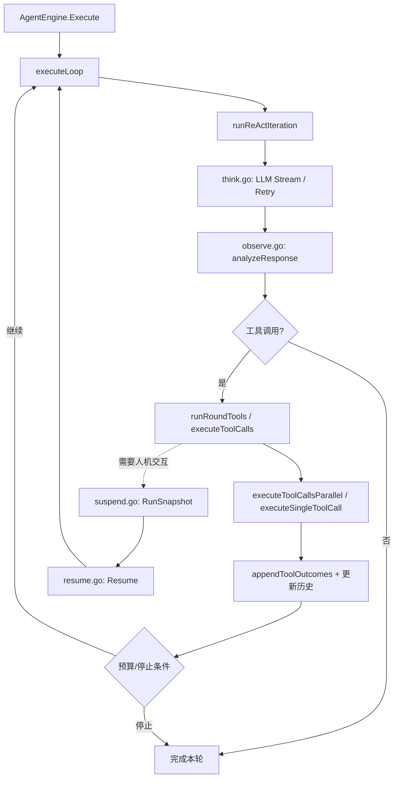
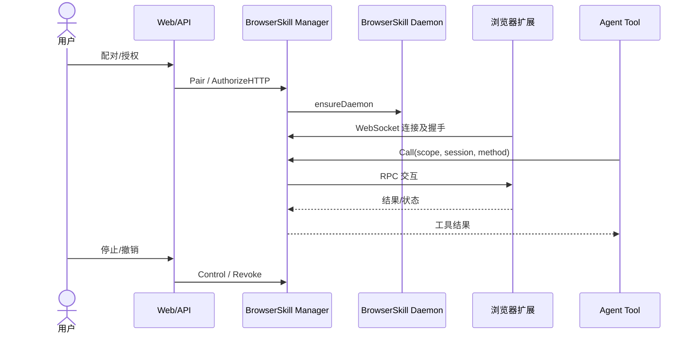
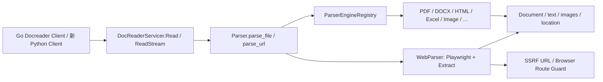
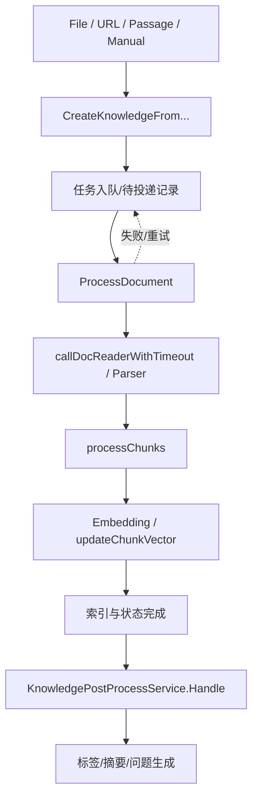

# WeKnora 源码级架构调研报告

> 审阅日期：2026-10-26 · 目标仓库：[Tencent/WeKnora](https://github.com/Tencent/WeKnora) · 分支：`main` · 已查询 Git Tree SHA：`97d7f0ad7b2b9fbd8bd717d737b9e79be6ace4c9`。
>
> 证据级别：**A** = 读取了文件内容并确认符号；**B** = 通过 Git Tree/目录确认路径；**D** = 目标架构推导。该 SHA 是检索到的树对象，不是已锁定的完整 commit SHA。未验证的调用细节统一标为待确认，不能当作源码既成事实。

## 1. 执行结论

WeKnora 不是简单的“Go + RAG”系统。所审源码具有：分阶段的 ReAct Agent、工具并行调用与结果观测、可挂起与恢复的运行快照、浏览器设备和 WebSocket RPC 管理、Python gRPC 文档解析服务、具备 SSRF 防护的 Playwright WebParser、知识入库任务队列及索引/后处理子系统。

**重构建议**：以 LangGraph 实现 Agent 状态与中断，不照搬 Go 主循环；优先评估直接复用 `docreader` 的 Python 解析能力；BrowserSkill 重构为有用户授权的适配层，Playwright 做无登录服务端采集；知识流水线采用可靠任务队列而不是让 Graph 节点执行全部后台工作。

## 2. 证据范围和方法

- 使用 GitHub Connector 获取 `main` Git Tree 与目标源码文件，确认模块目录与方法/函数名。
- 已阅读核心文件：`internal/agent/{engine,think,act,observe,checkpoint,resume,suspend}.go`、`internal/browserskill/{manager,authorization,daemon,human}.go`、`docreader/{main,preprocess}.py`、`docreader/parser/{registry,parser,web_parser}.py`、`docreader/utils/ssrf.py`、`internal/application/service/{knowledge_create,knowledge_process,knowledge_post_process,knowledge_index_content}.go`、`internal/application/repository/task_queue.go` 等。
- 本轮以架构/公开符号级审阅为主，**尚未**执行 Go 端到端测试、动态 trace、完整行级控制流及数据库迁移对照。对于具体内部实现判断以原文件为准。

## 3. `internal/agent`：执行引擎

### 3.1 源码证据表

| 文件 | 源码确认的符号（A） | 架构作用及边界 |
|---|---|---|
| [`engine.go`](https://github.com/Tencent/WeKnora/blob/main/internal/agent/engine.go) | `AgentEngine`, `NewAgentEngine`, `Execute`, `executeLoop`, `runReActIteration`, `runRoundTools`, `withinIterationBudget`, `loopGuards` | Agent 运行主控，轮次循环、预算、失败工具循环保护 |
| [`think.go`](https://github.com/Tencent/WeKnora/blob/main/internal/agent/think.go) | `streamLLMToEventBus`, `streamThinkingToEventBus`, `callLLMWithRetry`, `watchStreamStall` | LLM 流与事件、超时/重试处理 |
| [`act.go`](https://github.com/Tencent/WeKnora/blob/main/internal/agent/act.go) | `executeToolCalls`, `executeToolCallsParallel`, `executeSingleToolCall`, `runToolCall`, `appendToolOutcomes` | 工具调用、并行执行、结果汇总及追踪 |
| [`observe.go`](https://github.com/Tencent/WeKnora/blob/main/internal/agent/observe.go) | `manageContextWindow`, `runCompaction`, `analyzeResponse`, `buildToolsForLLM`, `buildMessagesWithLLMContext`, `appendToolResults` | 对话上下文窗口/压缩、观察工具结果、组装模型输入 |
| [`suspend.go`](https://github.com/Tencent/WeKnora/blob/main/internal/agent/suspend.go) | `RunSnapshot`, `PendingRound`, `PendingCall`, `EnableSuspension`, `snapshot`, `beginRound`, `recordCall` | 运行快照及挂起准备 |
| [`resume.go`](https://github.com/Tencent/WeKnora/blob/main/internal/agent/resume.go) | `Resume`, `pendingCallHistory`, `finishPendingRound` | 从待处理轮次恢复 |
| [`checkpoint.go`](https://github.com/Tencent/WeKnora/blob/main/internal/agent/checkpoint.go) | `SetContextCheckpointSink`, `saveContextCheckpoint` | 上下文压缩检查点的独立保存接口；**不能直接等同 LangGraph 全图 Checkpointer** |
| [`finalize.go`](https://github.com/Tencent/WeKnora/blob/main/internal/agent/finalize.go) | 文件存在（B） | 终止与最终回答职责待进一步追踪 |
| `approval/`, `hitl/`, `tools/`, `skills/`, `compaction/`, `collaboration/` | 子包存在（B）；`approval/gate.go`、`hitl/broker.go` 等可定位 | 审批、人工介入、工具和技能、上下文压缩、协作等分层 |

### 3.2 静态调用链（核心函数边界，待完整控制流复核）

> 图表示基于符号/职责重构的调用关系概览，不声称每个箭头是源码中的直接函数调用。实现时需按真实代码 trace 校准。

### 3.3 重构要求

- 用 `StateGraph` 明确 `plan/think`, `tool_policy`, `execute_tools`, `observe`, `finalize` 和 `interrupt`；持久化 `thread_id`。
- 保留并行工具执行但增加副作用隔离；对外工具结果标记不可信。
- 区分两种 checkpoint：模型上下文压缩存档 vs 工作流恢复状态。
- 保留最大轮次、重复失败工具检测、Token/时长限额、流式超时、取消及停止事件。
- `approval`/`hitl` 应映射审批服务 + LangGraph interrupt，不能单靠一个 LLM 提示词代替权限判断。

## 4. `internal/browserskill`：本机浏览器运行时

| 文件 | 确认符号（A） | 含义 |
|---|---|---|
| [`manager.go`](https://github.com/Tencent/WeKnora/blob/main/internal/browserskill/manager.go) | `Scope`, `Status`, `Manager`, `Pair`, `Revoke`, `ServeHTTP`, `attach`, `rpc`, `Call`, `Control`, `Preview`, `Forget`, `ForgetAll` | 以租户/用户作用域管理设备、配对、连接、RPC 和会话控制 |
| [`authorization.go`](https://github.com/Tencent/WeKnora/blob/main/internal/browserskill/authorization.go) | `AuthorizeHTTP`, `watchLease`, `Account`, `GetStatus`, `DownloadExtension`, `tokenHash` | 授权、令牌及租约状态 |
| [`daemon.go`](https://github.com/Tencent/WeKnora/blob/main/internal/browserskill/daemon.go) | `ensureDaemon`, `start`, `Close`, `connectionLimit` | daemon 生命周期与连接限制 |
| [`human.go`](https://github.com/Tencent/WeKnora/blob/main/internal/browserskill/human.go) | `IsHumanStep`, `humanTimeoutMS`, `clusterTimeout` | 用户介入步骤与超时 |
| [`store.go`](https://github.com/Tencent/WeKnora/blob/main/internal/browserskill/store.go) | 文件存在（B） | 持久化边界待深查 |
| `focus.go`, `stop.go`, `cluster.go`, `result.go` | 文件存在（B） | 焦点/停止/集群/结果支持 |

### 4.1 运行模型

> 该图是连接参与方关系图；原项目具体配对握手消息及代理拓扑需要在 TDD 前以协议代码和浏览器扩展代码逐项核对。

### 4.2 与 Playwright 的关系（重要源码发现）

`docreader/parser/web_parser.py` **已经引入 `playwright.async_api`**，实现 `StdWebParser.scrape`、`wait_for_rendered_content`、`install_ssrf_route_guard`、`WebParser`。因此“Playwright”不是从零引入全新技术；新增的是将其从**网页解析器能力**抽象为**可受控的研究采集浏览器适配器**。不要把现有 WebParser 误认为已实现多步骤 Research Agent。

### 4.3 浏览器适配器设计影响

- **BrowserSkill**：用户身份关联、显式授权、登录/验证码时转交用户、支持停止/撤销；必要时复用本机浏览器现有会话，但绝不把 cookie 发送给 LLM。
- **Playwright**：服务端隔离环境、域名/协议/网络出站白名单、只读默认，运行于受资源限制的容器；访问动态网页和抽取结构化信息。
- 两者共享 `BrowserAdapter` 接口，但不可共享浏览器身份和凭据模型；BrowserSkill `Scope` 到 Python Principal 的映射必须保留租户和用户隔离。

## 5. `docreader`：Python gRPC 解析服务

### 5.1 代码结构与入口

| 文件 | 确认符号（A） | 分析 |
|---|---|---|
| [`main.py`](https://github.com/Tencent/WeKnora/blob/main/docreader/main.py) | `DocReaderServicer`, `Read`, `ReadStream`, `ListEngines`, `main` | gRPC API：同步读取、流式读取、引擎枚举 |
| [`proto/docreader.proto`](https://github.com/Tencent/WeKnora/blob/main/docreader/proto/docreader.proto) | `service DocReader` | 跨语言契约；应进一步锁定字段/版本 |
| [`parser/parser.py`](https://github.com/Tencent/WeKnora/blob/main/docreader/parser/parser.py) | `Parser.parse_file`, `parse_file_stream`, `parse_url`, `detect_effective_file_type` | 文件与 URL 的调度层 |
| [`parser/registry.py`](https://github.com/Tencent/WeKnora/blob/main/docreader/parser/registry.py) | `ParserEngineRegistry`, `register`, `get_parser_class`, `list_engines` | 基于格式/引擎的注册路由 |
| [`parser/web_parser.py`](https://github.com/Tencent/WeKnora/blob/main/docreader/parser/web_parser.py) | `StdWebParser.scrape`, `extract_markdown_from_html`, `wait_for_rendered_content`, `install_ssrf_route_guard`, `WebParser` | HTML 提取、渲染与请求级 SSRF 守卫 |
| [`preprocess.py`](https://github.com/Tencent/WeKnora/blob/main/docreader/preprocess.py) | `PreprocessRunner`, `PreprocessLimits`, `_Worker` | 进程监督/预处理及资源治理 |
| [`utils/ssrf.py`](https://github.com/Tencent/WeKnora/blob/main/docreader/utils/ssrf.py) | `is_ssrf_safe_url`, `_resolve_host_ips`, `_is_restricted_ip` | URL/DNS/IP 访问限制 |
| [`utils/ssrf_proxy.py`](https://github.com/Tencent/WeKnora/blob/main/docreader/utils/ssrf_proxy.py) | 文件存在（B） | 代理约束的具体执行需要审查 |
| `parser/{pdf,docx2,excel,html,image,markdown,mhtml,epub,xmind}_parser.py` | 文件存在（B） | 多格式具体实现及输出一致性需 golden tests |
| `splitter/splitter.py`, `parser/source_locator.py` | 文件存在（B） | 分块/来源位置语义值得保留 |

### 5.2 解析调用链

### 5.3 可保留/替换的取舍

**建议 Phase 0 首先复用原 Python DocReader 作为独立微服务**，以 gRPC wrapper 封装而不是立刻把其实现拆进 API；这可最大限度减少解析质量差异。待完成许可证/第三方依赖审查、解析样本对照与资源隔离验证，再决定合并 Python 包、保留 gRPC 或重新实现。

必须验证：Proto 输出字段兼容、PDF 页码与表格定位、流式读取的 backpressure、图片/二进制占用、超时、OCR、临时文件清理、SSRF 代理、并发和内存限制。对应源码已有 `tests/test_web_parser.py`、`test_ssrf.py`、`test_ssrf_proxy.py`、`test_parser_routing.py`、`test_pdf_router.py`、`test_docreader_stream.py` 等回归测试（目录 B）。

## 6. 知识入库流水线

### 6.1 服务与任务入口

| 源文件 | 已确认函数（A） | 职责 |
|---|---|---|
| [`knowledge_create.go`](https://github.com/Tencent/WeKnora/blob/main/internal/application/service/knowledge_create.go) | `CreateKnowledgeFromFile`, `CreateKnowledgeFromURL`, `CreateKnowledgeFromPassage`, `CreateKnowledgeFromManual`, `enqueueManualProcessing` | 文件/URL/手工内容入口，创建知识记录并调度 |
| [`knowledge_process.go`](https://github.com/Tencent/WeKnora/blob/main/internal/application/service/knowledge_process.go) | `ProcessDocument`, `processChunks`, `updateChunkVector`, `callDocReaderWithTimeout`, `resolveDocReader`, `ReparseKnowledge`, `CancelKnowledgeParse` | 解析/分块/向量处理、重解析/取消 |
| [`knowledge_post_process.go`](https://github.com/Tencent/WeKnora/blob/main/internal/application/service/knowledge_post_process.go) | `KnowledgePostProcessService.Handle`, `enqueueAutoTagTask`, `enqueueSummaryGenerationTask`, `enqueueQuestionGenerationTasks` | 入库后标签/摘要/问题生成与其他后处理 |
| [`knowledge_index_content.go`](https://github.com/Tencent/WeKnora/blob/main/internal/application/service/knowledge_index_content.go) | `buildKnowledgeIndexContent` | 索引内容组成 |
| [`repository/task_queue.go`](https://github.com/Tencent/WeKnora/blob/main/internal/application/repository/task_queue.go) | `Enqueue`, `ClaimBatch`, `PeekBatch`, `IncrFailCount`, `taskDeadLetterRepository.Insert`, `SeedKnowledgeFinalizingWithPendingOp` | 数据库待投递操作及死信/恢复支持 |
| [`repository/chunk.go`](https://github.com/Tencent/WeKnora/blob/main/internal/application/repository/chunk.go) | 文件存在（B） | Chunk 数据持久化 |
| [`service/retriever/keywords_vector_hybrid_indexer.go`](https://github.com/Tencent/WeKnora/blob/main/internal/application/service/retriever/keywords_vector_hybrid_indexer.go) | 文件存在（B） | 关键词与向量混合索引 |
| `service/knowledgebase_search*.go` | 多文件存在（B） | 检索、融合、Rerank 和结果规整 |

### 6.2 静态业务链路

注意：创建文件和 URL 路径可能采用不同存储/准备分支；上述为高层功能关系，不是每个分支的实际逐语句顺序。`task_queue.go` 中待投递/死信模型说明必须核验可靠派发语义，不应只依赖 Celery 的默认“至少一次投递”。

### 6.3 Python 重构设计重点

1. 定义 `Document`、`DocumentVersion`、`IngestionJob`，入库必须可重试、幂等、可追踪。
2. API 在事务中创建文档版本与 Outbox；dispatcher 投递 Celery；Worker 阶段性存状态。
3. 对大文档先对象存储，解析中间件输出文本、表格、图像、页码/位置；Chunk 索引保留精确来源。
4. 以 `document_version_id` + `pipeline_version` 唯一化索引；完成索引后原子切换可见版本；失败不污染检索。
5. 采集 Research Graph 只产生已批准的 `IngestionRequest`，不直接写向量库。
6. 后处理（摘要、FAQ、Wiki）独立队列，不影响主文档基础可检索性。

## 7. 功能映射与复用决策

| 原代码/能力 | PyKnora 目标 | 建议 | 风险 |
|---|---|---|---|
| `AgentEngine` | `graphs/agent.py` | LangGraph 重新设计 | 高：状态与事件语义 |
| `approval/` + `hitl/` | `policies/`, `approvals/`, interrupt | 保留语义，重新建模 | 高：重复副作用 |
| `Manager` BrowserSkill | `adapters/browser/browserskill.py` | 协议适配/可选择复用 daemon | 高：会话授权 |
| `docreader` gRPC | `services/docreader/` | 优先保留服务 | 中：版本兼容 |
| `web_parser.py` Playwright | `adapters/browser/playwright.py` | 抽取可复用组件，隔离研究与解析职责 | 中：浏览器并发 |
| `knowledge_create/process` | `services/ingestion`, Celery | 业务状态机重写 | 高：最终一致性 |
| `task_queue.go` | Transactional Outbox + Worker | 借鉴可靠投递、死信能力 | 高：宕机恢复 |
| `knowledge_post_process.go` | Async enrichers | 后处理独立化 | 中：异步依赖 |

## 8. 深度复核清单（源码分析余项）

- 固定 commit SHA；按 Go `Execute → runReActIteration` 追踪具体调用边、事件枚举与错误类型。
- 提取 `RunSnapshot` JSON 结构、审批 token 的生成/消费规则及暂停时 tool idempotency。
- 浏览器扩展消息协议、scope 字段、租约、超时、设备配对、用户接管的完整安全审计。
- Proto 各字段/状态、文档解析配置路由、图片/表格定位实际精度。
- `ProcessDocument` 的事务、任务入队、失败重试、索引可见切换与并发重解析冲突。
- 验证 Postgres、ParadeDB、Qdrant、Milvus 等检索后端实际能力差异。
- 跑原项目及 PyKnora 对照 golden set、trace 与故障注入，补齐真实基线。

## 9. 来源与复现

官方文档：[总体架构](https://weknora.weixin.qq.com/docs/02-architecture/01-overview)、[入库流程](https://weknora.weixin.qq.com/docs/02-architecture/03-document-pipeline)、[本机浏览器](https://weknora.weixin.qq.com/docs/05-clients/09-local-browser)。源码锚点均已在上方以实际路径链接。建议正式实施前 checkout 锁定提交并执行 `go test ./internal/agent/... ./internal/browserskill/...` 与 `docreader` 的 Pytest 测试，结论以实测替代推断。
