# Phase 0 执行计划：任务并行判定、执行顺序与逐任务执行规程

日期：2026-10-27（Asia/Shanghai）。状态：**计划（Plan）**，不是执行结果。

依据与权威顺序：顺序看 [04 依赖 DAG](../poc/04_Phase0_Dependency_DAG.md)、范围看 [03 Backlog](../poc/03_Phase0_Task_Backlog.md)、通过标准看 [05 验收与故障矩阵](../poc/05_Phase0_Acceptance.md)、操作方式看 [06 执行指南](../poc/06_Phase0_Execution_Guide.md)；契约输入为 [07 契约闭合](../poc/07_Contract_Closure.md)（P0-T01 产物）。本文件不改写上述任何权威文档，只把「并行判定 → 执行顺序 → 逐任务执行规程」固化为可复用文件。

本文件不含任何运行通过声明：截至撰写时，31 项任务与九项 PoC 均为 `NOT_STARTED`；`experiments/phase0/`、`tests/phase0/`、`docs/poc/evidence/` 与实验 `uv.lock` 都还不存在。

---

## 1. 目标与范围

1. 判定 32 项 Backlog 任务中哪些在依赖、写入权、资源三个层面上**真正**可并行，其余必须串行。
2. 给出可直接执行的任务序列，并证明它满足全部依赖边（默认按波次并行，回退为线性）。
3. 把「提示词 06：日常单任务开发模板」实例化为逐轮可复用的执行规程：变量、步骤、命令通道、四项输出、停边界。
4. 固化波次编排规则：每波次一条分支、子 agent 数 = 该波次可并行任务数、波次末放行门禁询问是否提交（§4.5）。
5. 记录执行前已核实的环境事实与已知缺口，使后续每轮开工不必重新摸索。

范围：`docs/poc/03` 中的 P0-T01…P0-T32。不含 P1 任务，不含 ADR 状态变更，不含生产代码迁移。

**执行授权边界**：本文件被批准只代表计划成立；进入任何任务仍需用户当轮明确授权。默认节奏为「一轮一任务，完成即停」，不得自动跨任务。

### 1.1 执行前沿（当前唯一可开工位置）

| 位置 | 波次 | 任务 | 状态 | 派发条件 |
| --- | --- | --- | --- | --- |
| 已完成 | W0 | T01 | ✅ 完成 | 产物 `docs/poc/07_Contract_Closure.md` |
| 已完成 | W1 | T02、T09、T14 | ✅ 门禁通过并提交（`08c3c67`，已推送 origin） | 见 `docs/poc/evidence/wave-w1-record.md`；T02 PASS / T14 PASS(限域) / T09 PARTIAL |
| 已完成 | W2 | T03、T04 | ✅ 门禁通过并提交（`94defe2`、`d36629a`、`9b88cc7`、`f86765e`，已推送 origin） | 见 `docs/poc/evidence/wave-w2-record.md`；T03 PASS / T04 PASS(限域) |
| 已完成 | W3 | T05、T07、T10、T15、T19 | ✅ 门禁通过并提交（`ed669af` + `8239ab7`，未推送；全量 365 passed / ruff 通过 / 零越界） | 见 `docs/poc/evidence/wave-w3-record.md`；T05 PARTIAL（原生 saver 不可 fence → 单活 runner）/ T07·T10·T15·T19 PASS(限域) |
| **执行前沿** | **W4** | **T06、T08、T11、T16、T20、T22** | **未启动（等用户授权）** | 建分支 `feature/w4-t06-t08-t11-t16-t20-t22`；N 待实测后声明；写权互斥：T06 审批账本+迁移 002 / T08 作业消费+死信 / T11 解析 golden / T16 Playwright+网络策略 / T20 Context+预算+迁移 005 / T22 Planner+DAG 校验 |
| 未解锁 | W5–W11 | T12–T14、T17–T18、T21、T23–T32（15 项） | 未解锁 | 前置未 `PASS`，不得派发，也不得预先建分支 |

规则：**任何时刻只有「执行前沿」这一行允许创建分支与派发子 agent**；前沿推进的唯一判据是上一波次通过 §4.5.4 门禁且用户确认提交。表中未解锁任务即使看起来「文件不冲突」也不开工——依赖层未满足即不可并行。

---

## 2. 前置依赖与已确认输入

### 2.1 权威输入（均已读取，未重新审计参考源码）

| 输入 | 用途 |
| --- | --- |
| [AGENTS.md](../../AGENTS.md)、[CLAUDE.md](../../CLAUDE.md) | 开发规范、计划目录约定、一次会话一任务 |
| [PRD](../PRD_PyKnora.md) | 需求与验收编号（F-xx / AC-xx） |
| [TDD 01–08](../tdd/) | 契约、事务/恢复边界、各域设计 |
| [ADR 0001–0005](../adr/) | 五份均为 Proposed，未接受 |
| [03 Backlog](../poc/03_Phase0_Task_Backlog.md) | 32 任务定义、共同 DoD、量化验收 |
| [04 依赖 DAG](../poc/04_Phase0_Dependency_DAG.md) | 唯一依赖清单、波次、合入纪律 |
| [05 验收](../poc/05_Phase0_Acceptance.md) | 五态、证据字段、F1–F18 故障、G-DOC/G-P0/G-FULL |
| [06 执行指南](../poc/06_Phase0_Execution_Guide.md) | 会话契约五步、命令草案、清理规则 |
| [07 契约闭合](../poc/07_Contract_Closure.md) | C-01–C-10、INV-01–08、唯一写入者 |

### 2.2 环境实测事实（2026-10-27，只读探测）

| 项 | 实测结果 | 对执行的影响 |
| --- | --- | --- |
| 仓库 HEAD | `59d53ac9897f8b0e5d3eeb096332737f7ed6e1ce` | 每轮证据需记录当时 HEAD |
| 工作树 | `git status --short` 39 个 `M`；`git diff --ignore-cr-at-eol --stat` 为空 | 这些 `M` 是 **CRLF 工作树 vs LF 索引**的行尾差异，无用户实质改动；判断实质改动一律加 `--ignore-cr-at-eol` |
| 未跟踪 | `.idea/`、`docs/teacher/`、`docs/plans/` | 不得触碰；`docs/plans/` 为用户计划目录 |
| 参考源码 | `references/WeKnora` 子模块**未初始化**（`git submodule status` → `-662abaf9f944e37689d04c42160034b2cdec6829`，目录为空） | T09/T14 的静态预检**输入缺失**；需在相应轮次单独授权初始化，且不得改动基线 SHA |
| uv | 0.12.24，`C:\Python313\Scripts\uv.exe`（在 PATH） | 实验依赖解析工具就绪 |
| Python | Windows：根 `.venv` 为 3.13.7；`.python-version` 写 3.12；uv 托管 3.12.13 可用 | 实验项目固定 3.12 系（见 §10 A2） |
| Docker | daemon 可达；**原生 CLI 权威版本** `docker --version` 29.7.2、`docker compose version` v5.4.0（WSL 内另有一套 29.9.2 / v5.6.1，不作为依据） | core 服务可起；镜像 digest 需实际拉取确认 |
| 网络 | 原生 PowerShell 侧 pypi / github / gitee 均可达（pypi 约 0.7 MB/s）；WSL 侧不可达 | 下载、依赖解析、容器操作一律走原生 Windows 通道 |
| shell 通道 | **`pwsh` 工具调用失败**（`0xC0000142` DLL 初始化失败，命令未执行）；**持久 PowerShell 会话可用**（`terminal_open` / `terminal_send`，PowerShell 7.6.0，git、uv、docker 均已在 PATH） | 桌面命令一律走持久 PowerShell 会话；**不使用 wsl**（见 §6.4） |
| 缺失产物 | 无 `experiments/`、`tests/`、`docs/poc/evidence/`、根 `uv.lock` | 首个环境任务（T02）从零创建隔离实验区 |
| 文档差异 | [04](../poc/04_Phase0_Dependency_DAG.md) §4 称 72 条直接边，Mermaid 块实际可解析 71 条（缺 `T01 --> T02`） | 顺序校验以 72 边权威表为准（§4.2）；本计划不修改 04，差异记入待复核项 |

### 2.3 已知缺口（不阻塞计划，但决定任务可交付度）

- C-07（P0 来源审阅/身份域）状态 `BLOCKED`：产品 + 安全 + 架构决策未决，T27/T28 只能做合成实验。
- C-03/C-04/C-05/C-10 为 `NEEDS_POC`：T05/T06/T14–T18/T03 的结论以实验为准，不得预设成立。
- BrowserSkill 真源码/真设备、DocReader 真镜像与许可、模型 provider 额度与数据规则：外部素材，未取得即记 `BLOCKED`，不以 mock 消除。
- 实验 `uv.lock`、`compose.yaml`、`contracts.py`、迁移 `001–007`、`tests/phase0/conftest.py` 都是**单一写入权**产物（见 §3.2），多任务共用时必须串行合入。

---

## 3. 并行判定

### 3.1 三层筛选规则

一项任务可开工，必须同时满足：

1. **依赖层**：`docs/poc/04` 中的全部直接前置已 `PASS`（或经评审明确接受的限域结果）。多前置为 AND；前置只有 `PARTIAL` 时，只能做不依赖该失败假设的限域实验，并在证据中标注硬门禁未过。禁止删除依赖让图「通过」。
2. **写入权层**：本任务要写的共享产物当前无其他任务持有写入权（§3.2）。冲突时只能提交局部建议或申请新的迁移编号，不能并行覆盖权威 schema/锁文件/Compose。
3. **资源层**：本任务需要的独占资源可用——同一 PG/Redis 实例与端口、镜像拉取带宽、真实浏览器设备、模型额度与费用上限、真实 DocReader 服务。资源冲突时串行。

**判定式**：可并行 ⟺ 同波次 ∧ 写入权互斥 ∧ 资源独立 ∧ 前置已 PASS。任一不满足即串行。

### 3.2 共享产物写入权互斥表

| 共享产物 | 唯一写入权归属 | 其他任务允许的动作 |
| --- | --- | --- |
| 实验 `pyproject.toml`、`uv.lock`、`compose.yaml`、`.env.example` | P0-T02（后续新增 profile/依赖必须串行合入） | 提交局部依赖建议；不得自行改锁文件或加服务 |
| `contracts.py`（实验公共 Scope/身份/契约类型） | P0-T03（契约集成点） | 只提增量建议；不得另造 Scope/Job/epoch 方言 |
| `db/migrations/001_scope_core.sql` | P0-T03 | — |
| `002_approvals.sql` | P0-T06 | — |
| `003_jobs_outbox.sql` | P0-T07 | — |
| `004_version_index.sql` | P0-T12 | — |
| `005_budget.sql` | P0-T20 | — |
| `006_tasks.sql` | P0-T23 | — |
| `007_candidates.sql` | P0-T27 | — |
| `tests/phase0/conftest.py`、`fixtures/manifest.json` | P0-T04（控制站与 fixture 契约） | 各任务只按 fixture API 使用，不自造计数器/屏障 |
| `docs/IMPLEMENTATION_STATUS.md` | 每轮执行任务（追加本轮小节，不覆盖历史） | 只追加，不重写他人小节 |

补充：迁移文件一经合入，后续任务只能**新增更高编号迁移**，不得原地改历史编号；实验数据库按场景空间/实例清理，禁止触碰生产。

### 3.3 波次（与 `docs/poc/04` §3 逐项一致）

| 波次 | 可 ready 任务 | 状态 | 依赖层并行的实际含义 |
| --- | --- | --- | --- |
| W0 | T01 ✅ 已完成 | 已完成 | 唯一根任务 |
| W1 | T02、T09、T14 | ✅ 已完成并提交 `08c3c67`（未推送） | 三者写入权互斥（环境 / 两份静态预检证据）；T02 PASS、T14 PASS(限域)、T09 PARTIAL |
| W2 | T03、T04 | ✅ 门禁通过（102 passed / ruff / 零越界），待提交 | 文件不重叠；都需 T02 的隔离环境；T03 PASS、T04 PASS(限域) |
| W3 | T05、T07、T10、T15、T19 | **◀ 执行前沿（等授权）** | 核心恢复 / 可靠作业 / 解析 / 浏览器 / 模型五线分叉 |
| W4 | T06、T08、T11、T16、T20、T22 | 未解锁 | 最大波次，六项不相交 |
| W5 | T12、T17、T21、T23 | 未解锁 | T12 是解析线与作业线的收敛点 |
| W6 | T13、T18、T24 | 未解锁 | — |
| W7 | T25、T27、T30 | 未解锁 | — |
| W8 | T26 | 未解锁 | 单任务波次（融合点） |
| W9 | T28、T29 | 未解锁 | — |
| W10 | T31 | 未解锁 | P0 核心门禁 |
| W11 | T32 | 未解锁 | 全量门禁 |

```mermaid
flowchart LR
    W0["W0 · T01 ✅"] --> W1["W1 · T02·T09·T14 ✅ 08c3c67"]
    W1 --> W2["W2 · T03·T04 ✅ 门禁通过"]
    W2 --> W3["W3 · T05·T07·T10·T15·T19 ◀ 执行前沿"]
    W3 --> W4["W4 · T06·T08·T11·T16·T20·T22"]
    W4 --> W5["W5 · T12·T17·T21·T23"]
    W5 --> W6["W6 · T13·T18·T24"]
    W6 --> W7["W7 · T25·T27·T30"]
    W7 --> W8["W8 · T26"]
    W8 --> W9["W9 · T28·T29"]
    W9 --> W10["W10 · T31"]
    W10 --> W11["W11 · T32"]
```



### 3.4 结论：哪些任务真正可并行

- **可并行的最小单元是波次**；波次内若写入权与资源都不冲突，才可能同轮或多 agent 并行。
- **W1（T02/T09/T14）**：唯一一组在「无共享写权 + 无共享运行资源」意义上可立即并行的三项。但 T09/T14 依赖 `references/WeKnora` 真源码，且需各自单独的静态核验，实际并行度受素材取得限制。
- **必须串行的典型组合**（同一波次也不行）：T03 → T07/T12/T15/T23 任何要改 `contracts.py` 或引用 `001` 的任务；T04 → 任何要用 fixture/屏障的任务；T02 → 一切要用实验依赖或 compose 的任务；T12 → T13；T23 → T24；T05 → T06/T21/T23。
- **只在受限前提下可并行的组合**：T10 与 T11（T11 需 T10 的真 wire 结果）；T16 与 T17/T18（Playwright 线不阻塞 BSK 线，但 BSK 材料缺失时 T17/T18 只能 BLOCKED）；T25 与 T27（T25 是检索基线，T27 需要 T11/T16/T24 的真实产物）。
- **默认执行形态**：按波次切分支、按可并行任务数分发 N 个子 agent（§4.5.2 的 N 必须实算并声明）；写权或资源冲突的任务不派 agent，由 Lead 串行执行；任何不可并行场景退回 §4.1 序列。

---

## 4. 执行顺序

### 4.1 线性序列（回退视图，31 项，T01 已完成）

默认执行单元是**波次**：每波次先切分支、按可并行任务数分发 N 个子 agent、波次末进入放行门禁（§4.5）。当某波次判定为不可并行（依赖/写入权/资源冲突，或用户要求串行）时，退回本序列在波内逐项执行；两视图的任务集合与先后顺序完全一致。

**执行前沿 = 第 6–10 项（W3：T05、T07、T10、T15、T19，未启动）**；第 1–5 项（W1、W2）已通过门禁（W1 以 `08c3c67` 提交，W2 门禁通过待提交），第 11 项起全部「未解锁」，只有当前沿波次通过门禁后才逐项进入前沿，不允许提前预建分支或提前派发。

1. ~~**T02**（W1）隔离实验环境与核心依赖清单~~ ✅ PASS
2. ~~**T09**（W1）DocReader proto/镜像/许可静态预检~~ ✅ PARTIAL（缺 SBOM/镜像 digest）
3. ~~**T14**（W1）BrowserSkill 真源码/协议/许可静态预检~~ ✅ PASS（限域）
4. ~~**T03**（W2）合成身份、Scope 与最小 PG 契约~~ ✅ PASS
5. ~~**T04**（W2）可控下游、控制站与故障断点 fixture~~ ✅ PASS（限域）
6. **T05**（W3）原生 Checkpoint 单写者与并发恢复 ◀ **执行前沿**
7. **T07**（W3）Outbox 生产事务与派发 lease ◀ **执行前沿**
8. **T10**（W3）DocReader Read/ReadStream 真实互通 ◀ **执行前沿**
9. **T15**（W3）Browser port、能力协商与 Scope 契约 ◀ **执行前沿**
10. **T19**（W3）单 Provider ModelGateway 与窄工具 Registry ◀ **执行前沿**
11. **T06**（W4）审批绑定、调用账本与未知写核查
12. **T08**（W4）消费幂等、Job 对账与死信 redrive
13. **T11**（W4）五格式 golden、图片资产与引用映射
14. **T16**（W4）Playwright 真实隔离读取与 SSRF
15. **T20**（W4）Context 工具配对与预算预留账本
16. **T22**（W4）Planner 结构化输出与 DAG 校验
17. **T12**（W5）版本 staging、Chunk/Embedding 与引用模型
18. **T17**（W5）BrowserSkill 真扩展配对与读取
19. **T21**（W5）Harness 节点集成、取消与安全 trace
20. **T23**（W5）DependencyScheduler 与 Task/Graph/Job 对账
21. **T13**（W6）原子发布与版本竞态故障注入
22. **T18**（W6）BrowserSkill owner、撤销与人工接管
23. **T24**（W6）Evaluator、重规划 revision 与产物复用
24. **T25**（W7）授权检索、真实 Embedding 与 Hybrid 对照
25. **T27**（W7）来源质量、去重与人工 Review 契约
26. **T30**（W7）备份恢复、迁移和版本回滚演练
27. **T26**（W8）RAG Graph、引用与最终事件一致性
28. **T28**（W9）Research 全链控制站集成
29. **T29**（W9）P0 全链授权与内容安全回归
30. **T31**（W10）P0 核心出口证据评审（文档）
31. **T32**（W11）全量 Phase 0 / P1 前置证据评审（文档）

排序原则：波次优先，波次内沿用 `docs/poc/04` 列举顺序；同一域内先落契约再落实现（T03 先于 T12/T15/T23，T04 先于 T05/T07/T19）；解析线与可靠作业线交替推进，使 T12 收敛点两侧同时具备输入。

### 4.2 序列有效性校验

- 用 72 条直接边（`docs/poc/04` 与 Backlog 卡片依赖字段一致）对上述序列做拓扑校验：**违反 0 条**，32 个任务全覆盖，与波次表逐项一致。
- 已知文档差异：`04` 的 Mermaid 片段缺 `T01 --> T02` 一条边（渲染 71 条 vs 声明 72 条）。校验使用声明值 72，不影响结论；建议在某个文档轮次单独复核该不一致，**不得**以「减少依赖」方式修正。

### 4.3 关键路径与门禁（用于排优先级，不是工期承诺）

- 解析线：`T01→T02→T04→T10→T11→T12→T13→T25→T26→T29→T31`；可靠作业线：`T01→T02→T03/T04→T07→T08→T12→…`；两线在 **T12** 收敛，均 23 点；全量加 T32 为 24 点。
- P0 核心出口（T31）只要求核心链证据；T32 才涉及 BrowserSkill/Research 全量。BSK 材料与真实设备虽不计点数，但会主导日历，属日历风险。
- 点数只表达相对复杂度，**不是工时**；本计划不给出任何日期承诺。

### 4.4 就绪重算与跳队规则

每轮开工前执行：

1. 读取上一轮证据与 `docs/IMPLEMENTATION_STATUS.md` 的本轮小节；
2. 按 §3.1 三层规则重算 ready 集（前置是否 PASS、写入权是否空闲、资源是否可用）；
3. 若序列中下一任务被 `BLOCKED`（例如 T09 缺镜像/许可），跳过它并顺延到 ready 集内的下一项，**在状态文件中记录跳队原因**；不修改 DAG、不降低其验收标准；
4. 若某任务被判定 `PARTIAL`，其下游只能在「不依赖失败假设」的限域范围内推进，并在证据中显式标注。

### 4.5 波次编排：分支、子 agent 分发与放行门禁（强制规则）

#### 4.5.1 每波次一条分支

- **时机**：波次启动时、任何任务写入之前创建；基线固定为 `dev`（当前即 `dev` @ `59d53ac`），波次内全部任务在该分支上完成。
- **命名**：规范为 `feature/{波次名}:{任务名列表}`，但 **Git 拒绝 `:`**（`git check-ref-format --branch "feature/W1:T02"` 返回 `fatal: not a valid branch name`），故落库为等价可执行形式 `feature/<波次名小写>-<任务名小写、连字符分隔>`。**2026-10-27 用户已确认采用连字符形式**。
- **全波次命名表**（W0 已完成，不建分支）：

| 波次 | 分支名 | 任务数 |
| --- | --- | --- |
| W1 | `feature/w1-t02-t09-t14` | 3 |
| W2 | `feature/w2-t03-t04` | 2 |
| W3 | `feature/w3-t05-t07-t10-t15-t19` | 5 |
| W4 | `feature/w4-t06-t08-t11-t16-t20-t22` | 6 |
| W5 | `feature/w5-t12-t17-t21-t23` | 4 |
| W6 | `feature/w6-t13-t18-t24` | 3 |
| W7 | `feature/w7-t25-t27-t30` | 3 |
| W8 | `feature/w8-t26` | 1 |
| W9 | `feature/w9-t28-t29` | 2 |
| W10 | `feature/w10-t31` | 1 |
| W11 | `feature/w11-t32` | 1 |

- 切分支用原生 PowerShell 会话执行：`git switch -c feature/w1-t02-t09-t14 dev`。
- **不建 worktree**：所有任务共享同一工作目录，避免依赖重复安装与端口/容器重复。

#### 4.5.2 子 agent 分发数量（强制声明）

- **N = 该波次可并行任务数**（按 §3.1 三层规则实算），不是波次任务总数；被判不可并行的任务不派 agent，由 Lead 在该分支上串行执行。
- 派发前**必须**在波次记录文件中写入声明块，声明之后才允许派发：

```text
wave: W1   branch: feature/w1-t02-t09-t14   base: dev@59d53ac
parallel_tasks: [T02, T09, T14]   N = 3
serial_tasks: []                  # 逐项给不可并行原因
blocked_tasks: []                 # 启动时已确认素材缺失者，N 相应下调
per_task: id | 写入范围 | 资源槽 | agent 名 | 前置任务
```

- 每个 agent 只承担一个任务（`spawn_teammate`，`context=fresh`）：prompt = 该任务的提示词 06 实例化文本 + §3.2 写入范围 + 「不得改他任务文件」+「完成后停，四项报告」。
- **agent 数必须等于 N**：不得为「保险」多派，也不得少派后由 Lead 冒充并行。
- 启动时已确认素材缺失的任务（如子模块未初始化、无真实设备）从 `parallel_tasks` 移入 `blocked_tasks`，N 下调——不得派注定 `BLOCKED` 的 agent 充数。

#### 4.5.3 资源槽（同波次并行的硬约束）

| 资源 | 分配规则 |
| --- | --- |
| PostgreSQL | 每任务独立 schema `p0_<taskid>`，禁止跨 schema 写；core 实例共用，同波次并发写 schema 数 ≤3（超出排队） |
| Redis | 每任务独立 DB index（0–15），键前缀 `p0:<taskid>:` |
| 端口 | 每任务固定块，实际值写入波次记录：T02 5400 起、T04 5500 起、T16 5600 起、T10/T11 5610 起 |
| 浏览器/外设 | Playwright 与 BSK 真设备互斥，同一时刻只允许一个任务持有 |
| 模型额度 | 每任务单轮预算上限写入波次记录，超限即停并记 `PARTIAL` |
| Docker 镜像 | 拉取串行执行，避免带宽争抢；拉取结果（含 digest 或失败原文）写入波次记录 |

#### 4.5.4 波次末放行门禁（询问后才提交）

波次内任务全部产出四项报告后，Lead 依次执行：

1. 汇总各任务状态（PASS/PARTIAL/FAIL/BLOCKED/NOT_STARTED），核对是否有 agent 越界写入他人文件；
2. 在该分支运行本波次全部可运行测试 + ruff + 秘密扫描，记录真实命令、退出码与输出；
3. `git status`、`git diff --ignore-cr-at-eol` 审阅，确认改动只含本波次任务文件；
4. 写波次记录并追加 `docs/IMPLEMENTATION_STATUS.md` 小节；
5. **停下询问用户**：「W{N} 门禁结果如上，是否提交分支 `feature/...`？」——仅在用户确认后执行 `git add <本波次文件>` 与 `git commit`。

- 未获确认：不 `git add`、不 `commit`、不 `push`、不合并到 `dev`/`master`。
- 获确认提交时仍只暂存本波次文件；`push` 与合并须另行授权。
- 若波次全部 FAIL/BLOCKED，门禁照常记录，分支保留但不提交，由用户决定丢弃或重做。

#### 4.5.5 波次记录文件

- 位置：`docs/poc/evidence/wave-<wN>-record.md`（W1 起），内容含声明块、各任务结论与命令、门禁检查结果、提交决策与用户答复、残余风险。
- 随波次分支提交；**不写进 `docs/plans/`**（该目录只放计划，不放执行结果）。

---

## 5. 任务卡汇总

约定：`E/` = `experiments/phase0/`，`T/` = `tests/phase0/`，`V/` = `docs/poc/evidence/`。验收锚点为摘要，权威定义见 [03 Backlog](../poc/03_Phase0_Task_Backlog.md) 对应任务卡。共享写权列标 `是` 者见 §3.2。

**执行前沿标记**：第 1–5 行（W1 + W2）已通过门禁（W1 随 `08c3c67` 提交，W2 待提交）；**当前前沿为第 6–10 行（W3 的 T05、T07、T10、T15、T19）**，尚未启动；第 11 行起共 21 项一律「未解锁」，不得写入任何派发声明、波次记录或分支名。

| # | ID | 波次 | 直接依赖 | 主要产物 | 量化验收锚点（摘要） | 共享写权 |
| --- | --- | --- | --- | --- | --- | --- |
| 1 | T02 | W1 | T01 | `E/pyproject.toml`、`E/uv.lock`、`E/compose.yaml`、`E/.env.example`、`V/environment.md` | 核心包/镜像 100% 有精确版本+hash+license+来源；干净目录可重建；缺变量/镜像/端口显式失败；零真实秘密 | 是 |
| 2 | T09 | W1 | T01 | `V/docreader_manifest.md`、`V/docreader_fixture_plan.md` | 四 RPC 100% 有请求/响应/错误/限制；五格式均有路线；未知项逐项列阻断与替代 | 否 |
| 3 | T14 | W1 | T01 | `V/browserskill_protocol_manifest.md` | 每暴露动作 100% 有协议依据或标 unsupported；三组件部署/授权分开；无材料即全 U | 否 |
| 4 | T03 | W2 | T02 | `E/contracts.py`、`E/db/migrations/001_scope_core.sql`、`E/scope.py`、`T/test_scope.py` | 越权命中/可写 0；组合 FK 100% 拒绝跨空间；无 Run Job 恢复读当前 Principal；RLS 角色无 BYPASSRLS | 是 |
| 5 | T04 | W2 | T02 | `E/control_site/`、`E/faults.py`、`T/conftest.py`、`E/fixtures/manifest.json` | ≥20 控制向量/安全页面；重复 key 只计 1；10 次 kill 重建无遗留端口/数据；不依赖固定 sleep | 是 |
| 6 | T05 | W3 | T03、T04 | `E/checkpoint_probe.py`、`T/test_checkpoint_owner.py`、`V/poc01-owner.md` | run/thread 一致 100%；至多一个有效 writer；失锁后旧 invocation 不再写 checkpoint | 否 |
| 7 | T07 | W3 | T03、T04 | `E/outbox_probe.py`、`E/db/migrations/003_jobs_outbox.sql`、`T/test_outbox_transaction.py` | 事务回滚执行 0；SKIP LOCKED + 事务外 publish + epoch CAS；重派发不重复建业务结果 | 是 |
| 8 | T10 | W3 | T02、T04、T09 | `E/docreader_probe/`、`T/test_docreader_wire.py` | 真实 PDF/DOCX 各 ≥2 正例；错误/超时映射 100% 正确；无 meta 或断流不产可发布结果 | 否 |
| 9 | T15 | W3 | T03、T04 | `E/browser_contracts.py`、`T/test_browser_contracts.py` | 自有 port 与 wire 分离；未知能力/未知版本拒绝；授权绑定到具体 session/scope | 否 |
| 10 | T19 | W3 | T03、T04 | `E/model_gateway.py`、`E/tool_registry.py`、`T/test_gateway_registry.py` | 模型响应先持久化再登记意图；重入读原绑定不重新生成；Registry 窄工具白名单 | 否 |
| 11 | T06 | W4 | T05 | `E/approval_probe.py`、`E/tool_ledger.py`、`E/db/migrations/002_approvals.sql`、`T/test_approval_effects.py` | 逐字段变更/过期/撤销后无新网络写；未知结果不自动重放；重复 Resume 不产生未确认副作用 | 是 |
| 12 | T08 | W4 | T07 | `E/job_probe.py`（含 `celery_app`）、`E/job_reconciler.py`、`T/test_delivery_recovery.py` | 100 Job×10 消息每 Job 单份业务结果；ACK 丢失/Redis 清空/死信 redrive 可恢复；dispatched ≠ 完成 | 否 |
| 13 | T11 | W4 | T10、T03 | `E/parsing_assets.py`、`E/locator_map.py`、`E/simple_reader.py`、`T/test_parser_golden.py` | ≥49/50 且每格式 ≥9/10；精确定位 100% 匹配金标准；缺图/截断可发布 0 | 否 |
| 14 | T16 | W4 | T15 | `E/playwright_probe.py`、`E/network_policy/`、`T/test_playwright_security.py` | 真实隔离 context；每跳 SSRF 校验；子资源出站受控；凭据不进日志 | 否 |
| 15 | T20 | W4 | T19 | `E/context_budget.py`、`E/budget_ledger.py`、`E/db/migrations/005_budget.sql`、`T/test_budget_context.py` | 预算预留/结算可对账；超预算拒绝而非截断成功；重复调用不重复计费 | 是 |
| 16 | T22 | W4 | T19 | `E/dag_contracts.py`、`E/planner_probe.py`、`T/test_dag_validation.py` | 32 节点/64 边/深度 8 的 DAG 校验；非法边/环/超深拒绝 | 否 |
| 17 | T12 | W5 | T03、T08、T11 | `E/index_staging.py`、`E/db/migrations/004_version_index.sql`、`T/test_index_staging.py` | staging 不可见；chunk/embedding 与 attempt 版本关联；旧 attempt 不覆盖 winner | 是 |
| 18 | T17 | W5 | T14、T15、T06 | `E/browserskill_probe/`、`T/test_bsk_live.py` | 真扩展配对/动作执行有真实 wire 证据；无设备则 BLOCKED 不 PASS | 否 |
| 19 | T21 | W5 | T05、T06、T08、T20 | `E/harness_graph.py`、`E/safe_trace.py`、`T/test_harness_integration.py` | checkpoint 丢失重入后业务事实不回退；取消可复现；trace 无秘密 | 否 |
| 20 | T23 | W5 | T22、T05、T08、T20 | `E/task_scheduler.py`、`E/task_executor.py`、`E/db/migrations/006_tasks.sql`、`T/test_task_coordination.py` | 旧 revision/epoch 不覆盖当前节点；租约过期新 epoch；Job 完成只唤醒一次 | 是 |
| 21 | T13 | W6 | T12 | `E/index_publication.py`、`T/test_publication_faults.py`、`V/poc03-publication.md` | T3 一次提交 active+winner+核心 Job；提交前失败全回滚；旧 active 不被旧 worker 覆盖 | 否 |
| 22 | T18 | W6 | T17、T06 | `E/browserskill_probe/recovery.py`、`T/test_bsk_recovery.py`、`V/poc05-recovery.md` | owner epoch CAS；撤销后不可执行；旧 epoch 迟到结果不写当前 session | 否 |
| 23 | T24 | W6 | T23、T20 | `E/evaluator_replanner.py`、`T/test_replanning.py` | 最多 2 次重规划；旧产物复用需重新授权；失败依赖不伪造 succeeded | 否 |
| 24 | T25 | W7 | T13、T19 | `E/retrieval_probe.py`、`T/test_retrieval_permissions.py`、`V/retrieval-baseline.json` | 100 QA 三路对照；只命中当前 active winning attempt；跨空间检索 0 命中 | 否 |
| 25 | T27 | W7 | T11、T16、T24、T03 | `E/candidate_review.py`、`E/db/migrations/007_candidates.sql`、`T/test_candidate_review.py` | 候选/去重/审阅追加历史；撤销后不可入库；缺来源/证据不发布 | 是 |
| 26 | T30 | W7 | T05、T08、T13、T21 | `E/restore_probe/`、`T/test_restore_upgrade.py`、`V/restore-runbook.md` | 备份可还原到一致状态；迁移/回滚可重复执行；RPO/RTO 待定需标注 | 否 |
| 27 | T26 | W8 | T25、T05、T21 | `E/rag_probe.py`、`E/events_probe.py`、`T/test_rag_events.py`、`V/poc09-report.md` | 引用固定版本且访问再授权；最终事件与业务终态一致 | 否 |
| 28 | T28 | W9 | T27、T18、T26、T13、T21 | `E/research_probe.py`、`T/test_research_e2e.py`、`V/poc08-report.md` | 30 研究任务全链；证据链可追溯；无设备则相关段 BLOCKED | 否 |
| 29 | T29 | W9 | T06、T08、T13、T21、T26 | `T/test_security_gate.py`、`V/security-matrix.md` | ≥100 越权探测 0 命中；跨空间/撤权/篡改 payload 全拒绝 | 否 |
| 30 | T31 | W10 | T26、T29、T30 | `V/P0_Core_Gate_Review.md` | 文档门禁：逐项证据可核、未通过项不得标 PASS | 否 |
| 31 | T32 | W11 | T28、T18、T24、T31 | `V/Phase0_Full_Gate_Review.md` | 全量门禁：BSK/Research 段缺证据则整体不 PASS | 否 |

---

## 6. 逐任务执行规程：提示词 06 实例化

来源：[开发指南 §7「提示词 06：日常单任务开发模板」](../teacher/1.Codex_PyKnora_Development_Guide.md)。下列为其实例化运行时约定。

### 6.1 模板变量

| 变量 | 来源 | 示例 |
| --- | --- | --- |
| `{TASK_ID}` | Backlog | `P0-T02` |
| `{波次}` / `{直接依赖}` | `docs/poc/04` + 本文件 §5 | `W1` / `T01` |
| `{关联 TDD/PRD 章节}` | Backlog 任务卡「关联」字段 | `TDD 01 §7`、`TDD 08 §2/7` |
| `{输入}` | Backlog「输入」+ 本文件 §2.2 | 07 契约、06 指南 §3 |
| `{预计产物}` | Backlog「文件」+ 本文件 §5 | `E/pyproject.toml` 等 |
| `{量化验收}` | Backlog「量化验收」原文 | 见 §5 摘要 |
| `{命令组}` | 本文件 §6.4 + 已实测通过的命令 | 见下 |

### 6.2 每轮五步（对齐 06 指南 §2）

1. **守卫**：`git status --short`、`git rev-parse HEAD`、`git diff --ignore-cr-at-eol --stat`；确认无用户实质未提交改动，记录脏差异 hash 用于证据。
2. **读输入**：AGENTS、`docs/IMPLEMENTATION_STATUS.md`、本任务关联的 PRD/TDD/ADR、Backlog 任务卡、上一相关证据（T03/T07/T12/T15/T23 必须读 07 契约）。
3. **先写验收清单**：在会话内（或证据草稿）列出本任务量化验收的最小可判定条目，再只改本任务文件；不改无关模块、不破坏既有接口、不加类型注解以外的大改。
4. **分级记录**：unit / contract / mock / 真实服务 / 真实设备分别记录结果；缺环境写 `NOT_RUN` 或真实尝试后的 `BLOCKED`；禁止用 `pytest.skip`、mock 或接口 200 冒充验收。
5. **收尾**：跑测试 + ruff + diff 复查 + 秘密扫描；更新证据文件与 `docs/IMPLEMENTATION_STATUS.md`；输出四项报告；**停在任务边界**（子 agent 交报告即停，Lead 收齐后进入 §4.5.4 波次门禁）。

### 6.3 四项输出模板（每轮结尾固定）

```
1) 改动摘要与文件列表（新增 / 修改分别列，注明是否触碰共享写权产物）
2) 测试与检查命令 + 实际结果（含版本、退出码、N passed/failed、ruff 结果）
3) 验收条件逐项核对：每条 → PASS / PARTIAL / FAIL / BLOCKED / NOT_STARTED + 证据位置
4) 风险、阻塞、下一 ready 任务建议（引用 §4.4 就绪重算结果）
```

第 3 项必须逐条对应 Backlog「量化验收」，不得合并成一句「基本满足」。

### 6.4 命令执行通道（本机约束）

`pwsh` 一次性调用在本机失败（进程创建即 `0xC0000142` DLL 初始化失败，命令未执行）。**改用原生持久 PowerShell 会话**，不再使用 wsl：

```text
terminal_open(type="shell", cwd="E:\project_month\pyknora")   # 得到原生 PowerShell 会话
terminal_send(sessionId, "<PowerShell 命令>")                  # 逐条执行并读回输出
```

已在该会话实测通过（2026-10-27）：

| 项 | 实测 |
| --- | --- |
| PowerShell | 7.6.0 |
| 当前分支 / HEAD | `dev` / `59d53ac` |
| uv | `uv 0.12.24 (5411378eb 2026-10-08)` |
| docker / compose | `Docker version 29.7.2`、`Docker Compose version v5.4.0` |

约定：

- 桌面一切命令（git、uv、docker、pytest、ruff）走该持久会话；**不再使用 `wsl` 工具**。
- 长驻进程（`docker compose up`、pytest 观察）用 `run_in_background` 或独立会话，避免占住主会话。
- 记录证据时写**实际执行的那条命令**与真实输出，不要把 `06` 指南里的 PowerShell 草案当作已运行命令。
- 命令必须显式指定项目与配置（如 `--project experiments/phase0`、`ruff --config ...`），避免因根目录无配置而「无测试空跑绿」。

### 6.5 测试与静态检查约定

- 测试文件放 `tests/phase0/`，实验代码放 `experiments/phase0/`；命令按**具体文件**执行，如 `pytest tests/phase0/test_scope.py -q`。
- 实验项目独立 `pyproject.toml` 承载 pytest/ruff 配置；不得为方便实验而改根项目依赖或加根配置。
- 每个任务的测试必须至少有一个真实断言路径（不得全部 skip/mock），并在证据中区分「本地逻辑可判」与「需真实服务才能判」两部分。

---

## 7. 每轮证据、状态与停边界

| 产物 | 位置 | 规则 |
| --- | --- | --- |
| 计划 | `docs/plans/` | 本文件及后续计划；不写执行结果 |
| 证据 | `docs/poc/evidence/` | 每任务一份（如 `environment.md`、`poc01-owner.md`）；含 §05 要求的字段 |
| 进度 | `docs/IMPLEMENTATION_STATUS.md` | 每轮**追加**「本轮：P0-Txx」小节，保留历史小节 |
| 停止 | 波次 | 各任务四项报告交齐 → 波次门禁（§4.5.4）→ 询问「是否提交本波次分支」；未获确认不暂存/不提交/不推送；不自动进入下一波次 |

证据必含字段（取自 [05 验收](../poc/05_Phase0_Acceptance.md)）：PoC/Task/scenario ID、Git SHA + 脏差异 hash、依赖 lock/镜像 digest/proto/模型配置 hash、fixture manifest、命令与时间、预期/实际结果、DB 快照摘要、下游计数/receipt、错误码、未执行项、残余风险、owner。

---

## 8. 风险、降级、回滚与阻塞记录

| 风险 | 触发信号 | 处置 |
| --- | --- | --- |
| 依赖解析/网络超时 | `uv lock/sync` 长时间无输出或超时 | 提高 `UV_HTTP_TIMEOUT` 重试一次；仍失败 → 记 BLOCKED（含精确包名与错误码），不降级为无锁安装 |
| 镜像 registry 不可达 / 拿不到 digest | `docker pull` 失败或超时 | 保留 `tag` + 明确 BLOCKED 原因；**不得使用 `latest`**；该 profile 标未就绪 |
| CVE 或许可未知 | 扫描/查证发现未知许可证 | 记阻断项 + 替代方案待评审；技术实验不等于许可批准 |
| 外部素材缺失 | 子模块未初始化、真设备/真服务不可得 | 相关任务标 BLOCKED 或全 `U`；不以 mock 消除 |
| 依赖冲突 / 无 3.12 wheel | `uv lock` 冲突 | 记 PARTIAL + 候选替代（评审后改），不静默换大版本 |
| 端口占用 | core 服务起不来 | 显式失败并记录占用端口；改端口需同步 `.env.example` 与证据 |
| 假绿 | pytest 0 收集、命令未真正执行 | 每个任务至少一个真实断言；证据记录 `N passed` 实数与退出码 |
| 行尾污染 diff | 新增文件后 `git diff` 出现整文件变更 | 新文件用 LF；改既有文件后核对 diff 仅含预期段落 |
| 回滚 | 需撤销某任务 | 新增实验/测试/证据目录可整体删除；容器 `down -v` 清数据；受控文档仅追加小节，可按 diff 精确回退 |

阻塞记录方式：在证据文件与 `IMPLEMENTATION_STATUS.md` 同时记录「阻塞项 / 已尝试命令 / 错误原文 / 解除条件 / 责任方」，不把阻塞写成「待办」而不留证据。

---

## 9. 变更边界

本轮与后续每轮都不得：

- 修改 PRD / TDD / ADR 内容或状态（ADR 保持 Proposed，需独立评审）；
- 修改 `references/WeKnora` 基线（子模块初始化需单独授权，且只能到固定 SHA）；
- 修改根 `pyproject.toml`、`src/`、`.gitignore`（除非该任务明确要求且已在计划记录）；
- 改写 `docs/poc/00–07` 权威规划（如需修订，另开计划并注明影响章节）；
- 在波次之外创建分支或 worktree；波次内分支按 §4.5.1 创建；暂存/提交仅在 §4.5.4 门禁获用户确认后执行，`push` 与合并须另行授权；
- 引入含秘密的 `.env`、日志或证据（`.env.example` 只放占位符）。

---

## 10. 假设（若与实际不符需在当轮修正）

- **A1 执行节奏**：沿用 `CLAUDE.md`「一次会话只执行 Backlog 中的一个任务」与提示词 06「不要自动实施下一项任务」。同一会话连续推进多个任务需用户显式豁免。
- **A2 Python 版本**：实验项目固定 3.12 系（与 `.python-version`、`06` 指南「主验证 Python 建议 3.12」一致），使用 uv 托管的 3.12.13；不因本机根 venv 为 3.13.7 而改变兼容声明。
- **A3 profile 交付形态**：T02 的 `queue/parser/browser` profile 以「骨架 + 未就绪清单」交付（依据 Backlog DoD「未就绪 profile 清单」与「不预装 BSK 猜版本」）；`parser` 镜像准入属 T09。
- **A4 文档差异**：`04` 的 Mermaid 少一条 `T01→T02` 边属既有差异，本计划只记录不改；如需修正必须单独文档轮次。
- **A5 分支命名**：`feature/{波次名}:{任务名列表}` 因 Git 禁止 `:` 而落库为 `feature/w<N>-<task>-<task>`（§4.5.1 全表）；如需改分隔符只需变更该规则。
- **A6 波次并行**：执行单元由「单任务」升级为「波次 + N 个并行子 agent」（用户 2026-10-27 明确要求，覆盖 `CLAUDE.md`「一次会话只执行一个任务」的默认节奏）。约束不变：单个 agent 只做一个任务且完成即停；波次结束停在放行门禁，不自动进入下一波次。

---

## 11. 本计划自检结果

| 检查项 | 结果 |
| --- | --- |
| 32 任务覆盖（T01 标已完成，其余 31 项在序列与任务卡中） | 通过 |
| 执行前沿唯一：§1.1 / §3.3 / §4.1 / §5 / §12 五处标注一致（W1 已提交、W2 门禁通过 → 前沿 W3 · T05/T07/T10/T15/T19），其余 21 项标未解锁 | 通过 |
| 波次表与 `docs/poc/04` §3 逐项一致 | 通过 |
| 线性序列为 72 条依赖边的拓扑序 | 通过（违反 0 条） |
| 共享写权互斥表覆盖 8 表 + 锁文件/Compose + fixture 契约 | 通过 |
| 11 条波次分支名已列全，且 `git check-ref-format --branch` 全部合法 | 通过 |
| 每波次 N（子 agent 数）由 §3.1 三层规则实算并强制声明 | 通过 |
| 提示词 06 四段输出与 `05` 证据字段、`06` 五步对齐 | 通过 |
| Mermaid 围栏成对、本地链接可达、无秘密 | 通过 |

自检方法：Markdown 围栏计数 + 链接存在性 + 依赖边拓扑校验 + 分支名合法性校验（脚本读 Backlog/`poc/04` 与 `git check-ref-format`）；校验命令与实际输出记录在 `IMPLEMENTATION_STATUS.md` 对应小节，不写入本文件。

---

## 12. 执行前沿波次 W3（未启动，等用户授权）

> W2 已收官：T03 PASS / T04 PASS(限域)，门禁 `%TEMP%\w2_gate.log`（19:22:47–19:24:05）实测 `102 passed in 60.45s`、`ruff` All checks passed、`git diff --numstat` 零实质改动、零越界、秘密扫描 0 命中。执行记录见 [wave-w2-record.md](../poc/evidence/wave-w2-record.md)。

**W3：T05 / T07 / T10 / T15 / T19**（依赖：T05←T03、T04；T07←T03、T04；T10←T02、T04、T09；T15←T03、T04；T19←T03、T04，全部已 PASS 或 PARTIAL 可用）

- 分支：`feature/w3-t05-t07-t10-t15-t19`，基线 `dev`。
- 声明块（派发前写入 `docs/poc/evidence/wave-w3-record.md`）：

| 项 | 内容 |
| --- | --- |
| `parallel_tasks` | `[T05, T07, T10, T15, T19]` |
| `N`（子 agent 数） | 待实测确认；按 §3.1 三层规则，五者写权互斥（checkpoint / outbox+迁移 003 / docreader / browser 契约 / gateway），理论 `N = 5`；若 T10 需临时起 DocReader 容器占用宿主端口或 T07 需独占 Redis DB，则下调并在声明块写明 |
| `serial_tasks` | 视上一行裁定 |
| 各自写入范围 | T05：`E/checkpoint_probe.py`、`T/test_checkpoint_owner.py`、`V/poc01-owner.md`；T07：`E/outbox_probe.py`、`E/db/migrations/003_jobs_outbox.sql`、`T/test_outbox_transaction.py`；T10：`E/docreader_probe/`、`T/test_docreader_wire.py`；T15：`E/browser_contracts.py`、`T/test_browser_contracts.py`；T19：`E/model_gateway.py`、`E/tool_registry.py`、`T/test_gateway_registry.py` |
| 资源槽 | PG schema `p0_t05`/`p0_t07`/`p0_t15`/`p0_t19`；Redis DB 3（T07）、DB 4（T05）；端口 5600（T10 探针）、5610（T15 契约自测）；T10 若起容器须避开 5433/6380/5500 |
| 前置 | 全部依赖已 PASS；T09 为 PARTIAL，故 T10 的镜像 digest 与许可仍为 `UNKNOWN`，只能按「真实 proto + 本地 stub」推进，缺 SBOM 项记 NOT_RUN |
| 已知输入 | `docs/poc/07` 的 C-01（T07）、C-03（T05）、C-04（T19）、C-05（T15）为 `NEEDS_POC`，这四项本波次正是解它们；C-08/C-09 约束 T07 的五态与死信 |
| 停边界 | 各 agent 交四项报告 → Lead 执行 §4.5.4 门禁 → 停下询问「是否提交 `feature/w3-…`」 |
| 不执行 | 根依赖改动、`push`/合并、ADR 状态变更、把 `NEEDS_POC` 自行标为已接受 |

状态：**未启动**。上一轮停在 W2 门禁并等待提交授权，因此本波次需新的授权口令才能开工。
