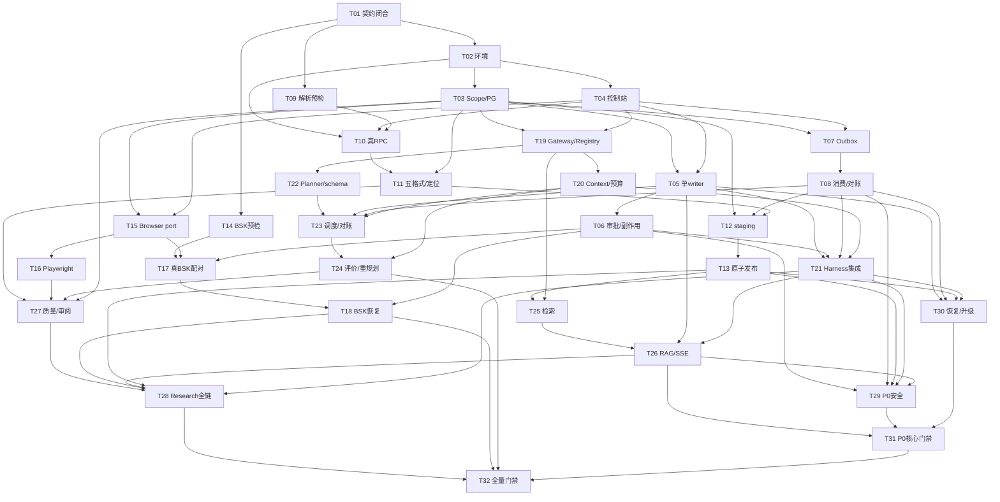

# Phase 0 依赖 DAG、执行顺序与并行约束

日期：2026-10-27。任务为 [Backlog](03_Phase0_Task_Backlog.md) 的规划任务；不是产品运行态Task DAG。本轮未启动任何任务/PoC。表内为全部**硬前置**，状态均NOT_STARTED；同一行多个前置为AND关系，不能择一通过。

## 1. 权威依赖表

| Task ID | 依赖任务 | 复杂度点 | 主要产物/唯一状态责任域 |
| --- | --- | --- | --- |
| P0-T01 | 无 | 2 | 契约闭合提议/架构负责人，无业务写 |
| P0-T02 | P0-T01 | 2 | 隔离环境/环境清单 |
| P0-T03 | P0-T02 | 2 | Scope/会员/execution binding |
| P0-T04 | P0-T02 | 2 | 下游计数/控制站，仅fixture状态 |
| P0-T05 | P0-T03, P0-T04 | 3 | 原生checkpoint；Run owner经RunService |
| P0-T06 | P0-T05 | 3 | ApprovalManager/ToolExecutor各域 |
| P0-T07 | P0-T03, P0-T04 | 2 | OutboxService/创建Job经JobService |
| P0-T08 | P0-T07 | 3 | JobService/OutboxService各域 |
| P0-T09 | P0-T01 | 1 | DocReader静态契约，无业务写 |
| P0-T10 | P0-T02, P0-T04, P0-T09 | 2 | ParserAdapter结果 |
| P0-T11 | P0-T10, P0-T03 | 3 | Parser结果/AssetService绑定 |
| P0-T12 | P0-T03, P0-T08, P0-T11 | 2 | Ingestion/IndexPublication/Job各域 |
| P0-T13 | P0-T12 | 3 | IndexPublication活动指针 |
| P0-T14 | P0-T01 | 1 | BSK真协议静态资料，无业务写 |
| P0-T15 | P0-T03, P0-T04 | 1 | BrowserSession公共port |
| P0-T16 | P0-T15 | 3 | BrowserSession/网络策略 |
| P0-T17 | P0-T14, P0-T15, P0-T06 | 3 | device/BrowserSession |
| P0-T18 | P0-T17, P0-T06 | 3 | BrowserSession/ToolCall各域 |
| P0-T19 | P0-T03, P0-T04 | 2 | ModelGateway结果/Registry定义 |
| P0-T20 | P0-T19 | 2 | BudgetManager/ContextManager |
| P0-T21 | P0-T05, P0-T06, P0-T08, P0-T20 | 2 | 原生Graph，各事实owner不变 |
| P0-T22 | P0-T19 | 1 | Planner草案/Orchestration登记 |
| P0-T23 | P0-T22, P0-T05, P0-T08, P0-T20 | 2 | Orchestration Task/Job各域 |
| P0-T24 | P0-T23, P0-T20 | 2 | Orchestration revision/预算各域 |
| P0-T25 | P0-T13, P0-T19 | 2 | Retrieval只读 |
| P0-T26 | P0-T25, P0-T05, P0-T21 | 2 | Run/Message/EventStore共享UoW |
| P0-T27 | P0-T11, P0-T16, P0-T24, P0-T03 | 2 | Source/Review各域 |
| P0-T28 | P0-T27, P0-T18, P0-T26, P0-T13, P0-T21 | 2 | Research控制流/各业务owner |
| P0-T29 | P0-T06, P0-T08, P0-T13, P0-T21, P0-T26 | 2 | 安全断言，无直接业务写 |
| P0-T30 | P0-T05, P0-T08, P0-T13, P0-T21 | 2 | 受控运维恢复，仍走原服务 |
| P0-T31 | P0-T26, P0-T29, P0-T30 | 1 | P0核心门禁文档 |
| P0-T32 | P0-T28, P0-T18, P0-T24, P0-T31 | 1 | 全量门禁文档 |

## 2. 全部任务依赖图

图中保留表中全部直接边（含显式但拓扑上冗余的依赖），方便逐项核对；节点标签简写 Txx，但含义是完整 P0-Txx。

## 3. 建议拓扑执行波次

同波次只有依赖上可并行，不等于允许同时改同一锁文件/迁移；资源冲突规则见§5。受硬门禁FAIL影响，ready还必须有前置PASS或被明确接受的限域结果，不能仅按代码存在判断完成。

| 波次 | 可ready任务 |
| --- | --- |
| W0 | P0-T01 |
| W1 | P0-T02, P0-T09, P0-T14 |
| W2 | P0-T03, P0-T04 |
| W3 | P0-T05, P0-T07, P0-T10, P0-T15, P0-T19 |
| W4 | P0-T06, P0-T08, P0-T11, P0-T16, P0-T20, P0-T22 |
| W5 | P0-T12, P0-T17, P0-T21, P0-T23 |
| W6 | P0-T13, P0-T18, P0-T24 |
| W7 | P0-T25, P0-T27, P0-T30 |
| W8 | P0-T26 |
| W9 | P0-T28, P0-T29 |
| W10 | P0-T31 |
| W11 | P0-T32 |

资源只有一个会话时，可以按每波次列举顺序逐项执行；只有P0先行时，把T14–T18/T22–T24/T27–T28延后，不改其依赖、不将P1功能加进P0。PoC执行顺序概括：预检/环境→PoC-01、02、04、06的窄子任务并行→PoC-03→PoC-09→P0安全/恢复/核心评审；PoC-05/07高风险支线就绪后→PoC-08→全量评审。PoC-06集成需PoC-01/02基础，不能把其三个任务都当无依赖启动。

## 4. 关键路径与复杂度

点数只表达集成压力，**不是天数/工时**；外部素材/许可/设备等待不计入点数，可主导实际日历周期。按依赖表/Backlog点数计算后应复核总点和最长链，避免凭想象报工期。

- P0有并列关键链：解析线T01→T02→T04→T10→T11→T12→T13→T25→T26→T29→T31；可靠作业线T01→T02→T03（或同长度的T04）→T07→T08→T12→T13→T25→T26→T29→T31。它们都为23点，在T12收敛；T11也必须等待T03。不能因只优化解析而忽略Outbox/Job对账的并列阻塞。
- 全量候选关键链在上述链后加T32；BrowserSkill设备/协议若被阻塞，会成为日历关键路径（T14/T17/T18→T28→T32），不能只看点数。
- 可并行分工建议：核心恢复线T05/T06；可靠作业线T07/T08；解析线T09/T10/T11；浏览器线T14/T15/T16/T17/T18；模型/预算/DAG线T19/T20/T22/T23/T24。它们在Scope和控制站完成后分叉，集成时按图收敛。
- 静态计算：32项、72条直接边、总计66点；P0核心最长链23点，全量最长链24点（上述链加T32）；同长度可有并列分支。拓扑无环、图边/表/Backlog一致。以上不是工时或运行性能证据。

## 5. 并行合入与失败处理

共用 `contracts.py`、实验锁文件、Compose、DB迁移由当前集成任务持有写入权；其他任务先提交局部建议/新编号迁移，不在同一工作目录竞争覆盖。建议分支隔离由具体后续会话按授权决定，本轮不创建分支/worktree/子agent。数据表事实各owner不变，实验数据库按场景空间/实例清理，清理不得触及生产。

前置只有PARTIAL时，后续只能做不依赖失败假设的限域实验并标明，不能标该硬依赖满足。例如T05仅单活成立可继续只在单活条件测T06，但多实例恢复门禁仍未过；T17无设备则T18/T28整体不能PASS，T16/T26可独立继续。替代路径需评审/修订本表及Backlog，不能删除失败依赖让图“通过”。
