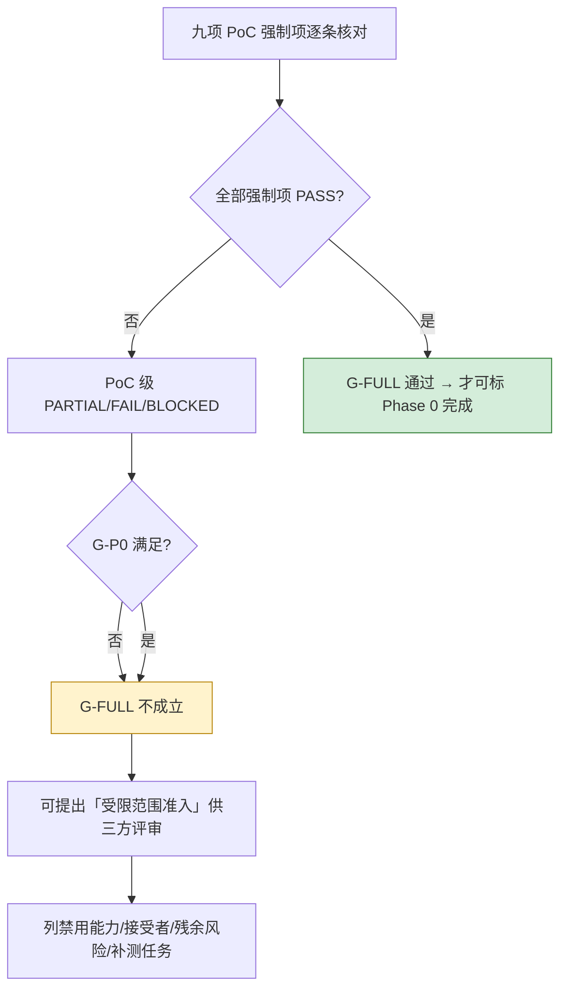

# Phase 0 全量 / P1 前置证据评审（P0-T32）

```yaml
task: P0-T32
branch: feature/w11-t32
base: dev @ 65a2f89
verdict_scope: 九项 PoC 强制项 × 05_Phase0_Acceptance.md
conclusion: G-FULL 不成立（九项 PoC 全部 PARTIAL，0 项无保留 PASS）
adr_actions: 仅建议，不含决策
```

- **任务卡**：`docs/poc/03_Phase0_Task_Backlog.md:541-556`（目标：核九项 PoC 全量退出，尤其真实双浏览器与研究闭环，不提前交付 P1 产品）。
- **依赖**：T28（W9）、T18（`fix/w5-t18`）、T24（W6）、T31（W10）——均已 `PASS（限域）`。
- **口径声明**：判定只依据 `docs/poc/05_Phase0_Acceptance.md` 的**强制 PASS 项清单**与实物证据；「任务级 PASS（限域）」不计入 PoC 强制项通过。判据原文见 `05:21-31`，G-FULL 定义见 `05:78-82`。
- **不做的事**：不重启 PoC、不改 ADR/TDD/PRD、不删测试、不把「限域成立」折算成「门通过」。

## 1. 输入清单

| 类别 | 文件 | 规模/校验 | 用途 |
| --- | --- | --- | --- |
| 判据 | `docs/poc/05_Phase0_Acceptance.md` | 88 行 | 九项强制项、五态、G-P0/G-FULL |
| 上游结论 | `docs/poc/evidence/P0_Core_Gate_Review.md` | 424 行 | 六 PoC 与五门初判、ADR/TDD/机制建议、19 项未执行 |
| 任务卡 | `docs/poc/03_Phase0_Task_Backlog.md` | 560 行（T32 在 `:541-556`） | T32 目标/步骤/量化验收/DoD |
| 波次 | `wave-w1-record.md` … `wave-w10-record.md`（10 份）+ `wave-w7r-record.md` | 见各自 `§2 声明` | 任务级判定与门禁输出原件 |
| PoC 专项 | `poc01-owner.md`、`poc01-scope.md`、`poc02-replanning.md`、`poc03-publication.md`、`poc05-browserskill-live.md`、`poc05-recovery.md`、`poc08-report.md`、`poc09-report.md` | 137–315 行/份 | PoC-01/02/03/05/08/09 直接证据 |
| 解析链 | `docreader_manifest.md`、`docreader_manifest_amendment-01.md`、`docreader_sbom.md`、`docreader_fixture_plan.md`、`docreader_image_inventory.json` | `:9` 载明 inventory sha256 `3c0d993a…bb01` | PoC-04 镜像/许可/样本 |
| 安全 | `security-matrix.md`（94,503 B）、`security-probes.json`（175,117 B，sha256 `84c09916…16f6`） | 549 条探针 | P1 安全矩阵 |
| 契约 | `docs/poc/07_Contract_Closure.md` | — | C-01–C-10 状态 |
| 环境 | `environment.md`、`fix-w1-t02-pgvector-record.md`、`pgvector-probe.md` | — | 环境/镜像/向量可用性 |

**已知输入缺口（沿用 T31 §1，不改写）**：无 `poc04-report.md`/`poc06-report.md`/`poc07-report.md` 独立报告；`sbom.md` 全仓 SBOM 不存在（仅 DocReader 镜像有 SBOM）；`docs/remote-extension-connection.md`、`tests/phase0/pyproject.toml` 为已登记缺口。本评审以「任务证据 + 波次记录 §3」替代，并在每项标注替代位置。

## 2. 方法

1. **九项逐一**：按 `05:21-31` 每行「强制PASS项（量化）」逐条问「有没有对应实物证据」；缺任一条即不判无保留 PASS（`05:15`、`05:76`）。
2. **五态唯一**：每项 PoC 给且只给一个结果；PARTIAL 必须写清「哪些强制项成立、哪些未成立」。
3. **两级口径隔离**：明确区分「任务级判定」（T01–T32 各自 `PASS（限域）`）与「PoC 强制项判定」；前者不推出后者。
4. **可复算性**：引用文件全部给出路径 + 行号或 sha256；hash 只作「记录时点」凭据（T31 §2.3 已证 119 处漂移），不作门禁判据。
5. **注入自检**：对「把 mock/NOT_RUN 结果声明为 real」构造声明集并跑校验器（§8），确认门禁能拦住。

## 3. 九项 PoC 全量退出判定

> 列含义：**判定**＝本评审给出的唯一五态；**成立部分**＝有实物证据且可复算；**缺项**＝`05` 强制项中未成立者（缺一项即不得无保留 PASS）。

| PoC | 判定 | 成立部分（证据） | 缺项（强制项未成立） | 与 T31 的关系 |
| --- | --- | --- | --- | --- |
| **PoC-01** 原生 checkpoint/恢复 | **PARTIAL**（单活降级） | 单写者/fencing/50 轮失锁/崩溃接管通过（`wave-w7r-record.md:61`，`12 passed / exit 0`；纯追加 +383/−0）；审批绑定+调用账本+未知写核查通过（`wave-w4-record.md:154`，`20 passed`，`replayed=49`、`50` 条 `unknown_outcome`） | **独立锁/saver 连接断开后仍单 writer（多实例安全）不成立**：原生 `PostgresSaver` 在锁连接被杀后 `put` 仍成功 → 只能单活（`wave-w3-record.md:89`、`wave-w3-record.md:173`）；多实例横向能力未测 | T31 §2.2 记 PoC-01 为 PARTIAL（单活），本评审**维持**并明确缺项即 `05:23` 第 4 条 |
| **PoC-02** 可靠后台作业 | **PARTIAL** | Outbox 事务原子性/SKIP LOCKED/epoch CAS/五态死信实测（`wave-w4-record.md:155`：`100 Job×10 消息 → applied=100 / duplicate=900`、`STALE_EXECUTION_EPOCH`、退避 1/2/4s→`dead_letter`、对账 `repair_count=1` 且并发不双修）；断 Redis 显式失败且 PEL 可恢复（`wave-w3-record.md:174`） | **真实 Celery worker 未跑**（T31 §5 第 6 项 `NOT_RUN`）；`05:24` 的「恢复后 60 秒测试 deadline 内全到明确终态」未按原样实测（用退避 1/2/4s 与 30 轮近似，`wave-w5-record.md:142`）；双 broker/CDC 未测 | T31 记 PASS（限域），本评审按强制项口径**下调为 PARTIAL** |
| **PoC-03** 版本化发布 | **PARTIAL** | staging 不可见、attempt/generation fencing、单事务三件事切换、10 000 次并发读零混版本零跨空间、8 类故障注入后可见版本不变（`wave-w6-record.md:111`、`wave-w5-record.md:140`）；发布证据 `poc03-publication.md`(208 行) | **真实对象存储（MinIO/S3）`NOT_RUN`**（T12 用 `InMemoryObjectStore.backend`，明标 fake，`wave-w5-record.md:140`）；删除/取消/重建（B5）、对象丢失（B6）`NOT_RUN`；`05:25`「对象失败不发布」只有假对象存储下的注入 | T31 记 PASS（限域），本评审**下调为 PARTIAL**（对象存储属强制项） |
| **PoC-04** 解析链 | **PARTIAL** | proto/镜像/许可预检（`wave-w7r-record.md:62`：`wechatopenai/weknora-docreader@sha256:9af668ac…5266`、revision `3e22822c1`=`v0.8.3`）；真 wire 4 RPC + 错误码/上限/取消/超时（`wave-w3-record.md:175`，17 passed）；五格式 golden 50/50 与 offset-free 定位 50/50（`wave-w4-record.md:156`，70 passed） | **真实 DocReader 服务镜像端到端 `NOT_RUN`**（T31 §5 第 8 项）；**真实文档样本 `NOT_RUN`**，50/50 golden 全为合成样本（`is_real_sample=false`，`wave-w4-record.md:156`）；`05:26`「真协议/伪定位/缺图静默发布」无真实服务侧证明 | T31 记 PASS（限域），本评审**下调为 PARTIAL**（真实服务与真实样本为强制项） |
| **PoC-05** 浏览器双后端 | **PARTIAL** | 真 daemon + 真 Chrome 扩展 + 真实动作链路（`poc05-browserskill-live.md`：`bsk 0.3.1`、Chrome `147.0.7727.117`、`session→tab→snapshot→evaluate→screenshot→console→close` 全走通，明示「未使用任何 mock」）；owner 唯一性/撤销/迟到结果丢弃（`poc05-recovery.md`，`fix/w5-t18` → `PASS（限域）`，`P0_Core_Gate_Review.md:223`）；SSRF 26 向量 + 每跳重定向/DNS rebinding/体量/时长（`wave-w4-record.md:157`，109 passed） | **Playwright 通道真实 read `NOT_RUN`**（未安装 Playwright，`wave-w4-record.md:89/:157`）→ `05:27` 要求「真扩展/daemon **及 Playwright 各有真实 read**」未满足；31 动作仅映射 13（`wave-w5-record.md:182`）；交互类动作仅单测；扩展 ZIP/daemon 产物 hash 与许可强制项未闭合（`browserskill_protocol_manifest.md:462`） | T31 §2.2 未覆盖 PoC-05；本评审新增并判 PARTIAL（**双后端只有单后端真实**） |
| **PoC-06** Harness/Gateway | **PARTIAL** | 单 Provider Gateway + 窄工具 Registry + intent key（`wave-w3-record.md:177`，98 passed）；Context 四区段裁剪确定性 + 100 轮预算竞争 `winners=100/rejected=100/overdraft=0`（`wave-w4-record.md:158`，27 passed）；Harness 节点原生主路径（langgraph 1.2.18 `StateGraph`+`interrupt()`+PG saver）已补（`wave-w5-record.md:141`，14 passed） | **单真实 provider 协议/usage `NOT_RUN`**（T31 §5 第 16/17 项：真实模型 plan、真实价格快照）；**`stream()` 未实现**（`wave-w3-record.md:144`）；`05:28` 的「secret/PII canary 0」只在替身路径验证 | T31 记 PASS（限域），本评审**下调为 PARTIAL**（真实 provider 为 `05:28` 第一条） |
| **PoC-07** DAG/Planner/重规划 | **PARTIAL** | 32 节点/72 边/66 点、最长链 12 节点、28 个非法计划全拒、RAG 路径 planner 调用 0（`wave-w4-record.md:159`，51 passed）；ready 判定/依赖传播/双调度 CAS（`wave-w5-record.md:142`）；22 例评估与有限重规划、第 3 次 `limit_exceeded`（`wave-w6-record.md:112`） | **一次真实结构化 plan `NOT_RUN`**（`05:29` 第一条）；checkpoint 用端口替身，真实 saver 故障未注入（`wave-w5-record.md:142`）；调度 30 轮非 100 轮；`retry_wait`/`dead_letter` 未在 T23 覆盖 | T31 §2.2 未覆盖 PoC-07；本评审新增并判 PARTIAL（真实模型 plan 属强制项） |
| **PoC-08** Research/入库/审阅闭环 | **PARTIAL** | 研究全链 20 passed（`wave-w9-record.md:38`），三通道（检索/BSK/模型）编排与 DAG 一致；来源质量/去重/审阅追加历史 66 passed、撤销后不可入库（`wave-w7-record.md:68`）；异步入库与原子发布（T07/T08/T12/T13） | **真实 chat 模型生成段 `NOT_RUN`**（无厂商 key，`wave-w9-record.md:15` 明标 `NOT_RUN` 而非 BLOCKED）；`05:30`「30 任务控制站全链」在替身模型下只成立代表正例；`100% provenance` 仅覆盖合成候选 | T31 §2.2 未覆盖 PoC-08；本评审新增并判 PARTIAL（研究闭环的「真实模型」环节缺失） |
| **PoC-09** 检索/RAG/引用 | **PARTIAL** | 授权检索 + 三路对照 100 QA、跨空间命中 0（`wave-w7-record.md:67`，12 passed）；引用 `citation_accuracy=1.0`（40/40）、伪引用/越权/错误引用全 0、50 次 finalize 仅 1 terminal（`wave-w8-record.md:80`，21/21） | **ANN/召回 `NOT_RUN`**（`wave-w7-record.md:67`，向量列为 `float8[]`；pgvector 虽已可用但未补跑）；真实 chat/embedding `NOT_RUN`；**质量阈值未校准**（`05:74`：`Recall@5 0.85`/引用 `0.95` 未校准即不 PASS） | T31 记 PARTIAL，本评审**维持**；G5 仍是唯一硬缺口 |

### 3.1 汇总

| 判定 | 数量 | PoC |
| --- | --- | --- |
| PASS（无保留） | **0** | — |
| PASS（限域） | 0 | —（限域只属任务级，PoC 级一律不计） |
| PARTIAL | **9** | 01、02、03、04、05、06、07、08、09 |
| FAIL | 0 | — |
| BLOCKED | 0 | —（原 T17/T18 的 BLOCKED 已由 `fix/w5-t17`、`fix/w5-t18` 解除） |
| NOT_STARTED | 0 | —（十波次已覆盖 T01–T31 全部 P0 任务） |

**九项唯一结果成立**（`05:21-31` 每项一个态，理由与证据齐全，满足 T32 量化验收第 1 条）；**但无一项达到「所有强制项 PASS」**，故 G-FULL 不成立（§4）。

### 3.2 与 T31 结论的差异（必须显式说明，不能静默改判）

| 项 | T31（六 PoC、任务级口径） | T32（九 PoC、强制项口径） | 差异原因 |
| --- | --- | --- | --- |
| PoC-01 | PARTIAL | PARTIAL | 一致 |
| PoC-02 | PASS（限域） | **PARTIAL** | T31 按任务判定（T07/T08 全绿）；T32 按 `05:24` 强制项（真实 Celery worker、60s deadline）判 |
| PoC-03 | PASS（限域） | **PARTIAL** | 同上：真实对象存储为 `05:25` 强制项 |
| PoC-04 | PASS（限域） | **PARTIAL** | 同上：真实服务端到端 + 真实样本为 `05:26` 强制项 |
| PoC-05 | 未覆盖 | **PARTIAL** | 新增；`05:27` 要求双后端各有真实 read，Playwright 未安装 |
| PoC-06 | PASS（限域） | **PARTIAL** | 同上：真实 provider/`stream()` 为 `05:28` 强制项 |
| PoC-07 | 未覆盖 | **PARTIAL** | 新增；`05:29` 首条即「一次真实结构化 plan」 |
| PoC-08 | 未覆盖 | **PARTIAL** | 新增；真实 chat 模型生成段 `NOT_RUN` |
| PoC-09 | PARTIAL | PARTIAL | 一致 |

**这不是翻案，而是口径分层**：T31 回答「核心出口能否准入」（任务级证据是否成立），T32 回答「九项 PoC 全量退出」（强制项是否逐条成立）。两份结论同时成立于各自口径；对外只能引用后者做 Phase 0 退出结论。

## 4. G-FULL 判定

`05:78-82` 要求：G-P0 满足；九项 PoC 所有强制项均 PASS；PoC-05 真扩展/daemon+Playwright 真实证据与安全能力矩阵齐全；PoC-07/08 含 DAG/replan/质量/审阅/异步入库/RAG 回源；全部高风险已验证或经正式范围变更排除。

| G-FULL 条件 | 现状 | 是否满足 |
| --- | --- | --- |
| G-P0 满足 | 5 门 0 门 PASS（4 PARTIAL + 1 NOT_RUN），`P0_Core_Gate_Review.md:405` | ❌ |
| 九项 PoC 强制项全 PASS | 9 项 PARTIAL（§3） | ❌ |
| PoC-05 双后端真实证据 + 安全能力矩阵齐全 | 真 daemon/扩展 ✅；Playwright 真实 read ❌；能力矩阵有 26 SSRF 向量但私网 IPv6/WebSocket/DNS rebinding 覆盖不全 | ❌ |
| PoC-07/08 含 DAG/replan/质量/审阅/异步入库/RAG 回源 | DAG/replan/审阅/异步入库 ✅（限域）；真实模型 plan ❌；RAG 回源 100 例 ✅ | ⚠️ 部分 |
| 全部高风险已验证或经正式范围变更排除 | 高风险 17 类中：单写者/越权/重复写/半成品发布已验证；多实例、许可、身份域、质量阈值未验证且**未走正式范围变更** | ❌ |

**结论：G-FULL 不成立，Phase 0 不得标记为完整 PASS。**



## 5. P1 安全矩阵与数据许可

### 5.1 安全（`security-matrix.md`、`security-probes.json`）

| 指标 | 值 | 来源 |
| --- | --- | --- |
| 探针执行 | **549** 条 | `security-matrix.md:5`、`:20` |
| 拒绝 | 536 | 同上 |
| 放行 | 13（全部为显式允许项） | 同上 |
| 越权/漏放 | **0** | `security-matrix.md:20` 合计行 |
| 预算下限 | cross_workspace 100 / revocation 12 / payload 20 / ssrf 24 / canary 12 / business_state 12 / citations 100 | `security-matrix.md:22` |
| 证据文件 | `security-probes.json` 175,117 B，sha256 `84c0991644ef720b761a34f7640ca1ca39d042454e1add2ec86eadbb5cca16f6` | 本评审实测 |

**P1 前仍需补的安全能力（`P0_Core_Gate_Review.md:328`）**：私网 IPv6、WebSocket 通道、DNS rebinding 的 BSK 侧不可控场景、提示注入页面、HTTPS pin+SNI。安全侧「0 breach」是**测试集零违反**，不是数学证明（`05:86`）。

### 5.2 数据与许可

| 资产 | 状态 | 依据 |
| --- | --- | --- |
| DocReader 镜像 | digest 固定 `wechatopenai/weknora-docreader:v0.8.3`，`sha256:ee308c6d…b19fa`；18 层 / 1,576,643,756 B | `docreader_sbom.md:23`、`:26` |
| 镜像汇总许可 | **`NOASSERTION`**（镜像未声明汇总许可） | `docreader_sbom.md:31` |
| apt 组件 | 971 个：744 有 `License:` 字段、**227 unknown** | `docreader_sbom.md:50` |
| pip 组件 | 72 个：61 可判定许可、**11 unknown** | `docreader_sbom.md:52` |
| OCR 权重 | **不存在**（4 个 onnx 权重全为非 OCR），该项 UNKNOWN 已闭合为「不存在」 | `wave-w7r-record.md:62` |
| 全仓 SBOM | **不存在**（仅 DocReader 镜像有） | T31 §1、`P0_Core_Gate_Review.md:333` |
| 解析样本数据权利 | 50/50 golden 全为合成样本（`is_real_sample=false`） | `wave-w4-record.md:156` |
| Redis | 7.4 = RSALv2/SSPLv1（许可未定） | `P0_Core_Gate_Review.md:297` |
| psycopg | LGPL-3.0（合规使用未定） | `P0_Core_Gate_Review.md:298` |

**结论**：许可侧「可分级但有 238 项 unknown（227 apt + 11 pip）」，`05:73`「未知许可不进入发布候选」→ 当前不得给出任何发布候选许可结论。数据侧无真实样本、无数据权利记录 → 真实文档解析能力**不可对外声称**。

## 6. ADR / TDD 重审与降级清单（仅建议，不含决策）

### 6.1 ADR 建议（状态一律 `Proposed`，本评审不改任何 ADR 文件）

| 编号 | 主题 | 触发事实 | 建议决策要点 | 优先级 |
| --- | --- | --- | --- | --- |
| ADR-NEW-1 | 缓存/队列组件许可 | Redis 7.4 RSALv2/SSPLv1 | 接受 SSPL 边界 / 改 Valkey / 仅内部不发布；须给部署形态结论 | P0 |
| ADR-NEW-2 | psycopg LGPL-3.0 合规使用 | `psycopg[binary]` | 动态链接 + 不修改 + 可替换声明 + NOTICE | P0 |
| ADR-NEW-3 | 部署范围：单活 runner | T05/T05R 原生 saver 无法 fencing | P0/P1 明确单活；多实例另立 ADR；写入残余风险模板 | P0 |
| ADR-NEW-4 | pgvector 进 core profile | `pgvector-probe.md` 证可用；换镜像作废 T02 digest 证据 | 立项授权 + 备份演练 + 重采 T02 证据 | P0（补 G5 前） |
| ADR-NEW-5 | 身份域与来源审阅范围（C-07） | C-07 `BLOCKED` | 产品/安全给出域模型边界，工程侧不得自创 | P0 |
| ADR-NEW-6 | 真实后端接入范围（MinIO/Celery/provider） | PoC-02/03/06/09 的真实后端均 `NOT_RUN` | 明确 P0 是否豁免真实后端；若豁免须写明「受限准入」而非 G-FULL | **P0（新增）** |
| ADR-NEW-7 | 双浏览器通道的产品定位 | PoC-05 只有 BSK 真后端，Playwright 未装 | 决定 Playwright 是「P0 必需」还是「P1 可选」；不得用单后端冒充双后端 PASS | **P0（新增）** |
| ADR-NEW-8 | 质量阈值批准流程 | `05:74` 阈值未校准即不 PASS | 谁批准 Recall@5 0.85 / 引用 0.95 / ANN 采样规模；改阈值须留旧结果 | P0（补 G5） |

### 6.2 TDD 修订建议（沿用 T31 §6.2，补充两条）

| 文件 | 修订点 | 依据 |
| --- | --- | --- |
| `docs/tdd/01_*.md` §6.4 | 补「原生 saver 不可 fencing」实测结论与单活前提 | T05/T05R |
| `docs/tdd/02_*.md` | `stream()` 未实现，port 需在 T21 前定形 | T19 `NOT_RUN` |
| C-03/C-05/C-10 | 由 `NEEDS_POC` 更新为「已验证/待验点」 | `docs/poc/07_Contract_Closure.md` |
| T21 集成 | 原生 `StateGraph`+`interrupt()`+PG saver 主路径同步进 TDD | `wave-w5-record.md:141` |
| **新增** 检索 TDD | ANN 缺位期间「三路检索对照」只覆盖 2 路，需写明降级定义与恢复条件 | PoC-09 |
| **新增** 解析 TDD | 合成样本 golden（50/50）与真实样本质量的区分口径 | PoC-04 |

### 6.3 降级清单（若产品/安全决定按「受限准入」推进，必须同时生效）

| 降级编号 | 降级内容 | 生效条件 | 复原点 |
| --- | --- | --- | --- |
| DG-1 | 单活 runner、无多实例高可用 | ADR-NEW-3 立项 | 多实例 fencing 方案通过 |
| DG-2 | 无真实对象存储，仅本地/InMemory | ADR-NEW-6 | MinIO/S3 接入并重跑 T12/T13 |
| DG-3 | 无真实模型，语义质量不对外声称 | ADR-NEW-8 | provider 额度到位 + 阈值批准 |
| DG-4 | 无 ANN，检索只可称「关键词/结构化对照」 | ADR-NEW-4 | pgvector 进 core + 补跑 T25 |
| DG-5 | 浏览器仅 BSK 单后端，禁真实登录/外部写 | ADR-NEW-7 | Playwright 真实 read 补齐或范围变更批准 |
| DG-6 | 解析只对合成样本负责 | 真实样本到位 | 真实样本 + 人工抽检 |
| DG-7 | 身份域 C-07 未定，来源审阅 API 不冻结 | ADR-NEW-5 | 域模型评审通过 |

## 7. 受限范围准入建议（供三方评审，本评审不代替决策）

依据 `05:81-82`：可提出「受限范围准入」，但必须列出**禁用能力、接受者、残余风险、补测任务**，且这不是 G-FULL 通过。

### 7.1 可准入门槛（全部满足才可提）

1. 单活部署、单租户、无外网出口（禁真实浏览器外部写、禁真实 provider）。
2. 只处理合成/授权数据；真实文档与真实网页不进入候选。
3. 安全矩阵 549/536/0 的三项硬指标不退化，且每次变更重跑。
4. 所有结论性输出（引用、来源、评估）都带「限域」标注，禁止裸 `PASS`（T31 §8.3 linter 纳入门禁）。

### 7.2 明确禁用能力

| 禁用项 | 原因 | 关联缺口 |
| --- | --- | --- |
| 真实浏览器登录/座席/外部写操作 | 只有 BSK 单后端真实链路，Playwright 未验；owner/撤销仅限域 | PoC-05、ADR-NEW-7 |
| 真实模型语义质量结论（摘要/研究/评估） | 无 provider 额度，全部 `NOT_RUN` | PoC-06/08、ADR-NEW-8 |
| ANN/向量召回与「三路检索」结论 | 向量列 `float8[]`，ANN `NOT_RUN` | PoC-09、DG-4 |
| 多实例高可用/RPO-RTO 承诺 | saver 不可 fencing；RPO/RTO `NOT_RUN` | PoC-01、DG-1 |
| 对象存储一致性、删除传播结论 | MinIO 未接，删除/取消 `NOT_RUN` | PoC-03、DG-2 |
| 真实文档解析成功率/精确定位对外承诺 | 全合成样本 | PoC-04、DG-6 |
| 任何「Phase 0 已完成 / 可生产」表述 | G-FULL 不成立 | §4 |

### 7.3 接受者（建议）

- **接受方**：产品负责人（范围）、安全负责人（禁用清单）、架构负责人（ADR-NEW-3/4/6/7）。
- **不接受方替代**：工程侧不得自行宣布准入；不得以测试全绿替代三方签署。
- **记录位置**：签署结论写入 `docs/adr/` 新编号 ADR（状态 `Proposed`→`Accepted` 需三方评审），本文件只作输入。

### 7.4 残余风险（准入后仍然存在）

| 风险 | 等级 | 现状 |
| --- | --- | --- |
| 单活 runner 故障即不可用 | 高 | 无多实例方案（DG-1） |
| 真实后端替换时的行为差异 | 高 | 全部真实后端 `NOT_RUN`（DG-2/DG-3） |
| 证据 hash 漂移致复核成本 | 中 | 119 处漂移（T31 §2.3）；M2 机制未落地 |
| 许可 unknown 238 项 | 高 | 227 apt + 11 pip（§5.2） |
| 安全测试集≠证明 | 中 | 0 breach 仅对 549 条探针成立（`05:86`） |
| 私人/敏感数据进证据 | 中 | 证据 JSON 含 DSN 的脱敏审计未做（T31 §7 第 8 项） |

### 7.5 补测任务（按依赖顺序，供排期）

1. **G5 补齐**：pgvector 进 core profile（ADR-NEW-4）→ 备份演练 → 重采 T02 证据 → 补跑 T25 ANN/召回 → 阈值校准（ADR-NEW-8）。
2. **真实后端批**：MinIO/S3（T12/T13 重跑）→ Celery worker（T08）→ DocReader 真实服务（T10/T11 真实样本）。
3. **双后端批**：Playwright 安装 + 真实 read（T16/T17/T18 补测）或走 ADR-NEW-7 范围变更。
4. **真实模型批**：provider 接入（T19 `stream()`、T22 真实 plan、T20 真实价格、T26/T28 生成段）。
5. **许可批**：238 项 unknown 收敛 + 全仓 SBOM + Redis/psycopg 许可 ADR 落地。
6. **机制批**：M1（状态列唯一维护人）、M2（证据 `computed_at`）、M3（口径 linter 进门禁）。

## 8. 注入测试：把 mock/NOT_RUN 结果声明为 real 必须被拒

T32 强制注入项（`03_Phase0_Task_Backlog.md:551`）。做法：构造「证据声明集」，每条声明绑定被引用证据文件 + sha256 + 断言标记 + 判定，用校验器逐条核对；其中 2 条伪造（把 `NOT_RUN`/mock 的结果声明为无保留 real PASS）。

### 8.1 校验器规则

| 规则 | 语义 | 违反后果 |
| --- | --- | --- |
| R1 存在性 | 被引用证据必须存在 | `MISSING_ARTIFACT` |
| R2 完整性 | 证据 sha256 必须与声明一致 | `HASH_MISMATCH` |
| R3 限域一致性 | 证据正文含 `NOT_RUN` 时，判定不得为裸 `PASS` | `UNSCOPED_PASS_WITH_NOT_RUN` |
| R4 声明-证据 | 声明中的每条断言标记必须真的出现在证据正文 | `MARKER_NOT_FOUND` |
| R5 mock 冒充 | 证据含 mock/fake 标记时，未标限域不得称 real | `MOCK_CLAIMED_AS_REAL` |
| R6 五态合法 | 判定必须落在五态枚举 | `ILLEGAL_STATE` |

### 8.2 实测（`experiments/phase0/.venv/Scripts/python.exe`，CPython 3.12.13）

| 用例 | 声明 | 预期 | 实测 | exit |
| --- | --- | --- | --- | --- |
| C0（对照） | PoC-05 真 daemon/扩展/真实动作链路，`PASS（限域）`，证据 `poc05-browserskill-live.md` sha256 `dbdc12fd…b276`，标记 `未使用任何 mock`/`bsk.exe`/`Chrome` | ACCEPT | `ACCEPT` | — |
| C1（**注入**） | PoC-05「Playwright 通道已完成真实浏览器 read」，`PASS`（裸），证据 `wave-w4-record.md` sha256 `9c736bf2…6d5a` | REJECT | `REJECT`：`R3 UNSCOPED_PASS_WITH_NOT_RUN`、`R4 MARKER_NOT_FOUND 真浏览器 read 已完成` | — |
| C2（**注入**） | PoC-06「真实厂商 API 与 stream() 已实现并通过」，`PASS`（裸），证据 `wave-w3-record.md` sha256 `3125980b…74e6` | REJECT | `REJECT`：`R3`、`R4 MARKER_NOT_FOUND 真实厂商 API 已完成` | — |
| C3（对照） | 同一断言改为 `PASS（限域）` 并明说 `NOT_RUN` | ACCEPT | `ACCEPT` | — |

汇总：`TOTAL claims=4 rejected=2 expect_mismatch=0`（exit 1 = 存在被拒声明，即门禁生效；全合法集 exit 0）。

**结论**：把 mock/NOT_RUN 结果改写成 real 无保留声明**会被 R3/R4 拦住**；同一断言如实标注限域则放行。这同时证明 T31 §8.3 的「口径 linter」思路可推广为声明级校验，建议作为 M3 的落地形态。

### 8.3 复现方法

校验器与声明集为一次性中间物（仓库内 `.t32_tmp/`，收尾已删除，`git status` 干净）。规则见 §8.1，最小复现：

```python
# claim_check.py 核心（完整版见 §8.1 六条规则）
import hashlib, io, json, sys
STATES = {"PASS", "PASS（限域）", "PARTIAL", "FAIL", "BLOCKED", "NOT_STARTED"}
def check(claim):
    problems = []
    raw = open(claim["artifact"], "rb").read()
    text = raw.decode("utf-8", "replace")
    if hashlib.sha256(raw).hexdigest() != claim["sha256"]:
        problems.append("R2 HASH_MISMATCH")
    if claim["verdict"] not in STATES:
        problems.append("R6 ILLEGAL_STATE")
    if "NOT_RUN" in text and claim["verdict"] == "PASS":
        problems.append("R3 UNSCOPED_PASS_WITH_NOT_RUN")
    for m in claim.get("assert_markers", []):
        if m not in text:
            problems.append("R4 MARKER_NOT_FOUND " + m)
    return problems
```

## 9. 剩余风险与下一步

### 9.1 结论

**G-FULL 不成立**：G-P0 未满足（5 门 0 门 PASS），九项 PoC 全部 `PARTIAL`（无一项强制项全通），PoC-05 缺 Playwright 真实证据，PoC-07/08 缺真实模型环节，多实例/许可/身份域/质量阈值四项高风险未验证且未走正式范围变更。**Phase 0 不得标记为完整完成。**

**可提出的下一步形态**：按 §7 走「受限范围准入」三方评审（禁用能力 7 类、接受者三方、残余风险 6 条、补测任务 6 批）；这是 `05:81-82` 允许的路径，但**不是** G-FULL 通过。

### 9.2 下一步任务（唯一推荐顺序）

1. **ADR 立项批（P0，先做）**：ADR-NEW-1/2/5（许可、身份域）与 ADR-NEW-3/4/6/7/8（部署范围、pgvector、真实后端、双后端定位、阈值流程）——8 条建议的立项与评审顺序由用户/架构裁决。
2. **G5 补齐批**：ADR-NEW-4 通过后立即跑 pgvector ANN + 阈值校准（会作废 T02 digest/E1/E2 证据，须同批重采）。
3. **真实后端批**：按 §7.5 第 2/4 项推进；这是把 9 项 PARTIAL 抬到 PASS 的唯一路径。
4. **机制批（可与上并行）**：M1/M2/M3 落进门禁脚本，避免下一轮评审重复人工核对（本轮 4.5 小时的手工核对成本高于脚本成本）。
5. **P1 产品开发**：在受限准入签署后启动；**不得**以「P0 已 PASS」为前提立项。

### 9.3 本评审的自检

| 项 | 结果 |
| --- | --- |
| 九项是否各有唯一态 | 是（9 PARTIAL，`§3.1`） |
| 是否给缺项写了证据位置 | 是（每行「缺项」列含文件:行号） |
| 是否有裸 PASS 混入 | 否（口径 linter 复检，见 `wave-w11-record.md` §3） |
| 是否改动了 ADR/TDD/PRD | 否（仅列建议） |
| 是否宣称 Phase 0 完成 | 否（§4、§9.1 明确不成立） |
