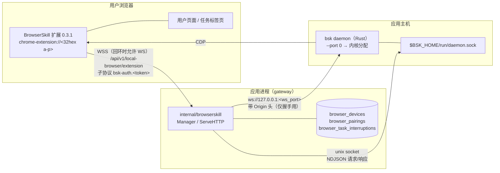
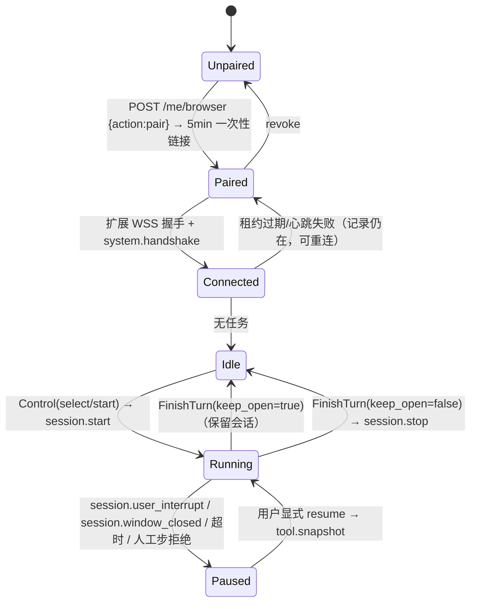

# BrowserSkill 真协议 / 许可静态预检清单（P0-T14）

> 任务：**P0-T14 BrowserSkill 真源码/协议/许可审查（静态）**
> 产物类型：D0 证据（静态预检，未执行 daemon、未启动浏览器）
> 关联：PoC-05；PRD F-11、AC-E02/08/09；TDD [05 §2–5](../tdd/05_Browser_Adapter.md)；契约 C-05（`docs/poc/07_Contract_Closure.md`）

| 项 | 值 |
| --- | --- |
| 检查对象 | `references/WeKnora` @ `662abaf9f944e37689d04c42160034b2cdec6829`（只读 submodule，未修改、未更新基线） |
| 被检查实现 | Tencent/BrowserSkill `ext-v0.3.1` @ `da6bf4eed2dd7256567e152df8c903c87f6598c3`（**本机不存在该 upstream 树**，见 §3） |
| 检查方式 | 纯静态符号/路径/序列核对（glob / grep / read），无进程、无网络、无 docker、无浏览器 |
| 结论口径 | 每条结论标注证据等级：**A** = 直接读到代码；**B** = 由配置/文档推断；**C** = 未确认；**UNKNOWN** = 读不到，附已查路径 |

---

## 1. 结论摘要（TL;DR）

1. **BrowserSkill 在本仓库只有"接入层"，没有可执行实现。** `references/WeKnora/internal/browserskill/` 是 Go 写的 gateway/manager，负责启动本地 daemon、终止扩展 WebSocket、做设备鉴权与任务串行化；真正的 daemon（Rust，包名 `bsk`）与浏览器扩展（TypeScript，`@browser-skill/extension`）**不在仓库内**，只在构建期用 `scripts/build_browserskill.sh` 从 GitHub 克隆指定 commit 现场编译（A：`scripts/build_browserskill.sh:35-55`）。
2. **协议是可读的，但只到"网关视角"。** 网关对 `tool.*` 方法是**不透明透传**（`internal/browserskill/manager.go:947-986`），方法名白名单、信封结构、超时、错误码、鉴权链路都可由代码确定（A）；**31 个动作各自的 upstream JSON Schema（必填/可选/返回体）在仓库内不可得**，只能取 WeKnora 自己的提示词描述（B）。
3. **三组件与授权是分开的**：daemon（进程）↔ gateway（Unix socket JSON-RPC）↔ extension（WSS）↔ 浏览器（Chrome 内部）；授权只在 extension↔gateway 一跳上，凭据是**一次性配对 token 换长期 device token**，DB 里只存 SHA-256（A）。
4. **Windows 不是受支持的构建/部署目标**：`build_browserskill.sh:8-11` 白名单只有 `linux/amd64|linux/arm64|darwin/amd64|darwin/arm64`；`daemon.go:130` 用 `os.MkdirTemp("/tmp", ...)`。P0-T15 若要在 Windows 上跑 BrowserSkill，必须先解决这两点（C/待验）。
5. **版本绑定靠 SHA 而不是协议号**：extension 与 daemon 必须同一 commit（`build_browserskill.sh:28-29` 强校验），运行时只校验 `result.protocol_version` **非空**（`manager.go:596-601`），协议版本号的具体取值 **UNKNOWN**。

---

## 2. 证据方法与边界

- 只读文件、只用 `glob` / `grep` / `read`。未运行 `uv`、`docker`、`pnpm`、`cargo`、浏览器或 daemon。
- 未做：真机配对、真扩展握手、真截图/输入 RPC、真撤销、真 owner 断线。这些属于 **P0-T17**（真配对）与 **PoC-05** 的范围。
- 无法获取的材料已登记在 §10 缺口清单，并明确标注"影响哪些验收项"。
- 引用格式：`文件路径:行号`，路径相对仓库根；上游路径以 `upstream:` 前缀标注（仅来自构建脚本与文档转述，等级 B）。

---

## 3. BrowserSkill 真实位置

### 3.1 仓库内实际存在的文件（A）

```text
references/WeKnora/
├── internal/browserskill/            # Go：gateway + 设备鉴权 + daemon 生命周期 + 租约
│   ├── daemon.go         192 行      # 启动/停止本地 daemon 进程
│   ├── manager.go       1386 行      # WS 终止、握手转发、RPC 客户端、方法白名单、任务表
│   ├── authorization.go  249 行      # 配对/续期 HTTP、token 生成、租约心跳、扩展包下载
│   ├── store.go          289 行      # browser_devices / browser_pairings / browser_task_interruptions
│   ├── cluster.go        258 行      # 多副本转发（HMAC 签名）
│   ├── focus.go          158 行      # ui.task_preview / ui.task_focus 侧信道
│   ├── stop.go            89 行      # session.stop 与 block-first 停止
│   ├── human.go           44 行      # 人工接管超时预算
│   ├── errors.go          32 行      # RPCError 信封与 data 截断
│   ├── result.go          31 行      # 导航未完成判定、URL 脱敏
│   └── *_test.go                     # cluster/errors/human/manager/result/stop/store/extension/shared
├── internal/agent/tools/browserskill*.go   # 9 个文件：模型工具层（schema/prompt/result/image）
├── internal/handler/session/browserskill.go 271 行  # HTTP 入口
├── internal/router/router.go:207-209,310-312        # 路由注册
└── scripts/
    ├── browserskill-release.json   # 版本 + 双端 source_commit 锚点
    ├── build_browserskill.sh       # 从 GitHub 克隆并构建扩展 ZIP + daemon
    ├── browserskill.md             # 上游集成说明（PR 映射、行为、验证命令）
    └── test_browserskill_extension.mjs
```

### 3.2 不存在的部分（关键缺口，A）

- **没有 vendor 的上游源码**：`scripts/build_browserskill.sh:35-36` 在构建期 `git clone https://github.com/Tencent/BrowserSkill.git` 后 `checkout --detach "$source_commit"`；脚本自述"builds the unmodified upstream checkout. No BrowserSkill patches are applied or maintained downstream."（`scripts/browserskill.md:14-15`）。
- 因此 `internal/browserskill/daemon.go` 不是 daemon 本体，只是**启动器**（它 `exec.Command(m.binary, "daemon", "start", ...)`）。
- 上游 `docs/remote-extension-connection.md` 只以链接形式被引用（`scripts/browserskill.md:50`），文件不在库内。

### 3.3 三组件清单与部署/授权分离（对应量化验收"三组件部署和授权分开"）

| 组件 | 本体 | 运行位置 | 启动者 | 鉴权方式 | 证据 |
| --- | --- | --- | --- | --- | --- |
| **daemon**（`bsk`，Rust） | 上游 `cargo build --locked --release -p bsk` | 应用主机，**每 app 实例一个进程** | Go gateway 在首次需要时拉起 | 无凭据；仅本机 Unix socket + 回环 WS，靠**文件系统权限** | A：`daemon.go:15-21,129-192`；`manager.go:670` |
| **extension**（Chrome/Edge 扩展 0.3.1） | 上游 `pnpm ext:build:zip` | 用户浏览器 | 用户安装（商店/ZIP） | `Origin: chrome-extension://<32位id>` + `Sec-WebSocket-Protocol: bsk-auth.<43字符token>` | A：`manager.go:374-399,613-628` |
| **gateway**（Go，本项目侧） | 本仓库 `internal/browserskill` | 应用进程内 | 应用自身 | 上游普通登录/租户成员校验（HTTP 侧）；WS 侧见上 | A：`handler/session/browserskill.go:126-271`；`router.go:207-209,310-312` |

> 三者可独立部署/替换：gateway 关掉（`BROWSERSKILL_BINARY` 未设）即 `Enabled()==false`，整条通道降级为不可用（A：`manager.go:147`）。

---

## 4. 启动方式

### 4.1 gateway 拉起 daemon 的完整轨迹（A，全部在 `internal/browserskill/daemon.go`）

| 步骤 | 行为 | 证据 |
| --- | --- | --- |
| 1 | 每个 app 实例一个 `daemon`，`home` = `os.MkdirTemp("/tmp", "wkb-")` | `daemon.go:130` |
| 2 | argv = `bsk daemon start --foreground --port 0 --daemon-idle 24h --session-idle 30m` | `daemon.go:134-145` |
| 3 | env = 继承 + `BSK_HOME=<home>` | `daemon.go:146` |
| 4 | stdout/stderr 全部丢弃（`io.Discard`） | `daemon.go:147-148` |
| 5 | 端口发现：轮询 `<home>/daemon.json` 的 `ws_port` 字段，间隔 50ms，上限 10s | `daemon.go:163-189` |
| 6 | 失败路径：启动超时/提前退出/ctx 取消 → `Process.Kill()` + 删除 home | `daemon.go:156-176` |
| 7 | 停止：`Process.Kill()` 后 `os.RemoveAll(home)`（会一并删除 `run/daemon.sock`） | `daemon.go:39-43` |
| 8 | 崩溃重启：`ensureDaemon` 检测 `exited()` 后**重启整个进程**并换新 home | `daemon.go:47-92` |

**`--port 0` 的语义（A）**：daemon 由内核分配端口，gateway 只通过 `daemon.json.ws_port` 得知实际端口；`manager.go:541` 用 `fmt.Sprintf("ws://127.0.0.1:%d", d.runtime.port)` 连接。**daemon 是否同时监听 0.0.0.0 无法从本仓库确认 → UNKNOWN**（已查 `daemon.go` 全文、`manager.go` 全部 dial 点；daemon 自身源码不在库）。

### 4.2 环境变量（A，`manager.go:127-144` 与 `daemon.go:23-28`）

| 变量 | 作用 | 缺失时行为 |
| --- | --- | --- |
| `BROWSERSKILL_BINARY` | `bsk` 可执行文件路径；**唯一启用开关** | `Enabled()==false`，所有 API 返回 503 `local browser is unavailable` |
| `BROWSERSKILL_PUBLIC_URL` | 配对用对外 WSS 基址 | 回退为浏览器页面 origin |
| `BROWSERSKILL_INTERNAL_URL` | 多副本内部转发地址 | 单副本模式可用；多副本会拒绝启动（`cluster.go:69`） |
| `BROWSERSKILL_CLUSTER_SECRET` | 多副本 HMAC 共享密钥 | 同上 |
| `BROWSERSKILL_MAX_CONNECTIONS` | 单实例扩展连接上限 | 默认 **32** |
| `BROWSERSKILL_EXTENSION_PATH` | 扩展 ZIP 路径（供下载） | `GET /api/v1/me/browser/extension` 返回 404 |

### 4.3 extension 侧启动（B）

- 用户从 Chrome Web Store / Edge Add-ons / 打包 ZIP 安装 0.3.1+，在"个人设置 > 浏览器连接"点配对，得到形如 `wss://host/api/v1/local-browser/extension#<43字符token>` 的链接，扩展消费 `#` 片段（B：`scripts/browserskill.md:95-98`；链接构造 A：`manager.go:213-259`）。
- 扩展 0.3.1 行为要点（B：`scripts/browserskill.md:71-93`）：使用官方独立 Agent Window；**无 `tabGroups` 权限**；弹出窗口归属遵循上游 PR #297；**remote upload/download 不支持**；借标签页确认提示必须落在常规窗口的 HTTP(S) 页面上。

---

## 5. 传输方式



### 5.1 逐跳事实表

| 跳 | 传输 | 证据 | 等级 |
| --- | --- | --- | --- |
| extension ↔ gateway | **WebSocket over TLS**（`wss://`）；仅 `localhost/127.0.0.1/::1` 允许 `ws://` | `manager.go:195-232`（`pairingEndpoint` 强制 WSS，除非回环） | A |
| gateway → daemon（RPC） | **Unix domain socket** `$BSK_HOME/run/daemon.sock`，**NDJSON**：一行 JSON 请求、一行 JSON 响应 | `manager.go:670,691,694` | A |
| gateway → daemon（转发的扩展连接） | 另一条 **WebSocket** `ws://127.0.0.1:<ws_port>`，握手时带扩展的 `Origin` 头 | `manager.go:539-557` | A |
| daemon → 浏览器 | CDP（未见代码，daemon 内部实现） | — | UNKNOWN |
| gateway ↔ gateway（多副本） | HTTPS POST `/api/v1/local-browser/internal`，HMAC-SHA256 头 `X-Browser-Signature` | `cluster.go:19,39-40,138` | A |

**要点**：daemon 同时暴露 **Unix socket（JSON-RPC）** 和 **回环 WebSocket（扩展隧道）** 两个面；前者给 gateway 发命令，后者把扩展的 WS 原样中继给 daemon。扩展并不是直连 daemon。

### 5.2 帧格式

- 扩展侧：**只允许 text frame**；非 text 直接断开（`manager.go:494-500`）。读上限 `maxFrame = 8 << 20`（8 MiB），两侧都设（`manager.go:31,470-471`）。
- 单请求上限：Unix socket 响应读取封顶 `maxFrame`（`manager.go:694`）；HTTP 入口 body 封顶 **4096 字节**（`handler/session/browserskill.go:159,225`、`authorization.go:67`）。

---

## 6. 协议清单

### 6.1 三种信封（A）

**① 扩展 ↔ daemon JSON-RPC（也用于 gateway 直发 daemon）**

```json
{"id": "<16字节hex>", "method": "<method>", "params": { ... }}
```

```json
{"id": "<same>", "result": { ... }, "error": {"code": "...", "message": "...", "data": { ... }}}
```

- 结构体：`rpcReply{ID, Result, Error}`（`manager.go:663-667`）；`RPCError{Code, Message, Data}`（`errors.go:7-11`），`Error()` 拼接为 `"code: message"`（`errors.go:13`）。
- `error.data` 超过 **8192** 字节时仅保留 `truncated:true` + `reason` + `effect_state`（各 ≤128 字符）（`errors.go:18-31`）。
- 请求 id 由 gateway 生成：12 字节随机 → 24 字符 hex（`manager.go:684-688`）；UI 侧信道用 `"wk-ui-" + <16字节hex>`（`focus.go:58`）。

**② 握手（唯一被网关解析的扩展→中继帧）**

```json
{"id":"1","method":"system.handshake","params":{"version":"0.3.1","instance_id":"<server-assigned>"}}
```

- 网关校验：`method` 必须等于 `system.handshake`，`id` 非空，`params` 非空（`manager.go:579-583`）。
- 网关**改写** `params.instance_id` = 服务端分配的 `leaseKey`（镜像由网关决定，扩展不能自报），然后把整帧转发给 daemon（`manager.go:584-588`）。
- daemon 响应必须：`id` 与请求一致、`result.protocol_version` **非空**、`error` 为空或 `null`（`manager.go:593-604`）。
- 网关从**请求**的 `params.version` 取扩展版本（≤64 字符，否则置空），注释强调"是扩展版本，不是 `browser.version` 也不是 `protocol_version`"（`manager.go:605-609`）。

**③ 事件帧（daemon → 扩展 → gateway，仅两种被消费）**

```json
{"event":"session.user_interrupt" | "session.window_closed","payload":{"session_id":"..."}}
```

- 网关**吞掉**这两种事件（不再转发），据此暂停任务；`session.window_closed` 时会清空 `t.id`（除非正在 stopping）（`manager.go:634-661`）。

### 6.2 方法总表（A：白名单在 `manager.go:816-848`）

| 类别 | 方法 | 由来 |
| --- | --- | --- |
| 自动化 | `tool.<name>`，`<name>` ∈ 31 个动作 | 白名单 31 项，调用处统一 `"tool."+method`（`manager.go:986`） |
| 会话 | `session.start`、`session.stop` | `manager.go:1170`、`stop.go:60` |
| 握手 | `system.handshake` | `manager.go:579` |
| 取消 | `cancel` | `manager.go:699` |
| UI 侧信道 | `ui.task_preview`、`ui.task_focus` | `focus.go:28,1263` |

合计 **37** 个可观测方法名（31 + 6）。

### 6.3 逐动作证据表（31 个暴露动作，对应量化验收"每暴露动作 100% 有真实协议依据或明确 unsupported"）

说明：**"允许清单 A"** = 方法名确实被网关放行（A）；**"网关强制项"** = 网关自身改写/删除的参数（A）；**"参数（B）"** = WeKnora 提示词声明的字段（B，非上游 schema）；**"上游 schema"** = 该方法的必填/可选/返回体定义，**本仓库不可得 → UNKNOWN**（影响见 §10）。

| # | 动作 | 允许清单 A | 网关强制项 / 默认值 | 参数（B）`browserskill_prompt.go:30-62` | 上游 schema |
| --- | --- | --- | --- | --- | --- |
| 1 | `tool.observe` | `manager.go:818` | — | `tab_id?, max_text_chars?, max_depth?, probe_hover?, debug_surfaces?` | UNKNOWN |
| 2 | `tool.snapshot` | `:817` | 复用时作为"被动恢复"方法，可重试 2s（`manager.go:1173-1200`） | `tab_id?, max_text_chars?, max_depth?` | UNKNOWN |
| 3 | `tool.screenshot` | `:838` | — | `tab_id?, ref?` | UNKNOWN |
| 4 | `tool.navigate` | `:819` | `wait_until` 默认 `domcontentloaded`（`manager.go:955-959`） | `url, tab_id?, wait_until?, timeout_ms?` | UNKNOWN |
| 5 | `tool.navigate_back` | `:820` | 同上 | `tab_id?, wait_until?, timeout_ms?` | UNKNOWN |
| 6 | `tool.navigate_forward` | `:821` | 同上 | 同上 | UNKNOWN |
| 7 | `tool.reload` | `:822` | 同上 | `tab_id?, hard?, wait_until?, timeout_ms?` | UNKNOWN |
| 8 | `tool.click` | `:823` | **不校验** `ref`/`selector` 二选一（交给 daemon） | `ref \| selector, button?, click_count?, modifiers?, tab_id?, timeout_ms?` | UNKNOWN |
| 9 | `tool.fill` | `:824` | 同上 | `ref \| selector, value, clear_before?, tab_id?, timeout_ms?` | UNKNOWN |
| 10 | `tool.press` | `:825` | 同上 | `key, ref?, selector?, hold_ms?, modifiers?, tab_id?, timeout_ms?` | UNKNOWN |
| 11 | `tool.hover` | `:826` | 同上 | `ref \| selector, settle_ms?, modifiers?, tab_id?, timeout_ms?` | UNKNOWN |
| 12 | `tool.wheel` | `:827` | 同上 | `delta_x?, delta_y?, ref?, selector?, modifiers?, tab_id?, timeout_ms?` | UNKNOWN |
| 13 | `tool.scroll_to` | `:828` | 同上 | `ref \| selector, tab_id?, timeout_ms?` | UNKNOWN |
| 14 | `tool.focus` | `:839` | — | `ref \| selector, tab_id?, timeout_ms?` | UNKNOWN |
| 15 | `tool.blur` | `:840` | — | `ref?, selector?, tab_id?, timeout_ms?` | UNKNOWN |
| 16 | `tool.select` | `:829` | — | `ref \| selector, values, tab_id?, timeout_ms?` | UNKNOWN |
| 17 | `tool.tab_list` | `:830` | 内部固定用法：`scope:"agent"`（`manager.go:730`） | `scope?`（`user` 表示未授权，需先 borrow） | UNKNOWN |
| 18 | `tool.tab_create` | `:831` | 内部固定用法：`url:"about:blank", active:false`（`manager.go:762-781`） | `url?, active?, index?` | UNKNOWN |
| 19 | `tool.tab_select` | `:832` | — | `tab_id` | UNKNOWN |
| 20 | `tool.tab_close` | `:833` | **前置保护**：若目标是 Agent Window 唯一标签页，先 `tab_create` 占位，失败回滚（`manager.go:982-990`） | `tab_id` | UNKNOWN |
| 21 | `tool.tab_borrow` | `:834` | 人工步：`confirmation_timeout_ms` 被夹到 ≤300000，并**删除** `timeout_ms`（`manager.go:970-974`） | `tab_id, confirm?` | UNKNOWN |
| 22 | `tool.tab_return` | `:835` | — | `tab_id` | UNKNOWN |
| 23 | `tool.get_html` | `:836` | — | `tab_id?, ref?, max_bytes?` | UNKNOWN |
| 24 | `tool.evaluate` | `:837` | — | `expression, tab_id?, await_promise?, return_by_value?, timeout_ms?` | UNKNOWN |
| 25 | `tool.console` | `:841` | — | `tab_id?, limit?, max_text_chars?, since?, include_stack?` | UNKNOWN |
| 26 | `tool.network` | `:842` | — | `tab_id?, limit?, max_text_chars?, since?` | UNKNOWN |
| 27 | `tool.wait_for_navigation` | `:843` | — | `tab_id?, wait_until?, timeout_ms?` | UNKNOWN |
| 28 | `tool.wait_ms` | `:844` | — | `duration_ms` | UNKNOWN |
| 29 | `tool.window_resize` | `:845` | — | `width, height` | UNKNOWN |
| 30 | `tool.emulate` | `:846` | — | `off \| overrides, tab_id?` | UNKNOWN |
| 31 | `tool.request_help` | `:847` | **删除** `completion_criteria`（拒绝模型自证完成，`manager.go:961-966`）；`timeout_ms` 夹到 1..300000（`human.go:27-35`）；返回 `outcome` 非 `continued/completed` 即暂停（`manager.go:991-999`） | `prompt, tab_id?, title?, targets?, timeout_ms?` | UNKNOWN |

**统一改写（所有动作）**：调用前删除调用方传入的 `session_id` / `browser_instance_id`，再写入服务端任务 id（`manager.go:947-967`）——模型永远不能指定会话 id。

**未支持（明确 unsupported，B）**：远端上传/下载（`scripts/browserskill.md:93`）；`tabGroups` 权限相关能力（`scripts/browserskill.md:73`）。

### 6.4 会话与 UI 方法

| 方法 | 请求 | 响应/语义 | 证据 |
| --- | --- | --- | --- |
| `session.start` | `{"focused":false,"browser_instance_id":"<leaseKey>"}` | 返回必须有 `session_id` 非空且 `browser_instance_id` 与期望一致，否则 `invalid task response` | `manager.go:1170-1222` |
| `session.stop` | `{"session_id":"<id>","all":false}` | 停止任务；`keep_open` 由 `FinishTurn` 在网关侧判断 | `stop.go:60` |
| `cancel` | `{"rpc_id":"<被取消请求的id>"}` | 超时/中断时由网关补发，自身不再级联（`method != "cancel"` 守卫） | `manager.go:696-701` |
| `ui.task_preview` | `{"session_id":"..."}` | 返回 `{image_base64, format:"jpeg", tab_id, title, captured_at}`；网关强制 `format=="jpeg"` 且 `image_base64` 非空 | `focus.go:43-84`；`manager.go:1263-1271` |
| `ui.task_focus` | `{"session_id":"..."}` | 返回 `{"focused":true}`；否则 `browser task tab unavailable` | `focus.go:24-39` |

`ui.*` 语义约束（B：`scripts/browserskill.md:46-69`）：只允许已鉴权远端 socket；绕过原生自动化队列，不会 start/resume 会话；预览 ≤640px 宽、按任务合并；Chrome 仍持有一帧时返回 `timeout`/`preview_busy`；老扩展回 `unknown_method` → 网关判定为不支持（A：`focus.go:105-110`）。

### 6.5 超时与重试语义（A）

| 场景 | 值 | 证据 |
| --- | --- | --- |
| daemon 启动等待 | 10s，轮询 50ms | `daemon.go:163-165` |
| 扩展 WS 鉴权上下文 | 15s | `manager.go:389` |
| 拨 daemon WS / 升级扩展 | 5s / 5s | `manager.go:539,550` |
| 握手整体截止 | 5s | `manager.go:561-564` |
| **通用 RPC 截止** | **35s** | `manager.go:675` |
| **人工步 RPC 截止** | **5m15s**（`HumanStepWait` 5m + 15s 余量） | `human.go:8-13`；`manager.go:676-678` |
| 超时后补发 `cancel` | 2s | `manager.go:697-699` |
| UI 侧信道 | 写 5s / 回复 5s / 并发上限 8 | `focus.go:54,68,74` |
| 下行写 deadline | 10s | `manager.go:486,512` |
| 租约 | 45s，心跳 10s（校验 5s） | `store.go:22`；`authorization.go:133-147` |
| 多副本转发 | 常规 2m / 人工步 5m15s | `human.go:20-25` |
| daemon 空闲 / 会话空闲（传给 daemon） | 24h / 30m | `daemon.go:141-144` |

**重试语义**：
- 通用动作**不自动重试**——超时错误文本明确写死 `"browser command interrupted or timed out; do not replay actions automatically"`（`manager.go:701`）。
- 唯一例外：`tool.snapshot`（被动恢复）在 2s 内每 50ms 重试，条件是错误含 `unfinished command`（`manager.go:1187-1200`）。
- `tab_close` 的占位补偿是**回滚**而非重试：RPC 失败时删除刚建的占位页（`manager.go:985-989`）。

### 6.6 错误码（A，除标注 B）

| code | 来源/含义 | 证据 |
| --- | --- | --- |
| `daemon_incompatible` | 网关合成：daemon 用 `id:"0"` + `protocol_error` 回答不认识的方法 ⇒ 两端协议不一致，提示"用同一 pin 重建 bsk 与扩展" | `manager.go:707-717` |
| `protocol_error` | daemon 原生：无法关联的未知请求方法 | `manager.go:711` |
| `unknown_method` | 扩展原生：不认识的方法（网关用它判定"缺 UI 通道"） | `focus.go:108-110` |
| `gateway_ui_unsupported` | 网关合成：扩展缺 `ui.*` 通道 | `focus.go:17-21` |
| `task_paused` | 网关合成：任务暂停中，禁止继续 | `human.go:37-44` |
| `not_found` + message `session is not registered` | daemon 原生；网关视为**幂等已停止** | `stop.go:88` |
| `timeout` / `cancelled` / `user_aborted` | 视为"被中断"→ 暂停任务 | `manager.go:1058-1062` |
| `not_found` / `timeout` / `cancelled` / `cdp_failed` | UI 通道原生错误码集合（B） | `scripts/browserskill.md:65-66` |
| `preview_busy` / `timeout` | 预览合并冲突（B） | `scripts/browserskill.md:61` |
| `data.reason = renderer_read_timeout` | 渲染进程读超时判别位（B） | `scripts/browserskill.md:17-22` |
| `local browser connection capacity reached` | 网关合成：超过 `BROWSERSKILL_MAX_CONNECTIONS` | `manager.go:108,401-403` |

**模型可见错误封装（A）**：`{"method":"<action>","error":{"code","message","data"},"recovery_hint":"..."}`，`recovery_hint` 由 `browserRecoveryHint` 依据 `data.reason` / `data.effect_state` 生成（`internal/agent/tools/browserskill_result.go:13-26`）。

**HTTP 层状态码（A）**：401 无/坏 token、403 origin 非扩展、409 设备被别处持有/已连接、503 未启用/无 store/容量满（`manager.go:370-425`；`authorization.go:50-116`）。

---

## 7. 授权与配对

### 7.1 配对链接

- 构造：`<wss基址> + "#" + <一次性token>`（`manager.go:258`）。
- 基址来源优先级：`BROWSERSKILL_PUBLIC_URL` → 浏览器页面 origin（`manager.go:213-232`）。
  - 显式 URL 必须是 `wss://`；仅 `localhost/127.0.0.1/::1` 允许 `ws://`；**不得含 userinfo / query / fragment**（`manager.go:195-207`）。
  - 页面 origin 必须是裸 origin（无 path/query/fragment），`https→wss`、`http→ws`，再拼 `/api/v1/local-browser/extension`（`manager.go:217-231`）。
- 回环优先：若 API 监听在回环地址，**强制用回环 origin**，防止 Lite 页面把扩展指向别的 host（`handler/session/browserskill.go:17-42,60-89`）。

### 7.2 token 形态

| 项 | 规则 | 证据 |
| --- | --- | --- |
| 生成 | 32 字节 CSPRNG → base64url 无填充 = **43 字符** | `authorization.go:19-25` |
| 校验 | 长度 43、可 base64url 解码、且回编码等价（严格） | `manager.go:385`；`authorization.go:40-43` |
| 存储 | 只存 `sha256(token)` hex，**不落明文** | `authorization.go:35-38`；`store.go:27-70` |
| 一次性 | `browser_pairings`，**5 分钟**有效，兑换即失效 | `store.go:19,151-169` |
| 长期凭据 | 同一设备下次用 `next_token` 续期，`browser_devices` **90 天**，`renew_after` **30 天** | `store.go:20-21,188-201` |
| 续期宽限 | 旧 hash 保留 5 分钟（`previous_hash`/`previous_until`） | `store.go:190,155` |

### 7.3 授权端点 `POST /api/v1/local-browser/extension/authorize`（A：`authorization.go:47-124`）

- 请求头：`Origin: chrome-extension://<32位 id>`（否则 403）；`Authorization: Bearer <43字符 token>`。
- 请求体（≤4096 字节）：`{"action":"pair"|"renew","next_token":"<43字符>","label":"<≤100字符>"}`；`token == next_token` 直接 400。
- 成功响应：`{"device_id","service_name":"WeKnora","expires_at","renew_after"}`。
- 失败：`ErrAuthorization` → 401 `authorization expired or already used`；存储异常 → 503。
- 该端点**不依赖浏览器 cookie**，token 只存在扩展侧 origin storage（`authorization.go:45-46` 注释）。
- 配对成功会主动断开同 scope 的旧连接（`authorization.go:102`）。

### 7.4 连接鉴权（WS 升级前，A：`manager.go:361-399`）

顺序：`/authorize` 后缀 → 授权端点；`/internal` → 多副本端点；然后
1. `Enabled()` 必真，否则 503；
2. `Origin` 必须是 `chrome-extension://` + **32 位、字符集仅 `a`–`p`** 的扩展 id（`manager.go:613-628`）；
3. `Sec-WebSocket-Protocol` 必须**恰好 1 个**且以 `bsk-auth.` 开头（`AuthProtocol`，`manager.go:30,380`）；
4. token 长度必须 43；
5. 用 `tokenHash` 查库：`revoked_at IS NULL AND expires_at > now AND (token_hash=? OR (previous_hash=? AND previous_until>?))`，且成员必须 `users.is_active` 且租户成员 `active`（`store.go:82-102,151-169`）；
6. 申请设备槽（容量 32）→ `claim` 租约（45s）→ 若已被别的节点持有则 409 `browser connection owned elsewhere; retry shortly`；
7. 建到 daemon 的 WS，再 `Upgrade` 扩展连接，随后做一次握手转发。

**鉴权边界**：网关把扩展连接**连到 daemon 时**用的是扩展原始 `Origin` 头（`manager.go:542`），且 `upgrader.CheckOrigin` 恒真（`manager.go:548`）——即 daemon 侧不再做 origin 校验，Origin 白名单只发生在网关入口。

### 7.5 owner / 租约 / 撤销

| 行为 | 机制 | 证据 |
| --- | --- | --- |
| 单 owner | `browser_devices.owner` + `owner_url` + `lease_until`；claim 需 `lease_until < now OR owner=''` | `store.go:214-232` |
| 心跳续约 | 每 10s `heartbeat(id, lease_key)`，失败立即关闭两条 WS | `authorization.go:126-155`；`store.go:234-255` |
| 断开 | `disconnectDeviceLocked` 递增 generation、暂停任务、清空 id；**generation 变化会让进行中的升级/启动直接作废** | `manager.go:439-445,462-464` |
| 撤销 | `POST /api/v1/me/browser {"action":"revoke"}` → `store.revoke`（写 `revoked_at`、清 owner/lease）+ 断开当前 scope | `handler/session/browserskill.go:242-252`；`store.go:202-212` |
| 停服 | `Close()` 断开所有设备、`releaseOwner(nodeID)`、kill daemon | `daemon.go:96-127` |
| 状态自愈 | `GetStatus` 发现设备已撤销/过期/租约过期/owner 不是本节点 ⇒ 上报未连接 | `authorization.go:196-209` |

### 7.6 会话生命周期（A/B 混合）



| 步骤 | 事实 | 证据 |
| --- | --- | --- |
| 建会话 | `session.start{focused:false, browser_instance_id}`，回包校验不通过即报 `invalid task response` | `manager.go:1170-1222` |
| 恢复 | 已存在会话 id 时改发 `tool.snapshot{session_id}`，仅此调用允许 2s 重试 | `manager.go:1173-1200` |
| 持久化 | **先落库再建窗口**：`markTask` 失败即中止，避免"有窗口但崩溃后忘记任务" | `manager.go:1177-1184` |
| 暂停证据 | 任务中断记录表 `browser_task_interruptions`，用于跨进程/重启后提示"已暂停，勿重放" | `store.go:69-70` |
| 跨回合 | `FinishTurn(keep_open)`：保留会话只停预览轮询，不摘 debugger；否则走 `session.stop` | `focus.go:116-158` |
| 用户中断 | 事件 `session.user_interrupt` / `session.window_closed` 被网关吞掉并 `pauseTask` | `manager.go:634-661` |
| 断开重连 | 不需重新配对（device token 仍在），但需要重新握手；浏览器窗口关闭仍会暂停 | B：`scripts/browserskill.md:95-98`；A：`manager.go:644-657` |

---

## 8. 版本与绑定

| 项 | 值 | 证据 | 等级 |
| --- | --- | --- | --- |
| 发布版本号 | `0.3.1` | `scripts/browserskill-release.json:2` | A |
| extension 版本 | `0.3.1` | `scripts/browserskill-release.json:4` | A |
| upstream commit（双端同值） | `da6bf4eed2dd7256567e152df8c903c87f6598c3`（tag `ext-v0.3.1`） | `scripts/browserskill-release.json:5,8`；`scripts/browserskill.md:3-9` | A |
| 一致性硬校验 | 构建时 `daemon_commit == source_commit`，否则 `BrowserSkill daemon/extension baseline mismatch` | `scripts/build_browserskill.sh:28-29` | A |
| daemon 构建命令 | `cargo build --locked --release -p bsk`（上游未发布 0.3.1 CLI 二进制） | `scripts/browserskill-release.json:9`；`scripts/browserskill.md:7-9` | A |
| 扩展产物命名 | `browser-skillextension-<ver>-chrome.zip` → 输出 `browser-skill-weknora-<ver>.zip` | `scripts/build_browserskill.sh:42` | A |
| 许可 | 构建时拷贝上游 `LICENSE` 为 `BrowserSkill-LICENSE` | `scripts/build_browserskill.sh:43` | A |
| 运行时协议版本 | 网关只要求 `protocol_version` **非空**，具体取值/语义 | `manager.go:596-601` | **UNKNOWN** |
| 运行时扩展版本 | 取自握手的请求参数 `params.version`（≤64 字符），仅用于展示/兼容提示 | `manager.go:605-609` | A |
| 版本不匹配信号 | 仅靠 `protocol_error` 间接判定，无版本号比较 | `manager.go:707-717` | A |

**绑定方式结论（A）**：版本一致性**不靠协商**，靠"同 SHA 构建 + 构建脚本硬校验 + 运行时握手只查非空"。因此任何"只换 daemon 不换扩展（或反之）"的部署都会在首次握手或首个方法调用时以 `daemon_incompatible` / `protocol_error` 形式暴露。

**许可边界（B）**：`scripts/browserskill.md:14-15` 声明不打补丁、直接用上游 checkout；`BrowserSkill-LICENSE` 随产物分发。**上游许可证正文（Apache-2.0 或其它）未在仓库内出现，需在构建产物或上游仓库确认 → UNKNOWN**（已查 `scripts/build_browserskill.sh`、`scripts/browserskill-release.json`、`scripts/browserskill.md`、`references/WeKnora/LICENSE` 引用点）。

---

## 9. 能力矩阵

### 9.1 参考实现已支持（A）

| 能力 | 证据 |
| --- | --- |
| 31 个自动化动作（§6.3 全表） | `manager.go:816-848` |
| 任务级串行：同一会话命令经 1-容量 channel 串行化（`make(chan struct{}, 1)`） | `manager.go:69,874-877`；`focus.go:134-144` |
| 会话创建/恢复/停止/保活 | `manager.go:1170-1225`；`stop.go:60`；`focus.go:116-158` |
| 人工接管（`request_help` / `tab_borrow`）带 5m 预算与暂停语义 | `human.go:8-44` |
| 预览与聚焦侧信道（`ui.*`，绕过自动化队列） | `focus.go:43-114` |
| 设备配对 / 90 天凭据 / 续期 / 撤销 | `authorization.go:47-124`；`store.go:18-70` |
| 单 owner 租约 + 心跳 + 跨节点转发（HMAC） | `store.go:214-255`；`cluster.go:19-40,138,162-216` |
| 多副本一致性（节点 id 不匹配即拒绝） | `cluster.go:210` |
| Agent Window 末页保护（避免误判"用户关窗"） | `manager.go:729-799,982-990` |
| 导航未完成判别（`reached=="timeout"`） | `result.go:9-18` |
| URL 脱敏（去 userinfo/query/fragment，仅 http(s)，≤8192） | `result.go:21-31` |
| 错误 data 截断（保留 `reason`/`effect_state`） | `errors.go:18-31` |
| 扩展包下载（需显式配置路径） | `authorization.go:226-249` |

### 9.2 明确未支持（B）

| 能力 | 依据 |
| --- | --- |
| 远端上传 / 下载 | `scripts/browserskill.md:93` |
| `tabGroups` 权限 | `scripts/browserskill.md:73` |
| 借用标签页被 `tab_close` 关闭 | `scripts/browserskill.md:88-89` |
| `request_help` 的自动 `completion_criteria` 完成判定（被网关主动删除） | `manager.go:961-966` |
| Windows 构建目标 | `scripts/build_browserskill.sh:8-11`（白名单无 windows） |

### 9.3 未确认（UNKNOWN / C）——T15、T17 必须先验证

| # | 未确认项 | 阻塞的验收 | 已查路径 |
| --- | --- | --- | --- |
| U1 | 每个 `tool.*` 的**上游 JSON Schema**（必填项、类型、返回体字段、`data` 结构） | T15 端口定义、AC-E02 | `internal/browserskill/manager.go`（不透传 schema）、`internal/agent/tools/browserskill_schema.go`（仅模型侧入参） |
| U2 | `protocol_version` 的实际取值与兼容策略 | 版本错配注入分析、T17 | `manager.go:593-601` |
| U3 | daemon 监听范围是否仅回环（`--port 0` 后绑 127.0.0.1 还是 0.0.0.0） | 网络控制/SSRF 论证（AC-E09）、T15 | `daemon.go` 全文、`manager.go` 全部 dial 点 |
| U4 | 上游许可证正文与 third-party 通知 | 许可清单（PoC-05 强制项） | `scripts/build_browserskill.sh:43`、`scripts/browserskill.md` |
| U5 | **全请求网络控制路径**：能否在 daemon/扩展层做每跳 SSRF/域名/速率拦截（还是只能靠网关前置策略） | AC-E09、T15 策略设计 | `internal/browserskill/*`（无任何网络策略代码）、`browserskill_prompt.go`（只有行为约定） |
| U6 | `tab_borrow` 确认 UI 的具体交互与超时上界（扩展侧实现） | T17 真配对、PoC-05 | `human.go`、`scripts/browserskill.md:86-91` |
| U7 | Windows 上能否运行（`/tmp` 硬编码、无 windows 构建目标、无 Windows 安装器） | 部署矩阵、T17 | `daemon.go:130`、`build_browserskill.sh:8-11` |
| U8 | daemon 崩溃/重启时既有会话的语义（`ensureDaemon` 换新 home 后旧 session 是否仍有效） | owner 断线注入分析 | `daemon.go:47-92`（仅知会重启进程与新 home） |
| U9 | `session.window_closed` 与"用户最小化/移动窗口"的区分精度 | AC-E08 人类接管判定 | `manager.go:634-661` |

---

## 10. 缺口清单（材料层面）

| 缺口 | 影响 | 处置建议 |
| --- | --- | --- |
| 上游源码树（`Tencent/BrowserSkill@da6bf4e`）不在本机，取回需网络 | U1/U2/U3/U6/U8 无法升到 A | 由有网环境 `git clone` 到**独立实验资料路径**（不改 `references/WeKnora`、不动 gitlink），记录 tree SHA + 产物 hash |
| 扩展 ZIP / daemon 二进制产物未获取（无法算 hash） | PoC-05 "产物 hash + 许可 + 设备授权" 强制项无法 PASS | T17 阶段补：`sha256sum` 双端产物、保存 `BrowserSkill-LICENSE` |
| `scripts/build_browserskill.sh` 依赖 `cargo` + `pnpm@10.17.0` + C 编译器 | 本机（Windows）不能直接跑 | 走 Docker/CI 构建，或先用上游预置 0.3.1 商店版做 T17 只读验证 |
| 无真机配对记录 | T17/T18 全部"真协议"证据缺位 | 见 §11 |

---

## 11. 对 T15 / T17 / T18 的建议

### 11.1 P0-T15（Browser port、能力协商、Scope 契约）

1. **端口定义不要按动作逐个建模**。参考实现里 31 个动作共享同一信封与同一 `error{code,message,data}` 结构，差异只在 `params`；建议 Browser port 用 `execute(action, params, expected_epoch, timeout_ms) -> result|RPCError` 单一入口 + 动作枚举，能力协商用 `capabilities: {actions: [...], ui_channel: bool, protocol_version: str}`。（依据 §6.1、§6.3、§6.5）
2. **`UNKNOWN` 必须落成显式能力位**。U1（逐动作 schema）未解前，端口层不得声明"参数强类型"；建议先落地"名称 + 超时 + 错误码"三件套，参数按 JSON 透传并记录 `schema_unknown=True`。
3. **把网关已有的硬约束搬进端口契约**（否则换后端会静默丢失）：`session_id` 服务端注入、`wait_until` 默认 `domcontentloaded`、`request_help` 拒绝 `completion_criteria`、人工步 300s 上限、超时**不重试**文案。
4. **网络控制只能是"网关前置"**（U5 未解）：端口契约里必须把域名/速率/SSRF 策略放在 PyKnora 侧，不得依赖 BrowserSkill。
5. **Windows 需单列**（U7）：若首要目标平台是 Windows，T15 必须在契约中标注 BrowserSkill 后端"实验性/不可用"，主后端走 Playwright，符合 AGENTS.md 的双后端方向与 ADR-0004 仍为 Proposed 的状态。

### 11.2 P0-T17（真配对与真扩展验证）——建议执行顺序

| 序 | 必验项 | 通过判据 | 对应缺口 |
| --- | --- | --- | --- |
| 1 | 取回 pinned upstream，记录 tree SHA + 许可证正文 | 与 `da6bf4e` 一致；license 文件存在 | U4 |
| 2 | 构建 `bsk` 与扩展 ZIP，记录双端 hash | hash 入证据；`build_browserskill.sh` 的 SHA 校验通过 | §10 |
| 3 | 配对：`POST /me/browser {pair}` → 5 分钟内兑换 → device token 落库为 hash | 明文 token 不出现在 DB/日志 | §7.1–7.2 |
| 4 | 握手：`system.handshake` 返回的 `protocol_version` 记值 | 记录实际值，替换 U2 的 UNKNOWN | U2 |
| 5 | 逐动作冒烟：31 个动作各一次，记录真实返回体 | 每个动作产出 `请求/响应` 样本，替换 U1 的 UNKNOWN | U1 |
| 6 | 人工步：`request_help` 与 `tab_borrow` 的真确认/超时/拒绝路径 | 暂停语义与 5m 预算符合 §6.5 | U6 |
| 7 | owner 断线：kill daemon → 租约 45s 过期 → 重连 | 无自动重放，任务停在 paused | U8 |
| 8 | 撤销：`revoke` 后旧 token 立刻 401 | 且已连连接被断开 | §7.5 |
| 9 | 部署矩阵：Linux/macOS/Windows 各记录可用性 | Windows 若失败，结论写入 T15 契约 | U7 |

### 11.3 P0-T18（浏览器工具与策略）

- 直接复用 §6.6 的错误码表做 `BROWSER_INCOMPATIBLE` / `CAPABILITY_UNSUPPORTED` 的映射（契约 C-05 已要求这两个码）。
- `effect_state` / `reason` 是参考实现保留的唯一恢复判别位（`errors.go:24-29`），策略层的"未知写不重放"判定应以此为准，而不是文本匹配。

---

## 12. 残余风险

| 风险 | 等级 | 说明 | 缓解 |
| --- | --- | --- | --- |
| 证据不对称 | 高 | 31 个动作只有"名称 + 信封"是 A，"参数/返回"是 B/C | T17 逐动作冒烟前，端口层不承诺 schema |
| 许可未闭环 | 中 | 上游 LICENSE 正文未在本机 | 构建流水线强制拷贝并归档（脚本已实现，缺执行证据） |
| 平台不可用 | 中 | Windows 无构建目标、`/tmp` 硬编码 | 主后端 Playwright；BrowserSkill 标实验性 |
| 网络控制缺位 | 高 | 参考实现无任何域名/速率/SSRF 代码 | 策略必须在 PyKnora 侧前置，不依赖后端 |
| 静默版本错配 | 中 | 只校验 `protocol_version` 非空 | 端口层增加显式版本白名单 + `daemon_incompatible` 透传 |
| 静态预检局限 | — | 本次**未执行**任何 daemon/浏览器/RPC，全部结论来自代码阅读 | 已在 §2、§11.2 明确标注待实测项 |

---

## 13. 附录：证据索引（按文件）

| 文件 | 关键行 | 提供的事实 |
| --- | --- | --- |
| `scripts/browserskill-release.json` | 2,4,5,8,9 | 版本 0.3.1、双端 commit、daemon 构建命令 |
| `scripts/build_browserskill.sh` | 8-11,13-14,28-29,35-43,54,58 | 平台白名单、克隆+checkout、SHA 硬校验、产物/许可拷贝、cargo 构建 |
| `scripts/browserskill.md` | 3-15,17-22,29,32,46-69,71-98,100-136 | 上游锚点、retired patches、UI 通道契约、0.3.1 行为、验证命令 |
| `internal/browserskill/daemon.go` | 15-21,23-28,39-43,129-192 | 进程模型、连接上限、argv/env、端口发现、超时与清理 |
| `internal/browserskill/manager.go` | 30-31,108,127-147,195-259,361-399,470-471,494-523,532-610,613-628,634-661,663-725,729-799,816-848,851-1000,1058,1170-1225,1255-1271 | 子协议、帧上限、配对基址、WS 鉴权、握手改写、事件、RPC 与超时、方法白名单、Call 强制项、会话生命周期、预览 |
| `internal/browserskill/authorization.go` | 19-43,45-124,126-155,158-224,226-249 | token 生成/存储、配对与续期 HTTP、心跳、状态、扩展包下载 |
| `internal/browserskill/store.go` | 18-23,27-70,82-102,151-169,188-212,214-255 | 生命周期常量、三张表、成员校验、续期宽限、撤销、租约 |
| `internal/browserskill/human.go` | 8-13,16-25,27-35,37-44 | 人工步常量、超时夹取、暂停错误 |
| `internal/browserskill/focus.go` | 17-21,24-39,43-84,86-114,116-158 | UI 侧信道、并发上限、`unknown_method` 映射、回合收尾 |
| `internal/browserskill/result.go` | 9-18,21-31 | 导航未完成、URL 脱敏 |
| `internal/browserskill/errors.go` | 7-13,18-31 | 错误信封、`data` 截断 |
| `internal/browserskill/cluster.go` | 19,39-40,69,107-138,162-216 | 多副本路径、HMAC 签名、节点校验 |
| `internal/browserskill/stop.go` | 11-13,37,60,88 | block-first 停止、`session.stop`、幂等 `not_found` |
| `internal/agent/tools/browserskill.go` | 16-22,40-44,65-133,138-142 | 工具层接口、scope 注入、`do not replay`、10s 清理预算 |
| `internal/agent/tools/browserskill_schema.go` | 18-348,484 | 模型侧入参 schema（非上游协议） |
| `internal/agent/tools/browserskill_prompt.go` | 24-62,86-105,107-132 | 31 动作清单与字段、人工接管与任务标签页约定 |
| `internal/agent/tools/browserskill_result.go` | 13-26,138-169 | 模型可见错误封装与 `recovery_hint` |
| `internal/handler/session/browserskill.go` | 17-124,126-194,196-256,259-271 | 配对 origin 选择、任务控制 API、账号 API、端点代理 |
| `internal/router/router.go` | 207-209,310-312 | 路由注册 |
| `internal/router/routes_chat.go` | 72-73 | 会话级 `/local-browser` GET/POST |
