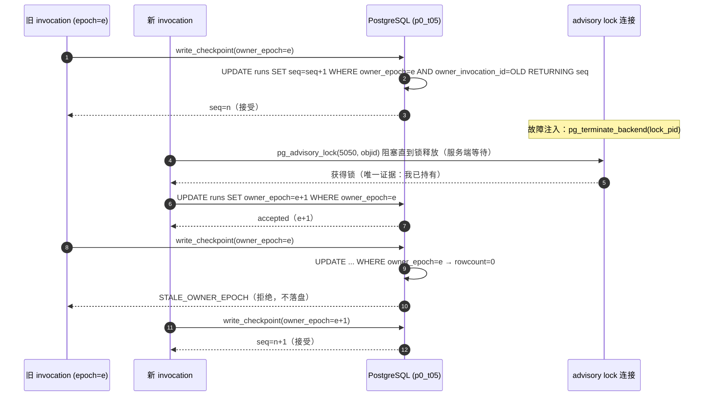

# P0-T05 证据：原生 Checkpoint 单写者与并发恢复

> 波次 W3 / 任务 P0-T05。本文件是 Backlog `docs/poc/03_Phase0_Task_Backlog.md`（P0-T05，lines 82–97）要求的 DoD 交付物：
> 「D0 + 连接级时序 / 原始故障证据 + 是否支持多实例的明确结论」。
> 契约依据：`docs/poc/07_Contract_Closure.md` C-03；`docs/tdd/01_System_Architecture.md` §6.4；`docs/tdd/04_LangGraph_Workflows.md` §7–9。

## 1. 任务声明

```yaml
wave: W3
task: P0-T05
agent: w3-t05-checkpoint
branch: feature/w3-t05-t07-t10-t15-t19
base: f86765e            # W2 顶点；本任务未提交，工作树 HEAD 仍为 f86765e
started_at: 2026-10-27T19:30+08:00
write_scope:
  - experiments/phase0/checkpoint_probe.py
  - tests/phase0/test_checkpoint_owner.py
  - docs/poc/evidence/poc01-owner.md
resource_slot: {pg_schema: p0_t05, redis_db: 4}
dependencies: [P0-T03, P0-T04]
reused_by: [P0-T06, P0-T21, P0-T23, P0-T30]
```

## 2. 已知约束

| 约束 | 内容 |
| --- | --- |
| 写权 | 只写上面三个文件；`contracts.py`、`scope.py`、`db/migrations/001_*.sql`、`002_*.sql`、`tests/phase0/conftest.py`、`fixtures/manifest.json` 一律只读。 |
| 迁移编号 | `wave-w3-record.md` 规定编号迁移归 T06/T07/T12/T20/T23/T27；**P0-T05 不新建编号迁移**，`p0_t05` 内的表由 `checkpoint_probe.py` 在运行时 DDL 创建。 |
| 依赖 | `experiments/phase0/pyproject.toml`、`uv.lock`、`compose.yaml`、`.env.example` 不得修改；额外包只用 `uv run --with` 临时注入并记录精确版本（见 §5.1）。 |
| Schema | 只用 `p0_t05`；DDL 首句 `DROP SCHEMA IF EXISTS p0_t05 CASCADE`（`--reset`），不触碰 `public` 与 `p0_t03`。 |
| 秘密 | DSN 只从 `scope.read_dsn()` 读（环境变量或 `experiments/phase0/.env.example`），口令不出现在代码、日志、本文件。 |
| Git | 波次内不做任何 `git add/commit/push/switch`；分支与 HEAD 由 Lead 在门禁统一处理。 |
| 测试纪律 | 不使用 `skip`/`xfail`/`mock` 冒充通过；每个数字都来自实跑。 |

## 3. 方法：为什么是「替身存储 + 对照组」

C-03 有两条硬约束决定了这个任务的实验形态：

1. **不自改 checkpoint 内部表**。原生 `langgraph-checkpoint-postgres` 的 `checkpoints`/`writes`/`blobs` 表不归本项目所有，不能往里面塞 `owner_epoch` 列。
2. **epoch「不宣称已能约束原生 saver 的写入」**。即：即使宿主正确持锁并推进 epoch，原生 saver 用自己那条连接照写不误。

所以要回答的命题其实是两个，必须分开测：

| 命题 | 实验载体 | 结果位置 |
| --- | --- | --- |
| P1：若写入路径归宿主所有，「持锁 + owner_epoch CAS」能否保证至多一个有效 writer，并让失锁的旧 invocation 写入被拒？ | `p0_t05` 内自建的**替身 checkpoint 存储**（写入路径 100% 经过 CAS） | §4.2 / §4.3 / §6 |
| P2：原生 saver 的独立连接在锁释放后是否仍能写？ | 真实 `PostgresSaver` + 真实 PG 连接 | §5 |

替身存储的表（全部在 `p0_t05`，`Harness.reset_schema()` 创建）：

| 表 | 作用 | 关键约束 |
| --- | --- | --- |
| `p0_t05.phase0_runs` | run↔thread 1:1 绑定 + 当前 owner | `UNIQUE(workspace_id, thread_id)`、`UNIQUE(workspace_id, run_id, thread_id)`；`owner_epoch bigint`、`owner_invocation_id uuid`、`last_checkpoint_seq bigint`、`graph_version`、`state_schema_version`、`status` |
| `p0_t05.phase0_invocations` | 每次 invocation 的生命周期 | 主键 `(workspace_id, invocation_id)`；`state`（running/exited/fenced） |
| `p0_t05.phase0_checkpoints` | checkpoint 序列 | 主键 `(workspace_id, thread_id, seq)`；`invocation_id`、`owner_epoch`、`parent_checkpoint_id`、payload jsonb |
| `p0_t05.phase0_write_attempts` | 每次写入尝试的账本（含被拒） | `fencing bool`、`code`、`seq`、`detail` |

> 说明：`phase0_runs` 是**替身**。生产侧的 `UNIQUE(workspace, thread_id)` 与 `phase0_execution_bindings` 归 001 迁移（P0-T03），本任务未改它，也不声称它与替身表等价。

单写者由三件事叠加：

1. **session 级 advisory lock**（独立 lock 连接，不共用 saver/writer 连接）：
   `pg_advisory_lock(5050, objid)`，`objid = blake2b(f"{workspace_id}:{thread_id}")` 前 4 字节转 int。用 2-arg 形式避免与全局单 key 锁冲突。
2. **owner epoch CAS**（短事务）：
   `UPDATE p0_t05.phase0_runs SET owner_epoch = owner_epoch + 1, owner_invocation_id = %s WHERE workspace_id = %s AND run_id = %s AND owner_epoch = %s AND status = 'running' RETURNING owner_epoch`。
   `rowcount = 0` → `OWNER_CLAIM_CONFLICT`（另有 `RUN_NOT_FOUND` / `RUN_NOT_RUNNING` 细分诊断）。
3. **写入处双检 CAS**（同一事务内完成「校验 + 递增 + 落盘」）：
   `UPDATE p0_t05.phase0_runs SET last_checkpoint_seq = last_checkpoint_seq + 1 WHERE workspace_id=%s AND run_id=%s AND owner_invocation_id=%s AND owner_epoch=%s AND status='running' AND graph_version=%s AND state_schema_version=%s RETURNING last_checkpoint_seq`，
   `rowcount = 0` → 再查原因，返回 `STALE_OWNER_EPOCH` / `OWNER_MISMATCH` / `RUN_NOT_RUNNING` / `CHECKPOINT_INCOMPATIBLE`；成功则同事务 `INSERT INTO phase0_checkpoints`。

两条事务首句都设 `SELECT set_config('lock_timeout', <ms>, true)`（claim 5000 ms / write 5000 ms），把「可能无限等行锁」变成可断言的 `LOCK_TIMEOUT`。

**为什么必须带对照组**：单纯观测到「旧 writer 写失败」不能证明是 epoch CAS 起作用——也可能只是旧连接恰好断了。因此同一套 harness 有 `fencing` 开关：`fencing=False` 时写入只 INSERT 不校验 owner。两组唯一差异就是这个开关。

**为什么没有固定 sleep**：所有等待都发生在 PG 侧（阻塞 `pg_advisory_lock`、`SELECT ... FOR UPDATE` 的服务端 `lock_timeout`）；客户端同步只用 `threading.Barrier` 与 `Thread.join`。`test_probe_contains_no_wall_clock_sleep` 用 AST 断言源码中不存在任何 `*.sleep(...)`。

### 3.1 失锁 → 接管 → 旧 writer 被拒（时序）



## 4. 门禁实跑记录

所有命令从仓库根 `E:\project_month\pyknora` 执行；`pwsh` + `$env:PYTHONUTF8='1'`。

### 4.1 测试与静态检查

| # | 命令原文 | exit | 真实结果 |
| --- | --- | --- | --- |
| 1 | `uv run --project experiments/phase0 pytest -c experiments/phase0/pyproject.toml tests/phase0/test_checkpoint_owner.py` | 0 | `11 passed in 18.05s`（门禁复跑；首次实跑 `11 passed in 15.49s`） |
| 2 | `uv run --project experiments/phase0 ruff check experiments/phase0/checkpoint_probe.py tests/phase0/test_checkpoint_owner.py` | 0 | `All checks passed!` |
| 3 | `uv run --project experiments/phase0 python experiments/phase0/checkpoint_probe.py --rounds 50 --reset` | 0 | 21.43 s；JSON 见 §4.2 |
| 4 | `uv run --project experiments/phase0 --with langgraph-checkpoint-postgres python experiments/phase0/checkpoint_probe.py --native --reset` | 0 | 1.51 s；JSON 见 §5.2 |

11 条用例逐条对应验收点：

| 用例 | 断言 | 对应验收 |
| --- | --- | --- |
| `test_run_thread_binding_is_one_to_one_at_100_percent` | runs=100，`rate_consistent=100.0`、`mismatches=()`、300 次重复绑定全被 `ThreadBindingConflict` 拒 | 验收 2（100%） |
| `test_fifty_rounds_lock_loss_and_reconnect_keep_single_writer` | 50 轮逐轮断言五项（旧 writer 必被拒 / 新 writer 必成功 / epoch 前进 / seq 前进 / 接管后锁持有者=1）；收尾 `live_writers==0` | 验收 1、2 |
| `test_without_db_fence_the_stale_writer_still_writes` | 对照组 10 轮：旧 writer **10/10 全被接受**，`rejected==0`，且 `epoch_violations==()` | 验收 1（反证） |
| `test_epoch_cas_protects_when_the_lock_is_bypassed` | 4 个 contender 绕过锁直接抢 CAS：1 个赢、3 个 `OWNER_CLAIM_CONFLICT`、`checkpoint_count==1` | 验收 1、3 |
| `test_two_writers_race_for_the_same_thread` | 并发抢锁：`lock_loser_codes==(LOCAL_LOCK_HELD,)`、`claim_loser_codes==(OWNER_CLAIM_CONFLICT,)`、`write_codes==(ACCEPTED,)`、`checkpoint_count==1` | 验收 3（两 writer 争抢） |
| `test_writer_reconnect_after_connection_loss_is_fenced` | 断 writer 连接后重连：`first_code==CONNECTION_LOST`、`writer_pid` 变了、`second_code==STALE_OWNER_EPOCH` | 验收 3（连接中断重连） |
| `test_restore_reads_the_latest_consistent_checkpoint` | 全新连接恢复读到 `seq==2` 且与 run owner 的 epoch/invocation 一致、payload 为最新 | 验收 3（恢复读最新一致） |
| `test_incompatible_graph_version_is_rejected_and_thread_preserved` | `graph_version` 不匹配 → `CHECKPOINT_INCOMPATIBLE`，原 checkpoint 与 run 版本不变 | 验收 5（契约） |
| `test_incompatible_state_schema_version_is_rejected` | `state_schema_version` 不匹配 → 拒绝，detail 同时给出期望/实际版本 | 验收 5（契约） |
| `test_probe_contains_no_wall_clock_sleep` | AST 扫描：`sleeps == []` | 验收 4 |
| `test_single_live_writer_and_attempt_ledger_agree` | attempt 账本与 `runs` 行一致：`rejected:STALE_OWNER_EPOCH==3`、`accepted:ACCEPTED==4`、`last_checkpoint_seq==final_seq` | 验收 1 |

### 4.2 50 轮实测基线（`--rounds 50`，JSON 摘要）

| 实验 | 关键字段 | 实测值 |
| --- | --- | --- |
| `binding` | `runs / checked / consistent / rate` | `100 / 100 / 100 / 100.0` |
| `binding` | `mismatches / rebind_attempts / rebind_rejections` | `() / 300 / 300` |
| `churn`（fencing 开） | `rounds / accepted / rejected / final_seq / expected_seq` | `50 / 51 / 50 / 51 / 51`（bootstrap 1 条 + 每轮 1 条） |
| `churn`（fencing 开） | `sequence_violations / epoch_violations` | `[] / []` |
| `churn`（fencing 开） | `restore_checks / restore_mismatches` | `50 / []` |
| `churn`（fencing 关，对照组） | `accepted / rejected / final_seq` | `101 / 0 / 101` |
| `lab` 汇总 | `fenced_stale_writes_accepted` vs `control_stale_writes_accepted` | **`0` vs `50`** |
| `churn` | `lock_wait_ms min / median / max` | `2.87 / 4.088 / 5.809` |
| `contention` | `lock_loser_codes / claim_loser_codes / write_codes / checkpoint_count` | `[LOCAL_LOCK_HELD] / [OWNER_CLAIM_CONFLICT] / [ACCEPTED] / 1` |
| `epoch_race` | winners / `checkpoint_count` | `1` 个 winner + 3×`OWNER_CLAIM_CONFLICT` / `1` |
| `reconnect` | `writer_pid_before / writer_pid_after / first_code / second_code / checkpoint_count` | `18460 / 18464 / CONNECTION_LOST / STALE_OWNER_EPOCH / 1` |

**这两行是整个任务的核心数字**：

- `fenced_stale_writes_accepted = 0`：开 fence 时，失锁的旧 writer 50 轮无一写入。
- `control_stale_writes_accepted = 50`：关 fence 时，同样的失锁旧 writer **50/50 全部写入成功**。

两组只差 `fencing` 开关，所以「旧 writer 写不进去」这件事确实由 epoch CAS 提供，不是巧合。
同时 `control` 组的 `epoch_violations == ()` 说明**epoch 单调性本身发现不了旧 writer**——它唯一能防的是写入处的 CAS 拒绝。

## 5. 原生 saver 连接级证据（P2）

### 5.1 版本（`uv run --with` 临时注入，未改 pyproject/lock）

| 包 | 版本 |
| --- | --- |
| `langgraph` | `NOT_INSTALLED`（`--with langgraph-checkpoint-postgres` 不带 graph 运行时；`ServerSaver`/`PostgresSaver` 本身可用） |
| `langgraph-checkpoint` | `4.3.1` |
| `langgraph-checkpoint-postgres` | `3.2.0` |
| `psycopg` | `3.3.6` |
| `psycopg-pool` | `3.3.3` |

saver 表建在 `p0_t05`（DSN 用 `options=-c search_path=p0_t05` 注入），`public` 未被触碰。

### 5.2 八步时序（命令 4，exit 0）

| 步骤 | 结果 | 关键观测 |
| --- | --- | --- |
| `setup` | ok | `native_pid=18466`（saver 自己的后端进程） |
| `lock_acquired` | ok | `lock_pid=18467`；`lock_is_not_saver_pid=True` —— 锁连接与 saver 连接确实是两个后端 |
| `put_with_lock_alive` | ok | 持锁时原生写入成功（基线） |
| `lock_terminated` | ok | 从管理连接 `pg_terminate_backend(lock_pid)`；`advisory_lock_holders == 0` |
| **`put_after_lock_loss`** | **ok（写入成功）** | 锁连接已死、saver 连接仍活 → **原生写入仍然成功**。C-03 的缺口在真实库上被证实，不是理论推断 |
| `saver_killed` | ok | 杀掉 saver 自己的后端 |
| `put_after_saver_kill` | **error** | `OperationalError: consuming input failed: server closed the connection unexpectedly / This probably means the server terminated abnormally before or while processing the request.` |
| `get_after_loss` | ok | **全新** `psycopg.connect(...)` + 新 `PostgresSaver` 实例 `get_tuple(config)` 读到 `checkpoint_id=588b9db5-dedc-4a6b-8952-2502de833c90`、`channel_values=[]` |

两条结论：

1. **锁释放不 fence 原生 saver**（步骤 5）：这是 C-03 担心的场景，实测成立。旧进程只要还握着 saver 连接，就能继续写 checkpoint。
2. **saver 自己的连接死了不会静默续写**（步骤 7）：抛 `OperationalError`，**没有**看到自动重连后继续写。这对我们有利——「连接级故障」是可观测的硬失败；危险窗口只存在于「锁丢了但 saver 连接还活」。

另外实测到的一个时序细节：`pg_terminate_backend` 是**异步**的。50 轮里出现过 `lock_holders_after_kill == 1`（round 48，后端尚未回收完），但后继者的阻塞 `pg_advisory_lock` 照样等到并成功拿到锁。所以：

> **接管确认的正确判据是「我已经持有这把锁」这个事件，而不是「我快照到锁无人持有」。**
> 若用 `pg_locks` 快照做判据，会在 round 48 这类窗口上误判为「旧 writer 仍活着/或已释放」。

## 6. 契约核对（冲突与细化点，写在这里而不是改 ADR）

| # | 契约原文位置 | 契约要求 | 实测/实现 | 判定 |
| --- | --- | --- | --- | --- |
| 1 | `07_Contract_Closure.md` C-03 | 「advisory lock 连接释放不能自动 fence 独立 saver 连接」 | §5.2 步骤 5 复现：锁连接已死，原生 `put` 仍成功 | **证实**（不是冲突） |
| 2 | C-03「接口」 | `claim_owner(scope, run_id, expected_owner_epoch)`、`release_owner(ctx)` | 实现为 `Invocation.claim_owner(expected_owner_epoch)` + `release_owner()`；`scope` 走 `RunBinding(workspace_id, run_id, thread_id, graph_type, graph_version, state_schema_version)` | 语义一致、形状不同；**记录不改契约** |
| 3 | C-03「提交点」 | 「lease 过期不构成安全接管证明」 | 对照组 50 轮 epoch 严格单调（`epoch_violations==()`）但旧 writer 50/50 写入成功 | **证实**：epoch 单调性不能替代写入处 CAS |
| 4 | `01_System_Architecture.md` §6.4 | 「接管必须确认 advisory lock 已释放」 | 接管用阻塞 `pg_advisory_lock` + 服务端 `lock_timeout`，「拿到锁」即释放已发生 | **满足**；见下方细化点 A |
| 5 | `04_LangGraph_Workflows.md` §7 | run↔thread 1:1 | 替身表 `UNIQUE(workspace_id, thread_id)`；100 组 0 mismatch，300 次重复绑定全拒 | **满足（替身表）**；正式表归 001 迁移 |
| 6 | `04_LangGraph_Workflows.md` §7–8 | `graph_version` 不可变、`state_schema_version` 整数；不识别 → `CHECKPOINT_INCOMPATIBLE` 且保留原 thread | 写入处同时校验两字段，不符即拒，原 checkpoint 与 run 版本不变 | **满足** |
| 7 | C-03「幂等/约束」 | epoch「不宣称已能约束原生 saver 的写入」 | §5.2 步骤 5：确实约束不了 | **证实**；据此给出单活结论（§8） |
| 8 | `01_System_Architecture.md` §6.4 | 「checkpointer 独立连接不天然 fenced，须 H1 故障注入验证」 | 本任务已做连接级注入（`pg_terminate_backend` × 锁连接/saver 连接） | **已完成**（H1 的一部分） |

### 6.1 建议写回 TDD 的细化点

- **A（写给 T06/T30）**：「确认 advisory lock 已释放」的可执行判据是**阻塞获取成功**，不是 `pg_locks` 快照为空。`pg_terminate_backend` 异步回收，快照会在短窗口内仍显示持有者（实测 50 轮里出现 1 次）。
- **B**：C-03 的 `claim_owner` 签名缺 `graph_version`/`state_schema_version` 入参，而写入处的 `CHECKPOINT_INCOMPATIBLE` 判定需要这两个值。建议在 T06 落地时把版本绑定放进 claim 的前置校验，或明确「claim 不校验版本、写入处校验」——当前实现取后者。
- **C**：C-03 未定义「同一 invocation 重新 claim」的语义。当前实现是 epoch 只增不减，同一 invocation 二次 claim 需要传入新期望值，否则 `OWNER_CLAIM_CONFLICT`。建议补一句。
- **D**：`phase0_write_attempts` 这类**被拒写入的账本**是「至少一次」语义的观测面，建议 T06 的 outbox/幂等设计直接沿用「写入处 CAS + RETURNING seq + attempt 账本」三件套。
- **E**：本任务未测「旧进程未死但失锁后仍在写」的**进程级**存活证据（只有连接级）。若 T30 需要进程级结论，需在 `kill_lock()` 之外补一条「writer 进程存活 + 写入被拒」的观测。

## 7. 逐条验收判定

| # | 验收条件（Backlog P0-T05） | 判定 | 依据 / 缺口 |
| --- | --- | --- | --- |
| 1 | 同一 `thread_id` 至多一个有效 writer；用 epoch/fencing token 或等价 CAS，证明旧 invocation 失锁后写入被拒 | **PARTIAL（单活）** | 替身路径 **PASS**：`fenced_stale_writes_accepted=0`，对照 `control=50`（§4.2）。原生路径 **FAIL**：锁释放后原生 saver 仍能写（§5.2 步骤 5）。二者合并只能得出「必须单活」的结论，不能声称已 fence 原生写入——按卡片允许的「单活 PARTIAL」如实记录，未隐藏失败 |
| 2 | `run/thread` 绑定一致率 100%；≥50 轮失锁→重连循环，每轮断言旧 writer 不再写、新 writer 能写、checkpoint 序列无回退 | **PASS** | `rate=100.0`（100/100）、300 次重复绑定全拒；churn `rounds=50`、`accepted=51`、`rejected=50`、`final_seq=51==expected`、`sequence_violations=[]`、`epoch_violations=[]`；每轮五项断言在 `test_fifty_rounds_...` 中逐轮执行 |
| 3 | 覆盖并发两 writer 争抢、连接中断重连、恢复后读到最新一致 checkpoint | **PASS** | `contention`（1 winner/1 checkpoint，败者 `LOCAL_LOCK_HELD`，旁路尝试 `OWNER_CLAIM_CONFLICT`）；`epoch_race`（1 winner + 3 拒）；`reconnect`（`CONNECTION_LOST` → `STALE_OWNER_EPOCH`，`writer_pid` 变化，`checkpoint_count=1`）；`restore_read`（50 轮 × `restore_mismatches=[]`，§4.2） |
| 4 | 无固定 `sleep` 作同步；真实跑出数字，失败如实记录 | **PASS** | AST 断言 `sleeps==[]`；等待全部在 PG 侧（`lock_wait_ms` 2.87 / 4.088 / 5.809 有非零值，证明真的等过锁）；失败项（原生 `put_after_saver_kill` 报错、原生路径 fence 缺口）原样记录在 §5.2 |
| 5 | 至少读 C-03 与 TDD checkpoint/恢复章节，契约冲突写进证据而非自改 ADR | **PASS** | §6 逐条对照 8 项，5 处细化点回写建议；未修改任何 ADR / 契约文件 |

### 7.1 明确结论：是否支持多实例

**不支持。** 在「原生 saver 使用独立连接」这一既定前提下，advisory lock 的得失无法 fence 已存在的原生写入路径（§5.2 步骤 5 实测），而 C-03 已声明不自改 checkpoint 内部表、epoch 不宣称约束原生写入。因此：

- **唯一可上线形态：单活 runner**（同一 run 只有一处能跑起来，跨实例靠租约 + 停旧进程，不靠锁）。建议按 C-03 的既定路径提出 **ADR-0001 限域修订**，把「多实例横扩」从 Phase 0 的设计假设里移除。
- 若要保留多实例能力，必须把**所有** checkpoint 写入收归宿主持锁代理（即原生 saver 不再由任意 invocation 直接持有连接），而这一点在本任务范围内**未验证**，属新增 PoC，不能由本证据支撑。
- 本任务**没有**制造「多实例可用」的假象：对照组 50/50 写入成功就是缺口本身。

## 8. 交付哈希（`Get-FileHash -Algorithm SHA256`）

| 文件 | 行数 | sha256 |
| --- | --- | --- |
| `experiments/phase0/checkpoint_probe.py` | 1881 | `2e21422e25bbd51630c9b616b125533435173b50380e49ff44722a7beb49d73c` |
| `tests/phase0/test_checkpoint_owner.py` | 314 | `01663a473d85fb0c9705812f715e4a6b4a158efbee3090a6f60bc47bde65dcf9` |

Git 状态：`branch=feature/w3-t05-t07-t10-t15-t19`、`HEAD=f86765e`（未提交），两个代码交付均为 `??` 未跟踪。

本文件自身不在上表内（自我哈希不稳定），由 `wave-w3-record.md` 的门禁统一记录。三个交付文件的秘密扫描：正则 `AKIA…|ghp_…|sk-…|PRIVATE KEY|phase0-local-only|pyknora:` 命中数 `0`。

## 9. 复用建议（T06 / T21 / T23 / T30）

| 任务 | 可复用 API | 建议 |
| --- | --- | --- |
| **P0-T06**（Jobs/outbox、事务边界） | `Harness.attempt_counts()`、`Invocation.write()`、`Harness.assert_single_live_writer()` | 直接复用「写入处 CAS + `RETURNING seq` + attempt 账本」三件套作为 outbox 幂等键的观测面；注意 §6.1-B（claim 不校验版本）与 §6.1-D（账本语义） |
| **P0-T21**（恢复/中断一致性） | `Harness.restore_read()`、`RestoreRead.consistent` | 「重启后读到最新一致 checkpoint」的断言工具；`consistent` 已同时校验 seq/payload/owner 三方，别重复实现 |
| **P0-T23**（多实例/H1 故障注入） | `run_baseline_lab(harness, rounds=)`、`classification_snapshot()`、`probe_native_saver()` | `classification_snapshot` 直接产出扁平 JSON，可当 CI 门禁（关键字段：`fenced_stale_writes_accepted` 必须为 `0`）；`probe_native_saver` 已是可重跑的连接级实验，不需要另写脚本 |
| **P0-T30**（故障矩阵总装） | `Invocation.open_lock/open_writer`、`Invocation.kill_lock()`、`Harness.terminate_backend(pid)`、`Harness.advisory_lock_holders()` | 沿用「独立 lock 连接 vs writer/saver 连接」的双连接模型做注入；必须避免用 `advisory_lock_holders()==()` 当接管判据（§6.1-A），并补进程级存活证据（§6.1-E） |

**不要复用**：`p0_t05.phase0_runs` 当生产表。它是验证夹具；正式 `UNIQUE(workspace, thread_id)` 归 001 迁移（T03），改它属于越界。
