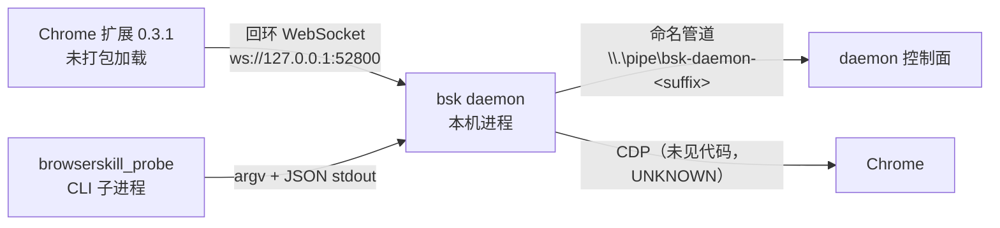

# BrowserSkill 远程扩展连接说明（W15-B）

- 任务：W15 波次任务 B——补齐 T31 登记的输入缺口 **D5**（`docs/remote-extension-connection.md` 不存在）
- 依据：`docs/poc/evidence/wave-w15-record.md:16`（任务定义）、`docs/poc/evidence/P0_Core_Gate_Review.md:160`（D5 原文）、`docs/poc/evidence/wave-w11-record.md:51`（缺口清单）
- 性质：**可操作说明书**，不是验收报告。本文只复述仓库内已有证据；未取证的一律标「待验证」
- 事实基线：`bsk 0.3.1` / `protocol 1.3` / 扩展 `0.3.1` / Chrome 147 / Windows（`docs/poc/evidence/poc05-browserskill-live.md:18-30`）
- 写权：本文件是本任务唯一允许写入的文件（`wave-w15-record.md:29`）

> 阅读顺序：§1 → §2 → §3 → §4；出故障先看 §5；对外承诺口径只能引 §6 的限域结论。

## 0. 本文的证据映射（先说明两个命名坑）

`wave-w15-record.md:16` 把依据写成 `fix-w5-t17-record.md` 与 `poc07-report.md`。**这两个文件在本仓库都不存在**，按现存材料映射如下，不做同名伪造：

| 波次记录里的引用 | 仓库实际状态 | 实际替代证据 |
| --- | --- | --- |
| `fix-w5-t17-record.md`、`poc07-report.md` | 均不存在（全库 grep 无该文件名）；后者已被登记为已知缺口（`docs/poc/evidence/Phase0_Full_Gate_Review.md:31`） | T17 真配对记录 `docs/poc/evidence/poc05-browserskill-live.md` + `docs/poc/evidence/wave-w5-record.md:164-189`（§5 解除记录） |
| `experiments/phase0/browserskill_protocol_manifest.md` | 路径不对；清单实际在证据目录 | `docs/poc/evidence/browserskill_protocol_manifest.md`（535 行，T14 静态协议清单） |
| 上游 `docs/remote-extension-connection.md` | 上游有该文件名，但**未随子模块进库**（`browserskill_protocol_manifest.md:67`，只以链接出现在 `scripts/browserskill.md:50`） | 本文即是按本仓证据重写的等价说明 |

本文每一步操作只对回**本仓库内**的文件与行号；上游原文未取证部分集中在 §7。

## 1. 前置条件

### 1.1 三件套的角色（不懂这三者关系，后面所有故障都会误判）

| 组件 | 本体 | 运行位置 | 谁启动 | 证据 |
| --- | --- | --- | --- | --- |
| daemon（`bsk`，Rust） | 本机自编译的 `bsk.exe` | 应用主机，回环地址 | 手工/宿主进程拉起 | `browserskill_protocol_manifest.md:73` |
| extension（Chrome 未打包扩展） | 自构建 0.3.1 | 用户浏览器 | **用户人工加载** | `poc05-browserskill-live.md:6,24` |
| 探针（本仓侧） | `experiments/phase0/browserskill_probe/` | 本机 CPython | 开发者执行 | `poc05-browserskill-live.md:89-92` |



要点：**扩展并不直连本项目进程**；本项目通过 CLI 子进程驱动 daemon，扩展与 daemon 之间是回环 WS（`browserskill_protocol_manifest.md:135-151`）。Phase 0 没有 Go gateway 那一跳，所以"本项目连 daemon"实际是"CLI 驱动 daemon"。

### 1.2 环境前提（均为实测值，不得按记忆改）

| 前提 | 真实值 | 证据 |
| --- | --- | --- |
| OS / 浏览器 | Windows（本机开发环境）；Chrome 147.0.7727.117，真实用户配置文件 | `poc05-browserskill-live.md:20-21` |
| 取证用解释器 | **CPython 3.13.3**（`C:\Python313\python.exe`） | `poc05-browserskill-live.md:30` |
| 上游基线 | `Tencent/BrowserSkill@da6bf4eed2dd7256567e152df8c903c87f6598c3`，LICENSE = MIT；版本名两处措辞不同：`release/0.3.1`（`poc05-browserskill-live.md:29`）vs tag `ext-v0.3.1`（`browserskill_protocol_manifest.md:396`） | `wave-w5-record.md:172` |
| 协议版本 | 扩展 `1.3`、daemon `1.3`，`version_skew=false` | `poc05-browserskill-live.md:25-26` |

**硬约束：真机取证必须用 CPython 3.13，不能用 uv 托管的 3.12。** uv 托管的 3.12.13 打开命名管道即 `PermissionError 13`（ctypes `CreateFileW` → `last_error=5`），由它派生的 `bsk.exe` 也拿不到管道（`connect IPC named pipe ... 拒绝访问 (os error 5)`）；同一份 `bsk.exe` 由系统 3.13.3 派生则全部正常（`poc05-browserskill-live.md:107-110`、`wave-w5-record.md:186-187`、`fix-w5-t18-record.md:101`）。这是运行时差异，不是代码差异，改代码修不了。

### 1.3 路径与人工边界前提

`bsk.exe` 与扩展目录**不在本仓库内**：仓库根是 `E:\project_month\pyknora`，实测产物在 `D:\PyKnora\` 下（`poc05-browserskill-live.md:24,136,139`）。换机器要重建这两个路径，否则 §2.4 的定位会失败。

扩展加载、浏览器登录、验证码一律由用户在浏览器界面完成，程序不代做、不绕过（`AGENTS.md`「权限、安全与数据一致性」节；`docs/adr/0013_Browser_Channel_Positioning.md:24`）。上游取回需要外网，本机 `github.com:443` 间歇不可达，实测经 `ghfast.top` 镜像（`wave-w5-record.md:171-172`）。

## 2. bsk daemon 的构建与安装

### 2.1 取回 pinned 上游源码（镜像源要求）

官方 `scripts/build_browserskill.sh` 在构建期 `git clone` 后 `checkout --detach "$source_commit"`，不在仓库内 vendor 源码（`browserskill_protocol_manifest.md:65`）。本机实操：

```powershell
git clone --depth 1 https://ghfast.top/https://github.com/Tencent/BrowserSkill.git BrowserSkill
git -C BrowserSkill fetch --depth 1 origin da6bf4eed2dd7256567e152df8c903c87f6598c3
git -C BrowserSkill checkout --detach da6bf4eed2dd7256567e152df8c903c87f6598c3
```

实测 907 tracked files，`LICENSE` = **MIT**（`wave-w5-record.md:171-172`）。镜像源要求只有一条：**必须能取到 `da6bf4ee…` 这个 commit**；crates.io / pnpm registry 的镜像配置在本仓库**无取证 → 待验证**（§7-9）。

### 2.2 编译 daemon

```powershell
cargo build --locked --release -p bsk
```

| 项 | 实测值 | 证据 |
| --- | --- | --- |
| 工具链 / 耗时 | rustc 1.99.1，13m13s | `wave-w5-record.md:173` |
| 产物与 hash | `bsk.exe` 15,925,760 B，`sha256=DE16E23C30FACD36AF7FC54244DC6E9EFFC69253F13CCB5A3F23C80842412C64` | `poc05-browserskill-live.md:27` |

上游未发布 0.3.1 CLI 二进制，只能自编（`browserskill_protocol_manifest.md:398`）。

### 2.3 打包扩展

```powershell
pnpm ext:build:zip
```

产物 zip **860,920 B**，`sha256=050211FDE1827E332F23DBA54F0BDF970C2C1ED0D1AD6E4939CCE394716839DB`（`wave-w5-record.md:175`）。上游脚本依赖 `cargo` + `pnpm@10.17.0` + C 编译器（`browserskill_protocol_manifest.md:463`）；本机实测 pnpm 版本未记录 → 待验证。

**不要直接在 Windows 上跑官方 `scripts/build_browserskill.sh`**：其平台白名单只有 `linux/amd64|linux/arm64|darwin/amd64|darwin/arm64`，且 `daemon.go:130` 硬编码 `os.MkdirTemp("/tmp", ...)`（`browserskill_protocol_manifest.md:21,439,451`）。但 BrowserSkill 的 Rust 工程本身支持 Windows（命名管道实现 + `tests/windows_parent_cancel.rs`），走 2.2 的单包编译即可（`wave-w5-record.md:176-177`）。

### 2.4 安装落点与定位顺序

定位顺序为**显式参数 → `BSK_BIN` 环境变量 → 内置候选 → `PATH`**，内置候选是 `D:\PyKnora\bsk\bsk.exe` 与 `%LOCALAPPDATA%\PyKnora\bsk\bsk.exe`（`experiments/phase0/browserskill_probe/cli.py:35-39,54-75`）。所以最省事的安装方式是放到上述任一路径，或用 `BSK_BIN` 指向实际位置；找不到时错误会列出全部已探测路径（`cli.py:75`），这行报错本身就是排查入口。daemon 运行期 home 默认 `C:\Users\Administrator\.bsk`（`poc05-browserskill-live.md:38`）。

### 2.5 拉起 daemon（必须显式前台）

```powershell
Start-Process -FilePath 'D:\PyKnora\bsk\bsk.exe' `
  -ArgumentList @('daemon','start','--foreground','--json','--daemon-idle','60m') `
  -RedirectStandardOutput "$env:TEMP\bsk_daemon.log" -WindowStyle Hidden
```

（`fix-w5-t18-record.md:49-53`；T17 等价命令见 `poc05-browserskill-live.md:136`。）不能靠自动拉起：`bsk status` 的"自动拉起 daemon"在本机失败，报 `cannot start an independent Windows daemon; the host may prohibit Job Object breakaway ... os error 5`，必须显式 `daemon start --foreground`（`poc05-browserskill-live.md:113-115`）。这属部署事实，不进产品代码。

`--daemon-idle 60m` 表示空闲 60 分钟自动退出。daemon 由 gateway/宿主以 `--port 0` 启动时端口由内核分配，只能从 `<home>/daemon.json` 的 `ws_port` 读回（`browserskill_protocol_manifest.md:96`）；手工启动未给 `--port` 时两次独立启动都落在 `52800`（`poc05-browserskill-live.md:22`、`fix-w5-t18-record.md:23`），但"是否固定默认端口"未取证 → 待验证（§7-5）。

## 3. 扩展加载步骤（浏览器界面级）

1. 准备已构建/已解压的扩展目录；T17 实测目录为 `D:\PyKnora\browser-skill-extension\0.3.1`（`poc05-browserskill-live.md:24`）。
2. 地址栏进 `chrome://extensions`。
3. 打开右上角「开发者模式」。
4. 点「加载已解压的扩展程序」，选中上面的目录（步骤 2–4 见 `poc05-browserskill-live.md:138-139`）。
5. 加载后逐项核对扩展卡片，不一致就是选错目录或版本错配：

| 核对项 | 期望值 | 证据 |
| --- | --- | --- |
| 版本 / 加载方式 | `0.3.1`；`location=4`（unpacked） | `poc05-browserskill-live.md:24` |
| 扩展 ID | `ipodpljpdchoicenpokpiakgdjafjimn` | 同上 |
| 扩展协议 | `extension_protocol_version=1.3`、`version_skew=false` | `poc05-browserskill-live.md:25` |

6. 让 daemon 看到它：执行 §4.1 的 `bsk doctor --json`，`extension connected` 应显示 `1 browser(s) connected`（`poc05-browserskill-live.md:42`）。

**克制说明（重要）**：T17 只写到"用户在 Chrome 147 加载未打包扩展（ID …），daemon `doctor` 6 项全 ok"（`wave-w5-record.md:178-179`），**没有记录扩展侧如何得知 daemon 端点、是否弹出配对/授权**。无 gateway 的 Phase 0 形态下，"加载完就自动连上 52800"只是观察到的结果，不是已记录的机制 → 待验证（§7-2）。文档与培训不得把这步描述成"点一下就配对"。

## 4. 连通性验证命令与预期输出

### 4.1 命令行自检（按顺序执行，前一步失败不要跳）

| 序 | 命令 | 预期输出 | 证据 |
| --- | --- | --- | --- |
| 1 | `Get-NetTCPConnection -LocalPort 52800` | `listeners=1`（有监听说明 daemon 在） | `fix-w5-t18-record.md:44` |
| 2 | `D:\PyKnora\bsk\bsk.exe doctor --json` | 关键项均 `status="ok"`：`bsk home writable`、`daemon running`（`pid … at ws://127.0.0.1:52800`）、`daemon local process identity`、`protocol compatible`（`daemon protocol 1.3`）、`extension connected`（`1 browser(s) connected`）、`browser protocol compatible` | `poc05-browserskill-live.md:36-43` |
| 3 | `bsk browsers --json` | 形如 `{"instance_id":"dc8a279d","browser_name":"chrome","browser_version":"147.0.0.0","extension_version":"0.3.1","session_count":0,"version_skew":false,"extension_protocol_version":"1.3"}` | `poc05-browserskill-live.md:50-54` |
| 4 | `bsk status --json` | `daemon_version 0.3.1` / `protocol_version 1.3` / `ws_port 52800` | `fix-w5-t18-record.md:43` |

**退出码陷阱**：`doctor` 在有 `status="na"` 项时退出码是 **1**，但仍输出完整 JSON，不能因此判失败；探针对 doctor 用 `check=False` 解析 stdout，其余子命令按非零即失败（`experiments/phase0/browserskill_probe/adapter.py:180-186`、`poc05-browserskill-live.md:45-46`）。另外两点口径差异：`doctor` 项数在 T17 记「6 项 ok」、T18 记「7 项全 ok」（`poc05-browserskill-live.md:142` vs `fix-w5-t18-record.md:41`），判定按"关键项 ok"而不是数项数 → 待验证（§7-6）。

### 4.2 端到端动作链（真机取证）

```powershell
C:\Python313\python.exe experiments\phase0\browserskill_probe\live_run.py `
  --json-out docs\poc\evidence\p0-t17-live-run.json
```

实测 `exit=0` 并写出证据 JSON（`poc05-browserskill-live.md:58-63`）。预期链路：

| 阶段 | 预期 |
| --- | --- |
| `session start` / `tab create` | 返回 `session_id`、`agent_window_id`、`interaction={borrow_confirmation:always, request_help:enabled}`；`tab_id` 与 `url=https://example.com` |
| `snapshot` / `evaluate` / `screenshot` / `console` | 读类动作均返回真实内容（截图约 56,940 B） |
| `tab close` / `session stop` | `{"stopped":[…],"failed":[],"return_failures":[]}` |

（`poc05-browserskill-live.md:65-77`。）session 由 daemon 持有、跨进程可见，但会被 `--daemon-idle` 或用户关闭 Agent Window 回收，所以**整条动作链必须在同一驱动脚本内连续跑完**（`poc05-browserskill-live.md:111-112`）。

### 4.3 回归与门控

```powershell
# 单测（不依赖 daemon）：实测 34 passed, 1 skipped
uv run --project experiments/phase0 pytest -c experiments/phase0/pyproject.toml `
  tests/phase0/test_bsk_live.py -q

# 真机用例必须显式开 BSK_LIVE
$env:BSK_LIVE = "1"
uv run --project experiments/phase0 pytest -c experiments/phase0/pyproject.toml `
  tests/phase0/test_bsk_recovery.py -q
```

单测实测见 `poc05-browserskill-live.md:96-102`；门控要求见 `docs/poc/evidence/wave-w9-record.md:26`——**未设 `BSK_LIVE=1` 必须记 `NOT_RUN`，禁止用 `skip` 冒充通过**。`-c experiments/phase0/pyproject.toml` 不能省，否则 rootdir/configfile 会落到仓库根（`CLAUDE.md`「命令陷阱」节）。

## 5. 常见故障

| 症状 | 判定命令 | 处置 | 证据 |
| --- | --- | --- | --- |
| **端口占用**：`daemon start` 失败或连到错误进程 | `Get-NetTCPConnection -LocalPort 52800` | 先确认监听方是否本机 `bsk.exe`；占用时改 `--port 0` 让内核分配，再从 `<BSK_HOME>\daemon.json` 的 `ws_port` 读回实际端口 | `browserskill_protocol_manifest.md:96`；`fix-w5-t18-record.md:44` |
| **原生消息清单路径**：按 Native Messaging 方向排查 | — | **本链路不使用 Native Messaging**，见 §5.1 专段 | `browserskill_protocol_manifest.md:135-151` |
| **扩展未加载**：`extension connected` 非 ok | `bsk doctor --json` | 回 §3 重走 `chrome://extensions` 加载，核对版本 `0.3.1` 与 `location=4` | `poc05-browserskill-live.md:42,24` |
| **daemon 未启动**：`status`/`doctor` 报不在，或自动拉起失败 | `bsk status --json` | 用 §2.5 的 `daemon start --foreground` 显式拉起；`os error 5` 属 Job Object 限制，别改代码绕 | `poc05-browserskill-live.md:113-115` |
| **命名管道拒绝访问**：`PermissionError 13` / `os error 5` | 打印解释器版本 | 换系统 CPython 3.13 派生 daemon 与驱动脚本，别用 uv 托管 3.12 | `poc05-browserskill-live.md:107-110` |
| **防火墙拦截** | 查 daemon 监听地址与入站规则 | 链路应全程回环；daemon 是否只绑 `127.0.0.1` 本仓**无法确认**，入站放行规则**待验证**，禁止先开例外再排障 | `browserskill_protocol_manifest.md:96,447` |
| **版本错配**：握手或首个方法调用报 `daemon_incompatible` / `protocol_error` | `bsk doctor --json` 看 `protocol compatible` | 版本一致性不靠协商、靠"同 SHA 构建"；只换一端必然在握手暴露 | `browserskill_protocol_manifest.md:403,405` |
| **空闲自动退出 / session 被回收**：过一会儿连不上，或动作链中途 session 消失 | 观察 daemon 日志 | 调长 `--daemon-idle`；恢复即重启并重跑 `doctor`；动作链单脚本内连续完成；用户关 Agent Window 会触发暂停 | `poc05-browserskill-live.md:111-112`；`fix-w5-t18-record.md:70` |

### 5.1 关于「原生消息清单路径」的专段（避免整条排查走错方向）

本链路**不是** Chrome Native Messaging。已取证的传输事实只有四个跳：

| 跳 | 传输 | 证据 |
| --- | --- | --- |
| extension ↔（gateway 或 daemon） | 回环 WebSocket | `browserskill_protocol_manifest.md:135-145` |
| gateway → daemon（RPC） | Unix socket `$BSK_HOME/run/daemon.sock`，NDJSON | `browserskill_protocol_manifest.md:146` |
| gateway → daemon（转发扩展连接） | `ws://127.0.0.1:<ws_port>` | `browserskill_protocol_manifest.md:147` |
| daemon → 浏览器 | CDP（无源码，`UNKNOWN`） | `browserskill_protocol_manifest.md:148` |

Windows 下 daemon 的控制面是**命名管道** `\\.\pipe\bsk-daemon-e974436b93237db7`（`poc05-browserskill-live.md:23`）。仓库内**不存在** native messaging host 清单文件，也没有任何注册表写入步骤（本任务对 `docs/` 与 `experiments/` 检索 `nativeMessaging|native_messaging|原生消息|Native Messaging`，除本节外**零命中**；`注册表` 的命中全在 DocReader 证据里，与浏览器无关）。所以"原生消息清单路径"在当前版本是**不适用**项，不是"路径写错"。若上游将来改用该机制，清单路径与键名必须重新取证——**待验证**，本文不给任何猜测值。

## 6. 安全与授权边界

### 6.1 配对与凭据（只复述已取证参数）

| 项 | 事实 | 证据 |
| --- | --- | --- |
| token 形态 / 落库 | 32 字节 CSPRNG → base64url 无填充 = 43 字符；只存 `sha256(token)`，不落明文 | `browserskill_protocol_manifest.md:321,323` |
| 一次性配对 / 长期凭据 | 配对 5 分钟有效、兑换即失效；设备凭据 90 天，`renew_after` 30 天，旧 hash 留 5 分钟宽限 | `browserskill_protocol_manifest.md:324-326` |
| 连接鉴权 | `Origin` 必须 `chrome-extension://` + 32 位（字符集仅 `a`–`p`）；子协议恰好 1 个且以 `bsk-auth.` 开头；token 长度必须 43 | `browserskill_protocol_manifest.md:341-343` |
| 撤销 | `revoke` 写 `revoked_at`、清 owner/lease，并断开当前 scope | `browserskill_protocol_manifest.md:357` |
| 鉴权边界提醒 | 网关把扩展连接转给 daemon 时用扩展原始 `Origin`，且 `CheckOrigin` 恒真 → daemon 侧不做 origin 校验，白名单只在入口 | `browserskill_protocol_manifest.md:348` |

### 6.2 域名 / 网络 / SSRF（T16 结论，**必须网关前置**）

- 上游 BrowserSkill **完全没有**域名/速率/SSRF 策略代码，必须由本项目侧前置（`poc05-browserskill-live.md:127`；`browserskill_protocol_manifest.md:449,506`）。
- T16 判定 `PASS（限域）`：109 passed、26 条 SSRF 向量、每跳（含重定向链）/协议/端口/DNS rebinding/体量/时长/重定向次数全覆盖；`navigate_back/forward/reload` 也过策略且 transport 零调用（`docs/poc/evidence/wave-w4-record.md:157`）。
- 三处未闭环，连接说明里不得回避：Playwright 未安装 → 真浏览器 `NOT_RUN`（显式 `PlaywrightUnavailable`，不 skip）；HTTPS pin+SNI 未实测；`allow_loopback_endpoints` 是**测试逃生门**，需启动期断言为空（同 `wave-w4-record.md:157`）。
- 后端切换不放宽边界：域名/网络/速率/资源预算与每跳 SSRF 对两个后端同样生效（`docs/adr/0013_Browser_Channel_Positioning.md:24`）。

### 6.3 审批（T29 结论）

外部写操作与敏感工具调用必须先过审批，且校验审批人、操作、参数、作用域、有效期与幂等性（`AGENTS.md`「权限、安全与数据一致性」节）。T29 实测拒绝矩阵可直接作为本通道的上游依据：

| 篡改点 | 期望结果 | 证据 |
| --- | --- | --- |
| 工具操作/参数版本漂移；审批未批准（pending） | `denied:TOOL_APPROVAL_MISMATCH` | `docs/poc/evidence/security-matrix.md:404,406` |
| 审批已过期 | `denied:TOOL_APPROVAL_EXPIRED` | `security-matrix.md:405` |
| 篡改 intent_key / operation / scope_hash / 幂等键 | `APPROVAL_INTENT_MISMATCH` / `APPROVAL_OPERATION_MISMATCH` / `APPROVAL_SCOPE_MISMATCH` / `APPROVAL_IDEMPOTENCY_MISMATCH` | `security-matrix.md:408-411` |
| 审批记录不存在 / 审批人撤权 / 撤权后复用旧审批 | `APPROVAL_MISSING` / `APPROVAL_PRINCIPAL_INVALID` | `security-matrix.md:415-416,396` |

T29 总体判定 `PASS（限域）`：549 probes / 536 refused / 0 breaches（`docs/poc/evidence/wave-w9-record.md:39`、`P0_Core_Gate_Review.md:234`）。注意**审批面本身不在本连接链里**：T17 探针不实现审批，`C-04` 账本属 P0-T06，接线留在 T21（`poc05-browserskill-live.md:130`）。

### 6.4 作用域隔离与不可做清单

- 真机验证过 `tab list --scope user` 只返回用户窗口、`--scope agent` 只返回 Agent Window 内标签页；探针在 `execute()` 前校验 `tab_close/tab_select` 目标必须落在 `agent` 集合内，越界抛 `AdapterRefused`（`poc05-browserskill-live.md:79-83`）。
- 所有动作加 `--no-focus`，不抢用户焦点（`fix-w5-t18-record.md:70`）；不实现远端上传/下载（`browserskill_protocol_manifest.md:435`）。
- 密钥、cookie、Authorization 不得进日志/trace/模型上下文；探针对 CLI JSON 递归脱敏（`experiments/phase0/browserskill_probe/cli.py:83-95`）。

### 6.5 对外承诺口径（写进任何材料前先看这条）

当前只有 BrowserSkill 单侧有真证据：`bsk.exe` 已构建、扩展已加载、端到端配对通过；Playwright 未安装未跑。能力矩阵只映射 **13/31** 个动作，未映射项按 `NOT_RUN` 处理（`docs/adr/0013_Browser_Channel_Positioning.md:9`）。因此：

1. 端口契约两个后端必须一致，不得各长一套 API；`NOT_RUN` 的能力不得写裸 `PASS`，单后端状态必须标注「单后端」（`ADR-0013:22-23`）；
2. 交互类动作（`click/fill/navigate`）只做过 argv 单测，**未在真实页面上点过**（`poc05-browserskill-live.md:125`）；
3. `owner`/撤销/借还属 T18，网络策略属 T16（`poc05-browserskill-live.md:126-127`）。

## 7. 待验证清单

| # | 待验证项 | 为什么现在给不出 | 解除条件 |
| --- | --- | --- | --- |
| 1 | `fix-w5-t17-record.md` 与 `poc07-report.md` 的实际内容 | 两文件在仓库不存在（`Phase0_Full_Gate_Review.md:31`、`wave-w11-record.md:51` 已登记为缺口） | 由 Lead 决定补建，还是把波次记录引用改为 `poc05-browserskill-live.md` |
| 2 | 扩展侧如何得知 daemon 端点、是否有配对/授权 UI | T17 只写"用户加载扩展 → doctor 6 项 ok"，中间动作未记录（`wave-w5-record.md:178-179`） | 补一次从零连接的逐屏记录，落 `poc05-*.md` |
| 3 | 原生消息（Native Messaging）清单路径与注册表键名 | 当前版本不使用该机制，仓库无相关文件与写入步骤 | 上游若改用，按新 commit 重新静态预检 |
| 4 | daemon 是否只监听回环；防火墙是否需入站例外 | `--port 0` 后绑哪个地址无法从接入层确认（`browserskill_protocol_manifest.md:96,447` U3） | 真机 `Get-NetTCPConnection` 看 `LocalAddress`，或拿到 daemon 源码 |
| 5 | 端口 `52800` 是固定默认还是随机 | 两次独立启动都是 52800，但无文档说明（`poc05-browserskill-live.md:22`、`fix-w5-t18-record.md:23`） | 连续三次冷启动记录 `ws_port` |
| 6 | `doctor` 是 6 项还是 7 项 | 两条记录不一致（`poc05-browserskill-live.md:142` vs `fix-w5-t18-record.md:41`） | 同版本重跑并归档 JSON |
| 7 | 31 个动作各自的上游 JSON Schema | 网关对 `tool.*` 不透明透传，schema 在仓库内不可得（`browserskill_protocol_manifest.md:211,445` U1） | 逐动作 `bsk <cmd> --help` 核对后入库 |
| 8 | crates.io / pnpm registry 的镜像源配置要求 | 本仓只记录 GitHub 取回走 `ghfast.top`（`wave-w5-record.md:171-172`），其余无取证 | 干净机器复现一次完整构建并记录源 |
| 9 | 扩展商店版与未打包版行为差异 | 只在 `location=4`（unpacked）下取证（`poc05-browserskill-live.md:24`） | 装一次商店版做同链对比 |
| 10 | `tab_borrow` / `request_help` 的人工确认 UI 与超时上界 | 真机 `NOT_RUN`（需人工确认），只有失败路径单测（`fix-w5-t18-record.md:98`、`poc05-browserskill-live.md:126`） | 人工操作录屏 + 一次 `--timeout 30` 成功样例（`poc05-recovery.md:265`） |
| 11 | Linux / macOS 可用性；多浏览器 / 多实例 | 只在 Windows 验证、CI 无 GUI、本机只有 1 个 Chrome 实例 `dc8a279d`（`poc05-browserskill-live.md:128-129`） | 目标平台各跑一次 §4；加第二个 Chrome profile 或第二台机 |
| 12 | 上游许可证正文与 third-party 通知归档 | 本仓只见 `LICENSE` = MIT 的结论，未见归档产物（`poc05-browserskill-live.md:29`；`browserskill_protocol_manifest.md:407` U4） | 构建流水线强制拷贝并算 hash |

## 8. 本文的自我限制

- 全程只读证据与源码文件，未执行任何 `bsk` 命令、未启动 daemon、未打开浏览器。§4 的"预期输出"全部是**转述已归档的实测记录**，不是本次复跑结果。
- 未做 git 写操作；本文件是本任务唯一写入。
- 版本号、hash、路径、端口、协议号一律来自上文 `文件:行`；凡本仓查不到的一律在 §7 标「待验证」，无一处用推测填补。与 `docs/poc/06_Phase0_Execution_Guide.md:76` 口径一致：BSK 步骤必须来自真实协议/构建材料与真机记录，不允许凭猜测写命令。
