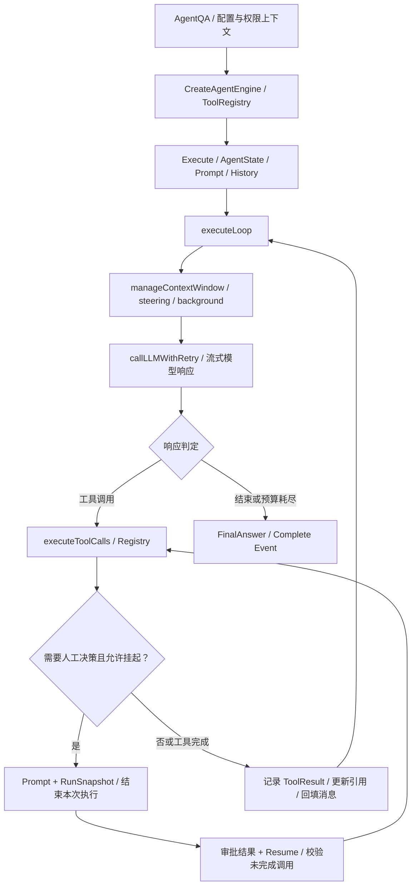
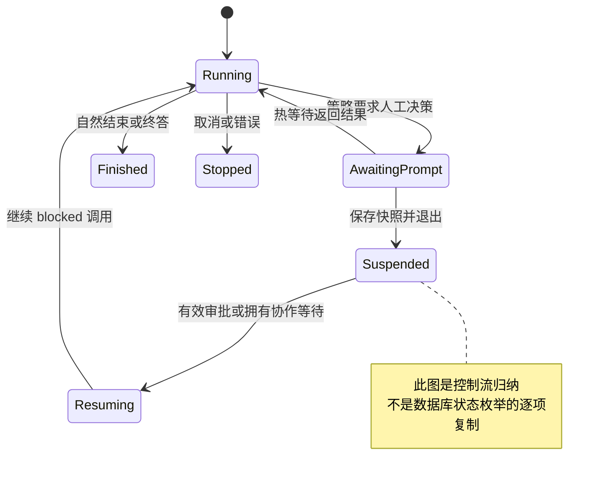
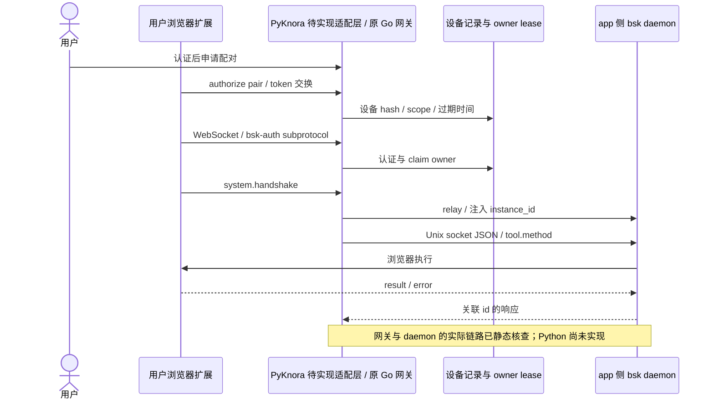
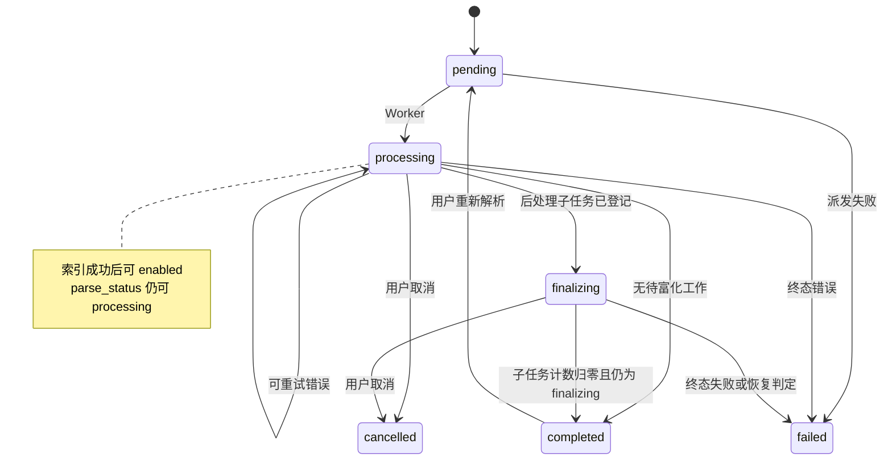

# WeKnora 源码级架构审计

日期：2026-10-27（Asia/Shanghai）。需求依据：[PRD](../PRD_PyKnora.md)。源码：`references/WeKnora`，分支 `main`，commit **`662abaf9f944e37689d04c42160034b2cdec6829`**。来源与许可基线见 [00_Source_Baseline.md](00_Source_Baseline.md)。本轮没有 fetch、切换参考分支或修改参考代码。

## 1. 证据边界与结论

- **A / 源码已验证**：实际读取本地文件中的实现和调用位置，属于静态验证；不表示运行成功、无安全漏洞或已经证明并发正确性。
- **D / 仅文档描述**：来自该 commit 内的官方 `website-docs/`，未沿全部实现验证；不使用移动的 main 网页替代固定版本证据。
- **N / 新架构建议**：对 PyKnora 的建议，尚未接受为 ADR、实现或通过 PoC。
- **U / 待验证**：外部组件、环境、运行结果或静态阅读未覆盖的分支。不把文件存在或测试名称当作测试通过。

本报告针对五条主链路进行抽样深入审计，并非整个仓库的穷尽安全审计。已有 `docs/WeKnora_Source_Architecture_Report.md` 保持原样；其 tree SHA 不作为本轮 commit 证据。

**A：核心结论**：原系统存在两套消费流程（插件式普通 RAG、ReAct Agent）、两类 checkpoint（上下文摘要、可挂起执行快照）、多种解析入口（Go 本地/远程服务）和多层异步状态。BrowserSkill 是授权、会话生命周期、daemon RPC 和连接路由的组合，不是一个通用 Playwright 客户端。任务 pending 表的存在不意味着所有上传都使用了事务 Outbox。[A01–A14、B01–B09、C01–C08、I01–I12、R01–R09]

## 2. Agent：执行、上下文和审批

### 2.1 执行主链

**A**：`sessionService.AgentQA` 解析本轮配置并调用 `agentService.CreateAgentEngine`。后者验证配置，建立独立 ToolRegistry，注册普通/MCP/业务操作/沙箱等工具，准备 MCP 目录，再构造 `AgentEngine`。[A01、A02]

`Execute` 建立 `AgentState`（`RoundSteps`、`KnowledgeRefs`、`CurrentRound`、`IsComplete`、`TurnUsage`），组装 system prompt 和历史、刷新 MCP、构建模型工具定义，进入 `executeLoop`。退出时清理工具；错误经 EventBus 发送。`executeLoop` 处理取消、轮次限制和协作，保证该次进程内 loop 的 complete 事件只发一次；这不是跨进程 exactly-once 保证。[A03、A04]

每轮 `runReActIteration` 先检查上下文、接收 steering/background 输入，再 `callLLMWithRetry`。模型响应经 `analyzeResponse` 分类，调用工具或生成终答；工具结果经 `appendToolResults` 和图片路径接回下一轮消息。不要把 think/act/observe 当成三个完全独立的服务，它们由 Engine 共同驱动。[A04–A07]

### 2.2 Tool Registry、错误和并发

**A**：Registry 重名注册采取 first-wins，支持 deferred 工具和模型可见定义。`ExecuteTool` 查找工具；直接 MCP 工具先校验目录授权，再进入公共执行路径；`execute` 执行 guard、参数类型转换、JSON Schema 校验、panic 捕获、结果规范化和输出长度控制。参数错误可作为 `ToolResult{Success:false}` 返回，不能只用 Go error 判断执行成功。[A08]

`executeToolCalls` 在模型 `finish_reason=length` 时拒绝执行该批可能被截断的参数。并行模式最多 8 个 goroutine；只有 `CanRunConcurrently` 的显式只读白名单可并行，写操作、任意代码与未知/MCP 工具构成顺序屏障，结果按模型原始顺序收集，单个失败不会自动取消所有兄弟调用。`runToolCallAnswered` 解析模型句柄，未解析引用通常在 I/O 前失败，并给工具注入 Principal、调用 ID、审批上下文、执行超时与 snapshot callback。[A07–A09]

**A**：`callLLMWithRetry` 先规范化消息；供应商上下文溢出触发一次强制压缩重试；协议伪文本触发一次模型恢复；瞬时错误最多额外重试 2 次，等待可取消。已有工具结果时可能尝试合成终答。工具重试和模型重试不是同一概念，不能因此重放成功副作用。[A06、A10]

### 2.3 Prompt 与 Context Compaction

**A**：system prompt 通过 `BuildSystemPromptSections` 统一组装，来源、能力、Skills 元数据、memory 等按选项拼接；Skills 先展示元数据，再按需加载完整说明。运行时页面/提及作用域还会注入上下文；`AgentQA` 明确避免把临时 scope envelope 持久化到用户消息中。[A01、A11、A13]

**A**：`manageContextWindow` 根据估计 token 和设置触发 `Compactor.Compact`；历史摘要保留 recent tail，摘要失败可退化成 raw archive，输出标注 degraded。压缩无明显收益时避免反复调用；超预算尾部工具结果另有有损裁剪。这里是上下文语义压缩，不能由数据库 checkpoint 自动替代。[A05、A12]

**A**：`checkpoint.go:saveContextCheckpoint` 将 `compaction.Checkpoint` 的摘要写到对应已存 turn，失败只告警，代价是下轮再摘要，不阻断本轮。它与挂起恢复不是一套状态。[A14]

### 2.4 Suspend / Resume 与人工审批

**A**：`RunSnapshot` 含版本、请求、query、图片、steering 原文、完成 steps、引用、轮次、usage、MCP exposure、协作游标与 `PendingRound`。后者含 blocked index 和待执行调用；每个 PendingCall 保留 ID/name/arguments/provider metadata。`DecodeRunSnapshot` 拒绝未知版本。[A15]

`Resume` 校验 blocked index、已完成调用数量、审批 ToolCallID 或协作 ownership，重建系统/历史消息、回放已完成工具结果并恢复 MCP exposure；`finishPendingRound` 从 blocked index 开始继续，避免正常路径重复执行此前完成的调用。它不证明“外部成功、记录失败”的崩溃窗口能自动去重。[A16]

恢复入口也有业务生命周期：`ResumeSuspendedRun` 保持 prompt lease，等待原执行完成消息保存/释放，再构造请求并重新进入 executeQA；原 owner 消失时可依据保存的 snapshot 重建 awaiting-input 状态。不能把“用户点批准”直接映射成无校验调用 Engine.Resume，跳过 teardown 与 owner 的并发控制。[A24]

**A**：`ConfirmedTool.Execute` 经风险/访问策略得到 Allow、Deny 或审批；已有授权可直接放行，并非所有写操作都固定逐次弹窗。需审批时通过 Gate/`hitl.Broker.Await` 发布 prompt；无人值守模式拒绝未授权审批，deferred 模式可立即挂起。消费批准结果时进入 executing，消费失败则 fail closed，结束调用后 `MarkExecuted`。这些语义值得保留，但审批消费与外部系统写入仍不属于同一个事务。[A17、A18]

### 2.5 Skills、Sandbox、长任务与限制

**A**：Skills Manager 缓存可用 metadata、按 allowed skills 过滤、从租户/默认来源读取完整说明。Sandbox 不等于 Skills：`DefaultManager` 仅接受适合自身语义的配置，会拒绝在无会话绑定的管理器上构造 Docker/Cube/E2B，要求走 SessionBoundManager；脚本校验不是容器/网络隔离的证明。[A13、A19]

**A**：普通 shell 执行默认 120 秒、上限 600 秒；`shell_exec_async` 将长命令提交到 ShellJobService，先在 yield 窗口等待，未结束返回 work_id；后台结果通过 `BackgroundRun` 在轮次边界进入模型。不能把这条长任务链理解成 HTTP handler 一直阻塞，也不能根据工具说明中的“无时间限制”推导租约、服务重启后永久可靠。[A20、A21]

**A**：限制分散存在：Engine 轮次（负值允许不限）、单轮只读工具并行 8、按模型的后台并发 governor（交互调用可透传）、协作 Runtime 默认 concurrency=3/max running=32、单任务最多 16 个 child、单 child turn 有边界。它们不是统一的组织预算账本，也不证明已存在 PRD 所要求的通用 Task DAG/Evaluator/Replanner。[A04、A07、A22、A23]

**N**：Python 用 LangGraph 承载执行 checkpoint/interrupt；Harness 保留上下文压缩、权限、审批绑定、模型/工具预算和观测；业务 run 状态独立持久化。恢复时仍需重新校验权限和外部副作用执行凭据。

## 3. BrowserSkill：授权网关与协议边界

### 3.1 设备、扩展和 daemon

**A**：`Scope` 是 Tenant + User。`BrowserSkillScope` 从原 caller 取范围，避免共享 Agent 执行租户替换浏览器所有者。配对、设备、任务记录由 Store 保存；配对有效期 5 分钟、设备有效期 90 天，token 采用 hash 保存并支持续期轮换。[B01–B03]

`AuthorizeHTTP` 限制 POST、扩展 Origin、请求体与 token 格式；pair 交换一次性 token，renew 轮换设备 token。扩展连接的 WebSocket 凭据通过单个 `bsk-auth.` subprotocol 提交，服务端认证、申请连接 owner lease 后接入 daemon。Origin 校验只验证 `chrome-extension://` ID 形态，不是固定商店扩展 ID 白名单；主要身份凭据仍是 token。[B02、B04]

**A**：daemon 在 **WeKnora app 一侧**启动，扩展在用户电脑上；`start` 调用 bsk `daemon start --foreground --port 0`，分配独立 `BSK_HOME`，读 `daemon.json.ws_port`。网关转发扩展 `system.handshake`，注入 browser instance ID，要求关联回复及非空 protocol_version；该函数没有实现完整版本范围协商。[B05、B06]

**A**：工具调用走 Unix socket `run/daemon.sock`，按行 JSON 帧 `{id,method,params}` 请求/关联 result 或 RPCError；上层加 `tool.` 前缀。超时尝试 cancel，并明确不自动重放操作；`id=0/protocol_error` 特判为 daemon_incompatible。此处不是 MCP，也不是 Playwright wire protocol。[B07]

### 3.2 工具、人工接管和多实例

**A**：模型工具 `local_browser` 先比较 caller scope、验证 schema、检查 connected/paired，再每 turn select 一次任务并调用 Manager。`Call` 校验方法白名单，用会话 command channel 串行自动化，校验 selected/paused/stopping、设备连接/expiry、generation/epoch。会清理调用者提供的 session_id/browser_instance_id，使用网关绑定的 session。[B01、B08]

`request_help` 和 `tab_borrow` 是 human step，最多 5 分钟等待并留 15 秒传输余量；`request_help` 删除模型提供的 completion_criteria，要求用户 Continue。`Control(select)` 不解除 pause；必须 start/resume 等明确控制；离线重连不自动重放动作。成功 turn 可清理临时任务，失败、取消或 keep_open 则保留页面供用户处理。[B01、B08、B09]

**A**：Store 中的 owner/owner URL/lease key 将设备连接映射到实际实例。`route` 再校验成员关系、有效设备与租约；跨节点使用带 timestamp/nonce/HMAC 的内部 HTTP RPC，拒绝重复转发。`InternalHTTP` 校验签名、时间窗与本节点 nonce 缓存。连接归属变化或远端不可达时失败，不偷偷在本机重开并重放。[B03、B10]

**U**：这不是连接无损迁移保证；断网、owner 崩溃、租约竞争、人工接管中停止以及浏览器 window/session 失效，需要真实多实例和扩展测试。

### 3.3 可复用与不确定项

**A**：构建清单固定 BrowserSkill 0.3.1，daemon/extension 共用 upstream commit `da6bf4eed2dd7256567e152df8c903c87f6598c3`。构建脚本单独 clone Tencent/BrowserSkill 并 checkout 此 SHA、复制 LICENSE。当前 WeKnora checkout 不等于已经获取该 upstream 实现。[B11]

**D**：官方说明支持 Chrome/Edge（Chromium 125+）、配套扩展至少 0.3.1，并要求 daemon/扩展一起升级；默认单节点活动设备上限 32 不代表吞吐。[D04]

**N**：优先复用固定版本 daemon/扩展，在 Python 重建授权网关与协议客户端，或先以独立受控桥接服务保留 Go 接入层；两种路线均需 ADR。统一 BrowserAdapter 应暴露 capability/error/human-intervention 契约，而不是假设所有 BrowserSkill 方法都有 Playwright 等价物。Go 实现中的 `/tmp`、Unix socket、进程启动方式意味着不能宣称 Python Windows 原生兼容已解决。[B05、B07]

## 4. DocReader：服务契约和复用条件

**A**：Proto 现有四个 RPC：Read、ReadStream、ListEngines、PreprocessImage。ReadRequest 支持文件 bytes/name/type 或 URL/title，配置含 engine 和 overrides、request_id；未提供 workspace_id。后端 Worker 必须在调用前校验工作区，而不能把共享服务 token 当用户权限。[C01]

| 契约 | 源码已验证行为 | 影响 |
| --- | --- | --- |
| Read | 完整 Markdown、图片、metadata、error、source_blocks | gRPC OK 不保证业务成功，需检查 error |
| ReadStream | 首帧 meta，随后每图一帧；部分 parser 可懒加载图片 | 不是逐段 Markdown 流，也不是上传流 |
| SourceBlock | Markdown Unicode code point 半开区间；locator_json 可描述页码/bbox | Go rune/Python/浏览器 UTF-16 必须明确转换 |
| ImageRef | original_ref、mime、storage_key、inline bytes | 图片存储与 URL 替换不由解析服务全包 |
| ListEngines | 返回 engine、支持格式、available 与原因 | 列表可用不代表端到端解析正确 |

证据：[C01–C03]。ReadStream 仍有整份文件请求和单个完整 Markdown meta，不能宣称内存与文档大小无关。Go 客户端还会累计 ImageRefs；Python Worker 若要降低峰值应边收图边落对象存储并在流完整结束后发布。[C01、C02、C04]

**A**：`_parse_request` 优先 URL 分支；`parse_file` 每次创建 parser，registry 按指定 engine → type default → builtin 回退，无匹配则抛错。内置覆盖 PDF/DOCX/MD/HTML 等，还有 markitdown/opendataloader；TXT 不在该 Python registry 的内置映射中，原 Go simple reader 承担 txt/md/csv/json 等，PyKnora 不可只接 gRPC 就声称 PRD 五种格式全部闭环。[C03、C05、C06]

`parse_url` 接受 engine/overrides 参数，但实际直接构建 `WebParser(title=...)`。WebParser 的 StdWebParser 使用 Playwright WebKit、Trafilatura 等提取；导航前 URL 检查、页面 route guard、SSRFProxy 是三层相关防护。代理解析并检查 IP，再连接指定地址；这不等于 robots、版权、域名许可与研究任务预算已经实现。[C03、C07、C08]

**A**：服务端为同步 grpc.server + RequestThreadPoolExecutor，可配置 worker 与消息上限；token interceptor 在未设置 GRPC_AUTH_TOKEN 时放行；TLS 依据配置启用。不得把默认启动当作生产安全配置。Python 元数据要求 >=3.10.18，含浏览器/OCR/Office/PDF 依赖；并非一个仅复制 main.py 即可运行的轻量纯 Python 函数。[C02、C09、C10]

**A**：Go `GRPCDocumentReader.Read` 首选 ReadStream，只有 UNIMPLEMENTED 降级 Read；流 meta/error 与异常需分别处理；没有 meta 判失败。图片持久化、原文资源绑定、正文表格规范化、source locator 重映射和分块主要在 Go 摄取服务，复用解析 RPC 不会复用这一整段业务。[C04、I04]

**N**：优先以独立服务复用 DocReader，Celery Worker 用固定 proto client + deadline/auth/TLS 调用；FastAPI 只创建任务。为 TXT 等定义 Python 简单格式适配，独立评估 chunker、图像存储和 source location。先跑 PDF/DOCX/TXT/MD/HTML golden set，再决定是否直接嵌入 parser 包。

## 5. 摄取：从 Handler 到索引与后处理

### 5.1 五条关键步骤

**A**：文件路径从 `KnowledgeHandler.CreateKnowledgeFromFile` 校验访问后调用 service，后者保存 Knowledge/原文件并创建 Asynq 文档任务；URL 路径另处理网页与文件 URL。创建任务使用 MaxRetry(3)，入队失败会标记 knowledge failed 并可能返回已保存的 knowledge，而非自动回滚原文件。[I01、I02]

标准 Redis 模式由 `router/task.go` 注册 `TypeDocumentProcess → KnowledgeService.ProcessDocument`，按队列池分配并发。Lite 模式另有同步执行器注册，不能把其持久性与 Redis 模式等同。[I03]

`ProcessDocument` 解析 `DocumentProcessPayload`，恢复 execution tenant，读取知识行/KB，验证 ownership、attempt、删除/取消/完成状态，设置 processing，然后 convert。解析结果经图片保存/绑定、表格规范化与位置映射，再 Go chunker 分割（可选 parent-child），进入 processChunks。[I04、I05]

`processChunks` 保存带 tenant/KB/knowledge、位置及 parent/prev/next 的 Chunk；构造 IndexInfo，包含标题/heading context 的 embedding 文本；BatchIndex 调用 embedding 和 repository。hybrid indexer 分窗口处理以限制输入与返回向量峰值，检查 embedding 数量。索引失败可能清理 chunk/index，重试预算未尽返回 error，否则落终态。[I04、I06]

索引可见后 `EnableStatus=enabled`，有文本或多模态后处理时 ParseStatus 仍 processing。postprocess 根据配置启动摘要、分批问题、graph、wiki 等子任务，设置 finalizing 与 pending_subtasks_count；终结时以原子 decrement + 条件 UPDATE 推进 completed。可检索和全部富化完成是不同事件。[I07、I08]

```mermaid
flowchart LR
    H["Handler / 权限与输入校验"] --> S["CreateKnowledge / DB 与原文件"]
    S --> Q["Asynq / Redis"]
    Q --> W["ProcessDocument / tenant 与 attempt"]
    W --> P["本地 Reader 或 Python DocReader"]
    P --> M["图片存储 / locator 映射 / Go chunker"]
    M --> C["Chunk DB"]
    C --> E["Embedding / BatchIndex / Retrieval Repository"]
    E --> V["enabled / 可检索"]
    V --> F["PostProcess / 富化 fan-out / finalizing"]
    F --> D["FinalizeSubtask / completed"]
```

### 5.2 幂等、重试与故障边界

**A**：入口使用内容/来源去重（见 I02 的创建分支），Worker 使用 completed skip、attempt superseded、文件路径/源替换和多处 cancel/delete 检查。`attemptSuperseded` 对 attempt<=0 返回 false；ProcessDocument 为旧/无 attempt payload 回退 OpenAttempt。初始创建所读 payload 构造处没有显式 Attempt 字段，因此不能仅根据 task.go 注释就断言每个生产者都在入队时携带 attempt；应继续追踪任务包装及兼容分支。[I02、I04、I05、I09]

**A**：`task_queue.go` 实现 pending op 的校验、事务插入、按 dedup key 的 claim/过期重领（Postgres SKIP LOCKED）、dead letter 等。已追踪的实际消费者是 Wiki ingest 的 KB-scoped pending op；Wiki finalizing 计数与 pending op 有专门事务入口。普通文件创建处直接 `s.task.Enqueue`。因此“所有业务创建与派发已统一事务化”不成立为本轮已验证结论。[I02、I10、I11]

`ProcessDocument` 错误处理不是统一返回：坏 JSON payload 记录错误后返回 nil；租户/知识 DB 暂时错误返回 error；缺失知识行返回 nil；非法 scope 可 SkipRetry；某些配置/业务错误写 failed 后返回 nil；BatchIndex 暂时错误按预算重试。Python 应显式区分 ack、retry、permanent failure、cancelled 与 superseded。[I04]

**A**：所读 Asynq dead-letter middleware 按 retry metadata 判定终次失败，记录 TaskDeadLetter 并调用状态回写 callback；它未在 `isFinalAttempt` 中单独识别 SkipRetry，不能据此保证全部不可重试路径均入死信，需逐入口核验。Lite 重启恢复与分布式不同：启动 reset 不会把其他副本可能还在处理的知识一律标 failed；分布式依赖巡检判定。不能复制成“启动清空所有 processing”。[I12、I13]

此图归纳主路径；删除、手工草稿、多模态及异常修复有额外分支，不能直接作为 PyKnora schema。**N**：原实现的 attempt 与补偿机制可借鉴；PRD 的 DocumentVersion/SourceVersion、版本化索引和原子激活应重新设计与故障注入验证，不声称原链已证明该契约。

## 6. 普通 RAG、Agent Chat 与 SSE

**A**：普通 `KnowledgeQA` 动态组装事件列表：历史（可选）、memory、query understand、parallel search、rerank、web fetch（可选）、merge、Top-K、数据分析（可选）、message、stream。纯聊天可跳过检索。`EventManager` 将同事件插件按注册顺序组成责任链，`KnowledgeQAByEvent` 按事件列表调度；这是原 Go 的编排方式，Python 不需再造插件事件框架。[R01、R02]

- **改写**：QueryUnderstand 默认保留原 query；关闭改写且无图时跳过；加载/调用改写模型失败可继续原查询，结构化结果包括意图/图片信息。[R03]
- **检索**：parallel search 克隆 ChatManage，分别查 chunk 与 entity 后合并去重。底层 HybridSearch 对全部 KB 校验 caller 授权，拒绝不同 embedding space 混检；先算 query embedding 再 fan-out。[R04、R05]
- **融合**：`fuseWithRRF` 使用两路最佳 rank、配置权重和 k，按最大可能分数归一化。它不是把向量余弦相似度和 BM25 原始分数直接相加，也不是 Rerank。[R06]
- **关键词存储**：所读 Postgres repository 使用 ParadeDB `content ||| ?` 及 score function，不能把这条 SQL 直接放到普通 PostgreSQL FTS。[R07]
- **重排**：模型缺失/不可用或调用错误可降级检索顺序，diagnostics 区分原因；真正过滤为空可触发 ErrSearchNothing。merge 另处理去重、父 chunk 和邻接内容，最后做 Top-K。[R08、R09]
- **引用**：模型上下文 Registry 注册真实搜索来源，用临时引用/资源句柄编码输入，流解码负责跨 token 边界还原引用；不可用证据有显式提示。source_blocks → chunk locator 另提供原文定位，不等于模型所写任意 URL 已验证。[R10、R11、I04]

**A**：Agent Chat 经 `AgentQA → Engine → tools` 多轮取证，与普通 RAG 共享检索服务、模型协议与 EventBus，但没有强制走普通 RAG 全部固定插件阶段。[A01、A02、R01]

**A**：Handler 创建每请求 EventBus，AgentStreamHandler 订阅 thought/tool/result/references/answer/approval/complete，向 StreamManager 写事件；SSE 层每 100ms 拉取、10 秒 heartbeat；ContinueStream 先验证 session 和 message 再重放/继续。完成事件在消息持久化成功后 publish，避免 UI 已完成而刷新丢历史。取消路径用不受取消影响的上下文保存已有步骤。[R12–R15]

**U**：内存/Redis stream buffer 与数据库消息保留期、游标过期、掉线重复片段、跨副本读与保存失败仍需运行验证；SSE 续传不等于 Graph checkpoint 恢复，也不等于任意进程崩溃后能重启模型流。

## 7. 与官方文档交叉验证

| 官方材料（固定在本地基线） | 源码对照 | 证据结论 |
| --- | --- | --- |
| D01：总体架构 / 后端分层 | A01、I01、R01 | API/业务/异步/解析分离一致；仅文档的部署能力不算实测 |
| D02：入库流程 | I01–I13、C01–C08 | Go 分块、异步富化、processing/finalizing 一致；文档第 280 行称不调用 ListEngines，与 C11 当前 handler 不一致 |
| D03：RAG Pipeline | R01–R15 | 动态插件链、统一流事件、SSE polling 与代码一致；多副本可靠性仍 U |
| D04：本机浏览器 | B01–B11 | app 侧 daemon/本机扩展、人工暂停与路由一致；Chrome/Edge 版本支持仅 D |

其他漂移：`docreader/parser/registry.py` 底部注释也称 Go 不调用 ListEngines，但 `fetchRemoteEngines` 实际调用；后处理源码前段注释提及逐 chunk 问题任务，紧接实现按 batch 计数。报告采用实现，不照搬注释。[C05、C11、I08]

## 8. 证据索引（真实路径、符号与行号）

所有相对源码链接均指向本地已锁定 checkout。行号范围表示本轮重点读取处，可用固定 commit 的 GitHub `blob/<SHA>/<path>#Lx` 复现。下表的符号和行号在交付前做静态一致性检查。

| ID | 源码路径与行号 | 关键符号/内容 |
| --- | --- | --- |
| A01 | [internal/application/service/session_agent_qa.go:306–415](../../references/WeKnora/internal/application/service/session_agent_qa.go#L306) | CreateAgentEngine、EnableSuspension、SetContextCheckpointSink、Resume/Execute |
| A02 | [internal/application/service/agent_service.go:231–301](../../references/WeKnora/internal/application/service/agent_service.go#L231) | CreateAgentEngine / 注册与模型作用域装配 |
| A03 | [internal/agent/engine.go:369–489](../../references/WeKnora/internal/agent/engine.go#L369) | Execute / AgentState / Cleanup |
| A04 | [internal/agent/engine.go:534–543,694–827,847–1428](../../references/WeKnora/internal/agent/engine.go#L694) | withinIterationBudget、executeLoop、runReActIteration、runRoundTools |
| A05 | [internal/agent/observe.go:39–151,1065–1125](../../references/WeKnora/internal/agent/observe.go#L39) | manageContextWindow、runCompaction、appendToolResults |
| A06 | [internal/agent/think.go:556–695](../../references/WeKnora/internal/agent/think.go#L556) | callLLMWithRetry |
| A07 | [internal/agent/act.go:228–357,454–696](../../references/WeKnora/internal/agent/act.go#L228) | executeToolCalls / executeToolCallsParallel / runToolCallAnswered |
| A08 | [internal/agent/tools/registry.go:60–105,177–338](../../references/WeKnora/internal/agent/tools/registry.go#L177) | RegisterTool、ExecuteTool、execute、executeRecovered |
| A09 | [internal/agent/tools/execution_policy.go:3–17](../../references/WeKnora/internal/agent/tools/execution_policy.go#L6) | CanRunConcurrently |
| A10 | [internal/agent/const.go:55–56,105–145](../../references/WeKnora/internal/agent/const.go#L55) | maxLLMRetries / toolExecutionTimeout |
| A11 | [internal/agent/prompts.go:321–338,562–630](../../references/WeKnora/internal/agent/prompts.go#L562) | formatSkillsMetadata / BuildSystemPromptSections |
| A12 | [internal/agent/compaction/compactor.go:112–163](../../references/WeKnora/internal/agent/compaction/compactor.go#L112) | Compact / summarizeHistory |
| A13 | [internal/agent/skills/manager.go:194–263](../../references/WeKnora/internal/agent/skills/manager.go#L194) | Initialize / GetAllMetadata / LoadSkill |
| A14 | [internal/agent/checkpoint.go:14–43](../../references/WeKnora/internal/agent/checkpoint.go#L21) | SetContextCheckpointSink / saveContextCheckpoint |
| A15 | [internal/agent/suspend.go:34–86,246–292](../../references/WeKnora/internal/agent/suspend.go#L34) | RunSnapshot / PendingRound / PendingCall / DecodeRunSnapshot / snapshot |
| A16 | [internal/agent/resume.go:18–155,170–206](../../references/WeKnora/internal/agent/resume.go#L18) | Resume / finishPendingRound |
| A17 | [internal/agent/tools/confirmed_tool.go:68–162](../../references/WeKnora/internal/agent/tools/confirmed_tool.go#L68) | ConfirmedTool.Execute |
| A18 | [internal/agent/approval/gate.go:273–387,402–449,554–615](../../references/WeKnora/internal/agent/approval/gate.go#L273) | awaitToolApproval / consumeDecision / MarkExecuted / ResolveForResume |
| A19 | [internal/sandbox/manager.go:21–104](../../references/WeKnora/internal/sandbox/manager.go#L21) | NewManager / initializeSandbox / Execute |
| A20 | [internal/agent/tools/shell_exec.go:72–79,446–540](../../references/WeKnora/internal/agent/tools/shell_exec.go#L72) | defaultShellExecTimeout / shellExecMaxTimeout / Execute |
| A21 | [internal/agent/tools/shell_exec_async.go:22–60,148–210](../../references/WeKnora/internal/agent/tools/shell_exec_async.go#L148)；[internal/agent/background.go:17–65](../../references/WeKnora/internal/agent/background.go#L17) | ShellJobSubmitter / Execute / BackgroundRun / injectBackground |
| A22 | [internal/models/chat/concurrency_wrapper.go:10–76](../../references/WeKnora/internal/models/chat/concurrency_wrapper.go#L37) | concurrencyChat.Chat / ChatStream |
| A23 | [internal/agent/collaboration/runtime.go:93–137,143–188](../../references/WeKnora/internal/agent/collaboration/runtime.go#L93) | New / Spawn / Send |
| A24 | [internal/handler/session/resume.go:46–125](../../references/WeKnora/internal/handler/session/resume.go#L46) | ResumeSuspendedRun / awaitSuspendedRunSettled |
| B01 | [internal/agent/tools/browserskill.go:24–142](../../references/WeKnora/internal/agent/tools/browserskill.go#L40) | BrowserSkillScope / BrowserSkillTool.Execute / Cleanup |
| B02 | [internal/browserskill/authorization.go:19–124](../../references/WeKnora/internal/browserskill/authorization.go#L47) | tokenHash / AuthorizeHTTP |
| B03 | [internal/browserskill/store.go:18–71,87–202,214–261](../../references/WeKnora/internal/browserskill/store.go#L18) | DeviceRecord / exchange / authenticate / renew / claim / heartbeat |
| B04 | [internal/browserskill/manager.go:28–44,361–438,613–627](../../references/WeKnora/internal/browserskill/manager.go#L361) | Scope / AuthProtocol / ServeHTTP / validExtensionOrigin |
| B05 | [internal/browserskill/daemon.go:23–27,129–192](../../references/WeKnora/internal/browserskill/daemon.go#L129) | connectionLimit / start |
| B06 | [internal/browserskill/manager.go:560–610](../../references/WeKnora/internal/browserskill/manager.go#L560) | relayHandshake |
| B07 | [internal/browserskill/manager.go:663–724](../../references/WeKnora/internal/browserskill/manager.go#L669) | rpc / rpcReply / daemon_incompatible |
| B08 | [internal/browserskill/manager.go:851–1012,1070–1170](../../references/WeKnora/internal/browserskill/manager.go#L851) | Call / pauseTask / Control |
| B09 | [internal/browserskill/human.go:8–42](../../references/WeKnora/internal/browserskill/human.go#L8) | HumanStepWait / IsHumanStep / clusterTimeout |
| B10 | [internal/browserskill/cluster.go:76–158,162–237](../../references/WeKnora/internal/browserskill/cluster.go#L76) | route / InternalHTTP |
| B11 | [scripts/browserskill-release.json:1–11](../../references/WeKnora/scripts/browserskill-release.json#L1)；[scripts/build_browserskill.sh:13–52](../../references/WeKnora/scripts/build_browserskill.sh#L13) | extension/daemon source_commit / clone / checkout / license |
| C01 | [docreader/proto/docreader.proto:7–128](../../references/WeKnora/docreader/proto/docreader.proto#L7) | RPC / ReadConfig / ReadRequest / SourceBlock / ImageRef / ReadStreamResponse |
| C02 | [docreader/main.py:188–365,383–418](../../references/WeKnora/docreader/main.py#L188) | _parse_request / Read / ReadStream / main |
| C03 | [docreader/parser/parser.py:48–136](../../references/WeKnora/docreader/parser/parser.py#L48) | parse_file / parse_file_stream / parse_url |
| C04 | [internal/infrastructure/docparser/grpc_parser.go:107–195](../../references/WeKnora/internal/infrastructure/docparser/grpc_parser.go#L107) | Read / readStream / UNIMPLEMENTED fallback |
| C05 | [docreader/parser/registry.py:68–114,151–211](../../references/WeKnora/docreader/parser/registry.py#L68) | get_parser_class / _build_default_registry |
| C06 | [internal/infrastructure/docparser/builtin_converter.go:34–84](../../references/WeKnora/internal/infrastructure/docparser/builtin_converter.go#L34)；[internal/infrastructure/docparser/engine_registry.go:69–144](../../references/WeKnora/internal/infrastructure/docparser/engine_registry.go#L69) | IsSimpleFormat / SimpleFormatReader.Read / NewReader / ListAllEngines |
| C07 | [docreader/parser/web_parser.py:137–150,174–243](../../references/WeKnora/docreader/parser/web_parser.py#L174) | install_ssrf_route_guard / StdWebParser.scrape |
| C08 | [docreader/utils/ssrf_proxy.py:22–37,40–85](../../references/WeKnora/docreader/utils/ssrf_proxy.py#L22) | resolve target / SSRFProxy._connect |
| C09 | [docreader/auth.py:41–108,156–198](../../references/WeKnora/docreader/auth.py#L156) | load_tls_credentials / AuthInterceptor |
| C10 | [docreader/pyproject.toml:1–37](../../references/WeKnora/docreader/pyproject.toml#L1) | Python 范围及依赖声明 |
| C11 | [internal/handler/system.go:552–564](../../references/WeKnora/internal/handler/system.go#L555) | fetchRemoteEngines → reader.ListEngines |
| I01 | [internal/handler/knowledge.go:313–436,493–539](../../references/WeKnora/internal/handler/knowledge.go#L313) | CreateKnowledgeFromFile / CreateKnowledgeFromURL |
| I02 | [internal/application/service/knowledge_create.go:27–289,311–475](../../references/WeKnora/internal/application/service/knowledge_create.go#L27) | 文件/URL 创建、去重与直接 Enqueue |
| I03 | [internal/router/task.go:137–156,270–280](../../references/WeKnora/internal/router/task.go#L270)；[internal/router/sync_task.go:249–256](../../references/WeKnora/internal/router/sync_task.go#L249) | newAsynqServer / TypeDocumentProcess 注册 |
| I04 | [internal/application/service/knowledge_process.go:3748–3906,4118–4284,4307–4410](../../references/WeKnora/internal/application/service/knowledge_process.go#L3748) | ProcessDocument / convert / 图片与 sourceIndex / chunker |
| I05 | [internal/application/service/knowledge.go:198–208](../../references/WeKnora/internal/application/service/knowledge.go#L198) | attemptSuperseded / currentAttemptSuperseded |
| I06 | [internal/application/service/knowledge_process.go:401–466,622–915](../../references/WeKnora/internal/application/service/knowledge_process.go#L401)；[internal/application/service/retriever/keywords_vector_hybrid_indexer.go:88–152](../../references/WeKnora/internal/application/service/retriever/keywords_vector_hybrid_indexer.go#L88) | processChunks / BatchIndex |
| I07 | [internal/application/service/knowledge_process.go:253–286](../../references/WeKnora/internal/application/service/knowledge_process.go#L262) | finalizeIndexedKnowledgeState |
| I08 | [internal/application/service/knowledge_post_process.go:83–172,199–295](../../references/WeKnora/internal/application/service/knowledge_post_process.go#L199)；[internal/application/repository/knowledge.go:675–741](../../references/WeKnora/internal/application/repository/knowledge.go#L675) | Handle / FinalizeSubtask / finalizeSubtask |
| I09 | [internal/types/task.go:300–322](../../references/WeKnora/internal/types/task.go#L300) | DocumentProcessPayload / Attempt |
| I10 | [internal/application/repository/task_queue.go:29–61,131–201,260–306,535–559](../../references/WeKnora/internal/application/repository/task_queue.go#L260) | Enqueue / SeedKnowledgeFinalizingWithPendingOp / ClaimBatch / Insert |
| I11 | [internal/application/service/wiki_ingest.go:983–1004](../../references/WeKnora/internal/application/service/wiki_ingest.go#L983) | pendingRepo.ClaimBatch 消费点 |
| I12 | [internal/middleware/asynqdl/asynqdl.go:66–98,124–131](../../references/WeKnora/internal/middleware/asynqdl/asynqdl.go#L66) | MiddlewareWithCallback / isFinalAttempt |
| I13 | [internal/container/reset_pending_tasks.go:18–105](../../references/WeKnora/internal/container/reset_pending_tasks.go#L32) | resetPendingTasks / Lite 与分布式差异 |
| R01 | [internal/application/service/session_knowledge_qa.go:198–250,674–744](../../references/WeKnora/internal/application/service/session_knowledge_qa.go#L198) | KnowledgeQA / KnowledgeQAByEvent |
| R02 | [internal/application/service/chat_pipeline/chat_pipeline.go:11–79](../../references/WeKnora/internal/application/service/chat_pipeline/chat_pipeline.go#L11) | Plugin / EventManager / buildHandler / Trigger |
| R03 | [internal/application/service/chat_pipeline/query_understand.go:61–167](../../references/WeKnora/internal/application/service/chat_pipeline/query_understand.go#L61) | PluginQueryUnderstand.OnEvent |
| R04 | [internal/application/service/chat_pipeline/search_parallel.go:90–178](../../references/WeKnora/internal/application/service/chat_pipeline/search_parallel.go#L90) | PluginSearchParallel.OnEvent |
| R05 | [internal/application/service/knowledgebase_search.go:130–275](../../references/WeKnora/internal/application/service/knowledgebase_search.go#L130) | HybridSearch / hybridSearchCandidates / authorizeKBAccess / validateSameEmbeddingModel |
| R06 | [internal/application/service/knowledgebase_search_fusion.go:170–206](../../references/WeKnora/internal/application/service/knowledgebase_search_fusion.go#L170) | fuseWithRRF |
| R07 | [internal/application/repository/retriever/postgres/repository.go:225–291,330–337](../../references/WeKnora/internal/application/repository/retriever/postgres/repository.go#L225) | KeywordsRetrieve / VectorRetrieve |
| R08 | [internal/application/service/chat_pipeline/rerank.go:39–159](../../references/WeKnora/internal/application/service/chat_pipeline/rerank.go#L39) | PluginRerank.OnEvent |
| R09 | [internal/application/service/chat_pipeline/merge.go:44–105,243–285](../../references/WeKnora/internal/application/service/chat_pipeline/merge.go#L44) | PluginMerge.OnEvent / resolveParentChunks |
| R10 | [internal/application/service/chat_pipeline/references.go:16–113](../../references/WeKnora/internal/application/service/chat_pipeline/references.go#L16) | prepareMessagesWithModelContext / Registry |
| R11 | [internal/application/service/chat_pipeline/chat_completion_stream.go:55–165,225–255](../../references/WeKnora/internal/application/service/chat_pipeline/chat_completion_stream.go#L55) | OnEvent / StreamDecoder / Flush |
| R12 | [internal/handler/session/qa.go:754–810,1282–1305,1452–1506,1552–1555](../../references/WeKnora/internal/handler/session/qa.go#L754) | setupSSEStream / executeQA |
| R13 | [internal/handler/session/agent_stream_handler.go:157–178,1000–1042](../../references/WeKnora/internal/handler/session/agent_stream_handler.go#L157) | Subscribe / publishCompletion |
| R14 | [internal/handler/session/stream.go:37–95,184–205,363–405](../../references/WeKnora/internal/handler/session/stream.go#L37) | ContinueStream / handleAgentEventsForSSE |
| R15 | [internal/handler/session/qa.go:1481–1489](../../references/WeKnora/internal/handler/session/qa.go#L1481) | context.WithoutCancel 保存已有结果 |
| D01 | [website-docs/02-architecture/01-overview.md](../../references/WeKnora/website-docs/02-architecture/01-overview.md)；[02-backend-design.md](../../references/WeKnora/website-docs/02-architecture/02-backend-design.md) | 官方总体架构 / 后端分层，D |
| D02 | [website-docs/02-architecture/03-document-pipeline.md:266–280](../../references/WeKnora/website-docs/02-architecture/03-document-pipeline.md#L266) | 官方解析与入库说明，D |
| D03 | [website-docs/02-architecture/04-rag-pipeline.md:1–96](../../references/WeKnora/website-docs/02-architecture/04-rag-pipeline.md#L1) | 官方 RAG / SSE，D |
| D04 | [website-docs/05-clients/09-local-browser.md:3–106](../../references/WeKnora/website-docs/05-clients/09-local-browser.md#L3) | 官方本机浏览器，D |

## 9. 本轮验证与未执行项

已执行只读 Git 基线核验、rg 符号定位和上述源文件/官方文档阅读。报告链接、行号范围、关键符号与 Markdown 围栏在交付前静态检查；结果记录于 [实施状态](../IMPLEMENTATION_STATUS.md)。

未运行 Go/Python 业务测试、服务启动、模型调用、真实扩展、多副本、网络攻防与性能实验。当前 shell 未发现 Go 命令；有 Python/uv 不代表 DocReader 依赖已安装。`internal/browserskill/extension_test.go:24–30` 明确缺少环境变量会 skip；`docreader/tests/test_docreader_stream.py:40,86` 提供流顺序和取消清理用例；`internal/agent/resume_test.go:32,83,92` 提供恢复/错审批/二次挂起回归入口。本轮仅阅读它们，没有声称通过。
