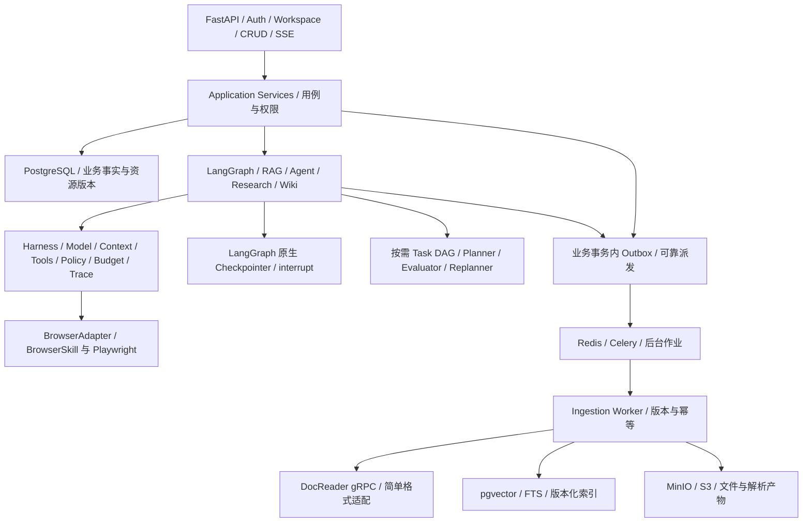

# WeKnora → PyKnora 架构映射与取舍

日期：2026-10-27。参考 commit：`662abaf9f944e37689d04c42160034b2cdec6829`。前置依据：[PRD](../PRD_PyKnora.md)、[源码审计及证据索引](01_Source_Architecture.md)。本文件全部目标模块、接口和取舍均为 **N / 新架构建议**，不是现有代码、已接受 ADR 或已验证依赖选择。Axx/Bxx/Cxx/Ixx/Rxx 是上一份报告的真实源码证据编号。

## 1. 保留职责，替换执行机制

原 Go 的 Engine、事件插件、业务服务、Asynq 和 repository 是可借鉴的职责边界，不能逐文件翻译。Python 的最小依赖结构建议为 API → application → domain/ports；Graph、模型、解析、对象存储、任务队列是适配层。业务表与 Graph checkpoint 分别保存事实与执行进度；稳定 ID 建立关联。

图中 Outbox、DAG 与 Worker 接口尚待 TDD/ADR，图不代表当前仓库已具备这些组件。

## 2. 模块映射与复用判断

建议路径均以未来 `src/pyknora/` 为根，不在本轮创建。

| 原实现及静态证据 | 建议 Python 模块 | 处理 | 依据、验证条件与阶段 |
| --- | --- | --- | --- |
| handler/knowledge、session QA（I01、R12） | `api/v1/`、`application/` | 重写 | 保留资源/事件语义，按 PRD 定义 API；不承诺原路径/body/status 完全兼容，P0 |
| tenant/KB caller 校验（R05、B01） | `auth/`、`policies/`、repository scope | 重设计 | 所有业务资源显式 workspace_id；用户、共享资源所有者、执行主体分离；不得只机械重命名 TenantID，P0 |
| AgentEngine loop（A03、A04） | `graphs/agent.py` | 替换 | LangGraph 节点/条件边承载循环、状态、中断与恢复；不移植 Go loop，P1 |
| 普通 RAG EventManager（R01、R02） | `graphs/rag.py` | 替换 | 保留可选改写/并行检索/重排/引用，普通 RAG 无需 Planner，P0 |
| Prompt/Compactor（A05、A11、A12） | `harness/context.py`、`harness/prompts/` | 重写并借鉴语义 | 保留最近窗口、工具对完整性、摘要降级和引用；不能直接承诺不同 tokenizer/provider 等价，P0/P1 |
| context checkpoint（A14） | `harness/context.py` + message summary storage | 保留业务能力 | 摘要是可再生缓存，和执行 checkpoint 分开；失败不必使整个 run 失败 |
| RunSnapshot/Resume/Suspend（A15、A16） | `graphs/state.py`、LangGraph checkpointer adapter | 替换 | 使用原生持久化/interrupt；旧 JSON 不直接导入，明确 graph/schema 版本、升级策略与 thread ownership |
| ToolRegistry（A08、A09） | `harness/tools/registry.py`、`executor.py` | 重写薄层 | 复用模型/工具库定义与 schema 能力；保留 runtime 授权、结果/错误规范、输出预算、只读并行屏障 |
| Gate/ConfirmedTool/HITL（A17、A18） | `harness/policy.py`、`approvals/` | 重设计 | 审批绑定具体参数、主体、scope 和工具版本；等待交给 interrupt；消费结果不等于外部执行幂等 |
| collaboration Runtime（A23） | `orchestration/` | 借鉴，按需重设计 | 幂等 request key、租约、限额值得保留；child 协作不是通用依赖 DAG，不默认复刻多 Agent，P1/P2 |
| BackgroundRun / ShellJob（A20、A21） | `jobs/` + result event adapter | 延后任意 shell | P0 仅摄取等固定后台任务；远程脚本与 Skills 沙箱按 PRD P2，不能用 Celery 自动等价替代所有远程进程 |
| Skills Manager / Sandbox（A13、A19） | `adapters/skills/`、sandbox port | 延后 | 元数据按需加载可借鉴；远程生命周期、租户密钥和执行安全需单独设计，P2 |
| BrowserSkill 网关（B01–B10） | `adapters/browser/browserskill.py` + gateway | 重写接入层或桥接 | 先验证官方 daemon/扩展固定版本；保留 caller scope、lease、pause、请求关联与禁止自动重放，P1 |
| BrowserSkill daemon/extension（B11） | 独立外部组件 | 优先评估复用 | 先获取 pinned upstream 源码/产物与许可、运行真设备兼容；本轮只有 WeKnora 构建清单 |
| WebParser（C07、C08） | `adapters/browser/playwright.py`、fetch policy | 分离职责 | 页面解析与可交互浏览器研究不是同一服务；复用成熟浏览器引擎，验证 SSRF/出口控制，P0 URL/P1 交互 |
| Python DocReader（C01–C10） | `adapters/parsing/docreader.py` | 优先服务级复用 | RPC 语言无关，隔离原生/浏览器依赖；认证、deadline、图片流、locator golden set 必验，P0 |
| Go simple reader（C06） | `adapters/parsing/simple.py` | 用成熟 Python 能力替换 | TXT/MD/HTML 等按支持矩阵处理，不能假设所有格式由 DocReader 覆盖，P0 |
| Go chunker / image resolver（I04、I06） | `ingestion/chunking.py`、`assets.py`、`source_locations.py` | 重写并对照评测 | 保留标题层级、原文偏移与图片引用；不承诺 chunk ID 或切分完全等同，P0 |
| Create/ProcessDocument（I02、I04） | `application/documents.py`、`workers/ingestion.py` | 重设计 | DocumentVersion、IngestionJob、attempt、幂等与版本索引比原状态字段更明确，P0 |
| Asynq / pool（I03、I12） | Celery queues + Redis | 替换 | 借鉴核心/富化资源隔离；验证 ack/retry/lease/死信/取消，禁止默认 exactly-once，P0 |
| TaskPendingOp（I10、I11） | `outbox/` + DB repository | 借鉴并扩展 | 原已核实消费者主要 Wiki，不是所有上传 Outbox；新用例按事务边界接入，P0 设计 |
| Summary/question/graph/wiki（I08） | `workers/enrichment.py`、`graphs/wiki.py` | 分阶段重写 | 核心可检索与富化完成分开；Wiki 优先级先解决 PRD 冲突，图谱延后 |
| hybrid/fusion/rerank（R05–R09） | `retrieval/` | 重写策略/复用库 | PG+pgvector 与 FTS 起步，ParadeDB BM25 需收益评测；算法分数契约与权限先明确，P0 |
| 引用 Registry/source locator（R10、R11、C01） | `citations/` | 保留设计、重写协议 | 临时模型句柄与真实资源分离；只接受有证据映射的引用，版本定位与权限检查必需，P0 |
| EventBus/StreamManager（R12–R15） | `events/`、`api/sse.py` | 重设计 | run 事件序号、授权重放、持久化后 completed；LangGraph stream 不是业务事件存档，P0/P1 |
| Langfuse span/usage（A03、A07、R08） | `observability/` | 复用生态、重写埋点 | 保留 run→step→model/tool 关联；脱敏、采样、导出范围需实测，P0 基础/P1 完整 |

## 3. Harness 的最小企业契约

建议只建立业务真正需要的薄层接口，名称不是预设必须实现的 class：

| 能力 | 输入/输出草案 | 必须遵守的边界 |
| --- | --- | --- |
| ModelGateway | 授权后的 model_ref、messages、预算 → response/usage | Provider SDK 负责协议；配置秘密不写 state；重试不得重放工具 |
| ContextManager | 历史、引用、token 上限 → messages + summary_ref | 摘要可退化；工具调用/结果成对；保留证据与近期指令，不生成越权 scope |
| ToolRegistry/Executor | tool_ref、typed args、execution context → typed ToolResult | 后端授权、schema、policy、超时、取消、输出预算、错误分类 |
| ApprovalService | 主体、workspace、tool/version、args hash、过期 → decision_ref | 业务持久化/审计；等待使用 interrupt；参数修改后重验与重新授权 |
| BudgetService | reservation + actual usage → remaining | 全局、workspace、run、child/task 各层预算不重复消费、不漏算重试 |
| Checkpoint adapter | workspace/run/thread 关联与清理策略 | 调用 LangGraph checkpointer；不自建 snapshot 引擎或 interrupt 协议 |
| Observability | 脱敏事件 + stable IDs | trace 不替代业务真相，默认不导出原文/秘密 |

执行上下文建议含 `workspace_id`、caller principal、resource owner、run_id、task_id（可空）、tool_call_id、policy_snapshot_id、approval_ref、deadline、budget reservation。资源 ID 不能由模型句柄直接充当；实际权限不从 LLM 的 JSON 获取。

## 4. Task DAG 与 Graph/Celery 的分界

原 A23 提供 child 协作、请求去重、租约和队列；本轮未证实它就是 PRD 所需 Planner→依赖 DAG→Evaluator→Replanner 的实现。PyKnora 的 DAG 是新能力契约，需要限制规模和重规划次数。

- Planner 输出受 schema 校验的 TaskSpec、依赖边、输入/产物引用与预算；拒绝环、自依赖、越权工具、超任务数；模型生成的计划未经校验不能调度。
- Scheduler 只选择依赖满足的节点；执行、重试、等待审批与失败传播由明确状态机控制。DAG 版本固定，重规划生成新版本并保留已完成产物，不静默改写在执行节点。
- LangGraph 执行有推理/分支/人工恢复的工作流；Celery 执行解析、embedding、固定采集/富化作业；一个业务 task 通过稳定 job_id 关联后台结果，HTTP 不持有长等待。
- Evaluator 给出证据/质量/覆盖度的结构化结果；Replanner 受剩余预算、次数上限和已执行副作用约束，不能无限循环或“失败就再写一次”。

技术难点是把 DAG revision、Graph checkpoint、业务 Task、Celery job、审批和外部工具 receipt 关联成可恢复契约，而不是让它们各自维护互相冲突的总状态。

## 5. 摄取与浏览器的建议接口

**解析**：`ParseRequest(source_ref, parser_profile, request_id)` → `ParsedDocument(markdown_ref, image_refs, source_blocks, parser_version, diagnostics)`。`workspace_id` 在调用者可信上下文中贯穿，不能盲信 parser 产物里的 ID。共享 DocReader 只负责解析，不写知识库、不批准来源、不承担用户 RBAC。

**入库**：`ApprovedIngestionRequest(source_version_id, target_kb_id, approval_id, idempotency_key)` → `IngestionJob`。事务登记版本与 Outbox；构建不可见索引，校验 source/document version 与 attempt 后原子激活；失败保留旧可用版本。删除/撤销使后台结果无法重新发布。此处是 PRD 目标，不是对原 Go 原子性的结论。

**浏览器**：统一 capability 包括公开读取、JS 渲染、用户会话、截图、交互、人工协助；BrowserSkill 与 Playwright 可支持不同子集。错误至少区分 unauthorized/offline/paused/unsupported/timeout/unknown_outcome。对 unknown_outcome 的写动作停止自动重试，恢复前先读当前页面并重新判定审批。

## 6. 值得保留与需重设计

值得保留：原始 caller 与执行租户分离；工具只读并行及变更屏障；先验证真实引用再给模型句柄；上下文摘要与运行快照分离；核心索引与富化状态分开；取消/旧 attempt guard；持久化后发布完成事件；浏览器暂停后显式恢复与不自动重放。[A07–A18、B01/B08/B10、I04/I07/I08、R10–R15]

需重设计：Go ReAct loop 与插件调度换成独立 LangGraph；tenant/workspace/共享权限模型；DocumentVersion 和索引激活；任务派发事务；统一审批/预算/副作用 receipt；Browser gateway 的跨平台与版本协商；SSE/Graph/业务状态和 DAG 的一致性。API、表结构、旧 checkpoint 与前端事件暂不承诺原样兼容。

## 7. 下一阶段 ADR 与设计输入

建议形成 ADR：运行时职责；Principal/workspace/共享访问；DocReader 服务复用及格式回退；业务 run 与 Checkpointer 映射；Outbox/Celery/索引版本；审批及副作用去重；BrowserSkill gateway 路线；检索算法/分数契约；流事件持久化与隐私策略。

先解决 PRD F-14 的 Wiki P0/P1 冲突与原 API/数据迁移需求，再锁定 TDD。Phase 0 实测门槛见 [兼容性与风险报告](03_Compatibility_Risks.md)，本轮不创建业务代码、正式接口或新依赖。
