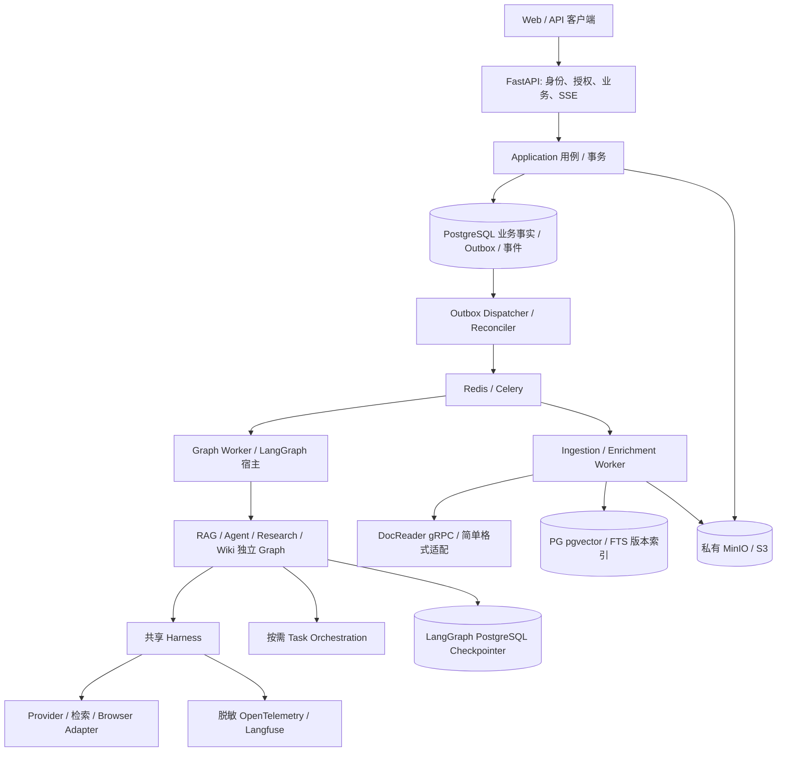
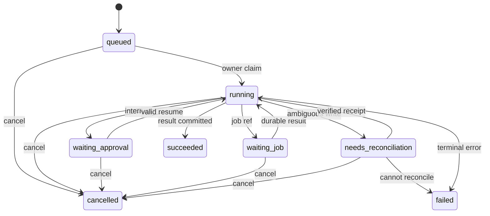

# 01 系统架构与统一契约

日期：2026-10-27。状态：**技术设计提议，待评审及 PoC**；不是实现或已接受 ADR。

## 1. 设计目标、范围与非目标

需求：[PRD](../PRD_PyKnora.md) G1–G5、F-01–F-19、AC-01–AC-06、AC-E01–AC-E10。输入：[源码基线](../research/00_Source_Baseline.md)、[审计](../research/01_Source_Architecture.md)、[映射](../research/02_Architecture_Mapping.md)、[风险](../research/03_Compatibility_Risks.md)。本文件是八份 TDD 的术语及状态规范；其他文档引用它，不另设同义 ID。

目标是以可恢复、可授权、可追溯的 P0 上传/URL→解析→索引→RAG 闭环为基础，增量支持 P1 Agent/Research/Wiki。非目标：逐行翻译 Go、旧 API/数据库/checkpoint 无损兼容、通用多 Agent 平台、exactly-once 外部执行、此次实现业务代码。

证据分类：A=本地源码静态核验，D=官方资料描述，N=本项目设计提议，U=待实测。本轮参考 HEAD 为 `662abaf9f944e37689d04c42160034b2cdec6829`，与研究基线一致，未更新或修改。既有审计仍是输入，并非全量重新核验。本轮定向复读了 `docreader/proto/docreader.proto`、`internal/infrastructure/docparser/builtin_converter.go`、`internal/agent/resume.go`、`internal/browserskill/daemon.go`、`scripts/build_browserskill.sh`、`internal/application/service/knowledge_create.go` 和 `knowledge_process.go` 的关键段。相关 A 结论：TXT 由原 Go simple 路径承担；ReadStream 首帧完整正文后续图片；普通上传直接 Enqueue；enabled 与富化状态独立。完整路径和定位沿用审计 C01/C06、A16、B05/B11、I02/I07；不从这些事实推导原系统已具备新版本原子发布。

## 2. 组件、通信与部署



FastAPI 只在请求期认证、校验、短事务、返回响应；不在请求生命周期运行长 Graph。P0 Graph Worker 是独立 Linux Celery `graph` 队列进程，任务仅调用指定版本 Graph 至结束或 interrupt，LangGraph 决定节点、边和检查点。Celery 仅承载唤醒和进程调度，不维护第二套推理状态机。P1 可拆为常驻 Graph Runner 服务，通过同一 Outbox 唤醒；接口和事实状态不变，是否拆分由并发/延迟实测决定。

API→PG 使用 SQL 事务；→对象存储使用 S3 API；Worker→DocReader 使用固定 proto gRPC；浏览器网关与 daemon 是隔离适配服务（见 [05](05_Browser_Adapter.md)）；模型 SDK 经 ModelGateway；SSE 从 PG 事件表读取，Redis 通知仅加速。P0 同一 PG 实例但业务、checkpoint 分 schema/DB role；迁移和备份兼容性分别管理。禁止 API 直接读取/改写 checkpoint 内部表。

P0 Compose 服务：API、dispatcher/reconciler、graph worker、ingestion worker、enrichment worker、PG+pgvector、Redis、S3 兼容对象存储、DocReader、OTel collector；模型为外部依赖。Worker 按队列分别设并发/内存/超时。P1 增加 Browser gateway、daemon、Playwright 隔离容器、周期调度；只允许单一 beat/调度 leader 产生周期触发，DB 唯一触发键兜底。P2 才做 K8s/自动伸缩/沙箱。

## 3. 包划分与依赖方向

以下都是未来路径，不在本轮创建模块。

| 包（`pyknora/` 下） | 职责和依赖 |
| --- | --- |
| `domain/`、`contracts/` | ID、枚举、实体规则、Pydantic DTO/Protocol；不依赖 FastAPI/Celery/LangGraph |
| `application/` | 授权后的用例、事务、Outbox、Run/版本服务；依赖 domain 与 ports |
| `api/v1/` | REST/SSE、身份转可信 Scope；依赖 application |
| `graphs/` | 四套 Graph、State、节点组合；调用 application、harness、orchestration |
| `harness/` | 模型、上下文、工具、策略、预算；不能反向导入 graphs，审批等待由 Graph 完成 |
| `orchestration/` | DAG 校验/调度/评价/重规划；通过 TaskExecutor port 调用子流程，不能导入 Celery |
| `ingestion/`、`retrieval/`、`citations/` | 版本流水线、授权检索、引用映射；依赖 domain/ports |
| `adapters/` | PG、S3、DocReader、Provider、Browser、checkpoint、观测的实现 |
| `workers/`、`bootstrap/` | Celery entrypoint、依赖注入、配置；唯一装配层 |

避免 P0 先建设插件市场、动态 Graph DSL 或泛化工作流引擎。框架 Pydantic 类型用于边界校验，业务规则放 domain；业务 SQL 与 checkpointer SQL 不共享 UnitOfWork。

## 4. 共用数据结构、稳定 ID、类型与生命周期

除 `trace_id`、`event_seq`、`task_graph_revision`、`index_version`、`idempotency_key` 外，ID 为服务端生成 UUIDv4。UUID 不是权限凭证。所有业务行都有 `workspace_id`；workspace 本身用 `workspace_id` 作主键。身份系统全局 principal 目录属**待 ADR 的例外**：本设计 P0 使用 workspace 内 principal，外部身份 subject→membership 映射保存在隔离身份域，不在业务模型引入 `user_id`。

| 字段 | 生成者、作用域、生命周期与关联 |
| --- | --- |
| `workspace_id` / `principal_id` | Workspace/身份服务；principal 为本空间主体（人/服务）；成员停用不删除审计引用；与工作区 membership 绑定 |
| `conversation_id` | 会话服务；空间内对话，多个 run；不等于 thread |
| `run_id` | RunService；一次用户执行/一次周期执行；重试和 resume 不换 ID，重新发起才新建；可空 conversation |
| `thread_id` | RunService；每 run 一个 UUID，与 run 1:1，UNIQUE(workspace_id,thread_id)；多轮会话每轮新 run/thread，历史从 Message 加载；子 Task 用同一 Graph 内子流程，P1 不另造子 thread |
| `task_id` | Planner 校验服务；run 内逻辑 DAG 节点，保留节点跨 revision 复用同 ID；CollectionTask API 的资源标识统一为 `collection_task_id`，不能冒用 task_id |
| `task_graph_revision` | Replanner；run 内正整数从 1 递增；执行节点键为 (run_id,revision,task_id) |
| `job_id` / `attempt_id` | JobService 创建逻辑作业 / 领取事务创建尝试；同 job 重投不换 ID，真实重试新 attempt；Celery 消息携 job_id，Celery 原生 task_id 仅叫 transport_id，禁止写入业务 task_id |
| `tool_call_id` | 工具意图登记器；run 内一次已规范化调用，恢复复用；provider 原始调用 ID 仅 protocol_call_ref，不能直接作为业务 ID |
| `approval_id` | ApprovalManager；空间内单次绑定审批，过期/参数变更后新建，历史不覆写 |
| `idempotency_key` | API 客户端/内部生产者；同 workspace+principal+operation 下唯一且绑定请求哈希；内部由稳定业务键导出，不从模型文本生成；保留期见 07 |
| `source_id` / `source_version_id` | 来源服务；规范化 URL/上传来源的稳定身份 / 不可变快照；重复抓取同内容仅新增 fetch observation，不伪造新快照 |
| `document_id` / `document_version_id` | 文档服务；KB 中逻辑文档 / 不可变输入与处理配置快照；reprocess 显式处理配置 revision 产生新版本，相同配置重复请求复用原版本，attempt 不修改其内容 |
| `index_version` | 文档服务持锁递增 bigint，每 document 唯一；一次索引构建代号，绑定 document_version_id 和 embedding profile；旧 attempt 的 chunk 不覆盖同代发布内容 |
| `trace_id` | OTel；W3C 32 hex；可跨重试另起 trace 并 link 原 trace，不作业务去重键 |
| `event_id` / `event_seq` | EventStore；UUID / run 内事务递增 bigint；唯一 (workspace_id,run_id,event_seq)，持久化后发送；不承诺跨 run 全序 |

补充唯一语义 ID：`kb_id`、`message_id`、`chunk_id`、`asset_id`、`browser_session_id`、`device_id`、`reservation_id`、`artifact_id`、`candidate_id`、`evidence_id`、`review_decision_id`、`policy_snapshot_id`、`model_profile_id`、`wiki_page_id`、`wiki_revision_id`、`outbox_id`、`collection_task_id`、`fetch_observation_id`、`collection_trigger_id` 均由对应业务服务生成 UUIDv4。资源行不可用第二个泛称 `id` 覆盖契约字段。时间统一 UTC RFC3339，呈现时转工作区时区；成本 Decimal/整数微货币，偏移 code point 半开区间。

`asset_id` 指物理 bytes 对象；`artifact_id` 指不可变、带类型/版本的逻辑结果 manifest（如评价报告、结构化事实集），可引用多个 asset/candidate/evidence，不是 asset 的别名。`*_ref/refs` 是目标 ID 的字段名约定，必须由 schema 固定目标类型；泛型结果引用采用 `{resource_type,resource_id}` 判别联合，不能裸 UUID 自动遍历任意表。`Scope.policy_snapshot_id` 为审计输入，真实当前权限仍每次计算。

共用接口草案（应用接口，非第三方 API）：

```python
from dataclasses import dataclass
from datetime import datetime
from typing import Literal, Protocol
from uuid import UUID

@dataclass(frozen=True)
class Scope:
    workspace_id: UUID
    principal_id: UUID
    policy_snapshot_id: UUID  # 可审计快照，不取代执行时授权

@dataclass(frozen=True)
class ExecutionContext:
    scope: Scope
    run_id: UUID
    thread_id: UUID
    task_id: UUID | None
    task_graph_revision: int | None
    deadline: datetime
    trace_id: str

class RunService(Protocol):
    async def start(self, scope: Scope, request: "RunRequest",
                    idempotency_key: str) -> "RunAccepted": ...
    async def resume(self, scope: Scope, run_id: UUID,
                     approval_id: UUID, idempotency_key: str) -> "RunAccepted": ...
```

所有 port 返回 typed DTO 或抛 `DomainError(code, retryable, safe_details)`；稳定错误码集中在 [07](07_Data_API_Security.md)。Scope 只由后端认证和授权构造；模型不能提交或扩展 Scope。

## 5. 状态拥有者与持久化矩阵

PRD 概念到本设计的显式映射：User/Membership→身份域 subject 映射+空间内 Principal（全局身份例外待 ADR-0005）；AgentRun/CollectionRun→Run；IngestionJob→Job；PRD §9.7 SourceDocument→Source；PRD §9.9 ApprovedIngestionRequest 的来源批准字段 `approval_id` 在本设计提议细化为 `review_decision_id`，工具执行审批才使用 `approval_id`。此项是语义澄清提议，评审前不宣称兼容 PRD 草案 JSON 或旧接口，不能在实现中接受两种同义字段。`target_kb_id` 的接口统一名为 `kb_id`。

`row_version` 为乐观锁整数，每次更新递增；租约 `lease_epoch` 为递增 fencing token。状态转移必须带期望旧状态/row_version，事件采用唯一业务键去重。非拥有者只能提交命令/事实，不能直接改另一个状态机。

| 状态域与枚举 | 唯一写入组件 / 持久化 | 转换、重复与冲突处理 |
| --- | --- | --- |
| Run：queued/running/waiting_approval/waiting_job/needs_reconciliation/succeeded/failed/cancelled | RunService / `runs` | 可信 Graph 事实经 apply_fact；CAS+事实键去重；取消为终态，新 resume 不得复活；未知副作用转 needs_reconciliation |
| Graph：节点、pending writes、interrupt | LangGraph / checkpointer schema | 只由匹配 graph_version 的宿主调用原生 API；thread 单 owner；不把业务状态回写成 checkpoint；恢复前再授权 |
| TaskNode：pending/ready/running/waiting_approval/waiting_job/succeeded/failed/blocked/cancelled/superseded | OrchestrationService / `task_nodes` | revision 与 node CAS；就绪依赖由 scheduler 判断；旧 revision 结果只留历史；详见 03 |
| Job：pending/running/retry_wait/succeeded/failed/cancelled/superseded | JobService / `jobs`、`job_attempts` | Worker 通过服务领取/心跳/完成；终态重投 no-op；过期租约尝试失效，旧 epoch 不得提交 |
| Approval：pending/approved/rejected/expired/revoked/consumed | ApprovalManager / `approvals` | 绑定完整意图；CAS 消费和 ToolCall 执行预登记同事务；consumed 不代表副作用成功；取消/撤权不得再执行 |
| ToolCall：prepared/executing/succeeded/failed/unknown_outcome/cancelled | ToolExecutor / `tool_calls` | 唯一工具意图；外部 receipt/幂等键；不可安全重放时 unknown_outcome，需要核查 |
| BrowserSession：pairing/connected/paused/human_handoff/disconnected/revoked/closed | BrowserSessionService / `browser_sessions` + owner lease | device/scope/epoch 匹配；重连只到 paused；动作结果另在 ToolCall；不以连接状态推断执行结果 |
| SourceVersion：captured/quarantined/approved/rejected/revoked | SourceService / `source_versions` + 审阅记录 | 不改快照内容，审核/撤销只改生命周期；来源删除先撤销访问及传播 |
| 摄取：pending/processing/index_ready/succeeded/failed/cancelled/superseded | IngestionService / `document_versions` | index_ready 尚不可见；succeeded 表示原子激活成功；attempt/desired_version/tombstone fencing |
| 索引：building/ready/active/retired/failed | IndexPublicationService / `index_builds`、`documents.active_index_version` | 唯一活动指针为可见性事实；发布事务切换，失败维持旧活动版本 |
| 富化：not_requested/pending/running/succeeded/partial_failed/failed/cancelled | EnrichmentService / `enrichment_tasks` + 聚合 | 每类型唯一任务，按终态集合聚合；不反转核心索引成功 |

PRD 的 CollectionRun planning/collecting/evaluating/ingesting 是 `runs.phase`，不是并列总状态；对应 run_id 不另加 collection_run_id。PRD IngestionJob 与通用 Job 为同一实体，不能双存两个总状态。图节点输入中的预算/Job/Approval 状态都是引用或快照，执行前读业务事实。



## 6. 事务边界、异常处理与恢复

1. API 校验权限和幂等键；对象先隔离上传并校验 checksum。PG 事务写业务版本、Job/Run、Outbox 和 accepted 事件，提交后才返回 202。对象上传与 DB 非原子：失败时保留隔离对象，GC 按无引用对象清理，绝不把临时对象当发布事实。
2. Dispatcher `FOR UPDATE SKIP LOCKED` 短事务领取 Outbox lease；事务外发 Redis，再事务标派发。发出后崩溃会重复发送，consumer 由 job_id/业务键去重。Redis 故障保留待发；超重试阈值告警而非丢弃。Reconciler 定期扫描 pending/retry_wait、过期 owner/job 租约和未确认 Outbox，重建唤醒，不仅依赖 broker。
3. Graph/PG 不做分布式事务。节点先提交业务幂等结果，再返回 state delta，由 checkpointer 保存；重入读取业务调用记录/产物。Run 成功要在最终结果事务中保存 Message/引用、终态与 completed 事件。Graph 已终止但结果事务失败时重试 finalizer；业务已成功但 checkpoint 未落时 finalizer no-op。
4. 单 run 同时只允许一宿主持有 PG session advisory lock，配合 owner lease/epoch。超时租约不能让新 owner 与旧 checkpoint writer 并发：接管必须确认 advisory lock 已释放；旧进程数据库连接失效后必须退出该 invocation，禁止自动重连继续写。业务提交额外检查 epoch。checkpointer 独立连接不天然 fenced，此部署约束必须在 H1 故障注入验证；若不能证明，改为单活 runner，不能声称安全横扩。
5. 不在 DB 锁内做模型/浏览器/解析网络 I/O。外部副作用先登记意图，再执行，再登记 receipt；中间崩溃的未知窗口见 [02](02_Agent_Harness.md)。没有外部去重/查询能力时不自动重放。

## 7. 技术取舍、替代方案与版本策略

均为 N。官方资料于 2026-10-27 核对，链接描述能力，不等于当前项目已安装或验证。P0 推荐 Python 3.12 作为验证主版本（仓库要求 >=3.12，本机 shell 为 3.14，不推定兼容）。锁文件和容器 digest 在后续依赖任务生成；此次不改依赖。所有候选在锁定前查维护活跃度、CVE/传递依赖与完整 LICENSE/NOTICE；不编造最新补丁号。

| 组件 / 用途 | 推荐与替代 | 版本/许可证验证条件 |
| --- | --- | --- |
| FastAPI/Pydantic | ASGI API、严格 schema；替代 Starlette+手写校验 | 同步支持的发行线一起锁定；官方 [lifespan](https://fastapi.tiangolo.com/advanced/events/)、[严格模式](https://docs.pydantic.dev/latest/concepts/strict_mode/)已查；对应 MIT 声明及依赖须随 artifact 归档 |
| LangGraph + PostgreSQL checkpointer | 框架执行；不自研 checkpoint | graph/core/checkpoint-postgres 配套锁定；[持久化](https://docs.langchain.com/oss/python/langgraph/persistence)已查；升级先回放历史 fixture；各包许可逐项查 |
| Celery + Redis | 可靠唤醒/后台作业；替代 Dramatiq 或后续独立 runner | 官方 [Tasks](https://docs.celeryq.dev/en/stable/userguide/tasks.html)当前为 5.6 文档；不把文档版本当安装版本。Celery BSD 系许可、Redis 具体发行版本/许可证和托管条件待定，禁止泛称全 MIT |
| SQLAlchemy + Alembic + psycopg | 事务/迁移，替代 psycopg SQL | PG 驱动/checkpointer 连接池组合实测；锁定时查 MIT/LGPL 等各自条件 |
| PG + pgvector | 业务、FTS/向量；替代 ParadeDB BM25/OpenSearch | 官方 [锁](https://www.postgresql.org/docs/current/explicit-locking.html)、[pgvector](https://github.com/pgvector/pgvector)已查；PG 主版本/扩展配套及向量过滤召回实测。FTS 不等于 BM25；中文分词基线后选型 |
| S3 API / MinIO | 私有原件/快照，替代云 S3 | 不同实现一致性/签名/删除语义实测；MinIO 所选发行物 AGPL/商业条款及分发模式须评审，S3 为服务条款 |
| grpcio / protobuf + DocReader | 服务复用；替代内嵌 parser | proto hash+参考 SHA+镜像 digest 锁定；Apache/BSD 等依赖及 OCR 权重单独 SBOM，不由 WeKnora MIT 覆盖 |
| Playwright / BrowserSkill | 服务端 JS / 用户授权浏览器 | 浏览器镜像与 Python package 配套；BrowserSkill 0.3.1 成套 upstream SHA 固定，见 05；真实互通、扩展分发许可待验 |
| OTel / Langfuse | 脱敏追踪；替代只保留 OTel | Collector/SDK/exporter 配套锁定，Langfuse 社区/企业及服务条款分开评估；默认禁止内容导出 |
| httpx / 成熟正文抽取库 | 受控 HTTP、HTML 抽取；替代 DocReader HTML 路线 | DNS/代理出口不可仅靠客户端库；抽取质量、安全与许可通过 golden set 后锁定 |

## 8. 架构决策清单

“继承”只表示用户规范/PRD 已给出的边界，**不表示已有已接受 ADR**。[ADR 目录](../adr/README.md)新增编号文件均为提议。

| 编号 | 状态 / 依据 | 决策方向与后果 |
| --- | --- | --- |
| ADR-0001 | 提议；职责边界继承 AGENTS/PRD §7/13 | Graph 管执行、Harness 管能力、DAG 按需、Celery 管唤醒；业务与执行状态分离 |
| ADR-0002 | 提议；AC-05、I02/I07/I10 | PG Outbox+租约、不可变版本+原子索引激活；增加对账器与版本存储成本 |
| ADR-0003 | 提议；AC-E09、A14–A18 | 审批绑定+工具调用账本+原生 interrupt；未知结果需核查，不承诺外部 exactly-once |
| ADR-0004 | 提议；C01/C06、B05/B11 | DocReader 服务复用+TXT/MD 简单适配；Browser 双后端，先桥接验证再决定 Python 直连 |
| ADR-0005 | 提议；F-01/05/06、R05/R14 | workspace 复合约束、引用再授权、持久化事件；空间内 principal，跨空间共享暂不支持 |
| DEC-06 | 待评测 | PG FTS+向量+RRF 起步，BM25/中文分词由 H6 决定；不可比较原始异构分数 |
| DEC-07 | 工作树已对齐，正式基线待确认 | 初读 F-14 为 P0，期间检测到非本轮工具写入的 PRD 修改将其调为 P1；保留该未提交编辑，当前按 P1 设计，未将外部编辑冒充本轮交付 |
| DEC-08 | 待产品/安全确认 | 首发认证/共享、模型地域、全文保留、合法站点、审批角色、TTL/RPO/RTO、原生 Windows 支持范围 |

## 9. 测试、验收与未决事项

设计阶段验收：八份 TDD 契约一致；F/AC 可追踪；11 类故障在 [08](08_Test_Strategy.md) 有提交点和观察量。PoC 验收见该文，当前没有真实运行基线。P0 仅实现上传五格式、单 URL 人工确认、基本授权、RAG、可靠投递和安全引用；P1 才上线通用工具循环、DAG、双浏览器、周期研究、Wiki/完整 RBAC；P2 延期图谱、多模态、Skills 沙箱、长期记忆、多渠道。

依赖/假设：PG 支持业务事务，索引位于同一 PG 事务域；换外部搜索需另立发布协议；对象存储不可变 key；模型有可度量 usage（缺失则保守计费）；Graph 宿主单写者约束需实测。未决项集中在 §8；安全/许可证条件未落实的组件不能以 mock 代替进入上线阶段。
