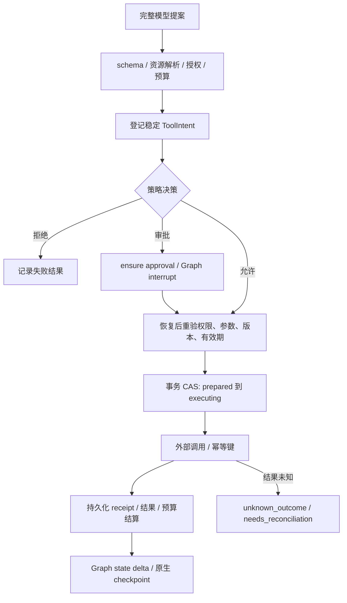

# 02 Agent Harness

日期：2026-10-27；状态 N/提议，未实现、未通过 PoC。统一 ID、状态和错误分别见 [01](01_System_Architecture.md)、[07](07_Data_API_Security.md)。需求：F-02/09/13/16、AC-06、AC-E08/09/10；审计 A05–A18、RUN-01/02。

## 1. 设计目标、范围与非目标

给四套 Graph 提供最小共享能力：授权模型调用、上下文、工具、安全审批、统一预算、观测。AgentRuntime 是节点可调用的门面，不另写 think/act 循环；CheckpointManager 不保存自建快照，不实现 interrupt；DAG 归 [03](03_Task_Orchestration.md)。P0 只需要模型/上下文/授权检索/预算/追踪；通用工具与审批 P1 装配。

## 2. 数据结构与核心接口

以下为应用自有 Python 类型草案，所有名称引用 01 的 UUID/Scope/ExecutionContext。Pydantic DTO 配置 `extra='forbid'`，对数值/枚举严格校验；UUID/时间在 JSON 边界显式解析，不假定 strict Python 校验接受字符串。绝不接受模型提供 workspace/principal/secret 字段。

```python
from typing import Any, AsyncIterator, Literal, Protocol
from uuid import UUID
from pydantic import BaseModel, ConfigDict, Field

class DTO(BaseModel):
    model_config = ConfigDict(extra="forbid")

class ToolSpec(DTO):
    name: str
    version: str
    input_schema: dict[str, Any]
    effect: Literal["read", "write", "sensitive_read"]
    supports_idempotency: bool
    supports_reconcile: bool
    max_output_bytes: int = Field(gt=0)

class ToolIntent(DTO):
    tool_call_id: UUID
    name: str
    version: str
    arguments: dict[str, Any]  # schema 校验后再规范化/hash
    arguments_hash: str
    resource_refs: list[UUID]
    idempotency_key: str

class ToolResult(DTO):
    tool_call_id: UUID
    status: Literal["succeeded", "failed", "unknown_outcome", "cancelled"]
    artifact_refs: list[UUID]
    safe_excerpt: str | None
    receipt_ref: UUID | None  # 脱敏 receipt 产物
    error_code: str | None
    usage: dict[str, int]  # tokens/pages/bytes 等实际值

class ModelGateway(Protocol):
    async def stream(self, ctx: "ExecutionContext", request: "ModelRequest",
                     reservation_id: UUID) -> AsyncIterator["ModelDelta"]: ...

class ContextManager(Protocol):
    async def prepare(self, ctx: "ExecutionContext", history: "HistoryRef",
                      limits: "ContextLimits") -> "PreparedContext": ...

class ToolRegistry(Protocol):
    def resolve(self, scope: "Scope", name: str, version: str) -> ToolSpec: ...

class PolicyEngine(Protocol):
    async def decide(self, ctx: "ExecutionContext", intent: ToolIntent) -> "PolicyDecision": ...

class ToolExecutor(Protocol):
    async def execute(self, ctx: "ExecutionContext", intent: ToolIntent,
                      approval_id: UUID | None) -> ToolResult: ...

class ApprovalManager(Protocol):
    async def ensure(self, ctx: "ExecutionContext", intent: ToolIntent) -> "ApprovalRef": ...
    async def decide(self, scope: "Scope", approval_id: UUID,
                     decision: Literal["approved", "rejected"],
                     idempotency_key: str) -> "ApprovalRef": ...

class BudgetManager(Protocol):
    async def reserve(self, ctx: "ExecutionContext", purpose_key: str,
                      maximum: "CostVector") -> "Reservation": ...
    async def settle(self, reservation_id: UUID, actual: "CostVector") -> None: ...
    async def release(self, reservation_id: UUID, reason: str) -> None: ...

class CheckpointManager(Protocol):
    async def bind(self, ctx: "ExecutionContext", graph_version: str,
                   state_schema_version: int) -> "CheckpointerBinding": ...
    async def retire(self, scope: "Scope", thread_id: UUID) -> None: ...

class Observability(Protocol):
    def span(self, ctx: "ExecutionContext", operation: str) -> "SafeSpan": ...

class AgentRuntime(Protocol):
    async def model_step(self, ctx: "ExecutionContext", request: "ModelRequest") -> "ModelResult": ...
    async def prepare_calls(self, ctx: "ExecutionContext", response: "ModelResult") -> list[ToolIntent]: ...
    async def execute_batch(self, ctx: "ExecutionContext", intents: list[ToolIntent]) -> list[ToolResult]: ...
```

`ModelRequest`：model_profile_id、prepared_context_ref、tools（授权后的 ToolSpec 子集）、max_output_tokens、temperature、timeout；ModelResult：finish_reason、tool proposals、text_ref、usage、provider_request_ref。输出截断/不完整 JSON 为 `INVALID_TOOL_ARGUMENTS`，不执行该批调用。ModelDelta 是内部流，业务 SSE 必须转换后持久化。

`PolicyDecision`：allow/deny/require_approval、reason_code、policy_snapshot_id、effective_scope_hash；`ApprovalRef`：approval_id、status、expires_at。`CostVector`：tokens、cost_microunits、pages、bytes、wall_ms、并发槽；金额带 currency，模型定价快照与 model_profile_id 关联。`CheckpointerBinding` 只给宿主配置/生命周期句柄，不能让模型查询任意 thread。

前置条件：当前 membership 有效、run 未终止、资源在授权范围、工具版本可用、deadline 未到。可重试错误通过 DomainError 的 retryable 表达；工具协议失败返回 ToolResult，不以 HTTP/gRPC 成功判断业务成功。

## 3. 工具生命周期、并行与副作用屏障

Registry 在装配时拒绝重复 name/version；动态 MCP catalog 固定版本/schema hash，工具 schema/授权改变即失效旧意图。生命周期为 resolve→validate→policy→reserve→prepare→execute→persist→settle→cleanup；cleanup 失败记录可重试清理作业，不覆盖已成功执行结果。

只有注册为只读且策略确认无外部副作用的工具可并行，建议最大并发 4（目标可配，未实测）。write、sensitive_read、未知 MCP 工具构成屏障：先 join 前面的只读组，再单独执行，再放行后一组；共享浏览器 session 总是串行。结果按模型调用原顺序回填。依赖前一工具输出的调用必须下一模型/Graph 步生成，不能同批猜值。



输出先限制下载 bytes/解析大小，再限制模型可见 tokens，保留 safe_excerpt 和 artifact_ref、截断诊断；引用指向原始 artifact/版本，不指向截断临时文本。默认建议工具输出 64 KiB、模型可见 8k tokens，必须经 H2 调优。任意 shell/动态代码不在 P0/P1 默认工具集中。

## 4. 审批绑定和执行顺序

审批行绑定 workspace_id、requester principal_id、approver principal_id、run_id、tool_call_id、name/version、规范化 arguments_hash、scope_hash、resource_refs、policy_snapshot_id、expires_at。规范化规则固定 schema_version：排序 JSON key、禁止 NaN/模糊数值、默认值显式化；URL 等规范化在审批前完成，不在批准后修改。审批 UI 展示脱敏参数和具体动作；秘密只保存在 vault，由连接器在执行时注入，禁止进入 arguments/Graph/模型。

1. `ensure` 对 pending/approved 使用部分 UNIQUE(workspace_id,tool_call_id,arguments_hash,scope_hash,tool_version) 登记有效审批；节点可安全重复调用。expired/revoked 后允许新 approval_id，consumed 的同一 ToolCall 则查执行账本，不重建批准以再次执行。
2. approval_wait 节点只 `interrupt({approval_id})`；用户决定通过 API 授权、事务 CAS pending→approved/rejected，写审计和 resume Outbox。API 不直接执行工具。
3. Executor 执行前重新检查请求者和审批者当前权限（含角色/成员是否撤销）、资源状态、工具/schema/policy 版本及过期。参数/范围变化→`APPROVAL_MISMATCH`，原批准 revoked，生成新意图/审批；权限撤销→`FORBIDDEN`，不发网络调用。
4. PG 同一事务锁 ToolCall/Approval，CAS approved→consumed 及 prepared→executing，登记 reservation 和稳定外部 idempotency_key。重复消费若已有 succeeded 则取原结果；executing 不能当作未执行重新调用。
5. 事务外调用，保存 receipt/结果及预算。同一调用恢复时用 tool_call_id 读记录。批准消费后、发请求前也可能崩溃：无法证明未发送就按未知窗口处理。

撤权与已经发出的外部请求不能做跨系统原子撤销；仅保证发出前最新授权检查、短时间窗口、可用时传下游短期 capability。撤权后到达的结果保留安全 receipt、禁用后续执行/发布，必要时明确授权补偿。

## 5. 重试、崩溃与恢复

模型 429/暂时 5xx/连接失败可取消指数退避，建议最多 2 次额外尝试；每次独立预留结算。若已向用户发送 delta，停止拼接新的模型流：新 generation 的输出必须 reset 或作为新消息版本，不能无标记混流。上下文溢出可压缩后至多一次重试；截断工具参数不“猜修复后执行”。

工具重试与模型重试分离：read 可以在预算内重试；写只有外部承诺相同 key 去重且 key 未过期、参数相同才允许安全重试。同一工具调用不因模型重试更换 key。连接器不支持外部去重时，即使 read-like click 也按可能副作用处理。

**故障：外部成功、结果落库前崩溃。** 恢复者 Reconciler 发现 executing lease 过期→CAS unknown_outcome，Run needs_reconciliation，冻结 reservation。支持查询则用外部幂等键/receipt 只读核查，确认成功后保存同一 ToolResult；支持去重但查询不可用时，在其保证窗口内经策略批准重新提交同 key。两者皆无则人工核查页面/下游记录，提交带证据的 resolve 命令；无法证明时保留未知并失败，禁止自动再次写。人工补偿是新工具调用、新审批，不修改历史。

Graph 重入和 interrupt 前代码重跑均先查稳定意图：succeeded 读结果；prepared 才尝试上述执行；executing/unknown_outcome 核查；failed 仅按可重试分类新 attempt。不能依赖 checkpoint 恰好在外部调用后落盘。官方说明 interrupt 所在节点恢复会重新执行，采用 [LangGraph 原生 interrupt](https://docs.langchain.com/oss/python/langgraph/interrupts)；此处账本为业务副作用凭据，不是第二套执行 checkpoint。

## 6. 上下文、工具消息与秘密

ContextManager 按 provider 的上下文窗口/tokenizer 保守估算，预留工具定义和最大输出；保留最近用户约束、授权范围摘要、引用映射。压缩时把 assistant tool calls 和对应 tool result 作为不可拆单元，保留 protocol_call_ref 映射；不能留下孤立 tool result。摘要保留来源 artifact/版本、事实不确定性和未完成事项，摘要失败降级窗口裁剪并标记 degraded，不把摘要当执行恢复依据。

历史正文先经过内容策略：个人敏感信息留受控原件，模型只接收脱敏摘录或授权占位符；PII 无法安全脱敏则拒绝该调用/转人工，不能仅靠后续扫描。外部正文用 data envelope 标注来源与不可信标签，不拼进 system 指令。引用句柄只映射当前授权真实 chunk/evidence；模型不能生成任意引用路径。

ModelGateway 运行时从密钥服务读取凭据，headers、cookie、签名 URL 不返回 ContextManager。异常 message 采用 allowlist 安全错误，不转储 SDK 请求/响应。禁止观测 SDK 自动记录 prompt、completion、工具原始参数；必要原件只存私有加密对象且有权限/保留期。

## 7. 预算预留、结算和并发竞争

Budget 表按 workspace/run 及 task 子额度建立同一账本，父 run 是成本总归集主体，子 task 是归因维度，不能父子各扣一次。锁序固定 workspace→run→task；`reserve(purpose_key)` UNIQUE(workspace_id,run_id,purpose_key)；事务检查 `spent+reserved+maximum<=limit`，同时预留金钱/tokens/pages/bytes 与并发槽。任何维度不足→`BUDGET_EXCEEDED`，不发调用。

实际费用 settle 原子 reserved 减 maximum、spent 加 actual，UNIQUE(reservation_id,settlement) 防重复；未发出调用可 release；已发出但 usage 未知不得超时自动释放，转 unsettled 保守保留，Reconciler 查询计费或按 maximum 计入待核对消耗。actual 超预留则记录真实超额、冻结后续预留并告警；严格费用上限必须有下游硬限额/足够保守估价，不能承诺未知供应商计价绝不超支。wall_ms 为 deadline，父运行墙钟不是并发子耗时求和。

重规划仅锁同一 run 剩余额度，不能创建新 run 逃逸预算；保留进行中任务预留，旧 revision 真正未执行的 reservation 才释放。子任务成功/失败和模型重试均计成本。取消释放未发请求，未知写保持冻结供核查。见 [03](03_Task_Orchestration.md) 与故障 F11。

## 8. CheckpointManager、观测、取舍与验收

CheckpointManager 校验 workspace/run/thread 对应及 graph/schema_version，装配原生 Postgres checkpointer、生命周期清理、备份恢复关联；不生成另一份 State JSON 来替代框架恢复。删除先撤销 thread 可访问性再按保留期原生清理；不让普通 API 直接指定任意 checkpoint 分支。升级详见 [04](04_LangGraph_Workflows.md)。

Observability span 只记录 stable IDs、安全状态、用量、错误码、耗时；trace 默认内容关闭，[OTel 敏感数据指南](https://opentelemetry.io/docs/security/handling-sensitive-data/)支持将脱敏作为独立控制面。trace 失败不改变成功业务结果；安全审计无法提交时，敏感写必须 fail closed。预算/调用账本为事实，trace 不是计费数据库。

取舍：优先薄 Protocol+现成 Provider SDK，而非自写统一底层协议；上下文摘要自管，执行恢复交框架；外部幂等能力按连接器声明，不能以本地锁替代。替代方案是将所有工具包成独立服务，P0 会增加部署成本，待隔离需求再拆。

测试与验收：H1/H2/H9，详见 08。要求并发只读结果顺序稳定；写屏障前无悬空只读；审批改参/撤权/过期均无网络写；50 次重复恢复仅一个业务意图和一份结果；不支持去重的未知写零自动重放；并行预留不超账本限额；秘密 canary 在 state/trace/log/模型请求中零出现。数字为建议测试规模，不是已测通过。

依赖/未决：provider usage/幂等保留窗、定价币种与硬限额、摘要质量阈值、人工核查责任人、PII 分类与脱敏规则需要确定；不能用未决项为由省略调用账本和审批绑定。
