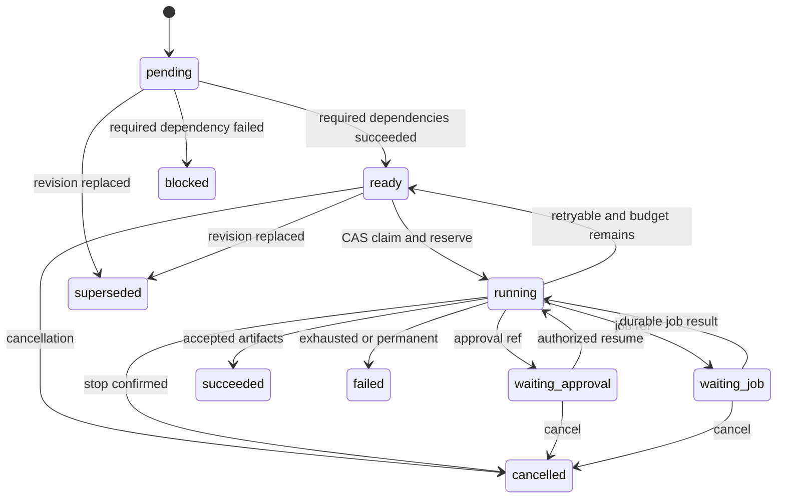
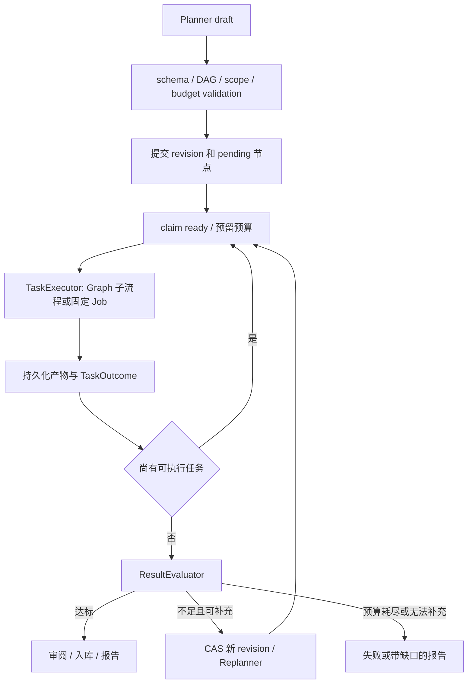
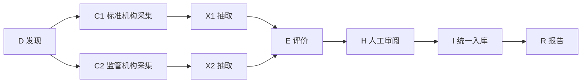

# 03 Task Orchestration

日期：2026-10-27；N/提议。需求 F-10/12、AC-E01/03/04/08/09/10；原 child-agent 仅作设计输入（审计 A23），不是已存在的通用 DAG。统一契约：[01](01_System_Architecture.md)，预算/工具：[02](02_Agent_Harness.md)。

## 1. 设计目标、范围与非目标

把复杂专业知识研究分成有依赖的有限任务，评价证据覆盖，必要时在剩余预算内重规划。普通 RAG 不进入 Planner。P1 首版支持固定任务种类、全成功依赖和有限 fan-out，不提供任意用户代码、无限嵌套 DAG 或多 Agent 消息平台。重复循环属于 Research Graph 的受限评价/重规划边，不在单个 DAG 中造环。

## 2. 数据结构和核心接口

```python
from typing import Literal, Protocol
from uuid import UUID
from pydantic import BaseModel, ConfigDict, Field

class TaskNodeSpec(BaseModel):
    model_config = ConfigDict(extra="forbid")
    task_id: UUID
    kind: Literal["discover", "collect", "extract", "evaluate", "review", "ingest", "report"]
    depends_on: list[UUID]
    input_refs: list[UUID]
    acceptance: dict[str, str]  # schema 只允许已注册规则，非任意 eval
    maximum_cost_microunits: int = Field(ge=0)
    maximum_attempts: int = Field(ge=1, le=3)
    required: bool = True

class TaskGraph(BaseModel):
    run_id: UUID
    task_graph_revision: int = Field(ge=1)
    nodes: list[TaskNodeSpec]

class Evaluation(BaseModel):
    passed: bool
    missing_topics: list[str]
    evidence_refs: list[UUID]
    conflict_refs: list[UUID]
    reason_codes: list[str]

class TaskPlanner(Protocol):
    async def plan(self, ctx: "ExecutionContext", goal_ref: UUID) -> TaskGraph: ...
class DependencyScheduler(Protocol):
    async def claim_ready(self, ctx: "ExecutionContext", revision: int,
                          limit: int) -> list["TaskLease"]: ...
class TaskExecutor(Protocol):
    async def execute(self, ctx: "ExecutionContext", node: TaskNodeSpec) -> "TaskOutcome": ...
class ResultEvaluator(Protocol):
    async def evaluate(self, ctx: "ExecutionContext", artifact_refs: list[UUID]) -> Evaluation: ...
class Replanner(Protocol):
    async def revise(self, ctx: "ExecutionContext", expected_revision: int,
                      evaluation: Evaluation) -> TaskGraph: ...
```

TaskLease = run/revision/task_id、lease_epoch、expires_at、reservation_id；TaskOutcome = status、artifact_refs、job_id?、approval_id?、error_code?、actual usage。TaskNode 运行行保存 row_version、status、input_hash、executor_version、policy_snapshot_id、attempt_count、result_refs、cancel_requested_at。输入/产物是受授权引用，不把正文和凭据放节点 JSON。

所有接口先核验 ctx 当前 membership、run owner/epoch、revision、范围和预算；Planner 输出无权决定 principal/domain allowlist。生成 task_id 在计划校验服务完成：模型输出本地标签由服务统一映射 UUID，不允许模型指定已存在资源 ID 越权复用。错误：`INVALID_TASK_GRAPH`、`REVISION_CONFLICT`、`BUDGET_EXCEEDED`、`FORBIDDEN`、`CANCELLED`；错误语义见 07。

## 3. 验证、调度与 Task 状态机

注册计划事务前：验证唯一节点、依赖存在/无自环、Kahn 拓扑检查、工具种类允许、输入资源可读、结果发布权限、预算总上界；建议初值 32 节点、64 边、深度 8、并发 4、最多 2 次重规划、每节点最多 3 次尝试、父 deadline 10 分钟。均为可配置建议，H3 确认；Graph recursion limit 是额外熔断，不等同业务步骤限制。



Scheduler 用 PG 锁 run→nodes，读 current_revision；仅依赖全部 succeeded 的节点可 ready。optional 失败由显式的 merge policy 记录缺口，不自动视作 succeeded；依赖 optional 的节点必须声明 accept_partial，否则 blocked。claim 与预算 reserve、Task running、必要 Job+Outbox 在同一业务事务中完成。只提交一次唤醒；重复调度读 CAS 失败即跳过。

TaskExecutor 的职责是选择现成 Graph 子流程或创建固定 Job；研究推理由 Research Graph 节点/子流程推进，Celery 负责 HTTP 收集、解析、入库等固定后台 I/O 作业。LangGraph checkpoint 保存当前引用/路由，Task 表保存依赖和产物事实；scheduler 在每次恢复读表重算 ready，不从旧 checkpoint 反向覆盖 Task 状态。



## 4. 专业研究 DAG 示例

目标：限定已许可官方域名、地域和近 12 个月，研究某行业标准变化。下表标签在实际持久化时替换成 task_id UUID；不以标签作为真实 ID。输入 goal/policy refs 已由 API 登记，金额只是示意的预算单位，价格不据此承诺。

| 标签 / kind | 依赖 | 输入→产物 | acceptance / 最大相对成本 |
| --- | --- | --- | --- |
| D / discover | 无 | goal+domain policy→来源候选 refs | 每链接有时间/域名判定 / 10 |
| C1 / collect | D | 标准机构候选→不可变 SourceVersion | 网络策略通过、快照 hash/许可齐全 / 20 |
| C2 / collect | D | 监管机构候选→不可变 SourceVersion | 同上 / 20 |
| X1 / extract | C1 | 快照→事实与 evidence | 每事实至少一个 locator / 10 |
| X2 / extract | C2 | 快照→事实与 evidence | 同上 / 10 |
| E / evaluate | X1,X2 | facts→coverage/conflict report | 覆盖主题、日期、标准号齐备 / 10 |
| H / review | E | 候选与冲突→人工 ReviewDecision | 有审阅权限；不允许“模型批准” / 0 |
| I / ingest | H | 批准的 SourceVersion→Job/活动索引 refs | 原子可检索、来源可追踪 / 15 |
| R / report | I | 来源+预算+拒绝项→最终报告 | 报告只引用已提交事实 / 5 |



验证后先执行 D，C1/C2 并行、各自预留，X1 可在 C1 成功后先运行；E 等两路成功。Evaluator 用确定性规则检查 URL/时间/证据完整性，再允许模型评价主题覆盖，模型不能降低硬安全门槛。例如缺少标准生效日期，revision 2 新增 C3/X3，E/H/I/R 的未运行旧节点 superseded，保留已完成 D/C1/C2/X1/X2 的 task_id 与产物；E 新节点依赖复用节点和 X3。若剩余预算不足，只输出明确缺口，不发布“研究完整”。

结构化计划序列化示例（符号表示法，仅文档示例）：

```json
{"run_id":"<uuid>","task_graph_revision":1,"nodes":[
  {"task_id":"<D-uuid>","kind":"discover","depends_on":[],"input_refs":["<goal-ref>"],"acceptance":{"source_policy":"official_allowlist"},"maximum_cost_microunits":10000,"maximum_attempts":2,"required":true},
  {"task_id":"<C1-uuid>","kind":"collect","depends_on":["<D-uuid>"],"input_refs":[],"acceptance":{"provenance":"snapshot_and_license"},"maximum_cost_microunits":20000,"maximum_attempts":2,"required":true}
]}
```

完整 DAG 以上表九节点为准；运行中结果经服务端产物绑定传给下游，不信任模型提供未授权 input_refs。

## 5. 失败、取消、重试与恢复

必需节点永久失败→递归 blocked 依赖者，其他独立只读节点按 run 策略取消或收尾，报告显示缺口。不会因兄弟失败自动重放成功节点。临时失败在次数/预算内重试，持久化 attempt_count；写任务适用 02 的调用账本，不以 Task retry 改变工具幂等键。

取消事务先设 run cancelled、递增取消 generation，禁止新 claim/approval/reservation/发布；运行节点合作式停止。网络取消无法证明下游写未发生，转工具 unknown_outcome 并保留审计/核查记录，Run 仍 cancelled，不能因晚到结果变回 succeeded。Task 对已发出未知写保持 cancelled+工具引用，状态不谎报撤销外部副作用。

恢复触发者是 Run Reconciler/Job 完成 Outbox/有效审批 API；单 owner 约束见 01。租约到期只重领能安全执行的节点；TaskOutcome 用 UNIQUE(workspace_id,run_id,revision,task_id,input_hash) 去重，旧 epoch 无权覆盖。结果合并按来源版本/事实 key 稳定排序；冲突事实并列呈现并进入 review，不以最后返回覆盖。

## 6. 重规划 revision、复用与预算竞争

Replanner 锁 run、校验 expected_revision 和 current_revision，若不一致返回 `REVISION_CONFLICT`，读取新 revision 后再评价。首版只在运行中的旧节点全部完成或确认停止后切换 revision；不能让旧执行节点跨 revision 偷写新状态。未知副作用必须先核查，否则停止重规划相关路径。

新 revision 事务复制可复用成功节点的引用，复用条件为 input_hash、executor_version、policy/source版本、授权均相同且产物仍有效；不重新执行已成功副作用，仅引用既有 receipt。条件不同新 task_id，旧结果保留但不合并。每个 revision 行不可变，run.current_revision 为唯一活动指针。

F11：并行 reserve 与重规划都锁同一个 run budget。事务 A 先预留则 B 看到扣除后的余额；B 切 revision 则 A 的 revision CAS 失败并回滚预留。旧正在执行或未知用量的预留不释放；只有未启动且 superseded 的任务可释放。预算实际归集到父 run，task 仅归因；无限重规划被 max revisions、deadline、累计费用共同阻断。

## 7. 技术取舍、测试与未决事项

选择成熟 Python 拓扑库/标准库 `graphlib` 作无环检测，Pydantic schema 做边界，PG CAS 做并发；不建设自研分布式调度框架。复杂跨日业务 DAG 若超过本模型能力，可评估专用工作流平台，但不可替换 LangGraph 后仍复制一套 Agent 状态机。P1 先使用固定 Task kind 与同步 ready 计算，后续实测再增优化调度。

验收 H3：环/缺边/超规模计划执行前拒绝；ready 永不提前；50 次重复调度不双领取；失败传播、optional 缺口、取消/晚到结果、两次并发重规划 CAS、产物授权失效/源撤销、预算最后一份额度竞争均覆盖。研究端到端 AC-E01/E04/E09 还须真实站点与模型；mock 仅验证契约。

依赖/假设：P1 并发计划规模有限；任务耗时/费用可给保守上界；人工审阅 SLA、何谓充分覆盖、optional 策略与专业领域金标准待产品确认。没有“研究完成率”实测基线；建议上限不是容量承诺。
