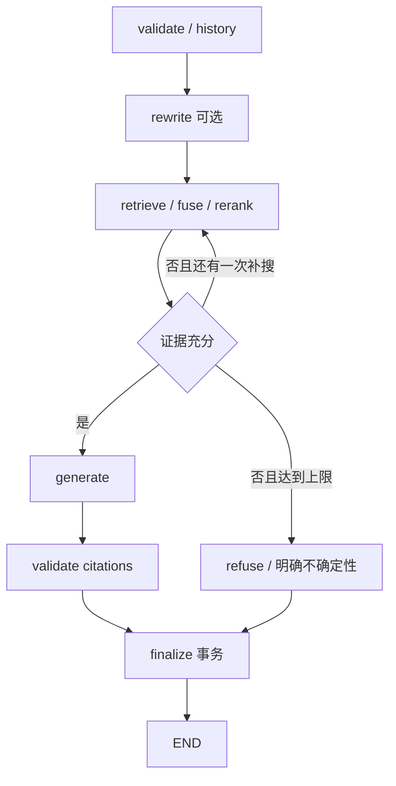
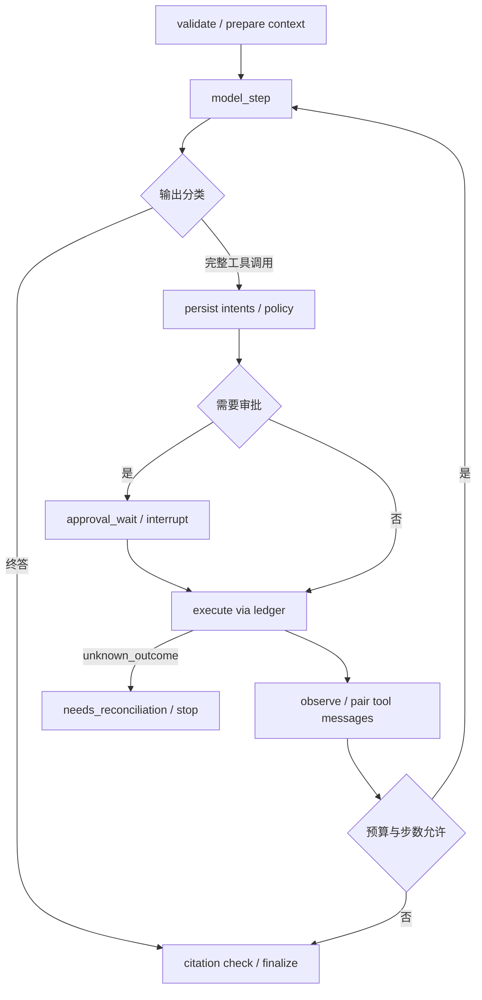
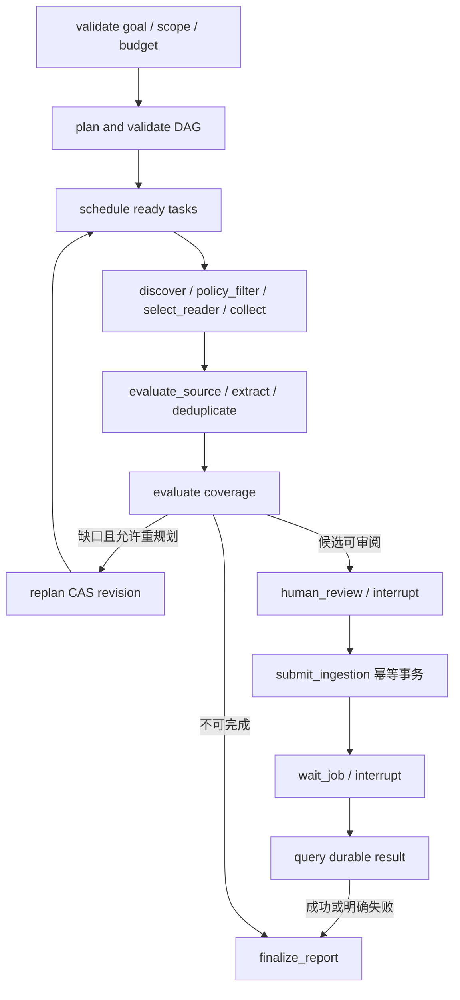
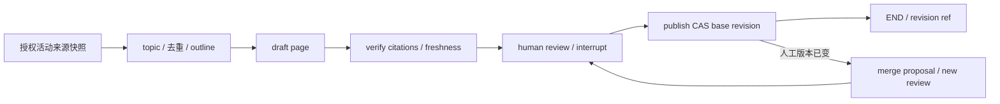

# 04 LangGraph 工作流

日期：2026-10-27；N/提议，未运行框架。需求 F-05/06/09/10/14、AC-03/05、AC-E01–E10；输入审计 A14–A18、R01–R15。契约基线：[01](01_System_Architecture.md)、[02](02_Agent_Harness.md)、[03](03_Task_Orchestration.md)。

## 1. 设计目标、范围与非目标

四个独立 Graph 共享薄 Harness，使用原生 Checkpointer/interrupt/resume 管理控制流。普通 RAG 不经 Planner；CRUD、摄取可靠作业不包装成推理 Graph。P0 实装 RAG，P1 实装其他三图；Wiki F-14 初读有冲突，期间检测 PRD 非本轮编辑已将其改为 P1，当前与工作树一致，正式基线待评审/提交。

官方资料于 2026-10-27 核对：[interrupt](https://docs.langchain.com/oss/python/langgraph/interrupts) 支持持久化中断及 Command 恢复、恢复时重入节点；[persistence](https://docs.langchain.com/oss/python/langgraph/persistence) 区分线程 checkpoint 与跨线程 store。具体安装版本、Postgres saver 初始化/事务/流 API 必须在后续锁版本时验证，本节不是对任意版本的可运行代码承诺。

## 2. 数据结构、State Schema 与核心接口

State 为可序列化、经过脱敏的有限工作集，以下 TypedDict 为自有草案。正文、原图、大 HTML 在私有对象存储，仅保存引用；messages 只存已脱敏的有限窗口，完整安全消息从业务 Message 读取。

```python
from typing import Literal, TypedDict

class BaseState(TypedDict):
    workspace_id: str
    principal_id: str
    run_id: str
    thread_id: str
    graph_version: str
    state_schema_version: int
    policy_snapshot_id: str
    step_count: int
    deadline: str
    error_codes: list[str]

class RagState(BaseState):
    conversation_id: str
    query_ref: str
    kb_refs: list[str]
    rewritten_query_ref: str | None
    evidence_refs: list[str]
    answer_draft_ref: str | None
    citation_refs: list[str]
    retrieval_round: int
    sufficient: bool

class AgentState(BaseState):
    conversation_id: str
    context_ref: str
    tool_call_refs: list[str]
    pending_approval_id: str | None
    answer_draft_ref: str | None
    should_finish: bool

class ResearchState(BaseState):
    collection_task_id: str
    task_graph_revision: int
    task_refs: list[str]
    source_version_refs: list[str]
    candidate_refs: list[str]
    evaluation_ref: str | None
    job_refs: list[str]
    pending_approval_id: str | None
    replan_count: int

class WikiState(BaseState):
    kb_refs: list[str]
    source_version_refs: list[str]
    wiki_page_id: str
    base_wiki_revision_id: str | None
    draft_ref: str | None
    citation_refs: list[str]
    pending_approval_id: str | None
```

同一引用字段 UUID 字符串与 01 UUID 一一对应；schema boundary 解析为 UUID。列表 reducer 采用按业务 ID 合并去重、稳定排序，不用简单 append 导致重放重复；大集合放业务表分页读取。预算、审批、job 状态在图中不维护可写副本，节点执行时读事实。State 中的 workspace/principal 用于关联，不用于授予权限，执行 Scope 来自可信宿主上下文。

应用 port：`WorkflowHost.start(scope, run_id) -> RunRef`、`resume(scope, run_id, approval_id?, completed_job_id?) -> RunRef`、`cancel(scope, run_id) -> RunRef`、`get_result(scope, run_id) -> ResultRef`；错误 `FORBIDDEN/RESOURCE_NOT_FOUND/RUN_CONFLICT/CHECKPOINT_INCOMPATIBLE/APPROVAL_MISMATCH/CANCELLED`。start/resume 必须有幂等键，带稳定 wake fact key；业务方法不是直接透传任意 `Command` 给客户端。节点 `async node(state, trusted_runtime) -> StateDelta`，通过 application 服务产生业务副作用。

## 3. RAG Graph（P0）

节点：validate_scope→load_history→可选 rewrite→retrieve（授权 FTS/向量/RRF）→可选 rerank→assess→generate/refuse→validate_citations→finalize。retrieve 必须对每个 KB 和 chunk 限定 workspace、ACL、活动索引和 embedding space；禁止检索后才过滤导致泄漏。Rerank 不可用可降级并给 diagnostics。证据不足最多补搜一次（建议），仍不足明确不确定性；无权限错误不能降级成绕过授权检索。



终止：最终消息事务完成，或预算/deadline/取消/永久错误。建议 max model steps=4、retrieval rounds=2；最终阈值由 H6 确定。模型引用只接受该轮真实 evidence handle，不接受模型自编 chunk_id。

## 4. General Agent Graph（P1）



节点并行/屏障由 Harness 执行批协议实现，不创建另一 Agent loop。建议最多 12 轮、每轮最多 4 个只读并行、父 deadline 和预算同时限制；错误修正也计 step 和费用。审批拒绝作为明确工具失败观察或终止，不改参逃避审批。

## 5. Research Graph（P1）



task_refs 关联 03 的持久化节点，图表达粗粒度阶段和恢复。URL/robots/许可/PII 校验在收集前；网页正文不生成权限指令。来源审批是 ReviewDecision，敏感工具审批是 Approval；两者不同，不能凭“已批准入库”允许浏览器外部写。wait_job 使用原生 interrupt 表示对已登记 Job 事实的等待；Job 完成 Outbox 唤醒同一 run，由宿主重查状态并提供 resume payload。丢失通知由 Reconciler 补发，模型不轮询循环耗费 tokens。仅 approved 且未撤销来源进入统一摄取。

停止条件：必需任务完成且质量/审阅/入库结果确定，或预算/重规划次数耗尽，或取消/未知副作用。最终报告区分 completed、failed、未审核、未发布、预算不足的缺口，不将“收集完”称为“已入库”。

## 6. Wiki Graph（P1，工作树已对齐）



输入固定来源版本与 base_wiki_revision_id；发布事务校验当前页面版本仍匹配 base、当前编辑权限、引用仍授权；UNIQUE(page,revision) 和发布命令幂等键防双版本。人工已编辑→`REVISION_CONFLICT`，生成合并提议，重新审核，不静默覆盖；源文变更标记 stale，撤销来源则先阻断显示/引用并安排清理。回滚是新修订引用旧内容，保留审计，仍检查来源授权。建议每页一次生成+最多一次修复，未通过引用校验不能发布。

## 7. Checkpoint / Resume / HITL 顺序

业务映射：workspace→run↔thread（1:1）；conversation→多 run；run→Task revision/TaskNode、Job、Approval/ToolCall；原生 checkpoint_id 作为框架内部 opaque 值，与 run/thread 映射表关联，不能用 event_seq 替代。四种 Graph 用 graph_type+graph_version 精确选择工厂；一个 thread 不切换 Graph 类型。

1. API start 事务登记 run/thread/graph/schema_version、输入 ref、Job/Outbox。
2. 宿主拿 01 的单写者锁与 epoch，重新授权，编译指定 Graph 并绑定原生 checkpointer。
3. prepare 节点先持久化 ToolIntent/Approval，approval_wait **只等待**，interrupt 前不执行外部写；不要捕获并吞掉框架 interrupt 控制异常，不随意调整同节点内 interrupt 顺序。
4. API 批准事务后唤醒。宿主从 DB 读绑定审批，重新校验权限、run 未取消、版本/参数/有效期；仅传 approval_id 等 JSON 引用给 `Command(resume=...)`，具体调用形式由配套版本 H1 验证。
5. execute 节点先查调用账本，成功则复用，不因重入重发；未知进入核查。节点结果事务先于 state delta/checkpoint，finalizer 同理幂等。
6. interrupt 已保存但 Run waiting 状态提交失败：Reconciler 在 owner 安全释放后通过原生 get_state 读取等待事实，幂等修正 Run。Run waiting 但无对应 checkpoint：重入 prepare/wait 节点用同一 Approval；绝不根据 approved 直接调用外部工具绕过 Graph。

DB 与 checkpointer 不在同一事务域，不保证恰好一次节点执行；“调用账本先成功再 checkpoint”窗口靠业务读取结果弥补。Checkpoint 恢复、SSE 续传和 Job 恢复分别处理，任何一个恢复都不推导其他两个已恢复。

## 8. 升级、异常和隔离

graph_version 为不可变发布标识，state_schema_version 为整数。业务 runs 记录二者；待执行 run 固定旧版本宿主池，滚动升级只把新 run 路由到新版。不能把旧 state 用新节点名/interrupt 顺序直接运行。迁移流程：冻结目标 run、备份 checkpoint 与业务关联、只在离线 fixture 验证纯转换；若原生版本无安全迁移能力，旧 run 在旧宿主结束/取消，再新 run 引用已确认产物，不手改 checkpoint 内部表。无法识别版本→`CHECKPOINT_INCOMPATIBLE`，保留原件、人工处理，不能静默重开 thread 重做副作用。

workspace/principal/thread 组合在应用层与映射表检查，checkpointer role 不给 API；所有 restore/resume 调用走 application，不能凭 UUID 读任意 state。权限撤销后历史 checkpoint 中 evidence 也不可直接返回，节点取用时重新授权/脱敏。

异常：模型/只读工具暂错按 02；Job 超时查 Job 事实，不新建同一入库作业；未知写/浏览器 owner 丢失停图核查；取消禁止新动作并完成安全保存；finalizer 数据库失败不发送 completed，详见 07。建议模型流保存批次与心跳配置需按延迟测试调优。

## 9. 取舍、测试验收与未决

选择独立 Graph 而非万能 Graph+mode 大分支；共享节点服务而非共享可写 State。使用原生 Postgres checkpointer，替代自建快照引擎；业务 Outbox/ToolCall 不替代它。多轮会话每轮新 thread 简化取消/版本边界，代价是需显式载入消息摘要，长程记忆 P2 再评估。

H1/H2/H3/H6/H8：进程退出后审批恢复、interrupt 前代码重入、业务成功/checkpoint 失败、checkpoint 成功/Run 回写失败、双 owner/旧 owner 迟到、历史 schema 升级、跨空间 resume、Job 完成通知丢失及引用撤销均应测试。已成功副作用零未经确认重放，最终消息和 completed 事件仅一次业务提交。当前未执行；进入实现前必须锁定 LangGraph/checkpointer 版本并验证单写者部署策略。

未决：原生 saver 连接失效行为/同步持久化配置、历史数据保留期、旧版本宿主最长保留期限、审批等待 SLA、Wiki P1 工作树修改的正式基线确认与合并 UX。P0 不交付时间旅行写分支，也不允许客户端 fork 历史 checkpoint 执行。
