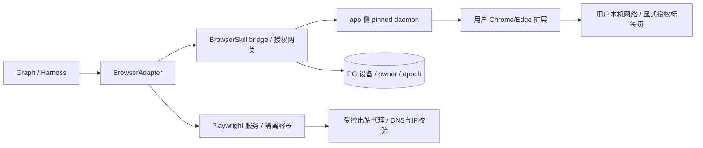
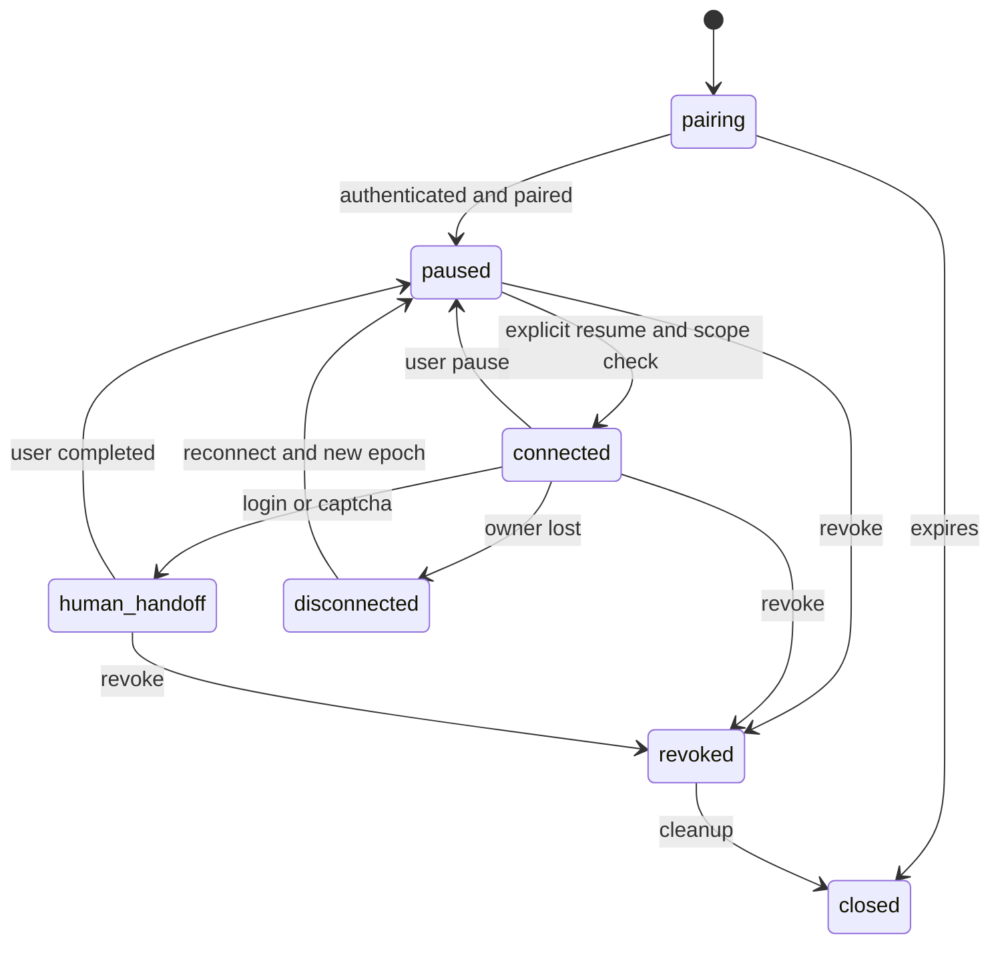

# 05 Browser Adapter

日期：2026-10-27；N/提议。需求 F-07/08/11、AC-06、AC-E02/08/09；证据 B01–B11、C07/C08、BRO-01/02。统一状态和审批：[01](01_System_Architecture.md)、[02](02_Agent_Harness.md)。本轮没有获取 BrowserSkill upstream 或运行真实浏览器。

## 1. 设计目标、范围与非目标

统一受控读取、有限交互、人工接管与错误语义，保留用户浏览器和服务端隔离浏览器的能力差异。不绕过登录/验证码/付费墙，不复制用户长期 cookie，不承诺两后端方法完全等价。P0 单 URL 受控 HTTP 抓取，P1 双浏览器；HTTP 不足时 P0 返回需浏览器/不支持，不偷偷开启未验证动态抓取链。

## 2. 部署及接入路线



A/本轮定向核验：WeKnora `scripts/build_browserskill.sh` 将 daemon/extension 固定同 upstream SHA，目标平台未列 Windows；`internal/browserskill/daemon.go` 在 app 侧启动 daemon。审计 B07 的 Unix socket JSON RPC 不等于 MCP/Playwright。构建清单为 **0.3.1 / `da6bf4eed2dd7256567e152df8c903c87f6598c3`**，只是已核实构建输入，不是已测协议兼容。

N/推荐 P1 验证期保留最小独立 Go bridge，Python 调自有内部受认证 port；复用原授权/路由协议行为，减少同时重写风险。不是启动整个 WeKnora，也不是修改参考源码。后续若获授权实现桥接，须独立源码/构建产物、保留许可、明确 bridge API 和依赖。不假设可将单文件无依赖抽出。

替代：Python gateway 直接处理扩展配对/WS、daemon RPC 和 owner 路由，可减少 Go 运维，但需重新实现全部安全与兼容验证。两路线用同一真实互通 fixture 对比，选择进入 ADR-0004 评审；未经通过，不宣称 Python 直连已可用。

Linux 容器为 gateway/daemon/Playwright 推荐部署目标；用户 Windows Chrome/Edge 扩展是不同支持面。原生 Windows 的 daemon 传输、进程管理/沙箱未验证，禁止承诺。Playwright Python SDK 可有平台安装能力，但本项目生产网络隔离只验 Linux；本机 Python 3.14 不作为运行支持依据。

## 3. 数据结构、接口及能力协商

```python
from typing import Literal, Protocol
from uuid import UUID
from pydantic import Field

class BrowserRequest(DTO):  # DTO 继承 02 的严格边界配置
    browser_session_id: UUID
    tool_call_id: UUID
    action: Literal["open", "read", "click", "extract", "screenshot", "close", "request_human_help"]
    url: str | None = None
    locator_ref: str | None = None
    arguments: dict[str, str] = Field(default_factory=dict)
    expected_epoch: int = Field(ge=1)
    timeout_ms: int = Field(gt=0, le=60000)
    max_bytes: int = Field(gt=0)

class BrowserResult(DTO):
    tool_call_id: UUID
    status: Literal["succeeded", "failed", "unknown_outcome", "cancelled"]
    final_url: str | None
    artifact_refs: list[UUID]
    error_code: str | None
    action_sent: bool
    observed_epoch: int

class BrowserAdapter(Protocol):
    async def negotiate(self, ctx: "ExecutionContext", backend: str) -> "Capabilities": ...
    async def create(self, ctx: "ExecutionContext", grant_ref: UUID) -> "BrowserSession": ...
    async def execute(self, ctx: "ExecutionContext", request: BrowserRequest,
                      approval_id: UUID | None) -> BrowserResult: ...
    async def control(self, scope: "Scope", browser_session_id: UUID,
                      command: Literal["pause", "resume", "revoke", "close"],
                      expected_epoch: int) -> "BrowserSession": ...
```

Schema 统一继承 02 DTO extra=forbid。locator_ref 由 adapter 观测生成，绑定页面 generation，不执行模型提供任意 JS；extract 只允许注册 schema，禁止任意 evaluate。action 的副作用类型按 ToolSpec/页面策略判定，click 默认写；open 虽为 GET 也只允许审核的导航，存在副作用风险的 URL 需审批或拒绝。

BrowserSession 字段：workspace_id、principal_id、browser_session_id、backend、device_id?、run_id、state、capabilities_hash、allowed_domains、tab_grant_refs、expires_at、owner_instance、lease_epoch、lease_expires_at、row_version。owner_instance 是内部部署标签，不可由模型选择；device token/WS 凭据不入此 DTO，仅 secret store 引用。

Capabilities = adapter_api_version、backend_version、daemon_version?、extension_version?、wire_protocol_version?、features、limits、unsupported_actions、platform。能力采用已测试 allowlist 与 handshake 交集；未知协议/版本返回 `BROWSER_INCOMPATIBLE`，不以非空版本字符串判定兼容。

| 能力 | Playwright | BrowserSkill |
| --- | --- | --- |
| 公开 JS 页面/临时会话 | 推荐；每 run 独立 context | 可用与否需成套版本实测，非批量爬虫默认后端 |
| 用户已有登录会话 | 不导入个人 cookie；可人工授权临时会话 | 用户已配对设备、指定标签页/本轮授权 |
| click/表单/截图/附件 | 有 SDK 能力仍须策略与审批；下载隔离 | 只暴露 pinned daemon 实际支持且已验的方法；不做等价猜测 |
| 人工接管 | 受控交互通道（如无则返回 unsupported） | 依 upstream 协议 request_help/继续信号验证 |
| 网络全链控制 | 容器 egress proxy+网络规则 | 用户网络不完全受服务端管控；需扩展全请求策略能力验证，否则拒绝高风险域/场景 |

Playwright 官方 [BrowserContext 隔离](https://playwright.dev/python/docs/browser-contexts) 支持独立 cookie/storage 环境；此能力不是 OS 沙箱/网络隔离的替代。

## 4. 身份、配对、续期与撤销

配对只允许已认证且有 browser.use 权限的主体；一次性随机 token，仅存 hash、绑定 workspace/principal、5 分钟有效（建议继承原行为，待评审）。扩展交换设备短期凭据，轮换旧 token 并设 replay 防护；有效期建议先 24 小时而非默认长期，产品确认后锁定。WS Origin 必须精确扩展 ID allowlist+token 身份双检验，不能只验证 `chrome-extension://` 形态；代理 access log 禁止记录认证 subprotocol。

1. API 创建 pairing；用户扩展确认指定设备和 workspace。
2. 网关校验并一次性兑换；DB UNIQUE(token_hash)、CAS 未消费→已消费，创建 device。
3. 扩展 WS 认证、capability handshake，owner claim 递增 epoch；默认 paused，用户显式 start/resume 授予本轮标签页范围后 connected。
4. 续期要求旧凭据和当前有效 membership，事务轮换，旧凭据失效；撤销立即关闭连接、递增 epoch、取消未发动作，后续都拒绝。撤销不能追回已经读取/发出的内容，按删除策略清理。

多工作区需独立设备 grant/session，不能将原 caller 自动替换为共享 KB 所有者。对同设备的跨空间任务不共享排队命令和页面句柄。

## 5. owner 路由、暂停与人工接管



BrowserSession 的动作队列按 session 串行，导航后页面 generation 更新，旧 locator_ref 无效。调用先验证 scope/session grant/epoch、owner lease、deadline、审批，再转发 owner；内部路由 mTLS 或 HMAC(timestamp,nonce,body_hash)+共享 anti-replay store，不仅单进程 nonce 缓存。非 owner 不本地重建后执行。lease 过期只允许新 epoch 建连，旧 epoch 返回的结果不能改当前会话。

owner 崩溃/断线：监测器将 session disconnected，尚未发动作可安全取消；已发写一律 ToolCall unknown_outcome，Run needs_reconciliation。扩展重连后 session paused，读取当前标签页只用于核查；任务必须经用户显式 resume、重新授权。重连不等于任务恢复，不能重新发之前 click。存在不同 owner 同时活动风险时，网关/daemon 转发也必须验证 fencing epoch，真实 H7 失败则降级单实例。

人工接管通过 interrupt 保存 handoff reference；用户自行登录/处理验证码，点击继续后服务端验证当前页面/范围，返回 paused，再显式 resume。模型无权声明“验证码已完成”或改变完成条件。无人值守无人工通道时终止为 `HUMAN_ACTION_REQUIRED`。handoff 建议 5 分钟到期，超时不自动提交表单。

## 6. 网络、下载、隐私与错误恢复

公开收集只允许 http/https、审核域名和端口，拒绝用户信息 URL、file/data/javascript、私网/环回/link-local/云 metadata。每次导航、重定向、iframe、子资源、WebSocket/下载均做 DNS 解析与连接 IP 校验，代理固定验证过的目的 IP 防 rebinding；出口网络阻断不能由浏览器 route hook 独自承担。控制站覆盖 IPv4/IPv6/别名/重定向链。BrowserSkill 若无法控制用户网络所有子请求，必须记录限制，按严格策略拒绝这类采集，不声称 SSRF 全覆盖。

逐域速率和总页数/depth/bytes/deadline 在预算账本预留；下载默认关闭，显式授权后白名单 MIME、总量、压缩展开比、隔离扫描，无可执行文件。弹窗/新标签不自动扩展权限；禁止任意本地文件上传/读取。Playwright 每 run/context 独立容器 profile，结束清理；用户会话只留用户设备，服务端不持久化 cookie。截图/DOM 先 PII 检测与遮罩，无法脱敏则禁止传模型或写普通产物区。

错误统一：`BROWSER_OFFLINE/BROWSER_PAUSED/BROWSER_INCOMPATIBLE/CAPABILITY_UNSUPPORTED/OWNER_LOST/HUMAN_ACTION_REQUIRED/SSRF_BLOCKED/APPROVAL_MISMATCH/TOOL_UNKNOWN_OUTCOME`。连接前失败 action_sent=false 可重试建连；发送后 timeout/cancel 若无法证明未执行，status=unknown_outcome，禁止自动换 owner/后端重复写。read 超时可在新授权/预算内重试，但须考虑页面动态变化，新快照单独记录。close 重复调用幂等，不能把 close 成功当撤回先前写动作。

## 7. 测试、取舍与未决

H7 必须用 pinned daemon+真实扩展+Chrome/Edge，分别记录 OS/browser/extension/daemon/protocol/hash；mock 只验 Python port。Playwright 用控制站验证 JS、跳转、截图、附件、人机交接及 SSRF；双副本测 owner crash/epoch/迟到结果、pair replay、续期旧 token、撤权、暂停期间动作拒绝、未知写不重放。

建议验收：测试集内越权/禁止地址零到达；未知写零自动重发；所有产物有会话/来源/范围审计；真实能力矩阵每项有证据或 unsupported。若上游实现无法满足，优先只读降级/关闭相应后端，不以 mock 宣称互通。

取舍：不以“统一接口”消除能力差异；保留桥接降低协议迁移风险，代价是维护额外服务和许可材料。未决：首发是否必须 BrowserSkill、bridge 提取范围/内部协议、扩展 ID 信任名单、原生 Windows 支持、用户网络控制边界、设备与授权 TTL、人工交接通道，以及 pinned upstream 许可/构建产物。全部进入 ADR-0004 验证条件。
