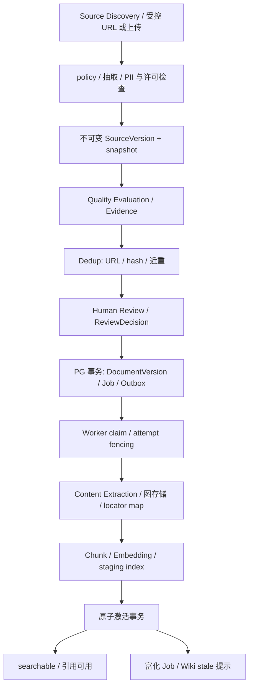
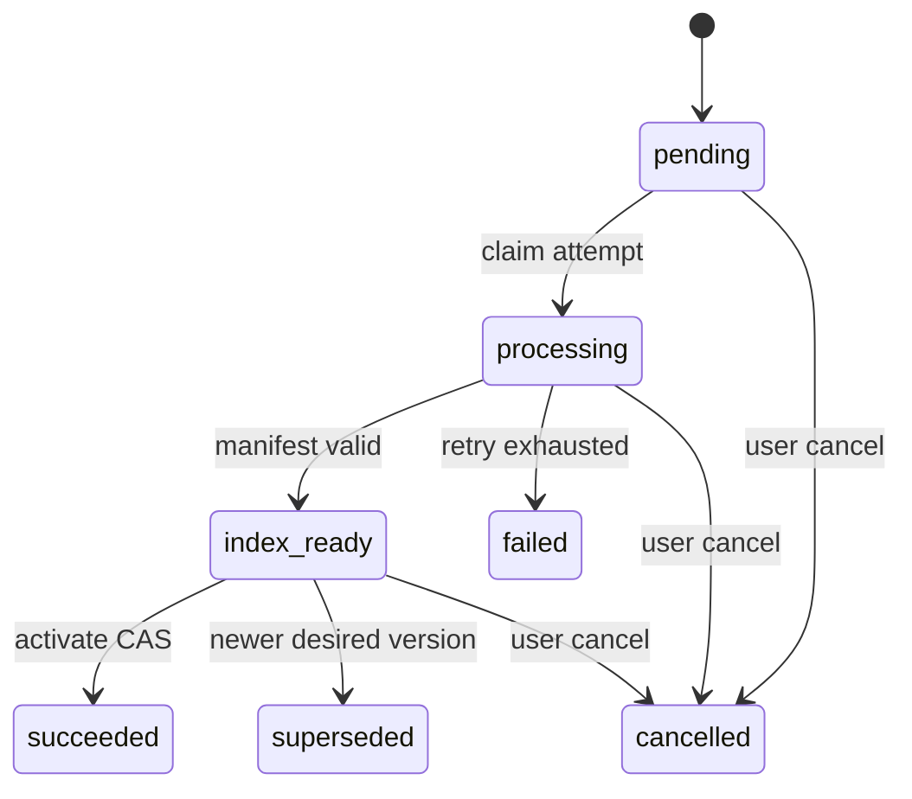
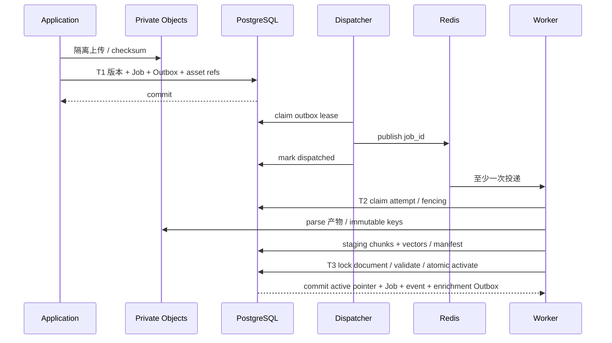

# 06 知识采集、摄取与版本发布

日期：2026-10-27；N/提议，未实现。需求 F-03/04/07/08/10/12、AC-01/04/05、AC-E03–E07；审计 C01–C10、I02–I11。共用字段/状态：[01](01_System_Architecture.md)，约束：[07](07_Data_API_Security.md)。

## 1. 设计目标、职责与非目标

P0 上传 PDF/DOCX/TXT/MD/HTML 与单 URL 人工确认后形成可检索版本；P1 将 Research 来源发现、质量评价、去重、审核与增量更新接入同一流水线。Graph 只编排研究，不复制摄取状态机；Celery 承载固定解析/分块/embedding 作业。目标为至少一次执行下的幂等发布，非目标是任意外部副作用 exactly-once、所有原 Go 格式/解析器兼容、富化全部成功才能检索。

## 2. 采集数据结构、接口与流程

Source 表示逻辑来源，不等于 Document。来源以 workspace+canonical_url（上传为内部 upload 来源键）去重；SourceVersion 为不可变 bytes/hash/许可/抓取元信息，DocumentVersion 为目标 KB 中选定来源和处理配置的不可变快照。一份来源可进入多个授权 KB，但不能跨空间共享对象路径。

```python
from typing import Literal, Protocol
from uuid import UUID
from pydantic import BaseModel

class ParseRequest(BaseModel):
    document_version_id: UUID
    source_version_id: UUID
    input_asset_id: UUID
    parser_profile: str
    request_id: str

class SourceLocator(BaseModel):
    kind: Literal["pdf", "docx", "text", "html"]
    start: int  # 原始解析正文 code point 半开区间
    end: int
    page: int | None = None  # 1-based
    bbox: list[float] | None = None  # 归一化 x0,y0,x1,y1，左上原点
    path: str | None = None  # heading/DOM/paragraph 路径

class ParsedDocument(BaseModel):
    parsed_asset_id: UUID
    image_asset_ids: list[UUID]
    source_blocks: list[SourceLocator]
    transform_map_asset_id: UUID
    parser_version: str
    diagnostics: list[str]

class IngestionService(Protocol):
    async def submit(self, scope: "Scope", source_version_id: UUID,
                     kb_id: UUID, review_decision_id: UUID,
                     idempotency_key: str) -> "JobAccepted": ...
    async def reprocess(self, scope: "Scope", document_id: UUID,
                        parser_profile: str, idempotency_key: str) -> "JobAccepted": ...
    async def publish(self, ctx: "AttemptContext", manifest: "IndexManifest") -> "Publication": ...
```

接口前置：当前 principal 有目标 KB 写权限；SourceVersion approved、许可允许处理、未撤销；ReviewDecision 对该来源版本和 KB 有效。上传者确认也记录为 review_decision（P0），不能拿任意 approval_id 冒充来源审核。reprocess 使用原 source_version_id，显式新处理配置 revision（包含在 processing_profile_hash）时新建 document_version_id/index_version；相同来源/配置重复请求复用版本，不改写旧版本。publish 是内部服务端 port，只允许持有有效 job/attempt/epoch 的 Worker，客户端无权直接调用。

URL 初次提交尚无快照时，只事务登记 Source、fetch Job 和 Outbox，202 返回 source_id/job_id；抓取成功后登记 SourceVersion 和审核状态，批准后才 submit 摄取版本/新 ingestion Job。初始 Job 的结果指向后续 Job/待审来源，不能提前返回不存在的 document_version_id。文件上传已有隔离 bytes，校验后可直接登记 SourceVersion 和批准的 DocumentVersion。

IndexManifest：workspace/document/version/index_version、attempt_id、chunk_count、embedding profile/dimension、FTS tokenizer profile、所有对象 checksum、source map checksum、完整性检查结果。Publication：active_index_version、document_version_id、searchable=true、enrichment_status。核心错误 `UNSUPPORTED_FORMAT/PARSE_FAILED/PARSE_INCOMPLETE/SOURCE_REVOKED/STALE_ATTEMPT/VERSION_SUPERSEDED/CANCELLED/INDEX_INCOMPLETE`。



QualityEvaluation 分项保存权威性、时效性、相关性、完整性、许可、敏感性、证据定位置信度；硬拒绝项（禁采/恶意/不可处理许可）不能被总分抵消。权重/阈值 U，P1 先人工审核。每结构化关键事实至少一条可复现 evidence，引用 source_version_id+原始定位+quote_hash；无定位事实标记不可证实，不自动发布。

去重按 workspace 隔离。URL 规范化保留语义 query，不盲删所有参数；canonical 仅信任经策略验证结果。精确 hash 相同可归一重复簇并共享空间内受控 artifact，Source 仍分别保留。近重仅生成建议，不自动合并互相矛盾事实；不能因另一空间命中 hash 泄露存在性。重复提交按操作幂等键复用 Job；同来源同正文同配置同 KB 的语义去重键再保证不重复建索引。

## 3. DocReader 服务复用及 P0 格式路线

| 格式 | P0 推荐路线 | 定位/限制及验证 |
| --- | --- | --- |
| TXT | Python 标准库严格解码 UTF-8/带 BOM UTF-8；用户显式选择编码可扩展 | 保留 bytes→code point 映射；未知编码拒绝而非静默乱码；行号/字符范围 |
| MD | 简单适配保留原文，成熟 Markdown parser 提取结构 | 原文 offsets，HTML 预览清洗；相对图片只能解析到已登记附件 |
| PDF | 固定 DocReader gRPC engine profile | 页码/bbox/扫描 OCR；locator 缺失则文档级引用，不能虚构页码 |
| DOCX | 固定 DocReader gRPC engine profile | 标题/段落/表格 locator，图片 relationship 映射实测 |
| HTML | 策略代理先抓 bytes，DocReader 文件模式/成熟正文库择优 | snapshot+DOM/段落定位；P0 不依赖未验浏览器网络防护；最终路线由 golden set 选择 |

原 Go simple 路线还支持 CSV/JSON/图片/音频，不纳入本轮 P0。A/定向复核 `docreader/proto/docreader.proto`：ReadRequest 没有 workspace；ReadStream 首帧 meta 携完整 Markdown，图片随后；SourceBlock 是 code point offsets；image_storage 已移出 ReadConfig。复用 RPC 不包含业务授权、图片存储、分块、正文变换与定位全过程。

DocReader 是隔离无业务 DB 权限服务，Worker 在授权后提供文件 bytes 和最小 metadata，禁任意 URL/engine override。共享服务 token 由连接器注入、mTLS/服务认证强制开启，不能依赖未设置 token 时放行的默认配置。proto 文件 hash 和镜像 digest 固定，ReadStream→Read 仅在 UNIMPLEMENTED 且大小允许时降级。

检查 gRPC status、meta.error、恰好一份 meta、EOF 完整性、图片大小/数量/类型；首帧后流断开→PARSE_INCOMPLETE，所有暂存图片不发布。image_count 是 best-effort，不能单靠 count=0 判完整；依实际 parser 契约+EOF+manifest 验证。单帧完整正文仍需内存上限/大文档拒绝阈值，不能宣传全链常量内存。

## 4. 图片、正文变换与引用定位

Worker 逐图在隔离前缀写不可变对象，检查 MIME/实际文件头/大小/病毒/PII；ImageRef.storage_key 或 original_ref 视为不可信，禁止直接读取任意文件路径/URL，若需获取必须通过策略代理并绑定来源。生成 asset_id 和 workspace/document_version 绑定，不将 parser 返回路径作为授权证明。图片 URL 在持久正文中改为内部 asset 引用，响应时再授权；不保存短期签名 URL。

维护三层：raw snapshot→parser 原始 Markdown+SourceBlock→规范化 Markdown+chunk。每次换图/换行/表格变换记录分段 interval map，带 transform_version，组合映射反查原始区间。模型摘录引用使用 chunk 内 range→规范化正文→原始 SourceBlock→snapshot。不可逆/歧义转换降级到段落/页级，并标定位精度，不制造精确 span。UTF-16 UI 用明确转换函数展示 code point 区间；中文、emoji、组合字符、CRLF、表格图片替换是 golden set 必测。

Citation 保存文档/来源/索引/Chunk/定位及 quote_hash；旧版本被 retired 后，历史已授权引用可读取旧私有原件（保留期内），检索仅选 active 指针。删除或撤权后历史引用也再授权，不能用旧签名/缓存绕过。引用保留策略与擦除请求冲突时以撤销访问/受控审计为先，保留内容政策待确认。

## 5. 版本生命周期、幂等与旧 attempt 拦截



DocumentVersion 内容/处理配置不可变，状态可迁移；Document 保存 desired_document_version_id、active_document_version_id、active_index_version、generation、deleted_at。每次确有新来源/配置 revision 的更新/reprocess 在 document 行锁内分配递增 index_version，设 desired version 并生成 Job+Outbox。相同配置复用原版本；新请求不改变旧活动指针，直到发布成功。

Job consumer 领取事务：检查 job pending/retry_wait、available_at、document desired/generation/未删未取消、Source 未撤销；新建 attempt_id、attempt_number、lease_epoch、lease expiry，CAS job→running，绑定 `index_builds.current_attempt_id`。重复消息若 running 且 lease 有效则 no-op；终态直接 ack。过期重试由 Job Reconciler 标旧 attempt expired、新 attempt/new staging partition；不复用旧执行 epoch。

Chunk 唯一 `(workspace_id,document_id,index_version,attempt_id,chunk_ordinal)`；全部暂存查询不可见。每个批次写入和最终提交都验证 current_attempt_id/epoch，不能只在 Worker 开始检查一次。索引发布指针同时绑定 winning_attempt_id，杜绝同 index_version 下旧 attempt 行混入检索。旧 attempt 回来→STALE_ATTEMPT，不清理当前 build/活动数据，只清理自身隔离分区。

用户取消：事务 generation++、相关 Job cancelled、待发布版本 cancelled；可选保留旧活动版本（取消新处理不等于删除旧知识）。删除：事务 tombstone+generation++、清空 active 指针、取消 Job/审批/候选并 Outbox 安排清理；所有检索即刻过滤 tombstone。后台结果 late→CAS 不满足丢弃，不能重新挂载资产。旧已发外部调用的费用/receipt 仍安全归集，不重新发布。

## 6. DB、对象、队列与索引事务/补偿



T3 在同一 PG 事务中：锁 document→job/build；重查权限服务的执行授权/来源状态、deleted_at、generation、desired_version、attempt/epoch、manifest 完整性、embedding profile；校验通过，将旧 active build retired、新 build active、document 活动双指针更新、DocumentVersion succeeded、Job succeeded、事件 indexed 和富化 Job+Outbox 一起提交。对象已在不可变 key 完整写入并校验存在，提交失败保留暂存数据供重试/GC。pgvector 与 FTS 都在同一 PG 事务域，检索一个 SQL snapshot join 活动指针和 winning_attempt，避免分两次查询混版本。改外部索引必须另写 ADR，不能沿用此原子性。

F1 DB 已提交/Redis 不可用：Outbox pending 保留，dispatcher 重试，API 仍返回已持久 accepted；恢复后至少一次投递。F2 重复 Job：claim CAS+租约、产物唯一键、T3 幂等；ACK 不作为事实来源。Celery 建议评估 acks_late、reject_on_worker_lost、有限 retry 与 visibility timeout（大于单步上界并故障验证），但进程丢失仍由 DB Reconciler 兜底，不仅依赖 broker 重投；见官方 [Tasks](https://docs.celeryq.dev/en/stable/userguide/tasks.html)。

F6 v1 晚于 v2：T3 对 desired_version/generation 比较，v1→superseded，v2 指针不变。F7 取消/删除后结果：取消 generation/tombstone 已先提交，late Worker 拒绝提交，无可见索引。F8 核心成功、富化失败：核心 succeeded/searchable 不变，enrichment partial_failed/failed，分类型重试，不再重跑解析/原子发布。

对象补偿：T1 未提交对象为孤儿，GC 延迟扫描且确认 DB 无引用+无活跃租约后删除；禁止仅凭文件年龄删除。发布对象缺失→INDEX_INCOMPLETE，旧活动版本维持；发布后存储损坏→报警并暂停相关版本服务，可显式回退到校验通过旧版本，不能静默返回坏引用。删除清理失败→保留 tombstone/重试清理，访问不恢复。DB GC 级联删除必须遵守引用/审计保留期。

## 7. Incremental Update 与富化

周期任务唯一 `(workspace_id,collection_task_id,scheduled_at)`，每触发新 run_id、policy snapshot，不复用上轮 Graph。HEAD/ETag/Last-Modified 仅优化，最终 bytes/hash 比较；相同内容新增 observation 不新建索引。变更建 SourceVersion/candidate，人工批准后新 DocumentVersion；“消失/404”先建撤销候选，不立即覆盖人工内容。许可撤销/敏感事件可立即阻断访问并发清理。

富化每 `(workspace,document_version_id,kind,profile_hash)` 唯一，状态单独聚合；任务完成通过唯一 completion fact 更新，不靠可重复 decrement 计数。摘要/问题/Wiki 提示失败最多影响 enrichment_status；新来源激活后 Wiki 标 stale 并产生待审草稿，不改人工正文。模型/embedding 失败重试计预算，embedding 维度/profile 不同必须新建索引空间，不混向量。

## 8. 技术取舍、测试与依赖未决

推荐 DocReader 独立容器、TXT/MD 小适配、成熟 chunk/正文库经评测选型；替代全量内嵌 parser 会耦合 OCR/浏览器/native 依赖，暂不采用。不复制 Go chunker 实现；行为用 golden set 对比，许可与通知保留。FTS 中文分词/近重算法/embedding profile 需 H4/H6 选择，安全与原文定位优先于“格式支持数量”。

H4/H5/H8/H9 验收：五格式 golden set、断流/缺图/坏 meta、Unicode 映射；Redis 断开/重投/Worker kill/旧 attempt、v1/v2 反序、取消/删后迟到、对象写成功 DB 回滚、发布成功 ack 丢失、富化失败。每轮观察 active pointer/winning_attempt、可见 chunk 数、Job 终态、Outbox、引用完整性与孤儿对象。测试与量化目标见 08，当前无实测性能/解析通过率。

未决：首批扫描/OCR 范围、文件/内存上限、DocReader 精确镜像/许可、HTML 最终引擎、源版权全文/摘要规则、近重阈值、对象保留和合规删除期限、旧版本回滚授权。此阶段只定机制与验证条件，不运行 PoC。
