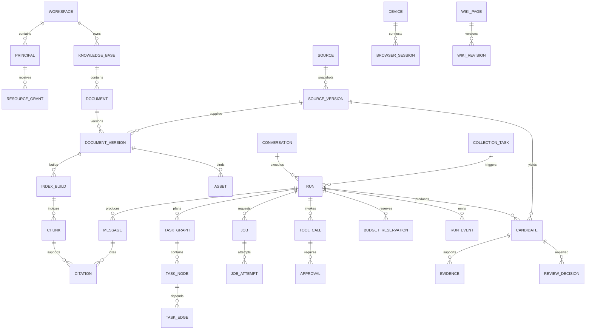

# 07 数据、API 与安全契约

日期：2026-10-27；N/提议。需求 F-01–F-16、PRD §11–16；AC-01–06、AC-E01–10。术语/状态唯一来源为 [01](01_System_Architecture.md)；本文件是八份 TDD 的字段约束、错误码、REST/SSE 契约来源。

## 1. 设计目标、职责与非目标

形成可落地到迁移和 OpenAPI 的逻辑模型，确保所有访问有空间和主体授权、所有长操作可查状态、所有事件可辨顺序与终态。P0 不兼容旧 WeKnora 数据表/API，不开放跨工作区共享，不允许客户端直接读 checkpoint、签名任意 object key 或执行任意工具。

## 2. ER 模型

所有图中实体（包括联表/事件/预算/审计）均带 workspace_id；workspace 本身主键即 workspace_id，身份边界例外待 ADR-0005 确认。图省略重复 workspace 边，不表示缺字段。



## 3. 数据结构：核心表、字段、外键、唯一约束与索引

通则：UUID 主键；每表 `UNIQUE(workspace_id,<pk>)` 供复合 FK；租户 FK 都含 workspace_id，禁止仅 FK(resource_id) 使跨空间行可连。除事件/不可变历史外有 created_at、updated_at、row_version；可变资源有 deleted_at/generation。不可变指**内容和来源**不改，状态列可按拥有者转移。内容表默认私有，不把 Graph State 当事实数据库。JSONB 严格按版本 schema，大小上限，禁止秘密/PII 原文。

| 表 / 主键 | 核心字段、FK（省略共同 workspace 前缀） | 唯一/索引和约束 |
| --- | --- | --- |
| workspaces / workspace_id | name,status,policy_revision | workspace 为隔离根，删除先 tombstone |
| principals / principal_id | membership_subject_ref,kind,role,status | UNIQUE(workspace,membership_subject_ref)；subject_ref 为身份域受控 opaque 引用，不复制邮箱/姓名到普通日志 |
| resource_grants / grant_id | principal_id,resource_type,resource_id,actions,expires_at,grant_version | UNIQUE(workspace,principal,resource_type,resource_id)；多态资源引用由受控 registry 校验，后续迁移优先按资源类拆 grant FK，禁止任意 UUID 授权 |
| policy_snapshots / policy_snapshot_id | revision,rules_hash,safe_rules | UNIQUE(workspace,revision)，rules 不含凭据 |
| model_profiles / model_profile_id | provider,model_name,kind,dimension,credential_ref,pricing_snapshot,status | UNIQUE(workspace,profile_name,profile_revision)；credential_ref 仅受限密钥句柄，不入 state |
| tool_configs / (tool_name,tool_version) | input_schema,schema_hash,effect,policy_ref,connector_ref,status | 复合主键含 workspace；相同版本不可修改 schema；connector secret 只在密钥域，变更创建新版本并失效旧授权意图 |
| knowledge_bases / kb_id | name,owner principal_id,model_profile_id,deleted_at | workspace+owner 索引；读写都检查 ACL |
| sources / source_id | canonical_url,canonical_hash,source_type,status | UNIQUE(workspace,canonical_hash)；哈希冲突核对正文 URL，URL query 敏感值先拒绝/清洗 |
| source_versions / source_version_id | source_id,content_hash,snapshot_asset_id,captured_at,published_at,license_info,status | UNIQUE(workspace,source_id,content_hash,extraction_profile_hash)；source/date 索引；许可和快照不可变 |
| fetch_observations / fetch_observation_id | source_id,source_version_id,run_id?,fetched_at,http_status,etag_hash | source/time 索引；相同内容多次观察不重复快照 |
| documents / document_id | kb_id,source_id,desired_document_version_id,active_document_version_id,active_index_version,generation,deleted_at | UNIQUE(workspace,kb_id,source_id) 作为默认语义文档；活动指针成对可空；活动 build 复合 FK，迁移用 deferred FK 解决互引用 |
| document_versions / document_version_id | document_id,source_version_id,parser_profile_hash,model_profile_id,index_version,status,generation | UNIQUE(workspace,document_id,index_version)；UNIQUE(workspace,document_id,source_version_id,processing_profile_hash)；相同配置 reprocess 幂等复用，强制重建须显式 profile revision |
| index_builds / (document_id,index_version) | document_version_id,current_attempt_id,winning_attempt_id,status,manifest_asset_id,dimension | 活动 build 唯一；winning attempt 必须属于同 build，ready/active 必须 manifest 完整 |
| chunks / chunk_id | document_id,document_version_id,index_version,attempt_id,chunk_ordinal,content_ref,tsvector,embedding,locator_ref | UNIQUE(workspace,document_id,index_version,attempt_id,chunk_ordinal)；GIN(tsvector)，向量索引按 embedding space/dimension 建独立物理分区；空间/KB/活动指针 join；不同维度不混列 |
| assets / asset_id | document_version_id?,source_version_id?,object_key,checksum,mime,size,state,encryption_ref | UNIQUE(workspace,object_key)；至少一个业务 owner，不能裸 key 访问；可多 owner 时用 asset_bindings 显式授权联表 |
| asset_bindings / binding_id | asset_id,source_version_id?,document_version_id?,wiki_revision_id? | 每行恰一 owner，复合 FK；UNIQUE(asset_id,owner type,owner ref) |
| artifacts / artifact_id | run_id?,document_version_id?,kind,schema_version,manifest,digest,status | 逻辑结果不可变，不同于 asset bytes；manifest 内 typed refs 均授权且同空间；业务 owner 至少一个，撤销/删除传播到引用访问 |
| conversations / conversation_id | owner principal_id,mode,status | workspace+owner+created_at 索引 |
| runs / run_id | principal_id,conversation_id?,collection_task_id?,thread_id,graph_type,graph_version,state_schema_version,status,phase,current_revision,owner_epoch,lease_expires_at,result_ref | UNIQUE(workspace,thread_id)，status+lease 索引；phase 仅展示子阶段；不另存 CollectionRun 总状态 |
| messages / message_id | conversation_id,run_id,role,content_asset_id,status,generation | UNIQUE(workspace,run_id,role,generation)（同 generation 单最终 assistant）；权限不从 role 推导 |
| citations / citation_id | message_id,chunk_id,source_version_id,document_version_id,index_version,locator_ref,quote_hash | 复合 FK+版本一致性校验；message 索引；引用不能映射到另一 build |
| task_graphs / (run_id,task_graph_revision) | schema_version,plan_hash,created_at | revision>0，不可变；run.current_revision 指向此表 |
| task_nodes / (run_id,revision,task_id) | kind,input_hash,input_refs,acceptance,status,lease_epoch,attempt_count,result_refs | ready/status 索引；所有依赖同 revision；复用保存旧产物的引用，非重执行 |
| task_edges / edge_id | run_id,revision,from_task_id,to_task_id,accept_partial | UNIQUE(workspace,run,revision,from,to)，双节点复合 FK，CHECK(from<>to)，无环由提交服务验证 |
| jobs / job_id | run_id?,source_id?,document_id?,document_version_id?,kind,dedup_key,status,available_at,current_attempt_id,lease_epoch,error_code,result_refs | UNIQUE(workspace,kind,dedup_key)，status+available_at 索引；至少一个业务 owner；fetch Job 可仅绑定 source，payload 仅稳定引用 |
| job_attempts / attempt_id | job_id,attempt_number,lease_epoch,status,started_at,heartbeat_at,ended_at,error_code | UNIQUE(workspace,job,attempt_number)，UNIQUE(workspace,job,lease_epoch)；旧 epoch 拒提交 |
| outbox / outbox_id | aggregate_type,aggregate_ref,operation,dedup_key,payload_refs,status,lease_epoch,available_at | UNIQUE(workspace,operation,dedup_key)，未发/过期 lease 部分索引；事务登记，至少一次派发 |
| tool_calls / tool_call_id | run_id,task_id?,revision?,intent_key,name,tool_version,arguments_hash,safe_arguments_ref,scope_hash,idempotency_key,status,receipt_ref,reservation_id | UNIQUE(workspace,run_id,intent_key)，UNIQUE(workspace,run_id,idempotency_key)；未知状态索引；意图 key 由持久化模型响应/序号稳定派生 |
| approvals / approval_id | tool_call_id,requester,approver?,tool_version,arguments_hash,scope_hash,policy_snapshot_id,expires_at,status | 对 pending/approved 部分 UNIQUE(workspace,tool_call_id,arguments_hash,scope_hash,tool_version)，历史过期/撤销可新建；CHECK(approved implies approver not null) |
| budgets / budget_id | run_id?,task_id?,limits,spent,reserved,currency | scope key 唯一，非负约束；层级锁序 workspace→run→task |
| budget_reservations / reservation_id | run_id,task_id?,purpose_key,maximum,actual,status,pricing_snapshot_ref | UNIQUE(workspace,run,purpose_key)，settlement 唯一；未知 usage 不自动释放 |
| run_events / event_id | run_id,event_seq,event_type,schema_version,payload,occurred_at | UNIQUE(workspace,run,event_seq)，UNIQUE(workspace,run,event_fact_key)；run_id+event_seq 索引；payload 脱敏 |
| event_counters / run_id | next_seq,min_retained_seq | 持锁分配 seq，不依赖全局数据库 sequence 连续无洞；只对已提交事件保证递增 |
| idempotency_requests / request_id | principal_id,operation,idempotency_key,request_hash,response_ref,expires_at | UNIQUE(workspace,principal,operation,key)；同 key 改参 409；request_id 也是 API 关联 UUID |
| collection_tasks / collection_task_id | principal_id,goal_ref,scope_ref,schedule,timezone,policy_snapshot_id,status,config_revision | 任务配置不可通过模型扩大范围；周期配置变更新 revision |
| collection_triggers / collection_trigger_id | collection_task_id,scheduled_at,run_id,config_revision | UNIQUE(workspace,collection_task,scheduled_at)，防 beat 多实例重复 |
| candidates / candidate_id | run_id,source_version_id,quality,evidence_set_hash,status | UNIQUE(workspace,run,source_version_id,extraction_profile_hash)；approved 需 ReviewDecision |
| evidence / evidence_id | candidate_id,source_version_id,claim_ref,locator_ref,quote_hash | candidate/来源 FK；locator 完整性硬校验 |
| review_decisions / review_decision_id | candidate_id?,source_version_id,kb_id,reviewer principal_id,decision,reason_code,at | 历史追加，不覆盖；decision=approve 不替代敏感工具审批 |
| enrichment_tasks / enrichment_task_id | document_version_id,job_id,kind,profile_hash,status | UNIQUE(workspace,document_version,kind,profile_hash)，聚合终态而非重复 decrement |
| devices / device_id | principal_id,token_hash,expires_at,revoked_at | UNIQUE(token_hash)，只存 hash，token 不进普通日志 |
| browser_sessions / browser_session_id | principal_id,device_id?,run_id,backend,state,grant_refs,owner_instance,lease_epoch,lease_expires_at | workspace+device+state 索引，单 session 串行；device 属同 principal |
| wiki_pages / wiki_page_id | kb_id,slug,current_wiki_revision_id,stale,deleted_at | UNIQUE(workspace,kb,slug)，base revision CAS 发布 |
| wiki_revisions / wiki_revision_id | wiki_page_id,parent_revision_id,content_asset_id,source_version_refs,editor_type,review_decision_id? | page+revision_number 唯一；发布保留引用审核记录 |
| audit_logs / audit_id | actor principal_id,action,resource_type,resource_ref,outcome,trace_id,occurred_at | workspace+time、actor+time 索引；仅安全元数据，不含原文/PII/秘密 |

表中附加主键 `grant_id/binding_id/citation_id/budget_id/request_id/enrichment_task_id/audit_id/edge_id` 亦按 01 服务端 UUID 规则，非新同义业务 ID。`revision` 为表内简写，接口字段只能 `task_graph_revision`；`attempt_number` 为计数，不能替代 attempt_id。schema 迁移正式化需生成 CHECK/FK 名称及 PG DDL，再在新阶段实施。

## 4. 工作区隔离和共享授权

Scope 来自已认证身份+后端 membership 与资源策略。请求 header `X-Workspace-ID` 仅选择候选空间，服务端验证成员身份；body 不收 workspace_id/principal_id 作为可信授权。P0 Owner/Member，Owner 管理成员和模型，Member 在授予 KB 范围读写。P1 扩 Owner/Admin/Contributor/Viewer 与按动作 grant。后台凭 Job 读取当前执行主体/资源权限，不信 Celery payload 中的 role。

所有 repository 必填 Scope、SQL 先过滤 workspace+ACL+deleted，再检索/排序/分页/聚合；API 对非授权资源统一 404 避免枚举，明确身份但没有某动作可 403。共享只支持同工作区显式 KB grant。跨工作区共享及全局配置是待 ADR 的例外，P0 拒绝，不能以切换执行 workspace 绕过。

推荐 PG RLS 作为纵深防御，应用 role 非 owner、无 BYPASSRLS、FORCE RLS、事务内 SET LOCAL 可信 scope，连接归还清除；后台和迁移 role 分离。官方 [Row Security](https://www.postgresql.org/docs/current/ddl-rowsecurity.html)说明 owner/特权角色的绕过风险，因此不能只写“启用 RLS 即安全”。RLS 不替代资源级授权或复合 FK；具体策略及池化复用必须 H9 验证。

## 5. REST 契约与代表性消息

统一 `/api/v1`，JSON UTF-8，UUID 字符串，时间 UTC。所有写操作支持 `Idempotency-Key`，body hash 包含路由、资源、语义参数；键保留建议 7 天，底层业务去重/版本唯一性长期保留，超过窗口重试明确告知可能新请求。并发同键只有一事务创建事实，其余读同 response；同键改参→409 `IDEMPOTENCY_CONFLICT`。资源更新用 If-Match(row_version)，缺失→428、冲突→409 `REVISION_CONFLICT`。

列表 `?limit=20&cursor=<opaque>`，limit 1–100，排序 `(created_at,pk)`；游标签名绑定 workspace/principal/filter/sort/snapshot_time，TTL 建议 24h；过期→410 `CURSOR_EXPIRED`。每页重新授权，撤权项立即排除；不声称跨可变授权的完全快照遍历。响应 `items,next_cursor,request_id`。

| API | 输入 / 响应 | 权限、幂等、副作用与阶段 |
| --- | --- | --- |
| POST /auth/login；POST /auth/logout | provider credential / session | 认证专用限流，cookie HttpOnly/Secure/SameSite，csrf 防护；秘密只进认证组件；首发 OIDC/本地认证待确认 |
| GET/POST /workspaces；GET/PATCH /workspaces/{workspace_id} | 名称 / workspace；更新 If-Match | 创建需身份域授权，配置变更 Owner；全局身份例外须 ADR，P0 之前确认 |
| GET/POST /models；PATCH /models/{model_profile_id} | provider 配置、write-only secret / 脱敏 profile | Owner；密钥入 vault，profile 版本化，维度变更重建索引 |
| GET/POST /knowledge-bases；GET/PATCH/DELETE /knowledge-bases/{kb_id} | KB DTO / row_version | KB 授权；delete 202 Job，先 tombstone |
| POST /knowledge-bases/{kb_id}/documents | multipart file+profile+确认 / 202 JobAccepted | 上传上限/扫描/KB write，生成上传 SourceVersion 与 ReviewDecision |
| POST /knowledge-bases/{kb_id}/imports/url | url+确认 / 202 JobAccepted | 许可/域名/SSRF，先快照审核后发布；可响应 review_required，P0 不能直接信客户端 robots 判定 |
| GET /documents/{document_id}；GET /documents/{document_id}/chunks | 状态/活动版本 / 分页 chunks | KB read，chunk 只读活动 build（历史需显式版本授权） |
| POST /documents/{document_id}/reprocess；DELETE /documents/{document_id} | profile revision/If-Match / 202 | KB write；新处理配置 revision 建新版本、相同配置幂等复用；删除先阻断可见性再异步清理 |
| POST /jobs/{job_id}/cancel；GET /jobs/{job_id} | cancel / Job DTO | 当前主体具有对应资源动作，取消幂等；不承诺已发写撤回 |
| POST /retrieval/search | kb_ids,query,mode,top_k / evidence+diagnostics | 每 KB 授权，拒绝混 embedding space，P0 |
| POST /conversations；GET /conversations/{conversation_id}/messages | mode / 会话和消息 | 会话 owner/grant，P0 |
| POST /conversations/{conversation_id}/messages | query,mode,kb_ids / 202 RunAccepted | 可信 Scope、预算；创建 run/thread/Outbox；query 先 PII 筛查，P0 RAG |
| GET /runs/{run_id}；POST /runs/{run_id}/cancel | status/result / Run DTO | owner/grant，取消 CAS 终态，P0 |
| GET /conversations/{conversation_id}/events?run_id=... | Last-Event-ID / SSE | 会话和 Run 双授权；P0 在线流，P1 公共续传能力，见 §6 |
| POST /agent-runs/{run_id}/approve | approval_id,decision,expected_arguments_hash / 202 | approval actor 权限与绑定；参数不随此 API 修改；resume Outbox，P1 |
| POST/GET /collection-tasks；GET/PATCH /collection-tasks/{collection_task_id} | goal/scope/budget/schedule / TaskConfig | collection.manage，If-Match；P1 |
| POST /collection-tasks/{collection_task_id}/run | config revision / 202 run_id | collection.execute；每执行新 run；周期触发唯一键 |
| POST /collection-runs/{run_id}/cancel；GET /collection-runs/{run_id}/candidates | cancel / candidates | 与 /runs 同一底层 RunService，不另造 collection_run_id/status |
| POST /collection-candidates/{candidate_id}/review | decision,reason,kb_id / 202 或 ReviewDecision | 内容审阅权限；批准事务生成版本/Job/Outbox；重复不重复入库 |
| GET /sources/{source_id}/versions | 分页版本 | 逐来源授权，禁止暴露敏感 URL query |
| GET/POST /tools；PATCH /tools/{tool_name} | version/schema/policy / 脱敏配置 | tools.manage，版本变更失效旧审批；P1 MCP 最小权限 |
| POST /browser/pairings；POST /browser/devices/{device_id}/renew | 用户确认 / 短期配对信息 | browser.use；凭据交换走专用不记录日志入口，P1 |
| POST /browser/sessions/{browser_session_id}/control | pause/resume/revoke/close+epoch / Session | session 所有者、CAS；revoke 不需模型同意 |
| GET/POST /wiki/pages；GET /wiki/pages/{wiki_page_id}/revisions；POST /wiki/pages/{wiki_page_id}/publish | 生成/审核版本 / 202 或 revision | KB write/review、base revision CAS，P1 暂定 |
| POST /wiki/pages/{wiki_page_id}/rollback | target revision+If-Match / 新 revision | 当前引用授权与审核；不重写旧 revision |
| GET /assets/{asset_id}/content；POST /assets/{asset_id}/signed-url | range/用途 / 内容或短效链接 | 逐资产关联资源授权；P0 默认内容代理 |
| GET /audit-logs | filters/cursor / 脱敏记录 | audit.read，运维角色不默认读内容，P1 |

`JobAccepted` 示例：

```http
POST /api/v1/knowledge-bases/11111111-1111-4111-8111-111111111111/imports/url
X-Workspace-ID: 22222222-2222-4222-8222-222222222222
Idempotency-Key: url-import-20261027-01
Content-Type: application/json

{"url":"https://standards.example.org/notices/2026-01","confirm_processing_rights":true,"parser_profile":"html-v1"}

HTTP/1.1 202 Accepted
Location: /api/v1/jobs/33333333-3333-4333-8333-333333333333

{"job_id":"33333333-3333-4333-8333-333333333333","source_id":"44444444-4444-4444-8444-444444444444","status":"pending","review_required":true,"request_id":"66666666-6666-4666-8666-666666666666"}
```

这是契约示例、域名不是已许可站点。用户确认不替代服务端许可/质量检查；若需追加人工审核，Job 为快照/审核前置作业，不能提前发布索引。RunAccepted 为 `run_id,thread_id,status='queued',events_url,request_id`。GET document 返回 ingestion_status、searchable、active_index_version、enrichment_status，不能只回单个含糊 completed。

```json
{"error":{"code":"APPROVAL_MISMATCH","message":"操作参数或授权范围已变化，请重新审批","retryable":false,"details":{"approval_id":"77777777-7777-4777-8777-777777777777"}},"request_id":"66666666-6666-4666-8666-666666666666"}
```

## 6. SSE Schema、顺序、重复与完成

业务 SSE 不直接暴露 LangGraph token/内部 trace。`EventEnvelope` = schema_version(1)、event_id(UUID)、event_seq(bigint)、workspace_id、run_id、event_type、occurred_at、payload。允许 event_type：run_started、step_progress、source_found、candidate_ready、approval_required、token、generation_reset、indexed、enrichment_updated、completed、failed、cancelled。事件 payload 按类型严格 schema；token 包含 message_id、generation、offset(code point)、text（已脱敏），approval_required 只有安全摘要和 approval_id，completed 只有最终 message/result refs、最后 generation/内容 hash。

```text
id: eyJydW5faWQiOiIuLi4iLCJldmVudF9zZXEiOjEyfQ.signature
event: token
data: {"schema_version":1,"event_id":"88888888-8888-4888-8888-888888888888","event_seq":12,"workspace_id":"22222222-2222-4222-8222-222222222222","run_id":"99999999-9999-4999-8999-999999999999","event_type":"token","occurred_at":"2026-10-27T08:00:00Z","payload":{"message_id":"aaaaaaaa-aaaa-4aaa-8aaa-aaaaaaaaaaaa","generation":1,"offset":0,"text":"根据已授权资料"}}

event: completed
data: {"schema_version":1,"event_id":"bbbbbbbb-bbbb-4bbb-8bbb-bbbbbbbbbbbb","event_seq":13,"workspace_id":"22222222-2222-4222-8222-222222222222","run_id":"99999999-9999-4999-8999-999999999999","event_type":"completed","occurred_at":"2026-10-27T08:00:01Z","payload":{"message_id":"aaaaaaaa-aaaa-4aaa-8aaa-aaaaaaaaaaaa","generation":1,"result_hash":"<sha256>"}}
```

completed 示例省略 id 行仅为缩短展示，实际每个持久事件都带自己的签名 cursor。cursor 绑定 workspace/principal/run/event_seq 和 expiry。每 run 一个提交顺序，分配 event_seq 时锁 event_counter 行；事务提交后 SSE 才发送。客户端按 event_id/seq 去重，按 generation+offset 合并文本；乱序/断口先重取，不自行猜补。跨 run 无总顺序；心跳为 `: ping` 注释，没有 event_id/seq，不进入业务状态。

P0：基础在线 SSE、最终结果查询、明确错误；事件从一开始落 PG，为可靠完成与诊断服务。公共 Last-Event-ID 续传按 PRD §8.4 暂列 P1（保留原 API 同路径），P0 请求续传返回 `CAPABILITY_UNSUPPORTED` 和结果查询地址，不能宣称已交付续传。P1：授权后从 `seq > cursor.seq` 顺序重放再追新事件，重复允许；事件 TTL 建议 7 天、按 run 记录 min_retained_seq；过期或已清理→连接开始前 410 `EVENT_CURSOR_EXPIRED`，返回 result_url/run_status，客户端取最终快照或显示流不可恢复。不能把过期游标当作从头新执行 Graph。

F10：部分 token 已发、Message 保存失败。token 先持久化，故能重放但只是草稿；finalizer 在**同一事务**保存 Message/Citation、Run succeeded、唯一 terminal event completed。失败不发送 completed，有限重试 finalizer；若永久失败可提交 Run failed+failed 事件，草稿保留/标 incomplete。DB 全不可用则连接断开、无伪 completed，Reconciler 恢复后查 finalizer fact 重试。Graph checkpoint 已结束也不绕过事务。用户重连不触发模型重跑，若模型进程崩溃需新 generation 并发 generation_reset，旧 token 不拼入新回答。

terminal 事件每 run 最多一个（UNIQUE terminal fact key），completed/failed/cancelled 互斥；completed 不表示富化成功，只表示该 Run 的定义结果已提交。富化是独立 Job/事件，摄取 Run 如有只负责核心可检索发布。Run 取消后可产生安全审计但不再改 terminal；事件重放仍须当前授权。进行中连接定期/每批校验 membership，撤权即断开，不继续推送缓冲内容。

## 7. 稳定错误码

所有模块只能使用此表，新增码先更新此表和契约测试。HTTP 是 API 映射；内部错误相同 code；safe_details 禁止 stack、secret、原始 URL query、SDK body。

| code | HTTP / retryable | 含义/处理 |
| --- | --- | --- |
| UNAUTHENTICATED / FORBIDDEN / RESOURCE_NOT_FOUND | 401/403/404，否 | 身份无效/动作不许可/不可见资源 |
| INVALID_REQUEST / INVALID_TOOL_ARGUMENTS / INVALID_TASK_GRAPH | 422，否 | schema/参数/计划非法，禁止执行 |
| IDEMPOTENCY_CONFLICT / REVISION_CONFLICT / REVISION_MISSING | 409/409/428，否 | 同键改参/版本竞争/缺 If-Match |
| RUN_CONFLICT / CHECKPOINT_INCOMPATIBLE | 409，否 | owner/状态不允许、历史图版本不支持 |
| APPROVAL_REQUIRED / APPROVAL_MISMATCH / APPROVAL_EXPIRED | 409，否 | 进入人工等待/重新审批/过期 |
| BUDGET_EXCEEDED / RATE_LIMITED | 409/429，否/是 | 预算不可继续/限速后可重试，后者带 Retry-After |
| CANCELLED / SOURCE_REVOKED | 409，否 | 运行已取消/来源不可使用 |
| STALE_ATTEMPT / VERSION_SUPERSEDED | 409，否 | 旧尝试/旧版本，不再重试发布 |
| UNSUPPORTED_FORMAT / CAPABILITY_UNSUPPORTED | 422，否 | 格式/后端/P 阶段不支持 |
| PARSE_FAILED / PARSE_INCOMPLETE / INDEX_INCOMPLETE | 422/502/502，按原因 | 永久解析错误/流不完整/manifest不完整；仅确定临时原因可重试 |
| SSRF_BLOCKED / CONTENT_POLICY_DENIED | 403，否 | 网络目的地/内容策略禁止，不能换通道绕过 |
| BROWSER_OFFLINE / BROWSER_PAUSED / OWNER_LOST | 409，否 | 需要人工建连/恢复/核查，不能盲重试写 |
| BROWSER_INCOMPATIBLE / HUMAN_ACTION_REQUIRED | 409，否 | 成套版本不兼容/需用户接管 |
| TOOL_UNKNOWN_OUTCOME | 409，否 | 外部效果未知，核查而非自动重放 |
| CURSOR_EXPIRED / EVENT_CURSOR_EXPIRED | 410，否 | 分页/事件游标失效，取资源快照 |
| DEPENDENCY_UNAVAILABLE / INTERNAL_ERROR | 503/500，按原因 | 临时下游错误/未知内部错误；只重试幂等操作 |

## 8. 原文、签名 URL、秘密、审计和攻击面

每次 asset/原文/图片/快照访问解析所属 source/document/version/KB，校验 workspace、当前 Principal、当前授权/撤销状态和保留期；不因历史 citation 有效就跳过。P0 默认认证内容代理，支持受控 range、防路径穿越和 Content-Disposition，HTML/Markdown 预览清洗、CSP、沙箱 iframe，远程图禁止直接取未经校验 URL。

签名 URL 是 bearer 访问能力且在有效期内可复用，官方 [S3 presigned URL](https://docs.aws.amazon.com/AmazonS3/latest/userguide/using-presigned-url.html)已查。短 TTL 建议 60 秒仍不能保证即时撤权；要求立即撤销的资源只能走每次授权代理。签名固定单对象/方法/用途，禁止目录前缀签名，签名 query 不进日志、trace、State 或模型；签名前再次授权，不把 object_key 当访问凭证。

Approval 与审计见 02：审批参数、主体、工具版本、scope、有效期和幂等性完整绑定；审核入库与工具批准独立。敏感写之前必须能提交审计意图；外部写后审计故障按 receipt 核查，不当作未执行重发。审计只记录 actor opaque ID、动作、资源、结果、错误码、trace/time；不记录姓名、邮箱、正文、cookie、Authorization、设备 token。生产日志/trace/state/模型请求均有 allowlist 脱敏和 canary 扫描，禁止 SDK 自动采集 headers/prompts。

出站：授权域名+每跳 SSRF/DNS/IP 验证、连接固定目的 IP、代理 egress 强制；模型 Base URL/DocReader 图片引用/Browser 子资源同样受网络策略，不允许配置任意内网地址。工具最小权限、短期执行 grant、下载隔离、预算/超时；浏览器限制见 05。提示注入控制：外部内容只能作为数据、引用与权限由服务端验证、工具 schema/动作由策略 allowlist、输出 DLP 防外泄；不声称靠提示词彻底解决。

## 9. 取舍、异常恢复、测试和未决

以 PG 业务事实与事件存档换取可核查性；替代 Redis-only SSE 更省写但无法提供同等最终提交/恢复语义，暂不采用。RLS+应用授权双层、空间内 principal 简化首版隔离；跨空间共享/全局主体是需 ADR 的后续工作。

异常恢复依靠 01 Outbox/单 owner、02 receipt/审批、06 版本发布；API 202 表示已登记而非执行成功。08 覆盖数据库约束、越权引用/签名/恢复/游标、RLS 连接污染、审批重放/撤权、事件草稿/终态、模型和 parser 注入、PII/secret canary。所有表/endpoint 在实现阶段生成迁移及 OpenAPI 契约测试；本轮未运行 DB/API 安全测试。

未决：身份域例外 ADR、P0 认证方式、模型与 PII 处理许可、RLS 策略精确 SQL、事件/幂等/对象 TTL、审计不可篡改存储、跨空间共享、法定擦除与保留冲突、查询中文分词。数值均为建议配置，不是已实现 SLA。
