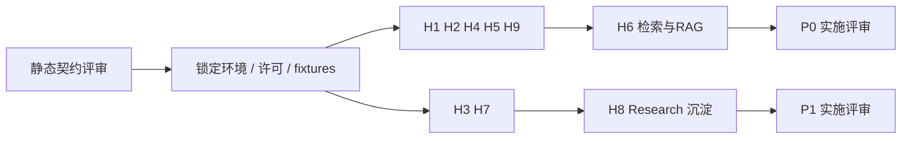

# 08 测试、故障注入与阶段验收

日期：2026-10-27；N/测试设计。**本轮没有实现或执行以下业务测试/PoC，未建立性能基线**。文档静态检查结果在 [实施状态](../IMPLEMENTATION_STATUS.md) 记录；需求输入为 [PRD](../PRD_PyKnora.md) §15/16 和审计风险 H1–H9。

## 1. 设计目标、范围与非目标

让后续工程以可重复证据证明：空间隔离、审批不可绕过、副作用未知时不盲重放、任务/索引可恢复、来源与引用准确、预算不因并发逃逸。覆盖单元/契约/真实集成/控制站 E2E/评测/性能/运维。mock 只能验证应用契约，不能证明 BrowserSkill/DocReader 真实兼容；文档 fence/链接通过不能称为安全或 PoC 通过。

## 2. 核心测试接口、样本和证据数据结构

测试配置与结果草案（未来保存在 `tests/` 和 PoC evidence 目录，本轮不创建测试实现）：

```python
from typing import Literal, Protocol
from pydantic import BaseModel

class TestEnvironment(BaseModel):
    environment_id: str
    platform: str
    python_version: str
    dependency_lock_hash: str
    image_digests: dict[str, str]
    model_profiles: list[str]
    fixture_manifest_hash: str

class CheckResult(BaseModel):
    scenario_id: str
    status: Literal["passed", "failed", "blocked", "not_run"]
    environment_id: str
    command: str
    evidence_refs: list[str]
    measurements: dict[str, float]
    limitations: list[str]

class FaultInjector(Protocol):
    async def arm(self, scenario_id: str, commit_boundary: str) -> None: ...
    async def release(self, scenario_id: str) -> None: ...
```

测试管理 API 只能在隔离测试环境使用、经服务身份授权、禁止生产开启；注入操作按 scenario_id 幂等且有超时清理。观察业务 DB/原生 checkpoint API/测试下游 receipt/事件/对象 checksum，禁止日志读取真实秘密。证据引用脱敏、不可变并带 SHA256；断言结果用标准码，失败不吞异常。

样本建议：五格式各 10 份为最低 golden set，其中中文/英文、emoji/组合字符、CRLF、表格、图、页边界、扫描 PDF；损坏/加密/解压炸弹/超大单帧另列拒绝集，不纳入标准文档成功率分母。100 条标注问答、30 个控制站研究任务为 PRD 启动目标，须提供许可和 hash 清单。控制站含静态/JS/iframe/跳转/附件/验证码演示/未知写计数端点，禁止用未获授权公网目标做攻击测试。

## 3. 分层策略与建议命令

以下是下一阶段预期命令，当前无 tests/业务依赖，**未执行**；实际命令需随实现与锁文件调整。

| 层次 | 重点、替身边界 | 建议执行/出口 |
| --- | --- | --- |
| 单元 | Pydantic schema、拓扑排序、状态转换、规范化 hash、区间映射、RRF、预算计算 | `uv run pytest tests/unit`；纯逻辑确定性、无网络 |
| 契约 | Provider 工具消息、port DTO、proto 响应/错帧、REST/OpenAPI、SSE schema | `uv run pytest tests/contract`；保存版本 fixture，mock 不叫真实互通 |
| PG/队列/对象集成 | 复合 FK/RLS/CAS/Outbox、重投、事务索引、S3 补偿 | `uv run pytest tests/integration`；真实 PG/Redis/S3/DocReader 容器，隔离两空间 |
| Graph 集成 | interrupt/进程退出/resume/单 owner/版本升级 | 真实 LangGraph Postgres checkpointer；模型先确定性替身，再一条真实模型通路 |
| Browser 互通 | pinned 扩展/daemon 真设备、多 owner、人工接管 | `uv run pytest tests/browser`；独立标记真实/mocked，人工步骤留签字证据 |
| E2E | 上传→RAG 引用、审批→研究→审核→入库、Wiki 冲突 | `uv run pytest tests/e2e`；受控真实服务，浏览器 UI 可用 Playwright |
| 安全 | 越权/SSRF/注入/DLP/日志、State、trace、签名 URL | `uv run pytest tests/security`；控制站+canary，失败阻断阶段出口 |
| 质量/性能 | 检索/问答/定位、入库成功率、延迟与 RSS | 固定数据/硬件/模型并导出原始测量，不用 mock 延迟替代实际容量 |

## 4. PRD → 设计 → 场景追踪矩阵

只使用 PRD 已有 F/AC 编号；H/Fault 编号是本 TDD 的测试 ID，不能伪装新增产品验收。

| PRD 编号 | 设计文档/模块 | 场景和进入阶段 |
| --- | --- | --- |
| F-01/F-03/F-15、AC-02/06 | 01 Scope、07 ACL/RLS/FK | H9 两空间全部直接 ID/检索/对象/引用/恢复/工具/游标拒绝；P0 最小隔离，P1 完整 RBAC |
| F-02、G5 | 02 ModelGateway/Budget、07 model_profiles | H2 Provider 能力/维度/超时/工具对、秘密脱敏、费用归集；P0 |
| F-04、AC-01 | 06 parser/assets/locator | H4 五格式 golden set、TXT 路线、图流异常、Unicode/页段落定位；P0 |
| F-05、AC-02 | 04 RAG、06 index、07 search | H6 FTS/向量/混合/RRF/Rerank对照、混 embedding 拒绝、权限前过滤；P0 |
| F-06、AC-03 | 04 finalize、07 SSE/Citation | H6 引用有效/无证据不确定；F10 流草稿和终态；P0 在线，P1 续传 |
| F-07/F-08、AC-04/06 | 05 HTTP policy、06 discovery/dedup/review | H8 单 URL 快照/重复提交/版权审核；H9 重定向/IP/DNS/下载；P0 |
| AC-05 | 01 Outbox、06 versions | F1/F2/F6/F7/F8、重解析/取消/旧 attempt；P0 |
| F-09/F-13、AC-E09 | 02 tool/approval、04 Agent | H1/H2，F3/F4/F5，MCP schema 漂移、未知工具写屏障；P1 |
| F-10、AC-E01 | 03 Planner/DAG、04 Research | H3 非法 DAG/ready/取消/失败传播、plan 可见、revision；P1 |
| AC-E02、F-11 | 05 双后端、06 extraction | H7 真扩展+Playwright+HTTP 能力矩阵；各产物有 URL/时间/通道；P1 |
| AC-E03/E04 | 03 Evaluator、06 quality/evidence/dedup | H8 重复簇独立来源、无证据不发布、许可不明转审；P1 |
| AC-E05/E06 | 06 ReviewDecision/ingestion、07 review API | H8 审阅权限、批量审核幂等、源撤销、入库/可检索/引用完整；P1 |
| F-12、AC-E07 | 06 incremental、07 triggers | 周期唯一触发、同文仅 observation、变更新版本、删除候选/人工内容不覆盖；P1 |
| AC-E08 | 02 Budget/Policy、05 Browser | H7/H9 验证码人工介入、域名/深度/pages/bytes/time/费用限制；P1 |
| AC-E10、F-16 | 02 Observability、07 audit | H9 脱敏 trace，来源/执行/审核/索引完整关联；P0 基础/P1 完整 |
| F-14、场景 C | 04 Wiki、07 WikiRevision | 来源引用、人工编辑竞争 CAS、审核发布/回滚/stale/源撤销；P1，与期间检测到的 PRD 未提交编辑一致，正式基线待确认 |
| F-17/F-18/F-19 | 01 延期范围 | P2 单独 TDD/安全与许可评审后建测试，当前无实现或通过声明 |

## 5. 十一类故障：提交点、触发者和最终断言

建议每窗口至少 50 次重复+不同进程时序，H5 并发竞争增加 100 轮；规模是测试建议，非已测结果。每个场景必须比较 DB 事实、可见索引/外部 receipt 和事件，而不只检查接口 200。

| 场景 | 执行顺序、提交点与故障注入 | 约束、恢复触发者和最终状态 |
| --- | --- | --- |
| F1 DB 已提交，Redis 不可用 | T1 提交版本+Job+Outbox 后断 Redis，dispatcher 发失败；恢复 broker | Outbox(operation,dedup_key) 唯一；dispatcher 重试+Reconciler 查漏；Job 最终 succeeded/明确 failed，未投递不丢，API 不虚报已运行 |
| F2 同 Job 重复投递 | 同 job_id 发送 10 份，分别在 claim 后/发布后 ACK 前 kill | job CAS、租约/epoch、唯一 attempt/build/发布；DB Reconciler 重领失效 lease；仅一个 active winning_attempt，终态重投 no-op |
| F3 外部成功，保存前崩溃 | ToolCall prepared→executing/批准 consumed 事务提交，控制站写成功计数后 kill，尚无 receipt | tool_call/intent_key 唯一；Reconciler 标 unknown_outcome；有外部 key 查询/去重则同调用核对，无则人工；零未经确认重发，Run needs_reconciliation 或确认后终态 |
| F4 批准后撤权/改参 | approved 提交后撤销 requester/approver membership，或规范化 args/version/scope 改变，再 resume | 执行前当前权限+hash/版本/expiry 校验，CAS 消费；撤权 FORBIDDEN，改参 APPROVAL_MISMATCH、新审批；控制站无写；已发写撤权窗口单列核查 |
| F5 Graph 重入副作用节点 | 业务结果已提交但 checkpoint 失败；或 interrupt 前 prepare 重跑，重复 Command/resume | 意图唯一、结果凭据先行、单 owner；宿主重查 ToolCall，成功读 receipt；仅一个调用业务结果，不能把重入等同需重做 |
| F6 v1 Worker 晚于 v2 | v1 staging 后暂停；v2 建新 desired version 并 T3 激活；释放 v1 | T3 document generation/desired version/CAS，v1 superseded；v2 active 指针/可见 chunks 不变，v1 仅可清自身 staging |
| F7 取消/删除后结果返回 | 后台 I/O 发出后提交 cancel generation++ 或 tombstone+清指针，然后让 Worker 返回 | 每批/发布检查 generation/epoch/tombstone；Job cancelled/superseded，活动索引不会复活；旧费用/receipt 安全记录，GC 不删其他版本 |
| F8 核心成功，富化失败 | T3 激活+核心成功+富化 Job Outbox 同事务；故意令摘要/问题失败 | enrichment unique(kind,profile) + 幂等 completion；Enrichment Reconciler 单独重试；searchable=true/core succeeded，富化 partial_failed/failed，可诊断不重解析 |
| F9 Browser owner 丢失/未知 | 两网关、发 click 后断 owner/WS，lease 到期另 owner 建连；旧结果晚到 | session epoch+route nonce+单串行队列；监测器 disconnected，重连 paused，已发写 unknown_outcome；显式授权/核查后恢复，零自动重放 click |
| F10 SSE/消息失败/游标过期 | token 持久后发出，finalizer Message 事务失败；重试/断连；另删旧事件使 cursor 过期 | Message+Run+唯一终态事件事务提交后才 completed；Reconciler finalizer 幂等；永久失败 failed，无伪完成；P1 过期 410，取 snapshot，不能自动重跑 Graph |
| F11 并行任务/重规划抢预算 | 两 Task reserve 和新 revision CAS 同时抢最后余额，含一个 unknown usage | workspace→run→task 固定锁序、purpose_key/settlement 唯一；失败事务回滚预留；Replanner 读锁后余额，未知费用不释放；无重复结算/预算逃逸，超实际预留记录超额并冻结 |

另测单写者约束：旧 Graph 进程持 checkpoint 连接但 owner lease 过期、新宿主尝试接管；新宿主必须等 advisory lock 释放，旧 invocation 连接失效不能自动重连续写。若真实 saver 行为不满足，横扩方案失败，进入单活降级设计评审，不能标恢复通过。

## 6. 质量、性能指标及其证据等级

| 指标 | 等级 / 目标 | 测量边界 |
| --- | --- | --- |
| 真实业务基线 | **尚无** | 当前仅初始化+源码静态审计+本轮设计 |
| CRUD P95、检索 P95、首 token P95 | PRD 建议目标：<500ms、10万 chunks <1s、<3s | 记录 CPU/RAM/磁盘/网络、索引参数/中文分词、模型/配额；CRUD 不含模型/解析，首 token 含检索不含冷启动 |
| 活跃对话 | PRD 建议目标单实例 20 | 同时报告排队时间、超时/错误率、模型吞吐及内存；不能只报连接数 |
| 标准集入库成功率 | PRD 建议目标 ≥98% | 标准五格式分层统计；损坏/加密单独报告正确拒绝率 |
| 来源/证据完整性 | PRD 要求已发布采集知识 100% | URL/快照、版本、quote locator 可复现；无证据条目不得进入分子 |
| 空间隔离、审批拦截、禁止地址、秘密扫描 | 建议阶段硬门槛：测试集 100% 通过、零泄漏 | 报告覆盖集合；100% 测试通过不等于证明所有攻击不可行 |
| Recall@5、引用准确率 | 待确认阈值：≥0.85、≥0.95 为 PRD 候选 | 100 QA 以上金标准、检索/引用人工双标；同时 MRR/NDCG/事实忠实度/无证据拒答 |
| 近重 precision/recall、研究成功率 | 阈值待首基准评审 | 30 控制任务、重复与冲突独立标签，不用人工审核率代替事实正确性 |
| 定位准确率、图完整率、内存/吞吐 | 安全定位要求不可虚构；数值阈值 U | PDF 页/bbox、DOCX 段落、TXT/MD字符、HTML snapshot；逐格式分层，记录大 meta RSS |
| Outbox 恢复延迟、RPO/RTO、取消生效延迟 | 阈值待运维/产品确认 | 先记录实际恢复分布与长尾，不假设固定“秒级”保证 |

性能计划：同环境固定种子/数据，预热后至少三轮建议 10 分钟稳定负载，报告 P50/P95/P99、吞吐、错误率、成本、RSS；冷启动另测。pgvector ANN 按权限过滤后的召回也测，FTS 与 BM25 作为不同实验，不拿不同 embedding 空间的分数直接相加。研究预算/页数/深度/时长必须每任务留证据。

## 7. 部署、迁移、备份恢复和回滚



部署测试 Linux Compose，API/dispatcher/三类 Worker 分别 kill/restart，依赖健康未就绪不得接收危险操作；Redis 数据丢失仍能由 PG Outbox/Job 重建唤醒。API 无长运行任务；多 Worker 过载时背压，不无限预留任务。Windows 只作为开发文档与用户浏览器客户端测试面，原生 daemon/Celery 生产运行未认证。

迁移：expand→双版本读取兼容→数据回填→验证→切流→contract；迁移 role 单独受控。每个 PG FK/唯一约束用真实冲突验证。向量维度变更新 profile/index，不原位修改；Graph 发布保留旧宿主按 graph_version 路由，历史 checkpoint fixture 回放。不可逆迁移必须备份恢复策略，不能只写 downgrade 命令。

备份：业务 DB 与 checkpoint schema 同一 PG 物理/PITR 时间线最佳，仍验证稳定 ID 对应；对象按 manifest/version 保留，记录 backup catalog。隔离环境恢复到一致时间点，**先禁所有外部出站写/调度**，校验 checkpoint→run→ToolCall/Approval/Job、active build→对象 checksum；工具未知结果保持核查，不能在恢复时自动重放过去动作。模型/浏览器凭据不得由普通备份恢复到无隔离测试环境。

回滚：停止新 run、排空或固定旧版本执行、回退应用路由而非覆盖已发布数据；索引显式 CAS 切到已验证旧 build，保留新版本审计；Wiki 回滚新修订；graph 不兼容旧 checkpoint 留旧宿主或人工结束。演练 owner 丢失、DB PITR 后已发生外部写但账本回退的情形，必须下游核查，不承诺数据库恢复可以撤销外部操作。RPO/RTO 需根据真实恢复实测评审。

## 8. 阶段出口、取舍和未决

当前 TDD 出口：八文档实际存在、统一术语/状态/API/error、11 故障闭环、编号 ADR 提议、需求冲突和资料限制明确、链接/图检查。下一阶段先形成独立 PoC 计划，明确负责人/环境/命令/数据/阈值，不能本轮跨阶段运行。

进入 P0 实施前建议 H1/H2/H4/H5/H6/H9 的阻断项已验证、关键 ADR 经评审、身份例外及 DocReader/Redis/S3 许可/运维方案明确。P1 还须 H3/H7/H8 真实环境通过；缺 BrowserSkill 真设备时不能宣称 AC-E02 整体完成。安全/未知副作用测试失败必须先修设计；非阻断性能阈值要经产品明确接受后再实施，不能伪造通过。

取舍：先验证关键崩溃窗口和授权，比追求单元覆盖率百分比更有价值；单元/契约替身快速回归，真实 E2E 控制数量和成本。测试失败时保留可复现证据，重跑需记录修复差异，不能仅报最后一次通过。未决集中为环境/模型/真实扩展、数据权利、阈值、审批角色、TTL、Wiki P1 正式基线确认、RPO/RTO；当前没有业务测试结果可报告。
